# Can one model price both a normal and an inverted yield curve?

15.456 Financial Engineering · Independent Project 1, Topic 4 (Yield Curve) · Fall 2026

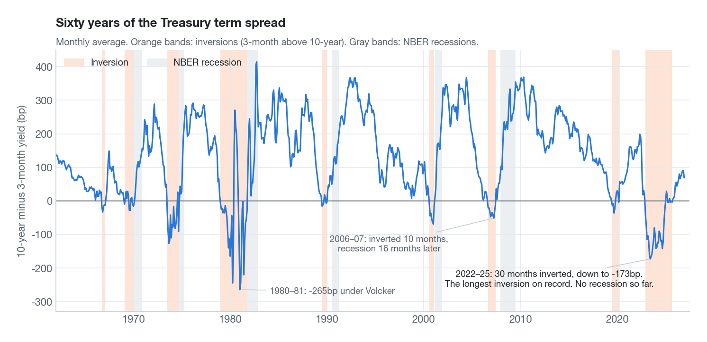

Long-term lending should pay more than short-term lending, so the yield curve should slope up. From late 2022 to 2025 it didn't: the 3-month Treasury yielded up to 1.7 points more than the 10-year, for 30 months, the longest inversion on record. Every inversion since 1969 had been followed by a recession. This one wasn't.

The project asks whether a single **no-arbitrage** model can describe both kinds of curve, and what the model needs to do so. We fit a ladder of models, from the one-factor Vasicek model seen in class to a two-factor Gaussian model (G2++), to the prices of every Treasury on five dates covering every curve shape since 2006, and then to 37 years of monthly curves at once. We then split the yield curve into expected rates and a term premium to see what the 2023 inversion actually priced, use the fitted curves to price and hedge bonds and an option, and, as a bonus, follow the curve minute by minute around 284 Fed and data announcements.

| | |
|---|---|
| Data | Every plain US Treasury bond, note and bill in CRSP (150–340 per date); the Fed's daily zero-coupon curve 1961–2026; constant-maturity yields 1962–2026; millisecond quotes for 32 Treasury ETFs on 562 days (TAQ) |
| Models | Nelson-Siegel and Svensson (benchmarks), Vasicek, CIR, G2++ (two-factor Gaussian), Dynamic Nelson-Siegel; G2++ with jumps on release dates |
| One factor, refitted every date | Fits, but only with nonsense parameters: volatility at its 10% cap in **64% of inverted months** (real short-rate volatility is about 0.5%) |
| One factor, one parameter set | Fails: **49bp** median error over 1990–2026, **82bp** in inverted months |
| Two factors, one parameter set | Works: **14bp** median error, and *no worse* in inverted months (12.5bp) than in normal ones (14bp) |
| What an inversion is | A high value of the second, **slope** factor: correlation 0.97 with the 3-month minus 10-year spread. It reverts with a half-life of about 2.3 years. |
| What 2023's inversion priced | **Half to two-thirds expected cuts, a third to a half negative term premium** (three estimates). The cuts it priced came about a year late, but roughly as priced. Earlier inversions priced small cuts and got recessions. |
| Robustness | Parameters frozen at 2015 price the 2022–25 inversion out of sample to **11bp** (G2++), against 119bp for Vasicek. On 1971–2026 our term premium matches the NY Fed's level exactly (1.58 vs 1.58 points). |
| Was 2023 a false alarm? | Recession models put it at **47–58%**, the strongest signal since the early 1980s: a coin flip that came up "no", not a broken indicator. |
| Pricing and hedging | Fitted curves price bonds they never saw as well as the ones they were fitted to (Svensson 4.0bp, G2++ 5.3bp). A two-factor hedge of a 10-year note removes **91–96%** of its daily risk, against 40–89% for duration hedges. |
| Announcements, minute by minute | CPI and jobs news shift the curve (the **level** factor); FOMC news twists it (the **slope** factor). The two G2++ factors explain 98–99% of how the curve jumps within minutes, against 81% for one factor on FOMC days. |

So a single model can describe both regimes, but **not a one-factor model**. A level that barely mean-reverts plus a slope that reverts within a couple of years covers normal and inverted curves alike, with the same parameters, and the same two factors reappear in how the curve reacts to news within minutes. An inversion is not a different world. It is the slope factor at an extreme, and in 2023 a third to a half of it was a negative term premium rather than a forecast of recession.

| The brief asks | Where it is answered |
|---|---|
| Collect and examine US Treasury yield curve data | [The puzzle](#the-puzzle), [How the curve turned](#how-the-curve-turned-2021-to-2026), [How the curve moves](#how-the-curve-moves), [`data/README.md`](data/README.md) |
| Introduce the models: assumptions, parameters, parallel shifts and slope changes | [The models](#the-models) |
| What shapes the models can produce, and how curves evolve in time | [The models](#the-models), [37 years](#thirty-seven-years-with-one-parameter-set), [Term premium](#priced-vs-real-the-term-premium) |
| Fit at least three dates and assess the fit | [How we fit](#how-we-fit), [One date up close](#one-date-up-close-june-2023), [Five regimes](#five-regimes-each-fitted-on-its-own), [One parameter set](#one-parameter-set-for-five-regimes) |
| How the curve prices bonds and other fixed-income instruments | [Pricing and hedging](#using-the-curve-pricing-and-hedging) |
| Normal vs inverted: can one model describe both? | [One parameter set](#one-parameter-set-for-five-regimes), [37 years](#thirty-seven-years-with-one-parameter-set), [Robustness](#robustness-out-of-sample-back-to-1971-and-recessions), [Conclusions](#conclusions) |

**Contents:** [The puzzle](#the-puzzle) · [How the curve turned](#how-the-curve-turned-2021-to-2026) · [How the curve moves](#how-the-curve-moves) · [The models](#the-models) · [How we fit](#how-we-fit) · [One date up close](#one-date-up-close-june-2023) · [Five regimes](#five-regimes-each-fitted-on-its-own) · [One parameter set](#one-parameter-set-for-five-regimes) · [37 years](#thirty-seven-years-with-one-parameter-set) · [Term premium](#priced-vs-real-the-term-premium) · [Robustness](#robustness-out-of-sample-back-to-1971-and-recessions) · [Pricing and hedging](#using-the-curve-pricing-and-hedging) · [Minute by minute](#bonus-the-curve-minute-by-minute) · [Conclusions](#conclusions) · [Limitations](#limitations-and-next-steps) · [Data and code](#data-and-code)

## The puzzle

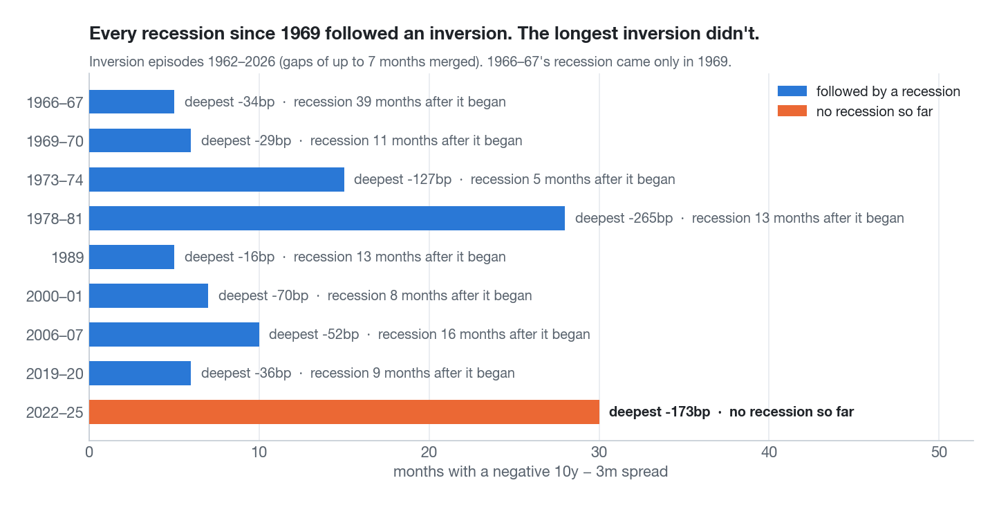

We call a month inverted when the average 10-year yield is below the 3-month yield, and merge runs separated by up to 7 months into one episode. There have been nine since 1962.

- **The signal has a strong record.** Every recession since 1969 started 5–16 months after an inversion began. The one false alarm before 2022 was 1966–67, a slowdown with no recession until 1969.
- **2022–25 broke it.** It was the longest inversion (30 months) and the second deepest (−173bp, after −265bp in 1978–81), and it has had no recession so far.
- The usual story is that an inverted curve prices in rate cuts, because the market expects a downturn. The Fed did cut, by 100bp in late 2024, but without a recession.

Inside a no-arbitrage model the question becomes precise: what combination of the model's state and parameters produces an inverted curve, and can the *same* parameters also produce the normal one?

## How the curve turned, 2021 to 2026

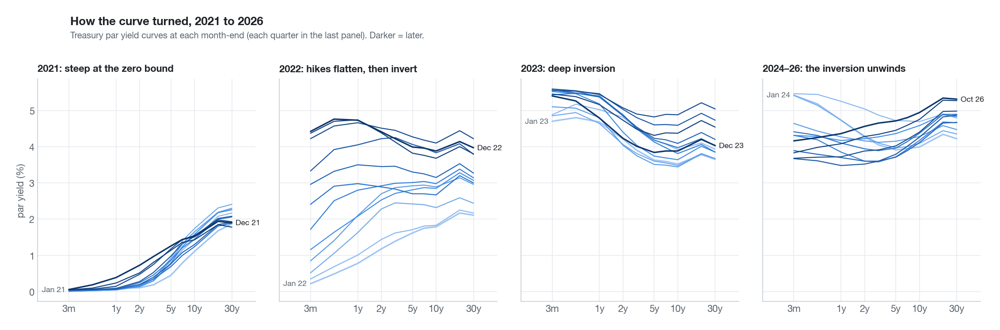

Five years took the curve through every shape a model has to handle:

- **2021:** pinned at zero up to 1 year, then steep: 0% at 3 months, 2% at 30 years.
- **2022:** the Fed raised rates by 4.25 points. The front end rose much faster than the long end, so the curve flattened, and by year end it was inverted.
- **2023:** deeply inverted. The front end sat near 5.5% while the 10-year moved between 3.4% and 4.9%, with a small rise again beyond 10 years.
- **2024–26:** cuts pulled the front end down while the long end rose. On the way the curve was a **U** (Sep 2024: down to 3.6% at 3–5 years, back up to 4.2% at 20 years). By Oct 2026 it slopes up from 4.2% to 5.3%.

## How the curve moves

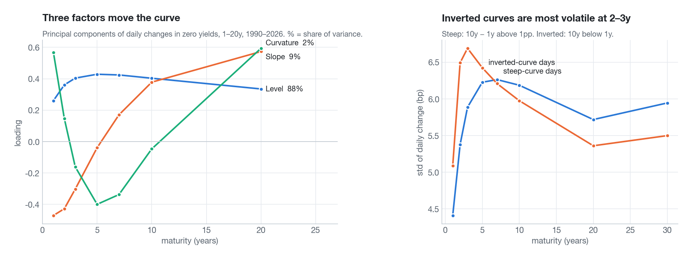

Principal components of daily changes in zero-coupon yields (Fed curve, 1–20 years, 1990–2026) give the classic Litterman-Scheinkman result: **level 88%, slope 9%, curvature 2%** of the variance. Two facts from this matter for the models:

- **The split is the same on inverted days (88.6 / 8.5 / 1.4%) and steep days (87.4 / 9.9 / 1.8%).** The curve's *movements* don't change between regimes; only its *shape* does. That already suggests one model could cover both.
- **A one-factor model can only produce the first factor.** It forces every yield to move in the same direction. In the data the 2-year and 30-year yields move in opposite directions on **24%** of days.

On inverted days the 2–3 year yields are the most volatile, because that is where the market reprices the path of Fed cuts. On steep days volatility peaks around 7 years.

## The models

| model | what it is | parameters | feature added |
|---|---|---|---|
| Nelson-Siegel | static curve shape, *not* arbitrage-free | 4 | benchmark: level, slope, one hump |
| Svensson | static curve shape | 6 | benchmark with a second hump (the Fed's own curve uses it) |
| **Vasicek** | one Gaussian short rate | κ, θ, σ + state r | mean reversion (the model from class) |
| **CIR** | one square-root short rate | κ, θ, σ + state r | positive rates; volatility grows with the level |
| **G2++** | two Gaussian factors, r = δ + x₁ + x₂ | a₁, a₂, σ₁, σ₂, ρ, δ + states x₁, x₂ | a second factor |
| Dynamic Nelson-Siegel | Nelson-Siegel with fixed decay, three factors over time | λ + three states | level, slope *and* curvature (not arbitrage-free) |

All dynamic parameters are **risk-neutral**: they are whatever makes model prices match market prices.

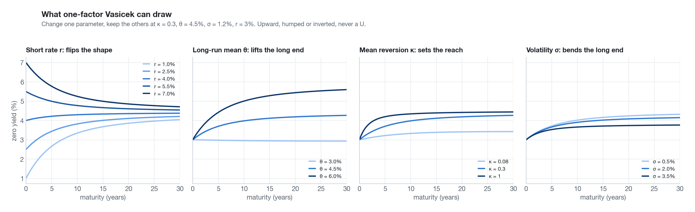

In Vasicek, $dr = \kappa(\theta - r)dt + \sigma dW$, and the zero-coupon yield for maturity τ is

$$
y(\tau) = y_\infty + (r - y_\infty)\,\frac{B(\tau)}{\tau} + \frac{\sigma^2}{4\kappa}\,\frac{B(\tau)^2}{\tau}, \qquad B(\tau) = \frac{1 - e^{-\kappa\tau}}{\kappa}, \qquad y_\infty = \theta - \frac{\sigma^2}{2\kappa^2}.
$$

- **An inversion just means r is above where it is expected to settle.** The curve is upward if $r < y_\infty - \sigma^2/4\kappa^2$, inverted if $r > y_\infty + \sigma^2/2\kappa^2$, and humped in between. Normal and inverted curves are the same model with r on opposite sides of θ.
- **Parallel shifts and slope changes.** A change in r moves each yield by $B/\tau$, which fades with maturity. A change in θ moves it by $1 - B/\tau$, which grows with maturity. **Equal changes in r and θ shift the whole curve in parallel; opposite changes tilt it.** σ only bends the long end down (convexity).
- **What it can't draw:** one factor gives at most one hump, so **no U-shape**. Every yield also moves in the same direction.

G2++ adds a second Vasicek-type factor. With one slow and one fast factor it can draw a U: the fast factor bends the front end down, and the slow one lifts the back end.

## How we fit

On each date we take every plain nominal Treasury in CRSP: non-callable notes and bonds, and bills, excluding inflation-linked and flower bonds. We drop:

- securities not yet issued on the date;
- bills with less than 30 days left;
- notes and bonds with less than a year left. These are old issues with stale prices; one note due in a month showed 3.5% while bills were at 5.3%. The bills cover the short end.

Each bond is priced as its cash flows discounted on the model's zero curve, against the CRSP bid/ask midpoint plus accrued interest. We minimise duration-weighted price errors, which are, to first order, errors in each bond's yield, and report the exact yield error (model minus market) in basis points. For scale, the bid/ask half-spread is 0.5–3bp of yield on most issues.

The five dates are month-ends inside the CRSP sample, which ends June 2026:

| date | shape | why |
|---|---|---|
| Dec 2006 | mild inversion | the inversion before the financial crisis, which *was* followed by a recession |
| Jun 2021 | steep, short rate at zero | normal curve at the zero lower bound |
| Jun 2023 | deep inversion | close to the deepest point of 2022–25 |
| Sep 2024 | U-shape | first cut done; front end falling, long end rising |
| Jun 2026 | normal | latest CRSP date |

## One date up close: June 2023

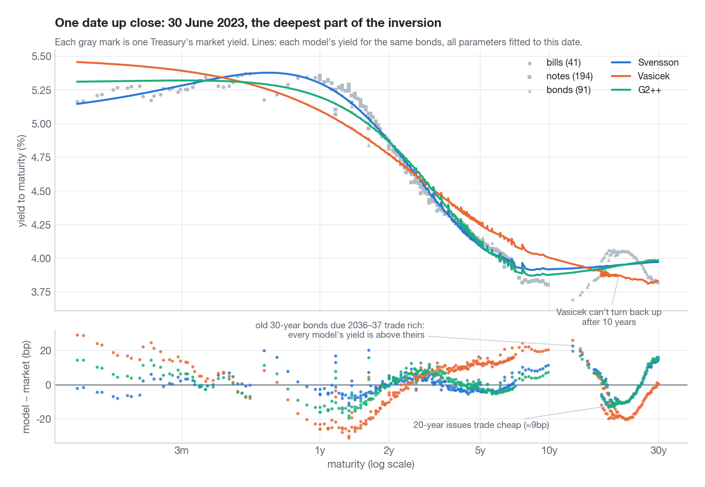

On 30 June 2023, 326 Treasuries priced a curve that rose from 5.15% at one month to about 5.35% at 9–12 months, then fell to 3.8% at 7–10 years and rose again to about 4% at 20 years.

- **Svensson** fits it to **6.4bp**, and **G2++** to **7.9bp**. Their remaining errors aren't about the curve's shape: they come from specific groups of bonds. The old 30-year bonds maturing in 2036–37 trade **rich**, 18–23bp below any smooth curve, and the 20-year issues trade **cheap**, about 9bp above it. These are liquidity and supply effects that no curve model will capture.
- **Vasicek** (14.5bp) has the right overall direction but misses everywhere else. It is too high at the very front, too low from 6 months to 2 years, too high at 2–10 years and too low at 15–25 years, because one factor can't follow a curve that changes direction twice.

## Five regimes, each fitted on its own

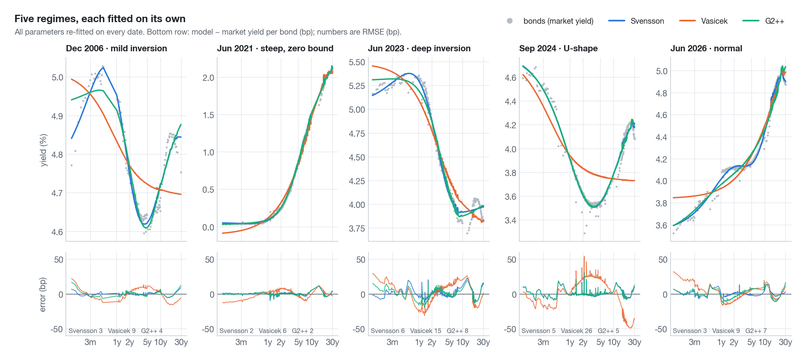

First the most generous test: every model gets fresh parameters on every date.

- **Svensson** fits all five regimes to **2–6bp**. **G2++** is within 0–4bp of it on every date, including the U.
- **Vasicek and CIR** are 2–5 times worse and **fail on the U** (Sep 2024, 26bp). The fit falls from the bill yields to a flat long end and can't turn back up. Mean reversion κ hits its bound of 5, so the short rate's influence dies within months.
- **The fits only work by distorting the parameters.** On the two inverted dates Vasicek needs σ at its 10% cap to bend the long end down; CIR likewise sits at its σ cap. In 2021 it needs θ = 18% with κ = 0.03: a short rate drifting up for decades, which is just a way to draw a steep straight line. **σ and κ act as shape knobs, not descriptions of how rates move.**
- G2++'s per-date parameters also hit their bounds (ρ = ±0.99, σ = 10%). With 8 parameters on one date, it is a flexible curve rather than a model of how rates evolve. The next test decides whether it is more than that.

## One parameter set for five regimes

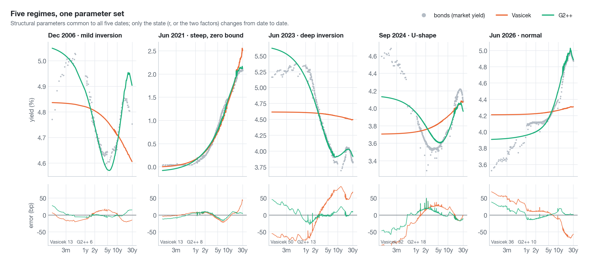

This is the brief's question as a test: the structural parameters are **common to all five dates**, and only the state (r, or the two factors) changes from date to date.

- **Vasicek and CIR collapse.** The best single parameter set is slow mean reversion (κ ≈ 0.08) with σ ≈ 0, which gives an almost **flat curve at the level of r** on every date. Errors reach 50bp in June 2023, and 36bp even on the *normal* 2026 curve. No one choice of κ can be the fast mean reversion an inverted curve needs and the slow one a steep curve needs.
- **G2++ holds up: 6–18bp on all five dates** with one parameter set. Its two factors read naturally:
  - Factor 1 is a **level**: it barely mean-reverts, so it moves the whole curve.
  - Factor 2 is a **slope**: it reverts with a half-life of about 1.7 years and mainly moves the front end.
  - The slope factor is **+3.3 points in June 2023** and +1.5 in Sep 2024 (inverted: the front end sits above where the level says it will settle), and **−1.1 points in June 2021** (the zero bound holds the short rate below the level, so the curve is steep).

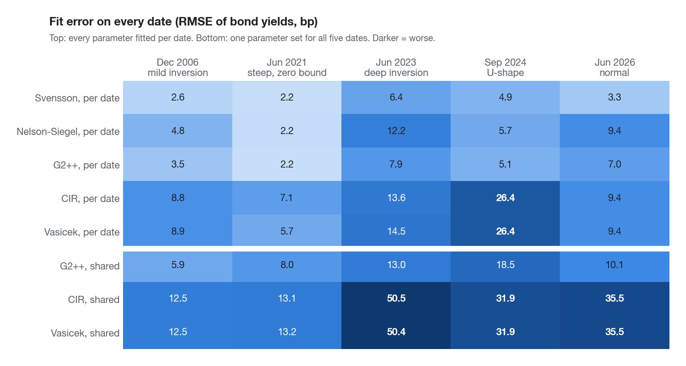

## Thirty-seven years with one parameter set

Five dates are a small sample. So we fit the same models to **all 442 month-end zero curves from January 1990 to October 2026**, with 11 maturities from 3 months to 30 years. Each model gets **one parameter set** for the whole period, and only the factors move month to month. (These curves are the Fed's own smoothed curve plus bill yields, not individual bonds, so the errors measure distance from a smooth curve.)

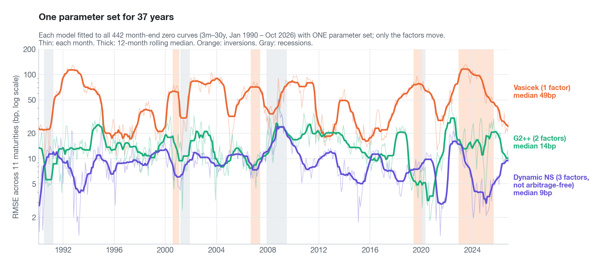

| one parameter set, 1990–2026 | median error | in inverted months | in other months |
|---|---|---|---|
| Vasicek (1 factor) | 49bp | **82bp** | 43bp |
| G2++ (2 factors) | 14bp | 12.5bp | 14bp |
| Dynamic Nelson-Siegel (3 factors, not arbitrage-free) | 9bp | 6bp | 9bp |

- **Vasicek is worst exactly when the curve is far from its average shape**: in inversions (60–75bp in 2000, 2006–07 and 2019; over 100bp in 2023) and in very steep periods (over 100bp in 1992–93; 80–90bp in 2002–04 and 2009–11). With one parameter set, one factor can only draw one family of curves.
- **G2++ is no worse in inversions than in normal times.** Its errors are highest in 2008–09 and 2022, when rates moved fastest, not when the curve inverted. With two factors, inverted curves need no special treatment.
- A third, **curvature** factor cuts errors by another third. Dynamic Nelson-Siegel isn't arbitrage-free; its arbitrage-free version (AFNS) is the natural next step.

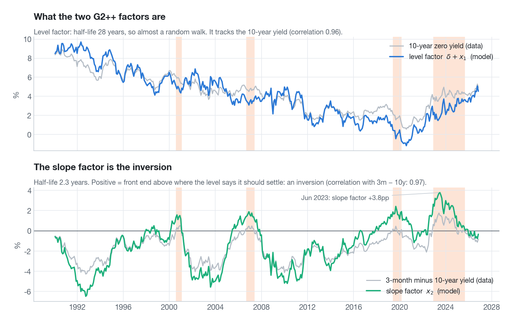

The two G2++ factors, estimated with one parameter set for 37 years, have clear meanings:

- **Level** (half-life 28 years, close to a random walk) tracks the 10-year yield, correlation 0.96. It carries the 40-year decline in rates.
- **Slope** (half-life 2.3 years) tracks the 3-month minus 10-year spread, correlation 0.97. It is positive in every inversion: 2000, 2006–07, 2019, and highest of all in **2023 (+3.8 points)**.

This answers the brief's question in model terms. **An inversion is the slope factor far above zero:** the front end is above where the level factor says rates will settle, and the model expects it to come down within a few years. The 2023 reading was the most extreme in 37 years, which matches the depth of the inversion. Whether that expected fall was a forecast of a recession, or a risk premium, is the next question.

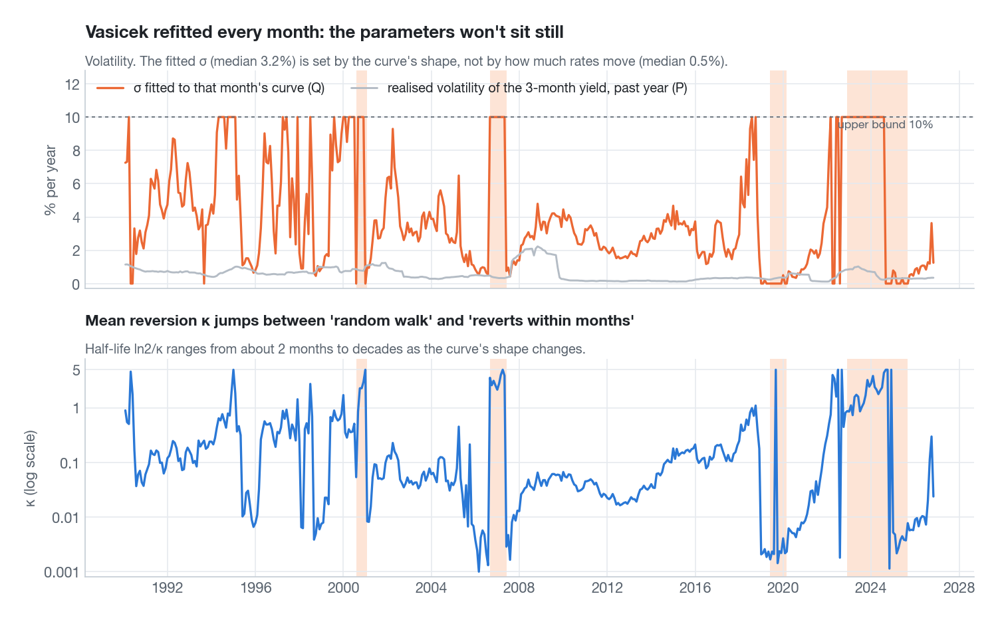

For contrast, Vasicek **refitted every month** (all four parameters free) fits each curve to 8bp. But its parameters swing wildly from month to month:

- **σ sits at its 10% cap in 64% of inverted months** and 7.5% of other months. The volatility actually measured on the 3-month yield over the past year has a median of **0.45%**.
- κ moves between 0.001 (a random walk) and 5 (half-life of two months), and θ sits at its 25% bound in 36% of months.

A model that needs new parameters every month to fit is a curve-fitting device, not one model.

## Priced vs real: the term premium

Everything so far uses **risk-neutral (Q)** parameters: whatever makes bond prices come out right. They say how bonds are *priced*, not how rates actually *move*. The gap between the two is the **term premium**, the extra yield investors demand to hold long bonds rather than roll short ones. To measure it we estimate the **real-world (P)** dynamics of the two G2++ factors with a VAR on their monthly history (1990–2026), keeping the loadings fitted to prices. This two-step approach is the one behind the NY Fed's published estimate (Adrian, Crump & Moench 2013; Joslin, Singleton & Zhu 2011).

| G2++ factor dynamics | priced by bonds (Q) | actual history (P) |
|---|---|---|
| Level: half-life of a shock | **28 years** | **4.4 years** |
| Slope: half-life of a shock | 2.3 years | 3.9 years |
| Volatility, level / slope (per year) | 1.6% / 3.0% | 1.4% / 1.5% |
| Correlation of the two factors | −0.99 | −0.85 |
| Volatility of the short rate | 1.4% | 0.8% |

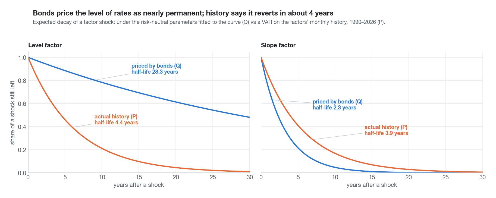

- **Bonds price the level of rates as nearly permanent; history says it comes back in about 4 years.** That gap is the term premium: long bonds are priced as if a rise in rates will last, so investors are paid to bear that risk.
- **Volatility should be the same under P and Q** in a Gaussian model (only the drift changes between them). For the level factor it nearly is (1.6% vs 1.4%). The slope factor and the short rate need about twice the real volatility to fit the curve's shape: the same problem as Vasicek's σ, in a much milder form.
- A caveat: VARs on persistent series underestimate persistence in samples this short (Bauer, Rudebusch & Wu 2012). The P half-lives are probably too short, so the term premium is probably a little overstated.

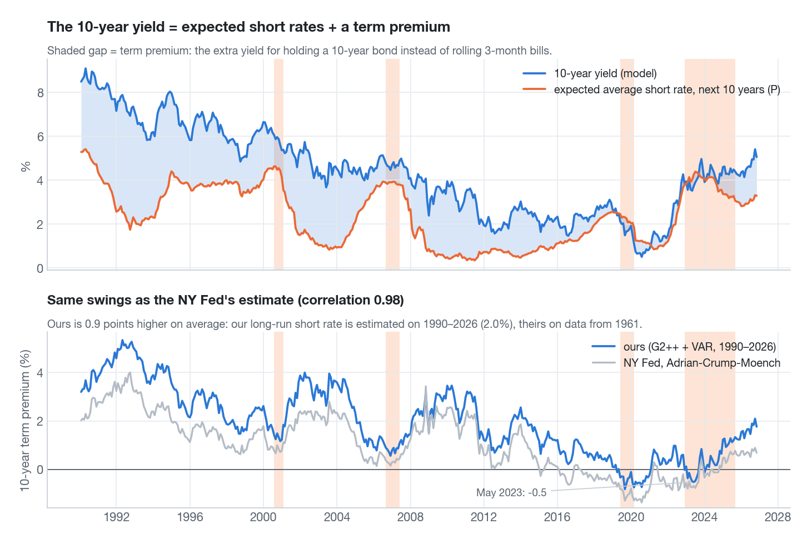

Our 10-year term premium moves with the NY Fed's ACM estimate almost one for one (**correlation 0.98**). It sits about 0.9 points higher on average because our long-run short rate (2.0%) is estimated on 1990–2026, a period of low rates, while ACM's uses data from 1961. The term premium's *level* is the least reliable thing any of these models produce; its *swings* are robust. It fell from about 4–5% in the early 1990s to below zero in 2019–21 (quantitative easing, low inflation risk), and turned **negative again in May 2023**, right at the deepest point of the inversion.

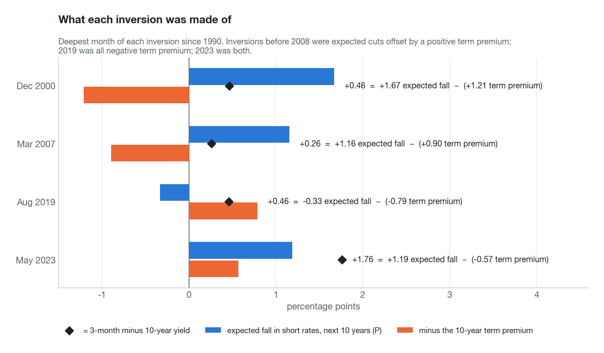

The 3-month minus 10-year spread splits exactly into the **expected fall in short rates** over the next 10 years and **minus the term premium**:

- **Dec 2000 and Mar 2007:** the market expected the short rate to average 1.2–1.7 points less over the next decade, and a *positive* term premium of about 1 point partly offset it. These were inversions made of expected cuts.
- **Aug 2019:** expected rates were not lower at all (−0.3). The whole inversion came from a **negative term premium** (−0.8).
- **May 2023:** both. 1.2 points of expected fall plus a 0.6-point negative term premium made the deepest inversion of the four, +1.76 points.

So **about a third of the 2023 inversion was not a forecast of falling rates** but a negative term premium. As a recession signal it was weaker than its depth suggested. (On the longer 1971–2026 sample the share rises to about half; see [Robustness](#robustness-out-of-sample-back-to-1971-and-recessions).)

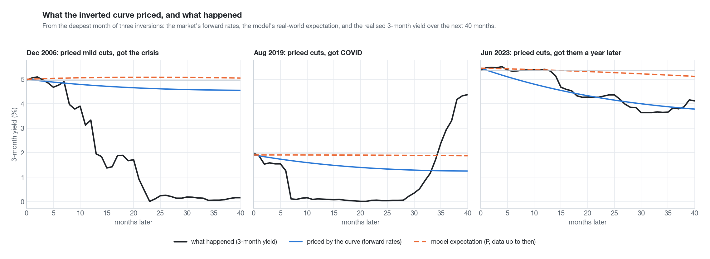

What did each inverted curve actually price for the 3-month yield, and what happened?

| from | priced in 12 months | happened | priced in 24 months | happened |
|---|---|---|---|---|
| Dec 2006 | 4.76% | 3.33% | 4.62% | **0.11%** |
| Aug 2019 | 1.55% | **0.11%** | 1.34% | 0.04% |
| Jun 2023 | 4.69% | **5.41%** | 4.18% | 4.36% |

- **2006 and 2019 priced mild cuts and got cuts to zero**: a financial crisis and a pandemic. The curve was right about the direction and badly wrong about the size.
- **2023 priced the cuts a year too early.** A year later the 3-month yield was still 5.4%, but by month 36 it was 3.83%, against 3.86% priced. The market got the path's destination right and its timing wrong.
- The model's own real-world expectation (dashed) barely moves in any episode. The VAR mostly says "rates stay where they are": with 37 years of data, it can't forecast turning points either.

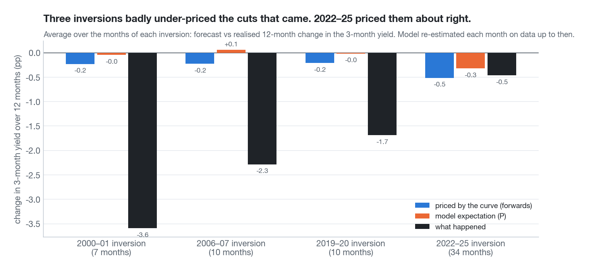

Averaging over every month of each inversion (forecasts made with data available at the time):

- In 2000–01, 2006–07 and 2019–20 the curve priced about **−0.2 points** of cuts over the next 12 months. What came was **−3.6, −2.3 and −1.7**.
- In **2022–25 it priced −0.5 and got −0.5.**

Over all months since 2000, a 12-month forecast of the 3-month yield misses by about 1.45 points whether it comes from forward rates, the model, or simply "no change". In inverted months, forward rates do best (1.74 against 1.92 for no change).

**What this says about the brief's puzzle.** Past inversions under-priced the easing that followed, because the easing was a recession response. The 2022–25 inversion was deep for two other reasons: the short rate started far above the long-run level (5.4% after the fastest hiking cycle in 40 years), and the term premium was negative. What it priced, a gradual easing, is roughly what happened. The "failed" recession signal is less a failure of the curve than a misreading of it: the curve never priced a recession-sized fall in rates.

## Robustness: out of sample, back to 1971, and recessions

Three checks on the main claims.

**1. Out of sample.** The 37-year fits estimated the parameters on the same months they were judged on. Here we estimate them on **August 1971 – December 2015 only**, freeze them, and price every month from 2016 to 2026, the whole inversion included. Only the factors are read off each month's curve.

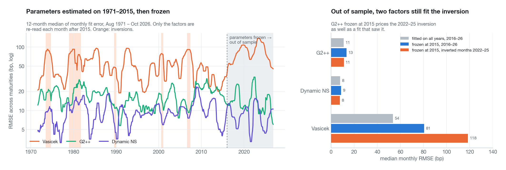

| median monthly error | fitted on all years, 2016–26 | **frozen at 2015**, 2016–26 | frozen at 2015, inverted months 2022–25 |
|---|---|---|---|
| G2++ | 11bp | **13bp** | **11bp** |
| Dynamic Nelson-Siegel | 8bp | 9bp | 8bp |
| Vasicek | 54bp | 81bp | 119bp |

**Two factors estimated before the inversion price it as well as a fit that saw it.** One factor gets worse out of sample, and worst in the inversion. On the full 1971–2026 sample the earlier numbers hold: G2++ 15bp median (12bp in inverted months), Vasicek 50bp (82bp).

One caveat: fitted separately on 1971–98 and 1999–2026, G2++'s mean-reversion speeds are fairly stable (level factor 0.019 vs 0.029 a year), but its volatility and correlation parameters are not (slope volatility 10% vs 1.4%, correlation +0.5 vs −0.99). Swapping the two halves' parameters costs only 5–7bp, so the *curve shapes* the model can draw are robust; its *volatilities* are not pinned down by yields alone, the same lesson as the option example.

**2. Back to 1971: the term premium.** Our 1990–2026 term premium tracked the NY Fed's swings but sat 0.9 points higher, because our long-run short rate came from a low-rate sample. Re-estimated on August 1971 – October 2026 (55 years: 3-month to 10-year yields throughout, 15–30 years as they become available, early bill rates converted from discount yields):

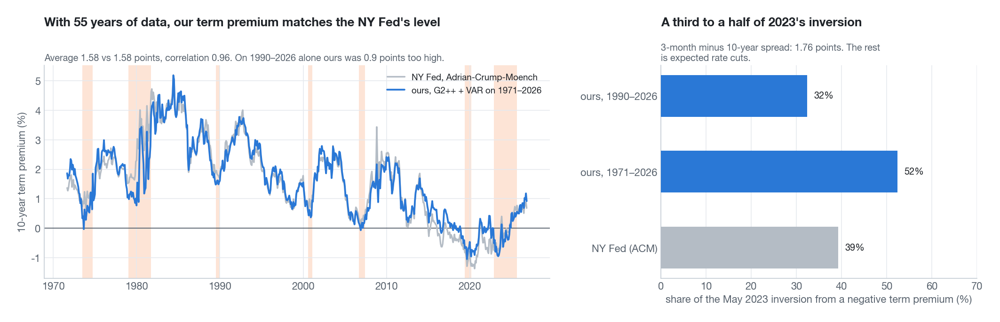

- **The levels now match: 1.58 vs 1.58 points on average**, correlation 0.97, typical gap 0.37 points. The 0.9-point gap was purely the short sample.
- The split of the 2023 inversion moves with it: the negative term premium explains **32%** (our 1990–2026 model), **52%** (our 1971–2026 model) or **39%** (the NY Fed's). The robust statement is **a third to a half**.

**3. Did the curve predict a recession?** We fit probit models of "in an NBER recession 12 months from now" on August 1971 – October 2025 (7 recessions), using the raw 10-year minus 3-month spread or its two parts from the 1971–2026 model.

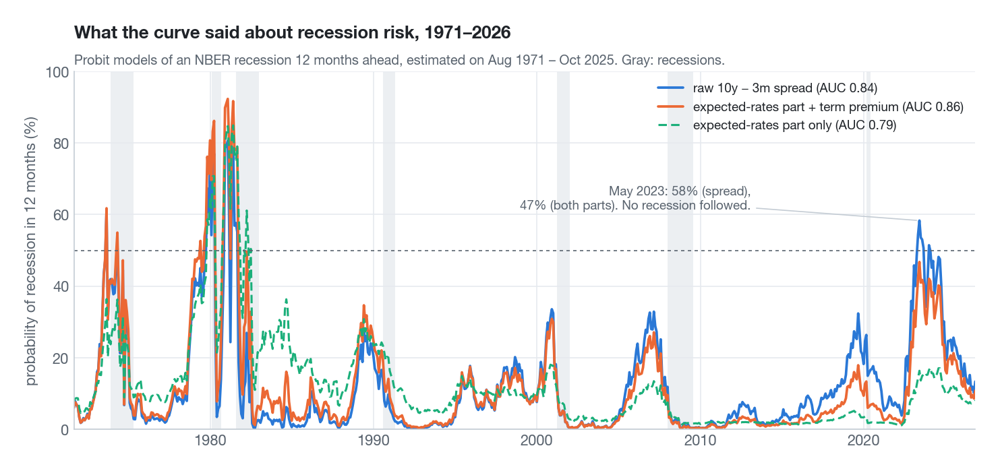

| model | fit (pseudo-R²) | AUC | P(recession), Dec 2006 | Aug 2019 | **May 2023** |
|---|---|---|---|---|---|
| raw spread | 0.23 | 0.84 | 28% | 32% | **58%** |
| expected-rates part only | 0.19 | 0.79 | 12% | 5% | 16% |
| term premium only | 0.02 | 0.60 | 17% | 21% | 21% |
| both parts | **0.26** | **0.86** | 23% | 18% | **47%** |

- **Both parts carry information.** The expected-rates part is the stronger predictor, but adding the term premium improves the fit, and a *low* term premium points to recession too (consistent with investors buying long bonds as insurance).
- **By every model with a decent fit, May 2023 was a 47–58% signal, the strongest since the early 1980s**, well above December 2006 (23–28%) or August 2019 (18–32%), both of which were followed by recessions.
- **So 2022–25 was not a broken indicator.** It said "about a coin flip", and the less likely half happened. Splitting off the term premium makes the signal somewhat weaker (47% vs 58%), but doesn't make it disappear.
- A real-time version, re-estimating the factor dynamics each month on data available at the time (1985–2025), gives the same picture for May 2023 (39–42%), with weaker individual coefficients. With 7 recessions, none of these tests is powerful; they bound the story rather than prove it.

## Using the curve: pricing and hedging

A fitted curve is a discount function, $P(\tau) = e^{-y(\tau)\tau}$: the value today of 1 dollar paid in τ years. Any instrument with known cash flows is priced by discounting each cash flow and adding them up. Instruments with uncertain cash flows (options, callables) also need the model's dynamics. This section uses the fitted models for four jobs: pricing one bond, pricing bonds the model hasn't seen, hedging, and pricing an option.

### One bond, step by step

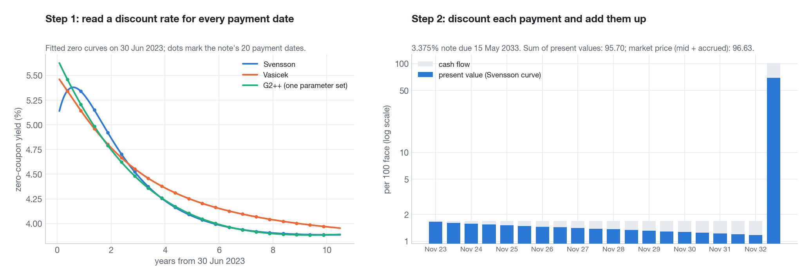

Take the newest 10-year note on 30 June 2023: 3.375% coupon, due 15 May 2033, 20 semi-annual payments.

1. **Read a discount rate for each payment date** off the fitted zero curve. The first coupon, in November 2023, is discounted at about 5.3%; the principal in 2033 at about 3.9%.
2. **Discount and add.** Each coupon of 1.6875 is worth between 1.65 (the first) and 1.17 (the last before maturity) today. The final payment, 101.69 of principal plus coupon, is worth 69.28. The total is **95.70** on the Svensson curve, 95.71 on the one-parameter-set G2++ curve and 94.98 on Vasicek's.
3. **Compare with the market:** 96.21 clean plus 0.42 accrued = **96.63**. The model price is 0.9 lower, so the note's yield is **11–12bp below the curve** on Svensson and G2++, and 20bp below on Vasicek.

That gap isn't a pricing failure. All four of the newest 10-year notes trade rich to the curve that day, by an amount that rises with how recently they were issued: 8.9bp for the Aug 2022 note, 9.6, 10.9, and 11.6bp for May 2023. Investors pay up for the newest, most liquid issue. **Model price minus market price is exactly the rich/cheap signal relative-value desks trade.**

### Bonds the model has never seen

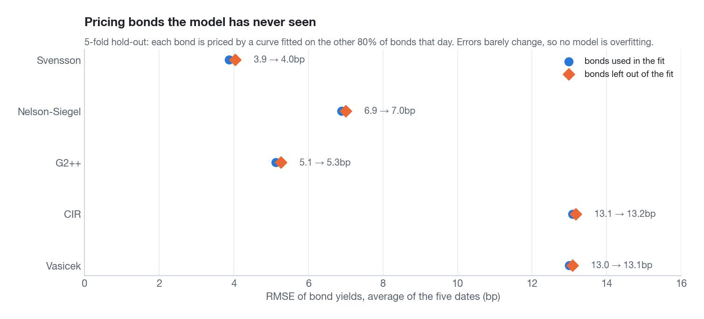

A curve is only useful if it prices bonds it wasn't fitted to. On each of the five dates we split the bonds into five groups, fit each model on four groups, and price the fifth. Averaged over the dates:

| | fitted bonds | bonds left out |
|---|---|---|
| Svensson | 3.9bp | 4.0bp |
| G2++ | 5.1bp | 5.3bp |
| Nelson-Siegel | 6.9bp | 7.0bp |
| CIR | 13.1bp | 13.2bp |
| Vasicek | 13.0bp | 13.1bp |

Errors rise by at most 0.2bp. **No model overfits.** What they miss on new bonds is what they miss on the old ones: the curve shape (Vasicek, CIR) or bond-specific effects (everyone).

### Hedging: how many factors, how many hedging bonds

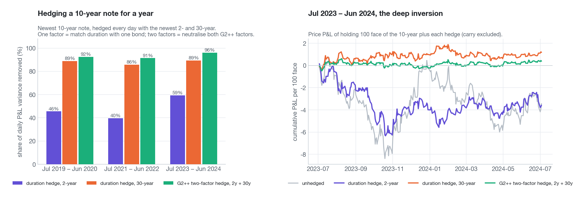

A model with k factors needs **k hedging instruments**. In G2++ a bond's price moves with each factor as $\partial P / \partial x_k = -\sum_j CF_j\, D(t_j)\, B_k(t_j)$. Holding the newest 10-year note, we hedged it every day for a year with the newest 2- and 30-year notes, choosing the amounts that set both factor exposures to zero. Against it, one-factor hedges matched duration (a parallel shift) with a single bond. Results on actual daily CRSP prices:

| share of daily risk removed | duration, 2-year | duration, 30-year | **G2++, 2-year + 30-year** |
|---|---|---|---|
| Jul 2019 – Jun 2020 (COVID) | 46% | 89% | **92%** |
| Jul 2021 – Jun 2022 (hikes begin) | 40% | 86% | **91%** |
| Jul 2023 – Jun 2024 (deep inversion) | 59% | 89% | **96%** |

- **A one-factor hedge is only as good as the bond you pick.** With the 2-year, it leaves most of the risk: on twist days the 2-year and 10-year move by different amounts, and a parallel-shift hedge can't see that.
- **Two factors cut the remaining risk by a third to two-thirds (32–63%)** compared with the best one-factor hedge. In 2023–24 the daily P&L std fell from 0.49 (unhedged) to 0.16 (best duration hedge) to **0.10 per 100 face**. Per 1 of 10-year, the hedge sold about 1.4 of the 2-year and 0.4 of the 30-year.
- In the right panel the 30-year duration hedge drifts by a full point over the year, because it was exposed to the curve's slope. The two-factor hedge stays flat.

### An option: what the curve does and doesn't tell you

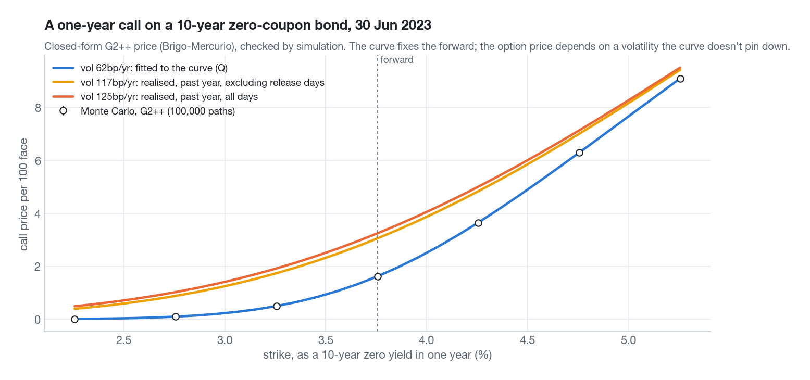

G2++ gives option prices in closed form. A European call on a zero-coupon bond (Brigo & Mercurio 2006) is

$$\text{ZBC} = P(0,S)\,\Phi(h) - K\,P(0,T)\,\Phi(h - \Sigma), \qquad h = \frac{\ln\!\big(P(0,S)/K P(0,T)\big)}{\Sigma} + \frac{\Sigma}{2},$$

where Σ, the standard deviation of the bond's log price at expiry, comes from the two factors' volatilities, correlation and mean reversion. We priced a **1-year call on a 10-year zero** on 30 June 2023 and checked the formula with a Monte Carlo simulation of the two factors (100,000 paths). They agree within simulation error at every strike, e.g. 1.617 ± 0.008 against 1.620 at the money.

The curve fixes the forward (a 3.76% 10-year yield in one year), but the option price depends on volatility:

| volatility of the forward 10-year yield | at-the-money call, per 100 face |
|---|---|
| implied by the G2++ fit to the curve: **62bp/yr** | **1.62** |
| realised over the previous year, release days excluded: 117bp/yr | 3.05 |
| realised over the previous year, all days: 125bp/yr | 3.25 |

The volatility implied by the curve fit is half what rates actually did, so it would price the option at half. It is the σ problem from Vasicek again, in its mildest form: curve shape barely constrains volatility, and the near-perfect negative correlation the fit picks (ρ = −0.99) cancels most factor volatility at the 10-year point. **That's why desks calibrate a model's volatility to option prices (caps, swaptions) and its drift to the curve,** instead of asking one to do the other's job. Release days add about 8bp of volatility here, the scheduled jumps of the previous section.

## Bonus: the curve minute by minute

The models above live at a monthly frequency. Rates, however, don't drift smoothly: much of their movement arrives in bursts at 8:30 am (CPI, the jobs report) and 2:00 pm (FOMC statements). This section asks what those bursts look like and whether the model can include them.

**Data.** Treasuries themselves aren't in TAQ, but Treasury ETFs are, down to the millisecond. Four liquid funds trade before the 8:30 releases and cover 2018–2026: **SHY (1–3 years), IEI (3–7), IEF (7–10) and TLT (20+)**. Each stands for one point on the curve: about 2, 5, 8 and 25 years. A change in the fund's mid price becomes a yield change through its duration, taken as that of a par bond of the same maturity at the day's yield level. We pulled every quote for **281 announcement days** (104 CPI releases, 103 jobs reports, 77 FOMC statements) and **281 quiet control days**, each the nearest earlier trading day with no announcement.

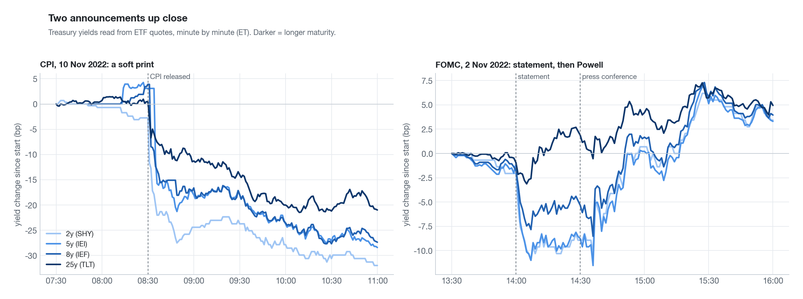

Two days show what the averages below are made of:

- **CPI, 10 November 2022.** A softer-than-expected inflation print. Between 8:25 and 8:50 the 2-year yield fell **24bp**, the 5-year 24bp, the 8-year 20bp and the 25-year 11bp. The whole curve moved at once, and by 11:00 the long end had caught up (−21bp since 7:30).
- **FOMC, 2 November 2022.** The statement read as dovish: the 2-year fell 10bp in ten minutes, and the 25-year barely moved. Then Powell said in the press conference that rates would go higher than expected. By 15:30 every yield was 5–7bp *above* where it started. The Fed's news hits the front end first.

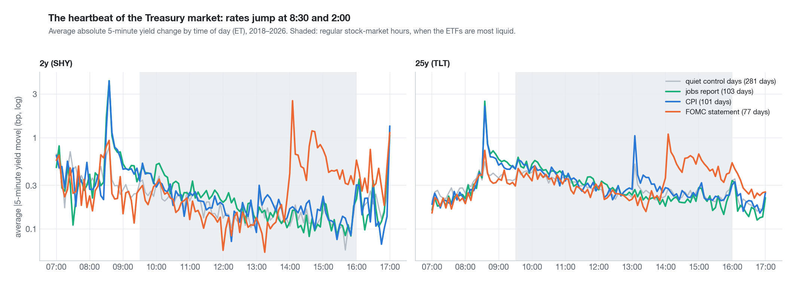

Averaged over 2018–2026, the market has a heartbeat:
- At the front end, a typical 5-minute move is about 0.2bp. On CPI and jobs days the 5 minutes after 8:30 average **4.2bp**, twenty times more. On FOMC days 14:00–14:05 averages 2.5bp, and a second wave follows at 14:30 with the press conference.
- At the long end the spikes are smaller: 2.2–2.5bp at 8:30, 1.1bp at 14:00. CPI days also show a bump at 1:05 pm, probably the 1 pm Treasury auctions, which often fall in CPI week.

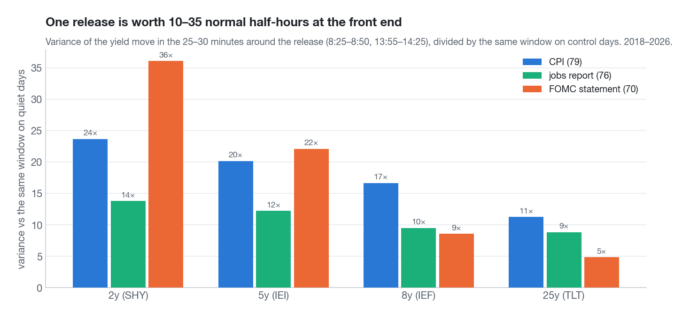

Over the 25–30 minutes around a release (8:25–8:50, 13:55–14:25), the variance of the yield move, compared with the same window on quiet days, is:

| | 2y | 5y | 8y | 25y |
|---|---|---|---|---|
| CPI (79) | 24× | 20× | 17× | 11× |
| jobs report (76) | 14× | 12× | 10× | 9× |
| FOMC statement (70) | **36×** | 22× | 9× | **5×** |

Releases concentrate at the front, and the FOMC most of all. Its effect fades fastest along the curve.


**Does one factor describe announcements?** A one-factor model forces every announcement to move the curve in the same *shape*: the 25-year must always move by the same fraction of the 2-year move.

- **CPI and jobs reports** move the curve like a slowly mean-reverting factor. Per 1bp at the 2-year: 1.0 at 5 years, 0.8 at 8, 0.5 at 25. A one-factor model would need κ ≈ 0.06 to produce that shape, close to the G2++ **level** factor.
- **FOMC statements** reach much less far: 0.84, 0.54 and 0.11. That needs κ ≈ 0.24, close to the G2++ **slope** factor (0.31).
- So the same two factors that fit 37 years of curves also sort the announcements. **Data news moves the level; Fed news moves the slope.** In the scatter, Fed announcements sit above the one-factor line (twists) and data releases along it (shifts).

| share of response variance explained | CPI | jobs | FOMC |
|---|---|---|---|
| one factor (Vasicek, loadings fitted to the curve) | 0.96 | 0.94 | **0.81** |
| two factors (G2++, loadings fitted to the curve) | 0.99 | 0.99 | **0.98** |

The model's loadings were fitted to month-end curves and were never shown these announcements. That they explain 98–99% of how the curve jumps within minutes is a strong out-of-sample check on the two-factor structure. In inverted periods data releases load a bit more on the front end (the 25-year moves 0.43–0.47 per bp of the 2-year, against 0.58–0.64 otherwise), but the structure is the same.

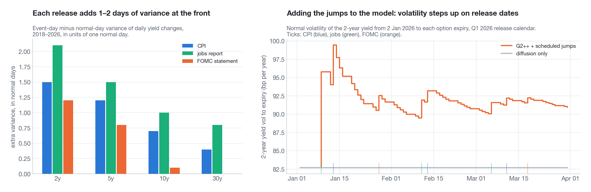

**Adding the jumps to the model.** A diffusion spreads variance evenly over time. The data puts a lump of it on known dates. On a daily basis:
- A jobs day adds the variance of **2.1 normal days** at the 2-year, CPI 1.5 and FOMC 1.2.
- At 30 years the extra is 0.8, 0.4 and 0.0: the Fed's news barely reaches the long end by the close.
- Over a year, these 32 days produce **17% of the 2-year's variance** but only 5% of the 30-year's.

The extension that captures this is Piazzesi's (2005): **G2++ with jumps on scheduled dates**. On each release date the factors jump by a normal amount whose variance depends on the release type: mostly the level factor for CPI and jobs, the slope factor for the FOMC. Because the dates are known and the jumps are Gaussian, the model stays affine, and bond prices keep their closed form. The jumps only add a tiny convexity term, so they barely change bond prices or the curve fits above.

They do matter for **options**. The right panel prices the volatility of the 2-year yield to each expiry in Q1 2026, using the actual release calendar:
- With a diffusion alone, volatility is flat at **83bp a year**.
- With the jumps it **steps up on every release date**: to 96bp for an expiry just after the 9 January jobs report, and 99bp just after the 13 January CPI. Over the whole quarter it settles to 91bp.

That is the pattern seen in Treasury option prices around release dates, and something a pure diffusion cannot produce.

## Conclusions

1. **Inside Vasicek, an inversion is simply r above its long-run level.** The one-factor model can draw both normal and inverted curves, but not a U, and not curves whose two ends move in opposite directions (24% of days).
2. **Refitted date by date, one factor fits, but only by turning σ and κ into shape knobs.** σ hits 10% in most inverted months against about 0.5% of real volatility.
3. **With one parameter set, one factor fails** (49bp median, 82bp in inversions). **Two factors work** (14bp, and no worse in inversions), including out of sample: parameters frozen at 2015 price the 2022–25 inversion to 11bp.
4. **The second factor is the inversion.** The G2++ slope factor tracks the 3-month minus 10-year spread (correlation 0.97) and peaked at +3.8 points in 2023, the highest in 37 years.
5. **The last few basis points are not about the curve at all.** In June 2023 the old 2036–37 bonds were rich by about 20bp and the 20-year issues cheap by about 9bp. Every curve model shares that floor.
6. **Bonds price the level of rates as nearly permanent (half-life 28 years); history says 4.4 years.** The gap is the term premium. Ours moves with the NY Fed's (correlation 0.98).
7. **A third to a half of the 2023 inversion was a negative term premium, not expected cuts**, and the cuts it did price arrived roughly as priced, a year late. Earlier inversions priced small cuts and got recession-sized ones.
8. **The same two factors describe the curve within minutes.** Data releases move the level factor and Fed statements the slope factor; together they explain 98–99% of announcement responses. Adding jumps on release dates (17% of the 2-year's annual variance) keeps the model affine and makes option volatility step up on release dates.
9. **Pricing and hedging need different things from the model.** Bond prices need only the curve, and the fitted curves price unseen bonds as well as fitted ones. Hedging needs the number of factors: two bonds for two factors removes 91–96% of a 10-year note's risk. Options need volatility, which the curve barely pins down: the fit implies 62bp a year against 117–125bp realised.
10. **The 2022–25 "false alarm" was a coin flip, not a broken signal.** Recession models fitted on 1971–2025 put May 2023 at 47–58%, the strongest reading since the early 1980s. Both parts of the curve carry information: a low term premium also points to recession.

## Limitations and next steps

- **Risk-neutral fits only see prices.** The curve fits say nothing about volatility on their own; that is why σ goes wrong in Vasicek and why the curve-fitted option volatility is half the realised one. A full model would calibrate volatility to caps or swaptions, which are not in our data.
- **The monthly panel is a smoothed curve.** The 37-year fits use the Fed's own Svensson curve plus bill yields, not individual bonds, so their errors measure distance from a smooth curve, not pricing errors.
- **The term premium's level depends on the sample.** On 1990–2026 ours sits 0.9 points above the NY Fed's; on 1971–2026 the levels match. The split of the 2023 inversion moves with it (a third to a half term premium). VARs on persistent series also understate persistence.
- **Intraday yields come from ETFs.** Prices are converted with an approximate duration (a par bond of the fund's average maturity), and only four funds trade reliably before 8:30. Control days still contain other 8:30 releases (jobless claims, retail sales), so the event effects are, if anything, understated.
- **Hedging ignores carry and costs.** The hedge test uses daily clean-price changes and free daily rebalancing.
- **Next:** the arbitrage-free three-factor model (AFNS), which should close the remaining gap to Dynamic Nelson-Siegel (14bp → 9bp median), and calibrating volatility to option prices.

## Data and code

Data sources, coverage and cleaning are in [`data/README.md`](data/README.md). CRSP and TAQ data are licensed through WRDS and not included in this repository; `data/README.md` explains how to rebuild them. The report is in [`report/main.pdf`](report/main.pdf). All results come from five scripts:

```bash
.venv/bin/python code/run_analysis.py    # every model fit -> data/processed/results.pkl   (~1 min)
.venv/bin/python code/run_intraday.py    # event windows + 5-minute grids from TAQ -> data/processed/intraday.pkl   (~30 s)
.venv/bin/python code/run_pricing.py     # bond example, hold-out pricing, hedges, option -> data/processed/pricing.pkl   (~2 min)
.venv/bin/python code/run_robustness.py  # out-of-sample test, 1971-2026 sample, recession probits -> data/processed/robustness.pkl   (~10 s)
.venv/bin/python code/make_figures.py    # every chart above, light and dark, + data/processed/numbers.json
```

The model code is in `code/yc/`: `data.py` (loaders, bond cash flows, yields), `models.py` (zero curves for every model), `fit.py` (per-date and shared-parameter bond fits), `timeseries.py` (monthly fits with one parameter set; states are profiled out by regression), `pq.py` (real-world factor VAR, expected rates, term premium, forecasts), `intraday.py` (ETF quotes to yield moves), `pricing.py` (hold-out pricing, factor hedges, G2++ bond option with a Monte Carlo check), and `plot.py` (chart theme). Yields are continuously compounded unless stated; "bp" means basis points of yield.
