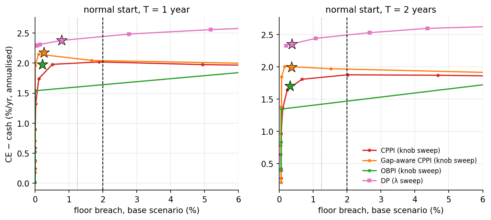
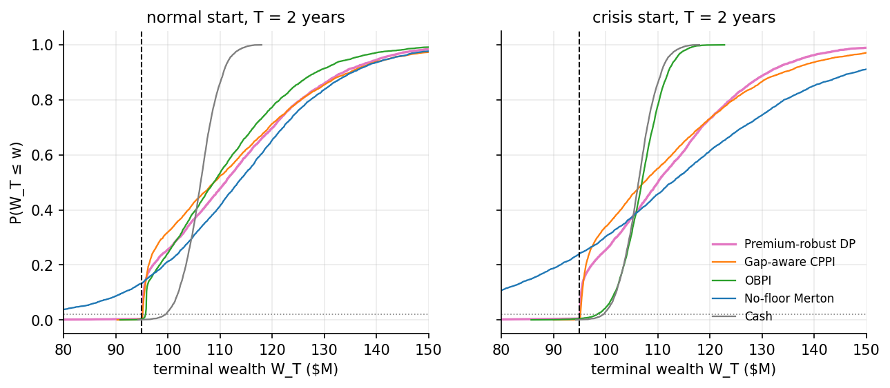
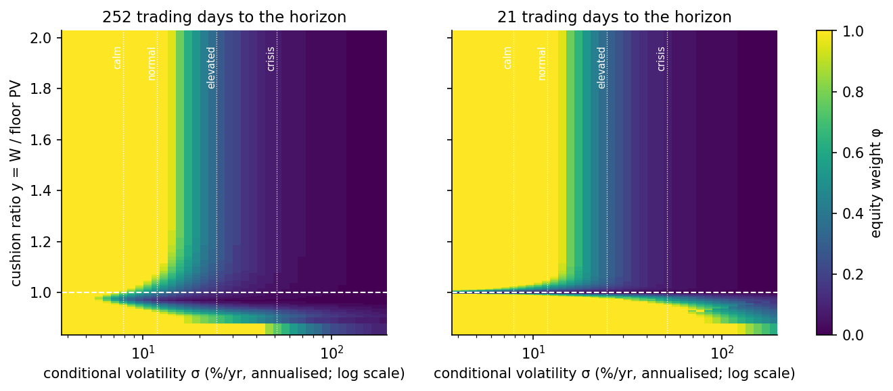
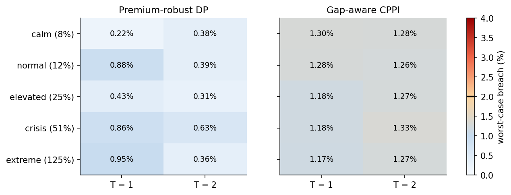
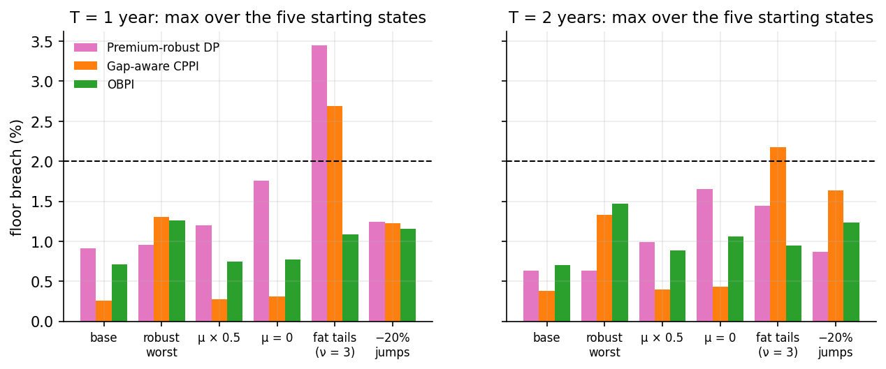
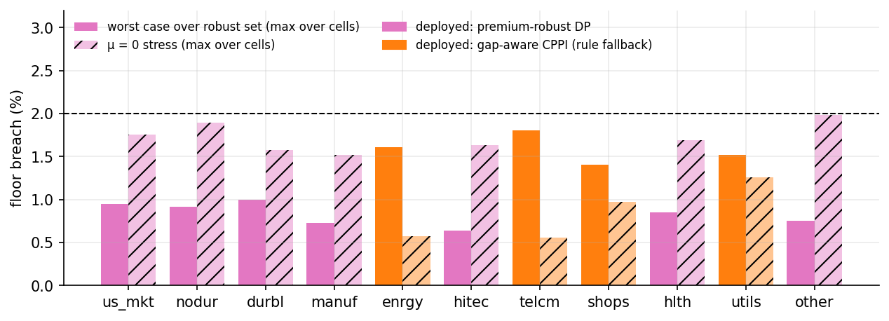

# Growing the money without breaking the floor

Investment committee report · MIT 15.456 hackathon · Team 27: Arturo Favara, Clarys Vignal, Nick Bernardini · Data through 2026-09-30

## Executive summary

**Recommendation.** Deploy the **premium-robust dynamic-programming (DP) policy**. It is a daily equity/cash rule
solved for CRRA γ = 2 with a penalty on ending below $95M, and its penalty is
calibrated so the floor holds even if the equity premium is half our estimate. A **fallback rule**, fixed before any
strategy results were seen, deploys **gap-aware CPPI** on any asset whose model diagnostics are weak. On our
11 test assets it routes 4 to CPPI (enrgy, telcm, shops, utils).

**Expected performance (US market, base model, 50,000 paths per cell).** The certainty equivalent
exceeds the cash return by **1.06% to 2.48% per year (annualised)**, depending on
the starting state and horizon. That is **+13 to +63 bp/yr
more than the best simple floor rule** in every one of the 10 named-state × horizon cells. The lowest
figure is for an extreme-volatility start at T = 1, where the DP holds mostly cash.

**Evidence that the floor holds.** The breach probability is at most **0.95%** in every
starting state, taking the worst of five models at each start: the estimated model plus four robust alternatives. The
mandate's limit is 2%. On scenarios held out of tuning, the DP stays below
2% with a zero equity premium (max 1.75%). It exceeds
2% under very fat tails (ν = 3) from crisis and extreme starts at T = 1 (max
3.45%). Gap-aware CPPI fails it too, in more cells, and the daily VaR backtest rejects ν = 3 as too
heavy (§3).

**Main limitations.** (1) The DP spends the premium it is told exists; it is the most premium-sensitive strategy we
tested. (2) The interest rate is fixed inside the DP; rate risk is handled only through a conservative floor. (3) The
model's unconditional 1–2-year left tail is thinner than history; dynamic de-risking, not the model, carries the
protection there. (4) The DP has not been run through the historical backtest (§6.5).

**Summary table: us_mkt.** Each cell shows base-model breach / worst case over the robust set / breach with zero
premium (all in %), then **CE − cash (%/yr, annualised)**. The deployed strategy on us_mkt is the premium-robust DP.

| start (σ0) | T | Deployed | Gap-aware CPPI | OBPI | No-floor Merton |
|---|---|---|---|---|---|
| calm (8%) | 1 | 0.14 / 0.22 / 0.34 · **+2.48** | 0.25 / 1.30 / 0.30 · **+2.35** | 0.22 / 0.80 / 0.27 · **+2.08** | 12.87 / 15.55 / 19.76 · **+2.10** |
| calm (8%) | 2 | 0.36 / 0.38 / 1.16 · **+2.45** | 0.38 / 1.28 / 0.43 · **+2.05** | 0.32 / 0.85 / 0.35 · **+1.72** | 12.91 / 17.05 / 22.24 · **+1.94** |
| normal (12%) | 1 | 0.79 / 0.88 / 1.75 · **+2.38** | 0.26 / 1.28 / 0.31 · **+2.17** | 0.22 / 0.80 / 0.26 · **+1.97** | 14.02 / 17.64 / 20.88 · **+1.89** |
| normal (12%) | 2 | 0.37 / 0.39 / 1.12 · **+2.36** | 0.37 / 1.26 / 0.42 · **+1.99** | 0.32 / 0.85 / 0.34 · **+1.70** | 13.49 / 18.05 / 22.84 · **+1.83** |
| elevated (25%) | 1 | 0.35 / 0.43 / 0.76 · **+1.94** | 0.22 / 1.18 / 0.27 · **+1.74** | 0.21 / 0.55 / 0.23 · **+0.98** | 18.75 / 24.44 / 25.36 · **+0.70** |
| elevated (25%) | 2 | 0.27 / 0.31 / 0.83 · **+2.14** | 0.36 / 1.27 / 0.38 · **+1.85** | 0.71 / 1.47 / 1.06 · **+0.93** | 16.32 / 22.43 / 25.52 · **+1.20** |
| crisis (51%) | 1 | 0.77 / 0.86 / 1.50 · **+1.54** | 0.22 / 1.18 / 0.24 · **+1.19** | 0.71 / 1.26 / 0.77 · **+0.26** | 28.00 / 36.16 / 33.34 · **-4.15** |
| crisis (51%) | 2 | 0.63 / 0.63 / 1.65 · **+1.97** | 0.35 / 1.33 / 0.38 · **+1.65** | 0.43 / 0.78 / 0.55 · **+0.28** | 23.46 / 32.01 / 31.78 · **-1.35** |
| extreme (125%) | 1 | 0.91 / 0.95 / 1.58 · **+1.06** | 0.23 / 1.17 / 0.23 · **+0.43** | 0.00 / 0.00 / 0.00 · **+0.05** | 43.04 / 52.46 / 46.30 · **-23.93** |
| extreme (125%) | 2 | 0.36 / 0.36 / 0.89 · **+1.68** | 0.32 / 1.27 / 0.36 · **+1.34** | 0.04 / 0.05 / 0.04 · **+0.05** | 38.73 / 48.78 / 44.20 · **-12.38** |

Source: scripts/07_report_numbers.py → results/report/tables/exec_compact_us_mkt.csv (from results/mc, results_dp_mu/mc summary.parquet)

## 1. The mandate and how we read it

We start with $100M in cash and trade daily between a diversified equity portfolio and cash
(weight φ ∈ [0, 1]; no leverage, no shorting; costs negligible). The horizon T runs from 1 to
2 years and is known at the start. The objective is the certainty equivalent
CE = (E[W_T^{1−γ}])^{1/(1−γ)} with γ = 2, subject to P(W_T < $95M) ≤
2% from every starting condition. Our interpretations:

- **The probability is model-based, and the model is uncertain.** The constraint must hold under our estimated model
  **and** under each of four robust alternatives (§3, §6). We call the maximum over these five the *worst-case breach*.
  Stress scenarios outside that set are reported separately, including where they fail.
- **A starting condition is (σ_0, r_0).** σ_0 is the model's one-day-ahead conditional volatility and r_0 the short
  rate, both observable at t = 0. Under our model these two numbers are the complete state (§3.3). The committee can
  switch on at any (σ_0, r_0). We report five named states (the 10th, 50th, 90th and 99th percentiles of the asset's own
  σ history, plus its historical maximum) and a dense grid.
- **CE is reported for the same starting conditions**, as the excess over the cash return: CE − cash (%/yr,
  annualised). This is the strategy's annualised CE minus that of holding cash on the same simulated rate paths.

## 2. Data

**Sources.** Kenneth French Data Library: daily and monthly Fama–French factors (market = Mkt-RF + RF) and the
value-weighted 10-industry daily portfolios, 1926-07-01 to 2026-09-30 (26,338
trading days). The SHA-256 of each file is in `data/raw/MANIFEST.json` and Appendix A. Nothing else is used.

**What the checks found** (`scripts/01_load_check.py` → `reports/data_check/data_check.json`):

- **Risk-free precision.** Daily RF is published to 0.01% per day (about 2.5%/yr
  resolution) and is constant within each month. It is zero on 9,795 days, and in
  315 months every daily value is zero while the monthly rate is positive. We
  therefore fit the rate model to the **monthly** series and use daily RF only for cash accounting. Compounded daily
  vs monthly RF never differs by more than the rounding bound (0 months flagged).
- **Negative rates.** The monthly RF is negative in 12 months
  (1933-02 to 1941-04). The rate model's 1954 start excludes
  them, and it does not floor rates at zero.
- **Market return construction.** Daily (Mkt-RF + RF) compounded to months matches the monthly file with a mean
  absolute difference of 0.047% (max 0.40%,
  1931-09).
- **Closure gaps.** 9 gaps exceed 4 calendar days (the longest, 12 days, is the
  1933 bank holiday). Returns after a gap are scaled by √(business days spanned) for fitting only.
- **Saturday trading** until 1952 (up to 52 Saturdays a year) and
  **1968** (226 days: the NYSE closed on Wednesdays during the paperwork crisis) explain every
  out-of-range year. The model runs in trading-day time.
- **Tails.** The largest daily move is -17.4% (1987-10-19). Excess kurtosis of
  daily log excess returns is 17.0. The worst 252-day return is
  -64.3% (ending 1932-05-31). Over the full sample,
  19.1% of 252-day windows lose more than 5%.

**Which data feed which estimate.**

| estimate | data | dates | source |
|---|---|---|---|
| Equity model (GJR-GARCH-t), premium, σ states, PIT | us_mkt daily x = log(1+r) − log(1+rf) | 1926-07-01 to 2026-09-30 | params_us_mkt.json |
| Equity model, industries without fallback | ind_* daily (value-weighted) | 1926-07-01 to 2026-09-30 | params_{asset}.json |
| Equity model, fallback industries | ind_* daily (value-weighted) | 1990-01-01 to 2026-09-30 | params_{asset}.json → fallback |
| Vasicek short-rate model, equity–rate ρ | monthly FF RF → rf_ann | 1954-01 to 2026-09 (872 months) | model_report.json → rate |
| Cash accounting in backtests | daily FF RF | 1926-07-01 to 2026-09-30 | data/processed/{asset}.parquet |
| PIT test (expanding refits) | us_mkt daily, quarterly starts | first fit after 10 years; refit every 252 days | results/model/pit_us_mkt.csv |
| Historical backtest | daily r, rf; investor refit every 5 years | first refit after 10 years of data | results/backtest/summary.parquet |

Source: scripts/07_report_numbers.py → results/report/tables/data_windows.csv (from results/model/*, reports/model/*, config.yaml)

## 3. Model

### 3.1 Equity: GJR-GARCH(1,1) with Student-t innovations

The modelling variable is the daily log excess return x = log(1+r) − log(1+rf). Its conditional variance follows
GJR-GARCH(1,1) with leverage, and its innovations are standardised t. The conditional arithmetic premium μ_e is constant.
We compared four models on us_mkt:

| model | gap_variant | loglik | bic | nu | persistence | half_life_days | uncond_vol_ann | PIT u<0.02 H252 | PIT u<0.02 H504 | VaR0.01 hit rate | VaR0.001 hit rate |
|---|---|---|---|---|---|---|---|---|---|---|---|
| garch_n | none | 88,728 | -177,414 |  | 0.9884 | 59 | 17.6% | 1.1% | 1.9% | 1.93% | 0.62% |
| garch_t | none | 89,706 | -179,361 | 5.48 | 0.9967 | 212 | 26.2% | 0.8% | 1.1% | 1.27% | 0.16% |
| gjr_t | none | 89,884 | -179,707 | 5.86 | 0.9881 | 58 | 15.3% | 1.4% | 1.9% | 1.22% | 0.16% |
| egarch_t | none | 89,943 | -179,825 | 5.90 | 0.9850 | 46 | 11.9% | 1.7% | 1.9% | 1.21% | 0.16% |
| garch_n | scale | 88,749 | -177,458 |  | 0.9882 | 58 | 17.4% | 1.1% | 1.9% | 1.93% | 0.62% |
| garch_t | scale | 89,712 | -179,373 | 5.51 | 0.9968 | 215 | 26.3% | 1.1% | 0.6% | 1.28% | 0.16% |
| gjr_t | scale | 89,889 | -179,717 | 5.89 | 0.9881 | 58 | 15.3% | 1.4% | 1.9% | 1.23% | 0.16% |
| egarch_t | scale | 89,947 | -179,834 | 5.93 | 0.9850 | 46 | 11.9% | 1.7% | 1.9% | 1.23% | 0.17% |
| gjr_t (FHS innovations) | scale | 89,889 | -179,717 | 5.89 | 0.9881 | 58 | 15.3% | 0.3% | 0.8% |  |  |

Source: scripts/07_report_numbers.py → results/report/tables/model_comparison_us_mkt.csv (from results/model/model_comparison_us_mkt.csv)

EGARCH-t has the best BIC, but its simulated 1–2-year tails are almost identical to GJR-t's, so the floor would not
change. GJR-t has a closed-form persistence and unconditional variance, and its σ_0 is a transparent state. GARCH-t is
kept as an alternative data-generating process in the robust set. Its slow vol mean reversion produces the fat
multi-year tails that GJR misses. Fitted us_mkt values: ν = 5.89, persistence
0.9881 (half-life 58 days), unconditional volatility
15.3%.

### 3.2 Premium and its shrinkage

The sample mean excess return is 7.83% per year with a standard error of
1.67% (105 years). We shrink it
50% toward zero and use **3.91%**.
The raw estimate is noisy, and the floor fails when the premium is overstated, not when it is understated. The same
procedure gives 2.59% to 5.16% across the
11 assets. Because the premium is the input the DP leans on most, we calibrate the DP against a
halved premium and test it with a zero premium (§4.6, §6.3).

### 3.3 Rates, and why (σ_0, r_0) is the complete state

The short rate is Vasicek, fitted by OLS AR(1) on monthly rates from 1954-01 to
2026-09 (872 months). The 1954 start follows the Treasury–Fed Accord. Estimates:
κ = 0.34 (SE 0.10), θ = 4.30%,
s = 2.57%, half-life 2.0 years. The equity–rate
correlation is ρ = -0.12 (same-month pairing). Under GJR-GARCH the next day's return
distribution depends on the past only through σ_t², and the sign of the last shock is already in it. Under Vasicek the
rate's future depends only on r_t. So (σ_0, r_0) is everything the model can use at t = 0. The named states for us_mkt
are calm 7.9%, normal 11.9%, elevated
24.6%, crisis 51.0% and extreme 125.1%
(the 1987-10-19 close), with r_0 = 2.67% (the median). As checks: the model's σ_0
on 2020-03-16 is 115.8% and on 2008-11-20 80.2%.

### 3.4 Validation

- **Stylised facts.** Simulated annual volatility is 14.9% against
  17.1% in the data. The 2% quantile of the 1-year cumulative excess log return is
  -34% in the model and -43% in the data.
  At 2 years it is -47% against -68%.
- **Conditional PIT test.** Each quarterly start is forecast with parameters estimated only on data before it
  (expanding window). We then count how often the realised 1- and 2-year return falls below the model's 2% quantile.
  Overall: 1.4% at 1 year (95% CI 0.3%–6.4%,
  effective n 91) and 1.9% at 2 years
  (CI 0.3%–11.2%). No bucket or era rejects.
  **The test has low power:** per-bucket confidence intervals are 9 to
  67 percentage points wide, and crisis starts are too few to test. The
  elevated-volatility point estimate at 1 year is 5.6%. This is one reason we tune
  to a target below 2%. Full table: Appendix B.
- **Daily VaR backtest of the t tail** (`scripts/02b_var_backtest.py`). The fitted ν produces too many 1% and 0.1%
  exceedances, meaning the left tail is heavier than a symmetric t. That asymmetry is why filtered historical simulation,
  which resamples the empirical residuals, is in the robust set. ν = 3 produces too few exceedances, meaning it is too
  heavy. So "fat tails (ν = 3)" is a stress test, not part of the robust set.
- **Parameter stability.** Across sub-samples (1926–1962, from 1963, 1963–1999, from 1990, 2000 onward), persistence
  ranges from 0.981 to 0.992 and ν
  from 4.6 to 7.7 (Appendix B). The parameter
  uncertainty is carried into the robust set as a "parameter draws" scenario.

### 3.5 Known weaknesses

- **Thin unconditional long-horizon tail.** GJR's volatility mean-reverts in weeks, so it cannot generate 1929–32-style
  multi-year drawdowns (2-year 2% quantile: see §3.4). This matters less for a dynamic strategy than for a static one.
  Our strategies re-read σ_t daily and de-risk as a drawdown develops, so a slow crash is met with less equity. The
  danger is a fast crash, which is why gap risk drives the design (§4) and the stress tests (§6).
- **ind_telcm.** Its PIT rejects as too thin at 1 year (H=252 u<0.01: too thin; H=252 u<0.02: too thin; H=252 u<0.05: too thin). The window is
  dominated by the 2000–02 telecom bust. The deployment rule routes it to CPPI.
- **Automatic fallback window.** If the full-history fit is near-integrated (persistence ≥
  0.998) or fewer than 70% of parameter draws are
  valid, all equity estimation for that asset restarts at 1990-01-01. It fired for
  4 assets (enrgy, telcm, shops, utils). A **rule** beats hand-picked per-asset dates
  (we first used 1984 for telecom) because the committee will run the procedure on assets nobody has looked at. A
  hand-picked date also embeds hindsight about where the regime broke.

| asset | persistence_full | valid_draws_full | fallback | start_used | persistence_used | half_life_used | valid_draws_used | nu | premium_used | uncond_vol | pit2_252 | pit2_504 | sigma_crisis | sigma_extreme |
|---|---|---|---|---|---|---|---|---|---|---|---|---|---|---|
| us_mkt | 0.98810 | 100.0% | False | 1926-07-01 | 0.9881 | 58 | 100.0% | 5.89 | 3.91% | 15.3% | 1.4% | 1.9% | 51.0% | 125.1% |
| ind_nodur | 0.99225 | 100.0% | False | 1926-07-01 | 0.9922 | 89 | 100.0% | 5.95 | 3.77% | 15.0% | 2.2% | 1.4% | 39.9% | 116.8% |
| ind_durbl | 0.99500 | 100.0% | False | 1926-07-01 | 0.9950 | 138 | 100.0% | 6.53 | 5.02% | 25.9% | 1.4% | 1.1% | 72.6% | 126.7% |
| ind_manuf | 0.98815 | 100.0% | False | 1926-07-01 | 0.9882 | 58 | 100.0% | 6.54 | 4.19% | 16.6% | 1.7% | 0.8% | 56.6% | 134.5% |
| ind_enrgy | 0.99748 | 50.0% | True | 1990-01-02 | 0.9947 | 130 | 50.0% | 9.05 | 4.97% | 24.8% | 1.9% | 2.0% | 75.1% | 140.5% |
| ind_hitec | 0.99171 | 100.0% | False | 1926-07-01 | 0.9917 | 83 | 100.0% | 6.92 | 5.16% | 22.4% | 1.4% | 1.4% | 67.4% | 154.5% |
| ind_telcm | 0.99996 | 33.3% | True | 1990-01-02 | 0.9843 | 44 | 100.0% | 8.15 | 2.59% | 16.8% | 7.8% | 6.1% | 52.1% | 88.8% |
| ind_shops | 0.99583 | 50.0% | True | 1990-01-02 | 0.9844 | 44 | 100.0% | 8.23 | 5.04% | 17.1% | 0.0% | 0.0% | 47.3% | 96.0% |
| ind_hlth | 0.98483 | 100.0% | False | 1926-07-01 | 0.9848 | 45 | 100.0% | 6.52 | 4.53% | 16.5% | 0.6% | 1.1% | 49.0% | 119.2% |
| ind_utils | 1.00000 | 33.3% | True | 1990-01-02 | 0.9909 | 76 | 100.0% | 7.45 | 3.73% | 15.4% | 2.9% | 3.0% | 52.0% | 104.7% |
| ind_other | 0.98657 | 100.0% | False | 1926-07-01 | 0.9866 | 51 | 100.0% | 5.94 | 3.59% | 17.2% | 2.2% | 2.2% | 63.5% | 130.1% |

Source: scripts/07_report_numbers.py → results/report/tables/assets_model.csv (from results/model/params_{asset}.json, reports/model/{asset}/model_report.json)

## 4. Strategy design (brief Q1)

### 4.1 The family and the logic connecting them

1. **Merton (lectures 1–2).** With CRRA and i.i.d. returns, the optimal weight is φ = μ_e/(γσ²), constant and myopic.
   It ignores the floor: on us_mkt it breaches 14.0% of the time from a normal
   start. It is our no-floor benchmark.
2. **CPPI.** Invest m × (W − floor PV) in equity. In continuous time it never breaches. In daily trading it breaches
   only when one day's loss exceeds 1/m: **gap risk**.
3. **Gap-aware CPPI.** Set m_t = 1/(z·σ_t), so the cushion always survives a z-standard-deviation day. The multiplier
   falls automatically when volatility rises.
4. **OBPI (lecture 2).** Under complete markets the CRRA-optimal payoff with a hard floor is max(K, X_T), where X is
   unconstrained Merton wealth. We replicate it daily, re-anchoring on actual wealth each day.
5. **DP with a breach penalty (lectures 1, 3).** We solve max E[U(W_T) − λ·1{W_T < K}] by backward induction on the
   state (days left, W/floor PV, σ_t²). This is the Lagrangian of the mandate itself, rather than a rule that only
   approximates it. Then we pick λ per (σ_0, T) so the worst-case breach meets the target.
6. **Premium-robust DP.** The same solved policies, but λ is calibrated against the robust set **plus a halved
   premium**.

### 4.2 Floor present value: a conservative discount

Cash earns a floating rate. A strategy that has locked into cash still ends below K if rates fall afterwards: the floor's
PV rises and cash does not catch up. That is reinvestment risk, and no cash/equity strategy can hedge it. Every floor
strategy therefore protects F̃_t = K·exp(−q_α), where q_α is the α = 0.1% quantile of log cash
growth over the remaining horizon under the investor's own Vasicek model. At the median rate this floor sits
1.2% above K at T = 1 and 4.2% above K at
T = 2. It costs little CE because every knob is re-tuned to it.

### 4.3 Robust tuning

Each knob (m, z, the OBPI floor level, the DP's λ) is set per (σ_0, T) so that the **maximum** breach over the robust
set is at most 1.25%. The robust set is: base model, GARCH-t as the data-generating process,
filtered historical simulation, parameter-uncertainty draws, and persistent volatility. The 1.25%
target leaves room below 2% for Monte Carlo error, selection noise and the weak PIT. The
breach-versus-knob crossing is found with a logistic fit over all candidates rather than by picking the last grid point
under the target, which is biased low. Knobs are tuned on one random seed (20,000 paths) and every
reported number uses an independent evaluation seed (50,000 paths).

### 4.4 The CE-versus-breach frontier

<figure markdown="1">

<figcaption><strong>CE − cash against breach.</strong> CE − cash against base-scenario breach for each strategy family (us_mkt, normal start). Lines sweep each family's knob; stars are the robust-tuned versions actually evaluated. Dashed: the 2% mandate; dotted: the 1.25% tuning target. Source: scripts/07_report_numbers.py → results/report/inputs/frontier_us_mkt.parquet, dp_lambda_frontier_us_mkt.parquet</figcaption>
</figure>

At any breach level the DP's frontier lies above every simple family's. Validation test V6 compares like with like: for
each tuned comparator it takes the best DP λ with *no higher* base breach. The DP earns more in
32 of 32 comparable cells, by
13 to 164 bp/yr.

### 4.5 Why the DP, and why a fallback

The DP is the only design that optimises the stated objective under the stated constraint. The others are rules that
satisfy the constraint and hope CE follows. Its advantage comes from what the rules cannot do. It holds equity close to
the floor when volatility is low and the cushion can absorb a bad day. It cuts equity sharply when volatility is high
even with a large cushion (Figure 3). The price is model dependence: the DP believes its premium and volatility
dynamics. Gap-aware CPPI uses only σ_t and the floor, so it is the right tool when the model is in doubt. Hence the
fallback rule (§6.6).

The DP was validated on us_mkt: Merton limit (V1) pass; grid convergence
(V4) pass; DP breach recursion vs Monte Carlo with the rate held constant
(V5) pass. Under stochastic rates,
16 of 80 V5 cells fail, all at T = 2. That gap is rate risk, which
the fixed-rate DP does not model; we report it rather than tune it away.

### 4.6 Dead ends

- **Base-only tuning.** Knobs tuned on the base model alone reach worst-case breaches of
  1.7%–4.6% across the robust set.
  This is why we tune on the worst case.
- **Untuned OBPI (floor = K).** Daily rebalancing leaves half the mass pinned at K just below it: base breach up to
  10.4%.
- **A 2nd-percentile floor discount.** It was proposed as "more conservative", but it was looser than the floor already
  in use and would have roughly doubled breaches. We moved to the 0.1% quantile instead (DECISIONS, 2026-11-21).
- **Last-candidate tuning bias**, replaced by the logistic crossing. **A quick-run (5k-path) worst case above target**
  turned out to be noise at 50,000 paths.
- **OBPI tracking drift and unbounded simulated variance.** Carrying the replicating portfolio forward let φ stay
  near 1 through very large down days. Daily re-anchoring fixed it. GARCH-t paths without a variance cap reached volatilities far beyond anything in the data, so we capped simulated volatility at 1.5 × the asset's historical maximum.
- **DP calibrated at the base premium only.** Under a zero premium it breached up to
  3.25% (calm, T =
  2). This led to the premium-robust calibration.

## 5. Expected performance (brief Q2)

| state | T | ce_xcash | q5 | q50 | q95 | p_near_floor | p_below_100 | phi_avg | turnover |
|---|---|---|---|---|---|---|---|---|---|
| calm | 1 | 2.48% | 95.10 | 105.00 | 123.68 | 24.3% | 33.9% | 0.79 | 6.03 |
| calm | 2 | 2.45% | 95.14 | 111.29 | 141.05 | 18.2% | 24.9% | 0.79 | 11.92 |
| normal | 1 | 2.38% | 95.07 | 104.92 | 124.07 | 23.5% | 33.5% | 0.78 | 6.86 |
| normal | 2 | 2.36% | 95.14 | 111.04 | 141.04 | 18.9% | 25.6% | 0.76 | 13.01 |
| elevated | 1 | 1.94% | 95.08 | 104.33 | 122.89 | 24.5% | 34.8% | 0.65 | 7.09 |
| elevated | 2 | 2.14% | 95.14 | 110.57 | 139.61 | 19.4% | 26.0% | 0.70 | 12.95 |
| crisis | 1 | 1.54% | 95.07 | 103.96 | 121.24 | 22.5% | 34.7% | 0.54 | 6.14 |
| crisis | 2 | 1.97% | 95.11 | 110.24 | 138.01 | 18.3% | 25.4% | 0.65 | 11.90 |
| extreme | 1 | 1.06% | 95.07 | 103.47 | 118.85 | 19.3% | 33.6% | 0.39 | 4.83 |
| extreme | 2 | 1.68% | 95.12 | 109.57 | 135.49 | 18.2% | 25.5% | 0.56 | 10.55 |

Source: scripts/07_report_numbers.py → results/report/tables/performance_dp_us_mkt.csv (from results_dp_mu/mc/summary.parquet + terminal subsamples (5k paths per cell))

q5/q50/q95 are terminal-wealth quantiles in $M. "Near floor" is P(K ≤ W_T < (1 + 2%)K) and "below 100" is P(W_T <
$100M), both from a 5,000-path subsample. φ is the average equity weight, and turnover is the average
Σ|Δφ| per path. Trading costs are negligible per the mandate.

**What to expect.** From a calm or normal start the DP earns about
2.4% per year over cash, with average equity weight
0.78 and median wealth $111.0M after two years. From a crisis or
extreme start it holds much less equity at first (average φ 0.39 at T = 1 from the
extreme state), so CE − cash falls to 1.1% at T = 1. Longer horizons recover more
(1.7% at T = 2), because volatility mean-reverts and the strategy has time to re-risk.
Across states, 18%–25% of outcomes end just above the
floor: the DP spends cushion when it is cheap and parks near the floor when it is not. The committee should expect a
sizeable minority of years in which the result is "floor plus a little".

<figure markdown="1">

<figcaption><strong>Terminal wealth.</strong> Distribution of terminal wealth, us_mkt, T = 2, base scenario (5,000-path subsample of the 50,000 evaluation paths). Dashed: the $95M floor; dotted: 2% probability. Source: scripts/07_report_numbers.py → results/report/inputs/terminal_base.npz</figcaption>
</figure>

<figure markdown="1">

<figcaption><strong>The DP policy.</strong> Premium-robust DP policy for us_mkt at the λ* of the normal state, T = 2 (λ = 0.00261). y = 1 (dashed) is the conservative floor PV. Dotted lines mark the named starting states' σ0. Source: scripts/07_report_numbers.py → results/report/inputs/policy_us_mkt.npz (from results/policies/dp_premrobust_us_mkt.npz)</figcaption>
</figure>

**Reading the policy.** Equity is the white-to-yellow region. (1) **Away from the floor and at low volatility** the DP
is fully invested, as Merton would be (1.00 at y = 1.5, normal σ). (2) **Volatility
alone de-risks**: at the same cushion, φ drops to 0.07 at crisis-level σ, because one
bad day can then consume the cushion. (3) **Near the floor** the weight falls fast as the cushion thins. Just below the
floor the DP gambles (high φ): once a breach is likely the penalty is mostly paid, so variance helps. This is a known
feature of the non-concave Lagrangian problem. It is rare in practice because the policy rarely lets wealth get there.
(4) **Close to the horizon** the no-trade boundary sharpens.

## 6. Why the floor holds from every starting condition (brief Q3)

### 6.1 Worst case over the robust set

<figure markdown="1">

<figcaption><strong>Worst-case breach by starting state and horizon.</strong> Worst-case breach over the robust model set (base, GARCH-t DGP, filtered historical simulation, parameter uncertainty, persistent vol), us_mkt, by starting σ0 and horizon; 50,000 evaluation paths per cell. The colour bar's black line is the 2% mandate. Source: scripts/07_report_numbers.py → results/report/tables/all_cells.csv</figcaption>
</figure>

The DP's worst-case breach is at most **0.95%** across all named states and both horizons. For
gap-aware CPPI it is 1.33% and for OBPI 1.47%. The DP's λ was solved and
calibrated at T ∈ {1, 2} for the named states; between them it uses the more conservative neighbouring λ (it never
interpolates λ). Gap-aware CPPI is also evaluated on a dense σ_0 × r_0 grid and at the intermediate horizons (the app reads these rows from `results/mc/summary.parquet`).

### 6.2 Monte Carlo error

With 50,000 evaluation paths, the standard error of a 2% breach estimate is
0.063 percentage points (0.099 at the
20,000 paths used for industries). The gap between our worst case and 2% is many standard errors.
The tuning seed and evaluation seed are independent, so the reported breach is not the one the tuner minimised.

### 6.3 Stress tests outside the tuning set

<figure markdown="1">

<figcaption><strong>Stress tests.</strong> Breach under the tuning scenarios and under stress scenarios held out of tuning, maximum over the five named starting states, us_mkt. Dashed: 2%. Source: scripts/07_report_numbers.py → results/report/tables/all_cells.csv</figcaption>
</figure>

| strategy | T | worst_robust_max | mu_low_max | mu_low_argmax | mu_zero_max | mu_zero_argmax | fat_tails_max | fat_tails_argmax | jump_max | jump_argmax |
|---|---|---|---|---|---|---|---|---|---|---|
| Premium-robust DP | 1 | 0.95% | 1.20% | extreme | 1.75% | normal | 3.45% | extreme | 1.25% | normal |
| Premium-robust DP | 2 | 0.63% | 0.99% | crisis | 1.65% | crisis | 1.45% | crisis | 0.87% | crisis |
| DP (base λ*) | 1 | 0.95% | 1.20% | extreme | 1.78% | calm | 3.45% | extreme | 1.29% | calm |
| DP (base λ*) | 2 | 1.12% | 1.93% | calm | 3.25% | calm | 1.63% | elevated | 1.47% | calm |
| Gap-aware CPPI | 1 | 1.30% | 0.28% | normal | 0.31% | normal | 2.69% | extreme | 1.23% | calm |
| Gap-aware CPPI | 2 | 1.33% | 0.40% | calm | 0.43% | calm | 2.18% | crisis | 1.63% | calm |
| OBPI | 1 | 1.26% | 0.75% | crisis | 0.77% | crisis | 1.09% | normal | 1.16% | calm |
| OBPI | 2 | 1.47% | 0.88% | elevated | 1.06% | elevated | 0.95% | calm | 1.23% | calm |
| CPPI | 1 | 1.24% | 0.29% | calm | 0.29% | calm | 1.21% | calm | 1.34% | calm |
| CPPI | 2 | 1.25% | 0.35% | calm | 0.35% | calm | 1.10% | calm | 1.40% | calm |
| No-floor Merton | 1 | 52.46% | 44.64% | extreme | 46.30% | extreme | 39.15% | extreme | 42.94% | extreme |
| No-floor Merton | 2 | 48.78% | 41.54% | extreme | 44.20% | extreme | 33.17% | extreme | 38.82% | extreme |

Source: scripts/07_report_numbers.py → results/report/tables/stress_us_mkt.csv (from results/mc, results_dp/mc, results_dp_mu/mc summary.parquet)

**Failures (breach > 2%), us_mkt:**

| strategy | scenario | state | T | breach |
|---|---|---|---|---|
| Premium-robust DP | fat_tails | crisis | 1 | 2.64% |
| Premium-robust DP | fat_tails | extreme | 1 | 3.45% |
| Gap-aware CPPI | fat_tails | calm | 1 | 2.35% |
| Gap-aware CPPI | fat_tails | calm | 2 | 2.16% |
| Gap-aware CPPI | fat_tails | normal | 1 | 2.44% |
| Gap-aware CPPI | fat_tails | normal | 2 | 2.16% |
| Gap-aware CPPI | fat_tails | elevated | 1 | 2.50% |
| Gap-aware CPPI | fat_tails | elevated | 2 | 2.12% |
| Gap-aware CPPI | fat_tails | crisis | 1 | 2.51% |
| Gap-aware CPPI | fat_tails | crisis | 2 | 2.18% |
| Gap-aware CPPI | fat_tails | extreme | 1 | 2.69% |
| Gap-aware CPPI | fat_tails | extreme | 2 | 2.15% |

Source: scripts/07_report_numbers.py → results/report/tables/stress_failures_us_mkt.csv (from results/mc, results_dp_mu/mc summary.parquet)

- **Premium halved / zero.** The premium-robust DP stays below 2% in every cell (zero
  premium: max 1.75%; the thinnest margin is 0.25
  percentage points). The rule-based strategies barely react to the premium (gap-aware CPPI ≤ 0.43%).
- **Fat tails (ν = 3).** The DP exceeds 2% in 2
  cells (crisis and extreme starts at T = 1). Gap-aware CPPI exceeds it in 10 of
  10 cells. OBPI does not, because its exposure is bounded by the Merton weight. The daily VaR backtest rejects ν = 3
  as too heavy, so this stress is more severe than the data support, but it marks the edge of the claim.
- **Jumps (a -20% day with probability 1% per path-year).** DP max 1.25%.

### 6.4 Where breaches come from

| strategy | T | n_breaches | gap | gradual | rate |
|---|---|---|---|---|---|
| Premium-robust DP | 1 | 7055 | 43.1% | 52.5% | 4.4% |
| Premium-robust DP | 2 | 4583 | 30.2% | 54.7% | 15.1% |
| Gap-aware CPPI | 1 | 6290 | 98.4% | 0.0% | 1.6% |
| Gap-aware CPPI | 2 | 7403 | 83.8% | 0.0% | 16.2% |
| OBPI | 1 | 5091 | 63.6% | 34.5% | 1.9% |
| OBPI | 2 | 6444 | 64.8% | 25.7% | 9.6% |

Source: scripts/07_report_numbers.py → results/report/tables/breach_decomposition_us_mkt.csv (from results/mc, results_dp_mu/mc summary.parquet (robust set, named states))

A breach is classified by the day the cushion was last crossed. *Gap*: one day's equity loss exceeded a cushion that
could absorb a one-σ move. *Gradual*: an eroded cushion. *Rate*: the floor PV rose or cash under-earned. Gap-aware
CPPI's breaches are almost all gaps, which is the residual risk a daily-rebalanced floor cannot remove. The DP's are
split between gaps and gradual erosion, because it deliberately keeps some equity near the floor. At T = 2 about
15% are rate-driven: the fixed-rate DP does not see rate risk (§7).

### 6.5 Historical backtest

We run each strategy from every month-end start since the first refit, with the investor re-estimated every 5 years
on past data only. The table shows the gap-aware CPPI and OBPI rows at T = 1 and 2 (overall and by σ_0 bucket; by
decade in Appendix B):

| strategy | group_type | group | n_starts | n_eff | breach | breach_lo | breach_hi | ce_xcash | T |
|---|---|---|---|---|---|---|---|---|---|
| Gap-aware CPPI | overall | all | 1089 | 91 | 0.6% | 0.1% | 5.1% | 5.67% | 1 |
| Gap-aware CPPI | overall | all | 1077 | 45 | 0.9% | 0.1% | 9.5% | 4.61% | 2 |
| No-floor Merton | overall | all | 1089 | 91 | 8.7% | 4.5% | 16.3% | 3.31% | 1 |
| No-floor Merton | overall | all | 1077 | 45 | 6.6% | 2.3% | 17.8% | 3.29% | 2 |
| OBPI | overall | all | 1089 | 91 | 0.3% | 0.0% | 4.6% | 4.32% | 1 |
| OBPI | overall | all | 1077 | 45 | 0.0% | 0.0% | 7.9% | 3.67% | 2 |
| Gap-aware CPPI | bucket | calm | 337 | 28 | 0.0% | 0.0% | 12.0% | 7.44% | 1 |
| Gap-aware CPPI | bucket | crisis | 57 | 5 | 0.0% | 0.0% | 44.7% | 6.75% | 1 |
| Gap-aware CPPI | bucket | elevated | 284 | 24 | 0.4% | 0.0% | 14.6% | 4.24% | 1 |
| Gap-aware CPPI | bucket | normal | 411 | 34 | 1.2% | 0.1% | 12.2% | 5.07% | 1 |
| Gap-aware CPPI | bucket | calm | 336 | 14 | 1.2% | 0.0% | 23.4% | 6.67% | 2 |
| Gap-aware CPPI | bucket | crisis | 56 | 2 | 0.0% | 0.0% | 62.2% | 3.25% | 2 |
| Gap-aware CPPI | bucket | elevated | 280 | 12 | 0.4% | 0.0% | 25.3% | 2.66% | 2 |
| Gap-aware CPPI | bucket | normal | 405 | 17 | 1.2% | 0.1% | 20.5% | 4.51% | 2 |
| No-floor Merton | bucket | calm | 337 | 28 | 4.2% | 0.8% | 18.5% | 3.40% | 1 |
| No-floor Merton | bucket | crisis | 57 | 5 | 10.5% | 1.1% | 55.2% | 9.93% | 1 |
| No-floor Merton | bucket | elevated | 284 | 24 | 16.9% | 6.8% | 36.3% | 2.37% | 1 |
| No-floor Merton | bucket | normal | 411 | 34 | 6.6% | 1.9% | 20.0% | 2.99% | 1 |
| No-floor Merton | bucket | calm | 336 | 14 | 3.6% | 0.4% | 26.8% | 2.78% | 2 |
| No-floor Merton | bucket | crisis | 56 | 2 | 10.7% | 0.6% | 69.7% | 7.22% | 2 |
| No-floor Merton | bucket | elevated | 280 | 12 | 11.8% | 2.6% | 39.9% | 2.91% | 2 |
| No-floor Merton | bucket | normal | 405 | 17 | 4.9% | 0.8% | 25.8% | 3.44% | 2 |
| OBPI | bucket | calm | 337 | 28 | 0.0% | 0.0% | 12.0% | 6.51% | 1 |
| OBPI | bucket | crisis | 57 | 5 | 0.0% | 0.0% | 44.7% | 1.75% | 1 |
| OBPI | bucket | elevated | 284 | 24 | 0.0% | 0.0% | 14.0% | 2.72% | 1 |
| OBPI | bucket | normal | 411 | 34 | 0.7% | 0.0% | 11.4% | 4.03% | 1 |
| OBPI | bucket | calm | 336 | 14 | 0.0% | 0.0% | 21.5% | 5.30% | 2 |
| OBPI | bucket | crisis | 56 | 2 | 0.0% | 0.0% | 62.2% | 1.07% | 2 |
| OBPI | bucket | elevated | 280 | 12 | 0.0% | 0.0% | 24.8% | 1.91% | 2 |
| OBPI | bucket | normal | 405 | 17 | 0.0% | 0.0% | 18.5% | 3.97% | 2 |

Source: scripts/07_report_numbers.py → results/report/tables/backtest_us_mkt.csv (from results/backtest/summary.parquet)

**What this can and cannot show.** Windows overlap, so 1,089 start dates carry
only about 91 independent 1-year observations. The 95% upper bound on
the realised breach rate is 5.1% overall and
45% for crisis starts (effective n 5). The
backtest can refute a badly wrong model, as it does for the no-floor Merton rule
(8.7%). It cannot confirm a 2% bound. The knobs also carry a mild
look-ahead (tuned on the full-sample model).
**The DP has not been backtested**: its policy is solved on full-sample parameters, so a fair historical test needs re-solving at each refit date. This is further work (§8).
### 6.6 External validity: other assets and the deployment rule

The committee will run the same procedure on other assets. We ran the full procedure on the 10 industry portfolios.
Each asset gets its own estimates, states, tuning and λ calibration. No constants carry over from us_mkt.

**Deployment rule** (`src/gf/deployment.py`, decided before results were seen). Deploy gap-aware CPPI instead of the DP
if (a) the fallback estimation window was triggered, (b) fewer than 70% of
parameter draws are valid after the fallback, or (c) the PIT test rejects at 1 or 2 years.

| asset | flag_fallback_window | fallback_reasons | valid_draw_share | flag_valid_draws | flag_pit_reject | pit_rejections | chosen_strategy |
|---|---|---|---|---|---|---|---|
| us_mkt | False |  | 100.0% | False | False |  | dp_premrobust |
| ind_nodur | False |  | 100.0% | False | False |  | dp_premrobust |
| ind_durbl | False |  | 100.0% | False | False |  | dp_premrobust |
| ind_manuf | False |  | 100.0% | False | False |  | dp_premrobust |
| ind_enrgy | True | valid draws 0.50 < 0.7 | 50.0% | True | False |  | cppi_vol |
| ind_hitec | False |  | 100.0% | False | False |  | dp_premrobust |
| ind_telcm | True | persistence 0.99996 >= 0.998; valid draws 0.33 < 0.7 | 100.0% | False | True | H=252 u<0.01: too thin; H=252 u<0.02: too thin; H=252 u<0.05: too thin | cppi_vol |
| ind_shops | True | valid draws 0.50 < 0.7 | 100.0% | False | False |  | cppi_vol |
| ind_hlth | False |  | 100.0% | False | False |  | dp_premrobust |
| ind_utils | True | persistence 1.00000 >= 0.998; valid draws 0.33 < 0.7 | 100.0% | False | False |  | cppi_vol |
| ind_other | False |  | 100.0% | False | False |  | dp_premrobust |

Source: scripts/07_report_numbers.py → results/report/tables/deployment.csv (from gf.deployment.deployment_table → results/deployment.csv)

<figure markdown="1">

<figcaption><strong>Deployed strategy on every asset.</strong> Deployed strategy on every asset (the rule's choice). Bars: maximum over the named-state × horizon cells; industries at 20,000 evaluation paths. Assets without a μ = 0 bar were not evaluated under that stress. Source: scripts/07_report_numbers.py → results/report/tables/industries.csv, results/deployment.csv</figcaption>
</figure>

| asset | strategy | n_cells | worst_max | base_max | mu_zero_max | fat_tails_max | jump_max | ce_min | ce_median | ce_max | n_robust_scen |
|---|---|---|---|---|---|---|---|---|---|---|---|
| us_mkt | Deployed (Premium-robust DP) | 10 | 0.95% | 0.91% | 1.75% | 3.45% | 1.25% | 1.06% | 2.05% | 2.48% | 5 |
| us_mkt | Premium-robust DP | 10 | 0.95% | 0.91% | 1.75% | 3.45% | 1.25% | 1.06% | 2.05% | 2.48% | 5 |
| us_mkt | Gap-aware CPPI | 10 | 1.33% | 0.38% | 0.43% | 2.69% | 1.63% | 0.43% | 1.79% | 2.35% | 5 |
| us_mkt | OBPI | 10 | 1.47% | 0.71% | 1.06% | 1.09% | 1.23% | 0.05% | 0.95% | 2.08% | 5 |
| ind_nodur | Deployed (Premium-robust DP) | 10 | 0.92% | 0.77% | 1.89% | 2.79% | 1.21% | 0.89% | 2.15% | 2.72% | 5 |
| ind_nodur | Premium-robust DP | 10 | 0.92% | 0.77% | 1.89% | 2.79% | 1.21% | 0.89% | 2.15% | 2.72% | 5 |
| ind_nodur | Gap-aware CPPI | 10 | 1.31% | 0.39% | 0.48% | 2.52% | 1.62% | 0.04% | 1.86% | 2.55% | 5 |
| ind_nodur | OBPI | 10 | 1.39% | 0.91% | 1.19% | 0.98% | 1.28% | 0.05% | 1.23% | 2.27% | 5 |
| ind_durbl | Deployed (Premium-robust DP) | 10 | 1.00% | 0.76% | 1.58% | 2.47% | 1.06% | 0.27% | 1.17% | 2.02% | 5 |
| ind_durbl | Premium-robust DP | 10 | 1.00% | 0.76% | 1.58% | 2.47% | 1.06% | 0.27% | 1.17% | 2.02% | 5 |
| ind_durbl | Gap-aware CPPI | 10 | 1.68% | 0.97% | 1.08% | 5.32% | 2.07% | -1.92% | 0.42% | 1.66% | 5 |
| ind_durbl | OBPI | 10 | 1.12% | 0.89% | 1.17% | 1.88% | 1.44% | 0.06% | 0.54% | 1.58% | 5 |
| ind_manuf | Deployed (Premium-robust DP) | 10 | 0.73% | 0.64% | 1.52% | 2.33% | 1.01% | 0.74% | 1.82% | 2.31% | 5 |
| ind_manuf | Premium-robust DP | 10 | 0.73% | 0.64% | 1.52% | 2.33% | 1.01% | 0.74% | 1.82% | 2.31% | 5 |
| ind_manuf | Gap-aware CPPI | 10 | 1.49% | 0.33% | 0.40% | 2.50% | 1.35% | -0.15% | 1.53% | 2.15% | 5 |
| ind_manuf | OBPI | 10 | 1.65% | 1.15% | 1.74% | 1.20% | 1.22% | 0.04% | 0.87% | 1.92% | 5 |
| ind_enrgy | Deployed (Gap-aware CPPI) | 10 | 1.61% | 0.50% | 0.57% | 1.47% | 1.32% | -2.09% | 0.57% | 1.64% | 5 |
| ind_enrgy | Premium-robust DP | 10 | 1.29% | 0.98% | 2.24% | 1.24% | 1.21% | 0.21% | 1.25% | 1.97% | 5 |
| ind_enrgy | Gap-aware CPPI | 10 | 1.61% | 0.50% | 0.57% | 1.47% | 1.32% | -2.09% | 0.57% | 1.64% | 5 |
| ind_enrgy | OBPI | 10 | 1.29% | 1.05% | 1.19% | 0.95% | 1.15% | 0.04% | 0.66% | 1.59% | 5 |
| ind_hitec | Deployed (Premium-robust DP) | 10 | 0.64% | 0.56% | 1.63% | 1.61% | 0.77% | 0.52% | 1.72% | 2.44% | 5 |
| ind_hitec | Premium-robust DP | 10 | 0.64% | 0.56% | 1.63% | 1.61% | 0.77% | 0.52% | 1.72% | 2.44% | 5 |
| ind_hitec | Gap-aware CPPI | 10 | 1.35% | 0.57% | 0.66% | 2.61% | 1.54% | -0.79% | 1.27% | 2.19% | 5 |
| ind_hitec | OBPI | 10 | 1.57% | 1.21% | 1.79% | 1.35% | 1.36% | 0.05% | 0.78% | 1.97% | 5 |
| ind_telcm | Deployed (Gap-aware CPPI) | 10 | 1.80% | 0.56% | 0.56% | 2.04% | 1.66% | -0.65% | 0.33% | 0.66% | 5 |
| ind_telcm | Premium-robust DP | 10 | 1.18% | 0.73% | 1.21% | 1.06% | 1.17% | 0.43% | 0.73% | 0.90% | 5 |
| ind_telcm | Gap-aware CPPI | 10 | 1.80% | 0.56% | 0.56% | 2.04% | 1.66% | -0.65% | 0.33% | 0.66% | 5 |
| ind_telcm | OBPI | 10 | 1.24% | 0.92% | 1.23% | 1.08% | 1.31% | 0.03% | 0.34% | 0.75% | 5 |
| ind_shops | Deployed (Gap-aware CPPI) | 10 | 1.41% | 0.83% | 0.97% | 1.97% | 1.82% | 0.54% | 1.96% | 2.57% | 5 |
| ind_shops | Premium-robust DP | 10 | 1.04% | 0.74% | 1.85% | 1.11% | 1.03% | 1.42% | 2.37% | 2.79% | 5 |
| ind_shops | Gap-aware CPPI | 10 | 1.41% | 0.83% | 0.97% | 1.97% | 1.82% | 0.54% | 1.96% | 2.57% | 5 |
| ind_shops | OBPI | 10 | 1.30% | 0.60% | 0.97% | 0.85% | 1.51% | 0.13% | 1.26% | 2.37% | 5 |
| ind_hlth | Deployed (Premium-robust DP) | 10 | 0.85% | 0.81% | 1.69% | 1.94% | 1.17% | 1.04% | 2.10% | 2.46% | 5 |
| ind_hlth | Premium-robust DP | 10 | 0.85% | 0.81% | 1.69% | 1.94% | 1.17% | 1.04% | 2.10% | 2.46% | 5 |
| ind_hlth | Gap-aware CPPI | 10 | 1.49% | 0.40% | 0.48% | 2.56% | 1.39% | 0.26% | 1.75% | 2.25% | 5 |
| ind_hlth | OBPI | 10 | 1.35% | 1.10% | 1.74% | 1.42% | 1.31% | 0.06% | 1.20% | 2.02% | 5 |
| ind_utils | Deployed (Gap-aware CPPI) | 10 | 1.52% | 1.01% | 1.26% | 3.56% | 2.04% | -1.07% | 1.24% | 1.94% | 5 |
| ind_utils | Premium-robust DP | 10 | 1.11% | 1.08% | 1.73% | 2.21% | 1.21% | 0.54% | 1.62% | 2.12% | 5 |
| ind_utils | Gap-aware CPPI | 10 | 1.52% | 1.01% | 1.26% | 3.56% | 2.04% | -1.07% | 1.24% | 1.94% | 5 |
| ind_utils | OBPI | 10 | 1.08% | 0.63% | 0.69% | 1.00% | 1.31% | 0.06% | 0.96% | 1.84% | 5 |
| ind_other | Deployed (Premium-robust DP) | 10 | 0.75% | 0.75% | 1.98% | 2.94% | 1.13% | 0.85% | 1.52% | 1.92% | 5 |
| ind_other | Premium-robust DP | 10 | 0.75% | 0.75% | 1.98% | 2.94% | 1.13% | 0.85% | 1.52% | 1.92% | 5 |
| ind_other | Gap-aware CPPI | 10 | 1.35% | 0.56% | 0.61% | 3.44% | 1.74% | 0.05% | 1.24% | 1.75% | 5 |
| ind_other | OBPI | 10 | 1.57% | 1.08% | 1.62% | 1.54% | 1.34% | 0.04% | 0.66% | 1.60% | 5 |

Source: scripts/07_report_numbers.py → results/report/tables/industries.csv (from results/mc, results_dp_mu/mc, results_ind_extra/mc summary.parquet)

- **The deployed strategy's worst case stays below 2% on every asset evaluated** (max
  1.80%, telcm). It is above the
  1.25% tuning target in some industry cells. Industries use 10,000 tuning
  paths, so tuning noise is larger there.
- **DP on industries** (durbl, enrgy, hitec, hlth, manuf, nodur, other, shops, telcm, utils, us_mkt): the DP's CE − cash beats gap-aware CPPI in
  100 of 100 industry cells (by +16 to
  +230 bp/yr).
- **DP misses and the rule.** The DP exceeds 2% in 1 industry cell(s) under the robust set or a zero premium: enrgy normal T = 2 under mu_zero (2.24%). The rule routes 1 of 1 of these assets to CPPI, so **the deployed strategy never contains a DP miss**.- **Thin margins under a zero premium** (deployed DP within two standard errors of 2%): nodur normal T = 1 1.89% (SE 0.10 pp); other normal T = 2 1.98% (SE 0.10 pp). These count as passes, but they can't be distinguished from the limit.
- **Fat tails (ν = 3) on industries.** The deployed DP exceeds 2% in 9 cells on durbl, manuf, nodur, other, us_mkt (max 3.45%), mostly crisis/extreme starts. This is the same failure as on us_mkt and is outside the robust set (§6.3, §7).
- **Simple rules on all industries** (SPEC 03 robust set): gap-aware CPPI worst case max 1.80%,
  OBPI 1.65%.

**A cost of the fallback.** On flagged assets, gap-aware CPPI can earn *less than cash* from crisis or extreme starts
(deployed minimum CE − cash -2.09%, enrgy). This is not
a lock into cash: only 0.7%–4.6% of paths
hold φ ≈ 0 at the end. It is a *soft lock-in*. With m = 1/(zσ), an unclipped cushion has a constant daily volatility of
1/z (16%–22% in these cells), so most paths bleed their cushion within weeks of a high-volatility start. They then end just above the
conservative floor: 46%–69% of paths finish within
2% of it, against 35% in other cells. Mean wealth still beats cash; the γ = 2 CE
does not.

| asset | state | T | sigma0 | z | cushion_daily_vol | ce_xcash | locked_cash_share | phi_avg | p_near_floor | median_W | mean_W | breach_base |
|---|---|---|---|---|---|---|---|---|---|---|---|---|
| ind_enrgy | extreme | 1 | 140.5% | 4.66 | 21.4% | -2.09% | 4.6% | 0.19 | 69.3% | 95.71 | 104.44 | 0.43% |
| ind_durbl | extreme | 1 | 126.7% | 4.89 | 20.5% | -1.92% | 3.3% | 0.22 | 65.2% | 95.90 | 103.93 | 0.88% |
| ind_utils | extreme | 1 | 104.7% | 4.45 | 22.5% | -1.07% | 1.7% | 0.32 | 58.8% | 95.93 | 104.23 | 0.99% |
| ind_enrgy | crisis | 1 | 75.1% | 4.72 | 21.2% | -0.97% | 2.3% | 0.29 | 62.8% | 95.90 | 104.74 | 0.38% |
| ind_durbl | crisis | 1 | 72.6% | 4.87 | 20.5% | -0.88% | 2.0% | 0.31 | 59.6% | 96.08 | 104.54 | 0.84% |
| ind_hitec | extreme | 1 | 154.5% | 5.78 | 17.3% | -0.79% | 1.7% | 0.27 | 53.1% | 96.59 | 104.47 | 0.28% |
| ind_telcm | extreme | 1 | 88.8% | 4.68 | 21.4% | -0.65% | 0.8% | 0.39 | 54.2% | 96.28 | 103.98 | 0.56% |
| ind_enrgy | extreme | 2 | 140.5% | 4.80 | 20.8% | -0.62% | 1.4% | 0.28 | 54.6% | 96.38 | 109.80 | 0.43% |
| ind_durbl | extreme | 2 | 126.7% | 4.83 | 20.7% | -0.52% | 1.5% | 0.31 | 51.2% | 96.69 | 109.42 | 0.90% |
| ind_telcm | crisis | 1 | 52.1% | 4.65 | 21.5% | -0.18% | 0.7% | 0.47 | 50.3% | 96.70 | 104.21 | 0.52% |
| ind_manuf | extreme | 1 | 134.5% | 6.15 | 16.3% | -0.15% | 0.8% | 0.35 | 45.9% | 97.39 | 104.44 | 0.24% |

Source: scripts/07_report_numbers.py → results/report/tables/cppi_gap_negative_ce.csv (from results/mc/summary.parquet + terminal subsamples)

## 7. When to use it, and when not (brief Q4)

**Use it** on a broad equity portfolio with a long, stable daily history. That means the asset's diagnostics are clean
(no fallback window, valid parameter draws, PIT not rejected), the horizon is 1–2 years, and the strategy can trade
every day.

**Do not rely on it** in these cases:

1. **Crash risk beyond the data.** Under ν = 3 tails both the DP and gap-aware CPPI exceed
   2% from some starts (DP up to 3.45% from crisis/extreme starts
   at T = 1 on us_mkt; 9 industry cells, up to 3.45%). If the committee believes single-day losses much larger than 1987 are plausible, use OBPI or a lower
   tuning target.
2. **A premium far below our estimate.** The premium-robust DP holds at zero premium on us_mkt, but with a thin margin
   in some cells (0.25 pp on us_mkt; nodur 1.89%, other 1.98%) and not on every industry. If the premium is in
   serious doubt, deploy gap-aware CPPI: it is nearly premium-insensitive.
3. **Assets flagged by the diagnostics** (fallback window, < 70% valid draws, PIT
   rejection). The rule already sends these to CPPI.
4. **Short or structurally broken histories.** Persistence near 1 means level shifts are being read as volatility.
   A fallback window helps, but on a short window the PIT test has too few independent observations to detect miscalibration.
5. **Very short horizons from crisis starts.** The strategy is mostly cash and CE − cash is small
   (1.1% at T = 1 from the extreme state; below cash for CPPI on some industries).
6. **Large rate moves.** The DP holds the rate fixed. Rate-driven breaches are 15% of
   its T = 2 breaches, and the conservative floor is the only defence.
7. **Anything that breaks daily trading**: overnight gaps larger than the model's one-day tail, trading halts, or real
   transaction costs. The breach control relies on rebalancing before the cushion is gone.

## 8. Advice (brief Q5)

- **Re-estimate** the model and re-run tuning and calibration at least annually, and immediately after a volatility
  regime change that moves σ_t outside the range of the named states. The pipeline is a single procedure
  (`scripts/01`–`09`), so this is a re-run, not a research project.
- **Check the diagnostics before switching on**, every time: fallback trigger, valid-draw share, PIT verdict. The
  deployment rule is code (`gf.deployment.deployment_choice`) and should be run, not remembered.
- **If the premium is doubted, deploy the CPPI fallback.** It gives up +13 to
  +63 bp/yr of CE on us_mkt but removes most premium dependence.
- **Remove reinvestment risk with a horizon-matched zero-coupon bond** (outside the current mandate). The floor would
  then be K × the bond price, and the conservative discount and rate-driven breaches would disappear.
- **Extensions:** the rate as a fourth DP state variable; full DP validation (V1–V6) on every asset; a DP backtest with
  re-solving at each refit; a finer λ grid (the current grid overshoots the target, costing CE); transaction costs.

## Appendix A: Reproducibility

**Fast path** (from committed results, minutes): `python scripts/07_report_numbers.py` then
`python scripts/08_build_report.py` rebuilds `results/report/numbers.json`, every table, every figure,
`deliverables/report.pdf` and `deliverables/deck.pdf`. **Full path** (several hours on 8 cores; run times per stage in DECISIONS.md): stages 01–06 as listed in
DECISIONS.md and README.md, then 07–09.

- **Seeds.** Model fitting 20261120; Monte Carlo master seed 20261121. Every cell's tuning and
  evaluation seed is a hash of (master seed, asset, "tune"/"eval"), so all strategies in a cell share paths.
  us_mkt: tune 808879553790532705, eval 22189377091890336.
- **Paths.** Tuning 20,000 (us_mkt) / 10,000 (industries); evaluation
  50,000 / 20,000.
- **Data hashes** (SHA-256):
  - `F-F_Research_Data_Factors_daily.csv`: `3f7910502dd6f188748210e5145d95642de1d8cff56c2cf0fa85985299610ff0` (1926-07-01 to 2026-09-30, downloaded 2026-10-26)
  - `F-F_Research_Data_Factors.csv`: `a3894d74d553cab812eabbe706bdbf443c97eb20b24b05e3e5f3ce47e46b90bb` (1926-07-31 to 2026-09-30, downloaded 2026-10-26)
  - `10_Industry_Portfolios_Daily.csv`: `01cfe3d5e54f6ddfcc3dc84fb793f10f6b0218fe59f780969f4dca84e72e823e` (1926-07-01 to 2026-09-30, downloaded 2026-10-26)
- **Code.** SPEC 03 run at commit `9773244d50a13e39100c0b797d83d09d4ddbd288`; this report from the commit tagged in the
  submission README.
- **Every number in this report** is a key in `results/report/numbers.json` or a row in `results/report/tables/`,
  written by `scripts/07_report_numbers.py`. The map from report items to keys is the table at the top of DECISIONS.md.

## Appendix B: Additional tables

**B.1 us_mkt: every strategy, named state and horizon** (breach in %, CE − cash in %/yr annualised).

| strategy | state | T | breach_base | breach_worst | worst_scen | breach_mu_low | breach_mu_zero | breach_fat_tails | breach_jump | ce_xcash | phi_avg | turnover |
|---|---|---|---|---|---|---|---|---|---|---|---|---|
| Premium-robust DP | calm | 1 | 0.14% | 0.22% | dgp_garch_t | 0.21% | 0.34% | 0.79% | 0.53% | 2.48% | 0.79 | 6.03 |
| Premium-robust DP | calm | 2 | 0.36% | 0.38% | fhs | 0.62% | 1.16% | 0.85% | 0.71% | 2.45% | 0.79 | 11.92 |
| Premium-robust DP | normal | 1 | 0.79% | 0.88% | dgp_garch_t | 1.12% | 1.75% | 1.85% | 1.25% | 2.38% | 0.78 | 6.86 |
| Premium-robust DP | normal | 2 | 0.37% | 0.39% | fhs | 0.61% | 1.12% | 0.89% | 0.72% | 2.36% | 0.76 | 13.01 |
| Premium-robust DP | elevated | 1 | 0.35% | 0.43% | dgp_garch_t | 0.51% | 0.76% | 1.49% | 0.70% | 1.94% | 0.65 | 7.09 |
| Premium-robust DP | elevated | 2 | 0.27% | 0.31% | fhs | 0.48% | 0.83% | 0.86% | 0.56% | 2.14% | 0.70 | 12.95 |
| Premium-robust DP | crisis | 1 | 0.77% | 0.86% | dgp_garch_t | 1.08% | 1.50% | 2.64% | 1.10% | 1.54% | 0.54 | 6.14 |
| Premium-robust DP | crisis | 2 | 0.63% | 0.63% | base | 0.99% | 1.65% | 1.45% | 0.87% | 1.97% | 0.65 | 11.90 |
| Premium-robust DP | extreme | 1 | 0.91% | 0.95% | param_unc | 1.20% | 1.58% | 3.45% | 1.21% | 1.06% | 0.39 | 4.83 |
| Premium-robust DP | extreme | 2 | 0.36% | 0.36% | param_unc | 0.54% | 0.89% | 1.23% | 0.63% | 1.68% | 0.56 | 10.55 |
| DP (base λ*) | calm | 1 | 0.77% | 0.84% | dgp_garch_t | 1.16% | 1.78% | 1.65% | 1.29% | 2.55% | 0.81 | 5.78 |
| DP (base λ*) | calm | 2 | 1.06% | 1.12% | dgp_garch_t | 1.93% | 3.25% | 1.51% | 1.47% | 2.53% | 0.81 | 11.35 |
| DP (base λ*) | normal | 1 | 0.79% | 0.88% | dgp_garch_t | 1.12% | 1.75% | 1.85% | 1.25% | 2.38% | 0.78 | 6.86 |
| DP (base λ*) | normal | 2 | 0.37% | 0.39% | fhs | 0.61% | 1.12% | 0.89% | 0.72% | 2.36% | 0.76 | 13.01 |
| DP (base λ*) | elevated | 1 | 0.35% | 0.43% | dgp_garch_t | 0.51% | 0.76% | 1.49% | 0.70% | 1.94% | 0.65 | 7.09 |
| DP (base λ*) | elevated | 2 | 0.92% | 0.94% | dgp_garch_t | 1.52% | 2.50% | 1.63% | 1.23% | 2.21% | 0.73 | 12.87 |
| DP (base λ*) | crisis | 1 | 0.77% | 0.86% | dgp_garch_t | 1.08% | 1.50% | 2.64% | 1.10% | 1.54% | 0.54 | 6.14 |
| DP (base λ*) | crisis | 2 | 0.63% | 0.63% | base | 0.99% | 1.65% | 1.45% | 0.87% | 1.97% | 0.65 | 11.90 |
| DP (base λ*) | extreme | 1 | 0.91% | 0.95% | param_unc | 1.20% | 1.58% | 3.45% | 1.21% | 1.06% | 0.39 | 4.83 |
| DP (base λ*) | extreme | 2 | 0.36% | 0.36% | param_unc | 0.54% | 0.89% | 1.23% | 0.63% | 1.68% | 0.56 | 10.55 |
| Gap-aware CPPI | calm | 1 | 0.25% | 1.30% | fhs | 0.28% | 0.30% | 2.35% | 1.23% | 2.35% | 0.78 | 5.61 |
| Gap-aware CPPI | calm | 2 | 0.38% | 1.28% | fhs | 0.40% | 0.43% | 2.16% | 1.63% | 2.05% | 0.71 | 13.17 |
| Gap-aware CPPI | normal | 1 | 0.26% | 1.28% | fhs | 0.28% | 0.31% | 2.44% | 1.18% | 2.17% | 0.75 | 6.49 |
| Gap-aware CPPI | normal | 2 | 0.37% | 1.26% | fhs | 0.39% | 0.42% | 2.16% | 1.59% | 1.99% | 0.69 | 12.95 |
| Gap-aware CPPI | elevated | 1 | 0.22% | 1.18% | fhs | 0.26% | 0.27% | 2.50% | 1.11% | 1.74% | 0.66 | 7.06 |
| Gap-aware CPPI | elevated | 2 | 0.36% | 1.27% | fhs | 0.36% | 0.38% | 2.12% | 1.50% | 1.85% | 0.66 | 12.38 |
| Gap-aware CPPI | crisis | 1 | 0.22% | 1.18% | fhs | 0.24% | 0.24% | 2.51% | 0.92% | 1.19% | 0.55 | 6.59 |
| Gap-aware CPPI | crisis | 2 | 0.35% | 1.33% | fhs | 0.36% | 0.38% | 2.18% | 1.38% | 1.65% | 0.61 | 11.68 |
| Gap-aware CPPI | extreme | 1 | 0.23% | 1.17% | fhs | 0.23% | 0.23% | 2.69% | 0.71% | 0.43% | 0.41 | 5.47 |
| Gap-aware CPPI | extreme | 2 | 0.32% | 1.27% | fhs | 0.33% | 0.36% | 2.15% | 1.21% | 1.34% | 0.55 | 10.68 |
| CPPI | calm | 1 | 0.30% | 1.24% | fhs | 0.29% | 0.29% | 1.21% | 1.34% | 2.04% | 0.67 | 5.28 |
| CPPI | calm | 2 | 0.37% | 1.24% | fhs | 0.35% | 0.35% | 1.10% | 1.40% | 1.73% | 0.59 | 8.92 |
| CPPI | normal | 1 | 0.30% | 1.24% | fhs | 0.29% | 0.28% | 1.20% | 1.28% | 1.93% | 0.64 | 5.34 |
| CPPI | normal | 2 | 0.35% | 1.19% | dgp_garch_t | 0.33% | 0.33% | 1.08% | 1.39% | 1.70% | 0.59 | 8.88 |
| CPPI | elevated | 1 | 0.25% | 1.14% | dgp_garch_t | 0.24% | 0.23% | 1.01% | 1.11% | 1.50% | 0.55 | 5.05 |
| CPPI | elevated | 2 | 0.31% | 1.24% | dgp_garch_t | 0.31% | 0.31% | 1.03% | 1.27% | 1.60% | 0.56 | 8.78 |
| CPPI | crisis | 1 | 0.17% | 1.24% | dgp_garch_t | 0.16% | 0.16% | 0.78% | 0.71% | 0.79% | 0.38 | 3.64 |
| CPPI | crisis | 2 | 0.25% | 1.22% | dgp_garch_t | 0.26% | 0.26% | 0.89% | 1.10% | 1.33% | 0.50 | 8.14 |
| CPPI | extreme | 1 | 0.19% | 1.09% | dgp_garch_t | 0.19% | 0.20% | 0.83% | 0.18% | -0.24% | 0.21 | 2.07 |
| CPPI | extreme | 2 | 0.26% | 1.25% | dgp_garch_t | 0.26% | 0.26% | 0.70% | 0.76% | 0.75% | 0.36 | 6.07 |
| OBPI | calm | 1 | 0.22% | 0.80% | fhs | 0.26% | 0.27% | 1.08% | 1.16% | 2.08% | 0.65 | 6.00 |
| OBPI | calm | 2 | 0.32% | 0.85% | fhs | 0.32% | 0.35% | 0.95% | 1.23% | 1.72% | 0.55 | 9.61 |
| OBPI | normal | 1 | 0.22% | 0.80% | fhs | 0.26% | 0.26% | 1.09% | 1.12% | 1.97% | 0.63 | 5.97 |
| OBPI | normal | 2 | 0.32% | 0.85% | fhs | 0.32% | 0.34% | 0.94% | 1.21% | 1.70% | 0.55 | 9.44 |
| OBPI | elevated | 1 | 0.21% | 0.55% | fhs | 0.22% | 0.23% | 0.27% | 0.40% | 0.98% | 0.28 | 1.02 |
| OBPI | elevated | 2 | 0.71% | 1.47% | fhs | 0.88% | 1.06% | 0.40% | 1.00% | 0.93% | 0.26 | 2.19 |
| OBPI | crisis | 1 | 0.71% | 1.26% | persistent | 0.75% | 0.77% | 0.27% | 0.80% | 0.26% | 0.08 | 0.18 |
| OBPI | crisis | 2 | 0.43% | 0.78% | fhs | 0.49% | 0.55% | 0.18% | 0.53% | 0.28% | 0.08 | 0.29 |
| OBPI | extreme | 1 | 0.00% | 0.00% | base | 0.00% | 0.00% | 0.00% | 0.00% | 0.05% | 0.01 | 0.06 |
| OBPI | extreme | 2 | 0.04% | 0.05% | persistent | 0.04% | 0.04% | 0.03% | 0.03% | 0.05% | 0.01 | 0.08 |
| No-floor Merton | calm | 1 | 12.87% | 15.55% | dgp_garch_t | 15.90% | 19.76% | 8.81% | 13.58% | 2.10% | 0.84 | 0.19 |
| No-floor Merton | calm | 2 | 12.91% | 17.05% | dgp_garch_t | 16.91% | 22.24% | 8.63% | 14.02% | 1.94% | 0.84 | 0.39 |
| No-floor Merton | normal | 1 | 14.02% | 17.64% | dgp_garch_t | 17.11% | 20.88% | 9.69% | 14.72% | 1.89% | 0.84 | 0.20 |
| No-floor Merton | normal | 2 | 13.49% | 18.05% | dgp_garch_t | 17.59% | 22.84% | 9.10% | 14.66% | 1.83% | 0.84 | 0.40 |
| No-floor Merton | elevated | 1 | 18.75% | 24.44% | dgp_garch_t | 21.86% | 25.36% | 13.91% | 19.19% | 0.70% | 0.84 | 0.25 |
| No-floor Merton | elevated | 2 | 16.32% | 22.43% | dgp_garch_t | 20.55% | 25.52% | 11.31% | 17.35% | 1.20% | 0.84 | 0.45 |
| No-floor Merton | crisis | 1 | 28.00% | 36.16% | dgp_garch_t | 30.55% | 33.34% | 22.90% | 28.24% | -4.15% | 0.84 | 0.37 |
| No-floor Merton | crisis | 2 | 23.46% | 32.01% | dgp_garch_t | 27.31% | 31.78% | 17.59% | 24.18% | -1.35% | 0.84 | 0.58 |
| No-floor Merton | extreme | 1 | 43.04% | 52.46% | dgp_garch_t | 44.64% | 46.30% | 39.15% | 42.94% | -23.93% | 0.84 | 0.70 |
| No-floor Merton | extreme | 2 | 38.73% | 48.78% | dgp_garch_t | 41.54% | 44.20% | 33.17% | 38.82% | -12.38% | 0.84 | 0.92 |

Source: scripts/07_report_numbers.py → results/report/tables/us_mkt_all_cells.csv (from results/mc, results_dp/mc, results_dp_mu/mc summary.parquet)

**B.2 Industries: DP vs comparators, CE − cash difference (bp/yr).**

| asset | dp_minus_cg_min | dp_minus_cg_max | dp_minus_ob_min | dp_minus_ob_max | n_dp_above_cg | n |
|---|---|---|---|---|---|---|
| ind_nodur | +17 | +85 | +43 | +154 | 10 | 10 |
| ind_durbl | +36 | +219 | +21 | +79 | 10 | 10 |
| ind_manuf | +16 | +90 | +32 | +144 | 10 | 10 |
| ind_enrgy | +33 | +230 | +17 | +73 | 10 | 10 |
| ind_hitec | +25 | +130 | +37 | +128 | 10 | 10 |
| ind_telcm | +24 | +109 | +15 | +57 | 10 | 10 |
| ind_shops | +22 | +87 | +33 | +186 | 10 | 10 |
| ind_hlth | +20 | +78 | +36 | +166 | 10 | 10 |
| ind_utils | +18 | +161 | +25 | +114 | 10 | 10 |
| ind_other | +18 | +80 | +26 | +123 | 10 | 10 |

Source: scripts/07_report_numbers.py → results/report/tables/industries_dp_vs_comparators.csv (from results/mc, results_dp_mu/mc, results_ind_extra/mc)

**B.3 PIT test, us_mkt, u < 2% (base model).**

| group_type | group | H | n_starts | n_eff | count | freq | ci_lo | ci_hi | verdict |
|---|---|---|---|---|---|---|---|---|---|
| overall | all | 252 | 363 | 91 | 5 | 1.4% | 0.3% | 6.4% | consistent |
| overall | all | 504 | 359 | 45 | 7 | 1.9% | 0.3% | 11.2% | consistent |
| bucket | calm | 252 | 120 | 30 | 1 | 0.8% | 0.0% | 12.8% | consistent |
| bucket | calm | 504 | 120 | 15 | 3 | 2.5% | 0.2% | 24.2% | consistent |
| bucket | normal | 252 | 156 | 39 | 0 | 0.0% | 0.0% | 9.0% | consistent |
| bucket | normal | 504 | 154 | 19 | 2 | 1.3% | 0.1% | 18.7% | consistent |
| bucket | elevated | 252 | 72 | 18 | 4 | 5.6% | 1.0% | 25.8% | consistent |
| bucket | elevated | 504 | 70 | 9 | 2 | 2.9% | 0.2% | 34.3% | consistent |
| bucket | crisis | 252 | 15 | 4 | 0 | 0.0% | 0.0% | 50.6% | inconclusive |
| bucket | crisis | 504 | 15 | 2 | 0 | 0.0% | 0.0% | 67.2% | inconclusive |
| bucket_group | high | 252 | 87 | 22 | 4 | 4.6% | 0.8% | 22.0% | consistent |
| bucket_group | high | 504 | 85 | 11 | 2 | 2.4% | 0.1% | 29.9% | consistent |
| era | pre-1952 | 252 | 68 | 17 | 0 | 0.0% | 0.0% | 18.4% | consistent |
| era | pre-1952 | 504 | 68 | 8 | 0 | 0.0% | 0.0% | 31.1% | consistent |
| era | 1952-1999 | 252 | 192 | 48 | 2 | 1.0% | 0.1% | 9.2% | consistent |
| era | 1952-1999 | 504 | 192 | 24 | 2 | 1.0% | 0.1% | 15.5% | consistent |
| era | 2000- | 252 | 103 | 26 | 3 | 2.9% | 0.4% | 17.6% | consistent |
| era | 2000- | 504 | 99 | 12 | 5 | 5.1% | 0.6% | 30.8% | consistent |

Source: scripts/07_report_numbers.py → results/report/tables/pit_us_mkt.csv (from reports/model/us_mkt/model_report.json → pit_tables (base GJR-t, u < 2%))

**B.4 Parameter stability, us_mkt.**

| sample | start | end | nobs | nu | persistence | half_life_days | uncond_vol_ann |
|---|---|---|---|---|---|---|---|
| estimation window (base) | 1926-07-01 | 2026-09-30 | 26338 | 5.89 | 0.9881 | 58 | 15.3% |
| pre-1963 | 1926-07-01 | 1962-12-31 | 10295 | 4.61 | 0.9879 | 57 | 17.1% |
| 1963-1999 | 1963-01-02 | 1999-12-31 | 9317 | 7.23 | 0.9922 | 89 | 13.3% |
| 2000-end | 2000-01-03 | 2026-09-30 | 6726 | 7.66 | 0.9813 | 37 | 16.5% |
| from 1952-07-01 | 1952-07-01 | 2026-09-30 | 18685 | 7.01 | 0.9860 | 49 | 13.7% |
| from 1963-07-01 | 1963-07-01 | 2026-09-30 | 15918 | 7.17 | 0.9888 | 61 | 14.9% |
| from 1990-01-01 | 1990-01-02 | 2026-09-30 | 9254 | 7.00 | 0.9822 | 39 | 15.3% |

Source: scripts/07_report_numbers.py → results/report/tables/param_stability_us_mkt.csv (from reports/model/us_mkt/model_report.json → subsamples)

**B.5 Historical backtest by decade, us_mkt.**

| strategy | group | n_eff | breach | breach_hi | T |
|---|---|---|---|---|---|
| Gap-aware CPPI | 1930s | 5 | 0.0% | 43.4% | 1 |
| Gap-aware CPPI | 1940s | 10 | 0.0% | 27.8% | 1 |
| Gap-aware CPPI | 1950s | 10 | 0.0% | 27.8% | 1 |
| Gap-aware CPPI | 1960s | 10 | 0.0% | 27.8% | 1 |
| Gap-aware CPPI | 1970s | 10 | 0.8% | 28.9% | 1 |
| Gap-aware CPPI | 1980s | 10 | 4.2% | 33.4% | 1 |
| Gap-aware CPPI | 1990s | 10 | 0.0% | 27.8% | 1 |
| Gap-aware CPPI | 2000s | 10 | 0.0% | 27.8% | 1 |
| Gap-aware CPPI | 2010s | 10 | 0.0% | 27.8% | 1 |
| Gap-aware CPPI | 2020s | 6 | 0.0% | 40.1% | 1 |
| Gap-aware CPPI | 1930s | 2 | 0.0% | 60.6% | 2 |
| Gap-aware CPPI | 1940s | 5 | 0.8% | 44.4% | 2 |
| Gap-aware CPPI | 1950s | 5 | 0.0% | 43.4% | 2 |
| Gap-aware CPPI | 1960s | 5 | 0.0% | 43.4% | 2 |
| Gap-aware CPPI | 1970s | 5 | 1.7% | 45.3% | 2 |
| Gap-aware CPPI | 1980s | 5 | 5.0% | 48.8% | 2 |
| Gap-aware CPPI | 1990s | 5 | 0.0% | 43.4% | 2 |
| Gap-aware CPPI | 2000s | 5 | 0.0% | 43.4% | 2 |
| Gap-aware CPPI | 2010s | 5 | 0.8% | 44.4% | 2 |
| Gap-aware CPPI | 2020s | 2 | 0.0% | 61.8% | 2 |
| No-floor Merton | 1930s | 5 | 0.0% | 43.4% | 1 |
| No-floor Merton | 1940s | 10 | 0.0% | 27.8% | 1 |
| No-floor Merton | 1950s | 10 | 0.0% | 27.8% | 1 |
| No-floor Merton | 1960s | 10 | 10.0% | 40.4% | 1 |
| No-floor Merton | 1970s | 10 | 15.0% | 45.9% | 1 |
| No-floor Merton | 1980s | 10 | 10.8% | 41.4% | 1 |
| No-floor Merton | 1990s | 10 | 0.0% | 27.8% | 1 |
| No-floor Merton | 2000s | 10 | 34.2% | 63.9% | 1 |
| No-floor Merton | 2010s | 10 | 0.8% | 28.9% | 1 |
| No-floor Merton | 2020s | 6 | 14.5% | 55.1% | 1 |
| No-floor Merton | 1930s | 2 | 0.0% | 60.6% | 2 |
| No-floor Merton | 1940s | 5 | 0.0% | 43.4% | 2 |
| No-floor Merton | 1950s | 5 | 0.0% | 43.4% | 2 |
| No-floor Merton | 1960s | 5 | 5.8% | 49.7% | 2 |
| No-floor Merton | 1970s | 5 | 14.2% | 57.5% | 2 |
| No-floor Merton | 1980s | 5 | 0.0% | 43.4% | 2 |
| No-floor Merton | 1990s | 5 | 5.0% | 48.8% | 2 |
| No-floor Merton | 2000s | 5 | 33.3% | 72.5% | 2 |
| No-floor Merton | 2010s | 5 | 0.0% | 43.4% | 2 |
| No-floor Merton | 2020s | 2 | 1.8% | 63.1% | 2 |
| OBPI | 1930s | 5 | 0.0% | 43.4% | 1 |
| OBPI | 1940s | 10 | 0.0% | 27.8% | 1 |
| OBPI | 1950s | 10 | 0.0% | 27.8% | 1 |
| OBPI | 1960s | 10 | 0.0% | 27.8% | 1 |
| OBPI | 1970s | 10 | 0.0% | 27.8% | 1 |
| OBPI | 1980s | 10 | 2.5% | 31.2% | 1 |
| OBPI | 1990s | 10 | 0.0% | 27.8% | 1 |
| OBPI | 2000s | 10 | 0.0% | 27.8% | 1 |
| OBPI | 2010s | 10 | 0.0% | 27.8% | 1 |
| OBPI | 2020s | 6 | 0.0% | 40.1% | 1 |
| OBPI | 1930s | 2 | 0.0% | 60.6% | 2 |
| OBPI | 1940s | 5 | 0.0% | 43.4% | 2 |
| OBPI | 1950s | 5 | 0.0% | 43.4% | 2 |
| OBPI | 1960s | 5 | 0.0% | 43.4% | 2 |
| OBPI | 1970s | 5 | 0.0% | 43.4% | 2 |
| OBPI | 1980s | 5 | 0.0% | 43.4% | 2 |
| OBPI | 1990s | 5 | 0.0% | 43.4% | 2 |
| OBPI | 2000s | 5 | 0.0% | 43.4% | 2 |
| OBPI | 2010s | 5 | 0.0% | 43.4% | 2 |
| OBPI | 2020s | 2 | 0.0% | 61.8% | 2 |

Source: scripts/07_report_numbers.py → results/report/tables/backtest_decade_us_mkt.csv (from results/backtest/summary.parquet)

## Appendix C: AI-use statement

**[TEAM TO COMPLETE — placeholder skeleton]**

**Tools used and for what.** [e.g. Claude Code for code, pipeline runs and drafting; which members used which tools.]

**How material outputs were verified.** [unit tests (pytest suite); data validation gates (SPEC 01 checks); PIT
calibration test; DP validation V1–V6; paired seeds between strategies and independent tune/evaluation seeds;
reproducing rows (e.g. the comparator pairing check, the DP lookup reproduction); byte-identical numbers.json from a
fresh clone.]

**Material AI errors found, and decisions overruled** (from DECISIONS.md; expand each with date and what changed):

- The pre-1952 annualisation claim was reversed: N = 252 *understates* calendar-year volatility before 1952; it does not overstate it.
- The proposed 2nd-percentile floor discount would have been looser than the floor in use and roughly doubled breaches; rejected.
- Hand-set per-asset start dates (1984 for telecom) were replaced by an automatic fallback-window rule.
- OBPI tracking drift and unbounded simulated variance were found at a quick-run gate; fixed by daily re-anchoring and a variance cap.
- Last-candidate tuning bias, replaced by a logistic crossing.
- The 5k-path worst-case breach above target was Monte Carlo noise; it disappeared at full size.
- The V6 optimality test was reworded to a breach-matched (frontier) comparison after the literal version had no comparable cells.
- [others the team identifies]

**AI lab notebook entries:** attached separately.

