# Data check report (Spec 01)

Generated 2026-11-20T19:16:43 by `scripts/01_load_check.py`. Overall status: **WARN**.

All returns are in decimal units. `r` = simple total return, `rf` = daily simple risk-free return, `x` = log(1+r) − log(1+rf), `rf_ann` = (1+rf_monthly)^12 − 1.

## Raw files (MANIFEST)

| file | sha256 | bytes | downloaded | date source | first | last | sections (rows) |
|---|---|---|---|---|---|---|---|
| F-F_Research_Data_Factors_daily.csv | 3f7910502dd6f188… | 1211963 | 2026-10-26 | file_mtime | 1926-07-01 | 2026-09-30 | section_0 (26338) |
| F-F_Research_Data_Factors.csv | a3894d74d553cab8… | 52533 | 2026-10-26 | file_mtime | 1926-07-31 | 2026-09-30 | section_0 (1203); Annual Factors: January-December (99) |
| 10_Industry_Portfolios_Daily.csv | 01cfe3d5e54f6ddf… | 4741344 | 2026-10-26 | file_mtime | 1926-07-01 | 2026-09-30 | Average Value Weighted Returns -- Daily (26338); Average Equal Weighted Returns -- Daily (26338) |

## Status summary

| asset | overall | units | coverage | dates | missing | extremes | monthly_crosscheck | summary |
|---|---|---|---|---|---|---|---|---|
| us_mkt | PASS | PASS | PASS | PASS | PASS | PASS | PASS | PASS |
| ind_nodur | PASS | PASS | PASS | PASS | PASS | PASS | – | PASS |
| ind_durbl | WARN | PASS | PASS | PASS | PASS | WARN | – | PASS |
| ind_manuf | PASS | PASS | PASS | PASS | PASS | PASS | – | PASS |
| ind_enrgy | PASS | PASS | PASS | PASS | PASS | PASS | – | PASS |
| ind_hitec | PASS | PASS | PASS | PASS | PASS | PASS | – | PASS |
| ind_telcm | PASS | PASS | PASS | PASS | PASS | PASS | – | PASS |
| ind_shops | PASS | PASS | PASS | PASS | PASS | PASS | – | PASS |
| ind_hlth | PASS | PASS | PASS | PASS | PASS | PASS | – | PASS |
| ind_utils | PASS | PASS | PASS | PASS | PASS | PASS | – | PASS |
| ind_other | PASS | PASS | PASS | PASS | PASS | PASS | – | PASS |
| (global) rf | PASS | – | – | – | – | – | – | – |

`–` = not applicable (e.g. no monthly file exists for industry portfolios).

## 7. Risk-free rate checks — PASS

- Daily RF constant within the month in 100.0% of months.
- Smallest step between distinct daily RF values: 1.00e-04 (≈ 2.52% p.a.).
- 315 months where every daily RF is 0 but the monthly RF is > 0 (daily RF rounded to 1e-04 = 0.01%/day). rf_ann uses the monthly file for this reason.
- Monthly RF is negative in 12 months (1933-02, 1938-03, 1938-07, 1938-11, 1939-01, 1939-03, 1939-08, 1940-05, 1940-08, 1941-01, 1941-02, 1941-04); rf_ann inherits these. Daily RF has no negative days (rounded/floored).
- All months agree with the monthly RF within the rounding bound (n_days x resolution/2 + 1.0 bp).
- |prod(1+rf_d) − 1 − rf_m| over 1203 months: mean 4.42 bp, median 3.91 bp, p95 10.02 bp, max 13.00 bp (1931-03); mean signed diff -0.790 bp.
- Months by number of distinct daily RF values: {1: 1203}
- Negative RF days: 0; zero RF days: 9795.

| decade | days | zero days | zero share | negative days |
|---|---|---|---|---|
| 1920 | 1037 | 25 | 2.4% | 0 |
| 1930 | 2988 | 2618 | 87.6% | 0 |
| 1940 | 2918 | 2918 | 100.0% | 0 |
| 1950 | 2598 | 921 | 35.5% | 0 |
| 1960 | 2489 | 0 | 0.0% | 0 |
| 1970 | 2526 | 0 | 0.0% | 0 |
| 1980 | 2528 | 0 | 0.0% | 0 |
| 1990 | 2528 | 0 | 0.0% | 0 |
| 2000 | 2515 | 713 | 28.3% | 0 |
| 2010 | 2516 | 2013 | 80.0% | 0 |
| 2020 | 1695 | 587 | 34.6% | 0 |

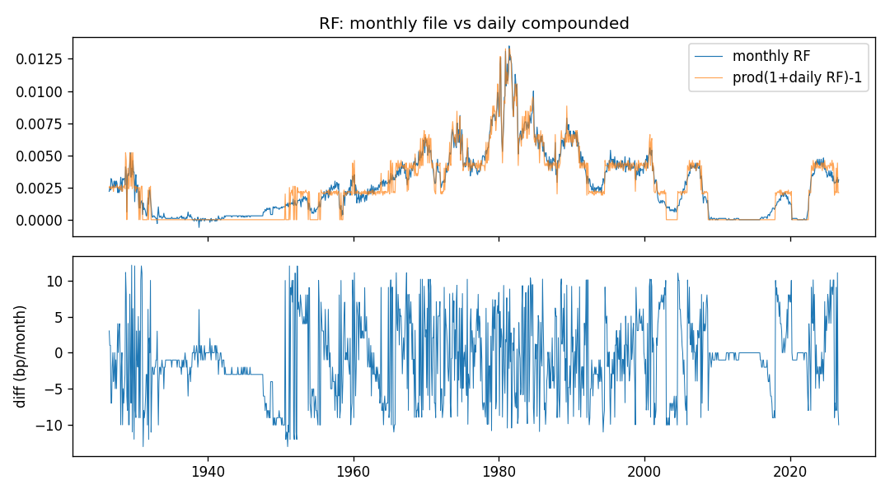

---

# Asset `us_mkt` — PASS

Source `F-F_Research_Data_Factors_daily.csv`, section “section_0”, column `Mkt-RF` + RF (excess → total return); saved to `data/processed/us_mkt.parquet` (26338 rows).

## 1. Coverage — PASS

1926-07-01 to 2026-09-30, 26338 trading days.

| year | days | Saturdays | reason |
|---|---|---|---|
| 1926 | 150 | 23 | partial year (sample start/end) |
| 1927 | 301 | 51 | Saturday trading era (51 Saturdays) |
| 1928 | 295 | 45 | Saturday trading era (45 Saturdays) |
| 1929 | 291 | 42 | Saturday trading era (42 Saturdays) |
| 1930 | 298 | 47 | Saturday trading era (47 Saturdays) |
| 1931 | 300 | 48 | Saturday trading era (48 Saturdays) |
| 1932 | 302 | 52 | Saturday trading era (52 Saturdays) |
| 1933 | 285 | 43 | Saturday trading era (43 Saturdays) |
| 1934 | 301 | 52 | Saturday trading era (52 Saturdays) |
| 1935 | 301 | 51 | Saturday trading era (51 Saturdays) |
| 1936 | 301 | 48 | Saturday trading era (48 Saturdays) |
| 1937 | 299 | 49 | Saturday trading era (49 Saturdays) |
| 1938 | 301 | 51 | Saturday trading era (51 Saturdays) |
| 1939 | 300 | 51 | Saturday trading era (51 Saturdays) |
| 1940 | 302 | 51 | Saturday trading era (51 Saturdays) |
| 1941 | 301 | 51 | Saturday trading era (51 Saturdays) |
| 1942 | 301 | 50 | Saturday trading era (50 Saturdays) |
| 1943 | 301 | 51 | Saturday trading era (51 Saturdays) |
| 1944 | 298 | 47 | Saturday trading era (47 Saturdays) |
| 1945 | 286 | 40 | Saturday trading era (40 Saturdays) |
| 1946 | 281 | 31 | Saturday trading era (31 Saturdays) |
| 1947 | 283 | 33 | Saturday trading era (33 Saturdays) |
| 1948 | 283 | 32 | Saturday trading era (32 Saturdays) |
| 1949 | 282 | 32 | Saturday trading era (32 Saturdays) |
| 1950 | 281 | 32 | Saturday trading era (32 Saturdays) |
| 1951 | 283 | 34 | Saturday trading era (34 Saturdays) |
| 1952 | 271 | 21 | Saturday trading era (21 Saturdays) |
| 1968 | 226 | 0 | explained in config: NYSE closed on Wednesdays Jun-Dec 1968 (paperwork crisis); verified: 0-1 Wednesday sessions/month Jun-Dec in the data |
| 2026 | 187 | 0 | partial year (sample start/end) |

Trading days per year

1926: 150, 1927: 301, 1928: 295, 1929: 291, 1930: 298, 1931: 300, 1932: 302, 1933: 285, 1934: 301, 1935: 301, 1936: 301, 1937: 299, 1938: 301, 1939: 300, 1940: 302, 1941: 301, 1942: 301, 1943: 301, 1944: 298, 1945: 286, 1946: 281, 1947: 283, 1948: 283, 1949: 282, 1950: 281, 1951: 283, 1952: 271, 1953: 251, 1954: 252, 1955: 252, 1956: 251, 1957: 252, 1958: 252, 1959: 253, 1960: 252, 1961: 250, 1962: 252, 1963: 251, 1964: 253, 1965: 252, 1966: 252, 1967: 251, 1968: 226, 1969: 250, 1970: 254, 1971: 253, 1972: 251, 1973: 252, 1974: 253, 1975: 253, 1976: 253, 1977: 252, 1978: 252, 1979: 253, 1980: 253, 1981: 253, 1982: 253, 1983: 253, 1984: 253, 1985: 252, 1986: 253, 1987: 253, 1988: 253, 1989: 252, 1990: 253, 1991: 253, 1992: 254, 1993: 253, 1994: 252, 1995: 252, 1996: 254, 1997: 253, 1998: 252, 1999: 252, 2000: 252, 2001: 248, 2002: 252, 2003: 252, 2004: 252, 2005: 252, 2006: 251, 2007: 251, 2008: 253, 2009: 252, 2010: 252, 2011: 252, 2012: 250, 2013: 252, 2014: 252, 2015: 252, 2016: 252, 2017: 251, 2018: 251, 2019: 252, 2020: 253, 2021: 252, 2022: 251, 2023: 250, 2024: 252, 2025: 250, 2026: 187

## 2. Dates — PASS

Strictly increasing: True; unique: True; weekend dates after 1952: 0.

Gaps > 4 calendar days:

| last date before | next date | calendar days |
|---|---|---|
| 1929-11-27 | 1929-12-02 | 5 |
| 1933-03-03 | 1933-03-15 | 12 |
| 1956-12-21 | 1956-12-26 | 5 |
| 1958-12-24 | 1958-12-29 | 5 |
| 1961-05-26 | 1961-05-31 | 5 |
| 1968-07-03 | 1968-07-08 | 5 |
| 2001-09-10 | 2001-09-17 | 7 |
| 2006-12-29 | 2007-01-03 | 5 |
| 2012-10-26 | 2012-10-31 | 5 |

## 3. Missing values — PASS

- Sentinel (-99.99 / -999) counts: source {'Mkt-RF': 0, 'SMB': 0, 'HML': 0, 'RF': 0}; rf_daily {'Mkt-RF': 0, 'SMB': 0, 'HML': 0, 'RF': 0}; rf_monthly {'Mkt-RF': 0, 'SMB': 0, 'HML': 0, 'RF': 0}
- Missing in the columns used: {'source:Mkt-RF': 0, 'rf_daily:RF': 0}
- NaN in asset frame: {'r': 0, 'rf': 0, 'x': 0, 'rf_ann': 0}
- Rows dropped — asset_dates_not_in_rf (inner join): 0
- Rows dropped — rf_dates_not_in_asset (inner join): 0
- Rows dropped — nan_in_r_or_rf: 0
- rf_ann days filled from an earlier month (monthly rate not yet published): 0; days with no monthly rate: 0

## 4. Units sanity — PASS

median daily r = 0.00080, std = 0.01077 (bounds in config `checks.units`).

## 5. Extreme days — PASS

| rank | date | r | x |
|---|---|---|---|
| 1 | 1987-10-19 | -17.41% | -19.16% |
| 2 | 1933-03-15 | 15.67% | 14.56% |
| 3 | 2020-03-16 | -12.00% | -12.79% |
| 4 | 1929-10-29 | -11.53% | -12.27% |
| 5 | 2008-10-13 | 11.36% | 10.76% |
| 6 | 1929-10-28 | -11.23% | -11.93% |
| 7 | 1929-10-30 | 11.22% | 10.61% |
| 8 | 1931-10-06 | 11.15% | 10.57% |
| 9 | 1932-09-21 | 10.94% | 10.38% |
| 10 | 2008-10-28 | 9.78% | 9.33% |
| 11 | 2025-04-09 | 9.67% | 9.21% |
| 12 | 1929-11-06 | -9.64% | -10.16% |
| 13 | 2020-03-12 | -9.62% | -10.12% |
| 14 | 2020-03-24 | 9.35% | 8.93% |
| 15 | 1933-07-21 | -9.15% | -9.60% |
| 16 | 2020-03-13 | 8.99% | 8.60% |
| 17 | 2008-12-01 | -8.96% | -9.39% |
| 18 | 2008-10-15 | -8.79% | -9.20% |
| 19 | 1939-09-05 | 8.79% | 8.42% |
| 20 | 1937-10-20 | 8.67% | 8.31% |

Expected dates: 1987-10-19 (r = -17.41%, in top: True)

Suspicious |r| > 25%: none

## 6. Daily vs monthly cross-check — PASS

1203 months (1926-07 – 2026-09). |diff|: mean 0.047%, median 0.039%, p90 0.098%, p95 0.110%, p99 0.131%, max 0.400% (1931-09). Mean signed diff -0.0069%. Months with |diff| > 0.5%: 0.

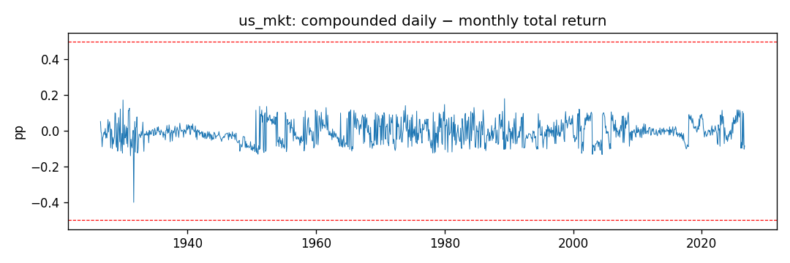

## 8. Summary statistics — PASS

Annualised with N = 252. Skew/kurtosis are of daily x. Worst-window and share columns use overlapping 252- and 504-day cumulative total returns (window assigned to the decade it ends in).

| period | days | mean r | mean x | vol x | skew x | exkurt x | min r | max r | worst 252d | worst 504d | P(252d<-5%) | P(504d<-5%) | mean rf_ann |
|---|---|---|---|---|---|---|---|---|---|---|---|---|---|
| full | 26338 | 10.84% | 6.36% | 17.12% | -0.46 | 17.0 | -17.41% | 15.67% | -64.3% | -74.0% | 19.1% | 14.6% | 3.24% |
| 1920s | 1037 | 14.84% | 10.08% | 19.22% | -2.21 | 33.7 | -11.53% | 11.22% | -29.7% | 0.6% | 5.6% | 0.0% | 3.73% |
| 1930s | 2988 | 3.44% | -0.70% | 27.63% | 0.38 | 5.6 | -9.15% | 15.67% | -64.3% | -74.0% | 45.0% | 47.1% | 0.55% |
| 1940s | 2918 | 8.31% | 7.51% | 12.70% | -1.52 | 12.8 | -7.21% | 4.81% | -25.8% | -23.4% | 25.0% | 21.6% | 0.40% |
| 1950s | 2598 | 16.71% | 14.55% | 10.07% | -1.12 | 9.7 | -6.49% | 4.43% | -11.9% | -6.1% | 2.7% | 0.2% | 1.87% |
| 1960s | 2489 | 8.55% | 4.22% | 9.93% | -0.62 | 11.4 | -6.97% | 4.93% | -20.3% | -5.8% | 13.7% | 0.0% | 3.88% |
| 1970s | 2526 | 6.76% | -0.21% | 13.27% | 0.16 | 2.4 | -3.54% | 5.34% | -42.8% | -44.3% | 27.2% | 25.5% | 6.34% |
| 1980s | 2528 | 16.67% | 7.07% | 15.54% | -3.29 | 64.3 | -17.41% | 8.60% | -20.1% | -7.0% | 16.0% | 0.2% | 8.95% |
| 1990s | 2528 | 17.31% | 11.71% | 13.35% | -0.52 | 5.7 | -6.68% | 4.95% | -18.0% | 7.6% | 3.9% | 0.0% | 4.95% |
| 2000s | 2515 | 2.09% | -3.11% | 22.31% | -0.13 | 6.7 | -8.96% | 11.36% | -46.7% | -48.8% | 38.2% | 35.5% | 2.77% |
| 2010s | 2516 | 13.93% | 12.26% | 15.24% | -0.51 | 4.5 | -6.96% | 5.08% | -11.8% | -19.6% | 1.7% | 5.7% | 0.52% |
| 2020s | 1695 | 16.27% | 11.23% | 20.79% | -0.66 | 13.8 | -12.00% | 9.67% | -22.2% | -15.3% | 14.8% | 2.1% | 2.82% |

## 9. Figures

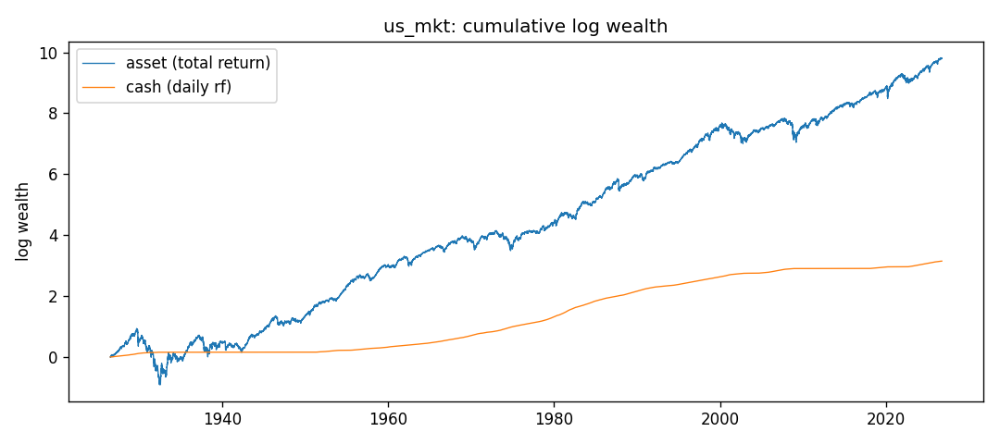
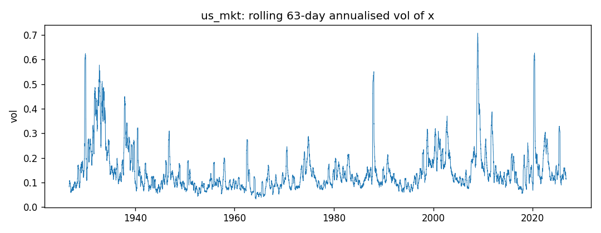
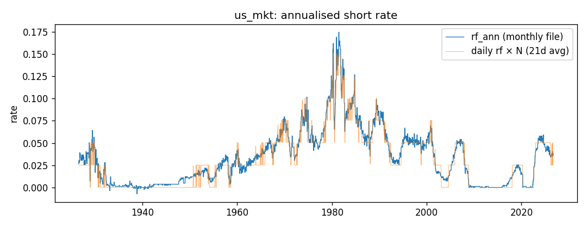
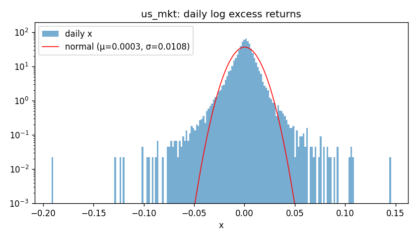
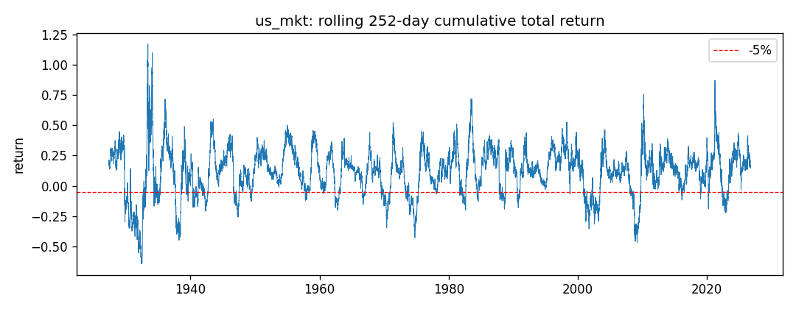

---

# Asset `ind_nodur` — PASS

Source `10_Industry_Portfolios_Daily.csv`, section “Average Value Weighted Returns -- Daily”, column `NoDur` (total return); saved to `data/processed/ind_nodur.parquet` (26338 rows).

## 1. Coverage — PASS

1926-07-01 to 2026-09-30, 26338 trading days.

| year | days | Saturdays | reason |
|---|---|---|---|
| 1926 | 150 | 23 | partial year (sample start/end) |
| 1927 | 301 | 51 | Saturday trading era (51 Saturdays) |
| 1928 | 295 | 45 | Saturday trading era (45 Saturdays) |
| 1929 | 291 | 42 | Saturday trading era (42 Saturdays) |
| 1930 | 298 | 47 | Saturday trading era (47 Saturdays) |
| 1931 | 300 | 48 | Saturday trading era (48 Saturdays) |
| 1932 | 302 | 52 | Saturday trading era (52 Saturdays) |
| 1933 | 285 | 43 | Saturday trading era (43 Saturdays) |
| 1934 | 301 | 52 | Saturday trading era (52 Saturdays) |
| 1935 | 301 | 51 | Saturday trading era (51 Saturdays) |
| 1936 | 301 | 48 | Saturday trading era (48 Saturdays) |
| 1937 | 299 | 49 | Saturday trading era (49 Saturdays) |
| 1938 | 301 | 51 | Saturday trading era (51 Saturdays) |
| 1939 | 300 | 51 | Saturday trading era (51 Saturdays) |
| 1940 | 302 | 51 | Saturday trading era (51 Saturdays) |
| 1941 | 301 | 51 | Saturday trading era (51 Saturdays) |
| 1942 | 301 | 50 | Saturday trading era (50 Saturdays) |
| 1943 | 301 | 51 | Saturday trading era (51 Saturdays) |
| 1944 | 298 | 47 | Saturday trading era (47 Saturdays) |
| 1945 | 286 | 40 | Saturday trading era (40 Saturdays) |
| 1946 | 281 | 31 | Saturday trading era (31 Saturdays) |
| 1947 | 283 | 33 | Saturday trading era (33 Saturdays) |
| 1948 | 283 | 32 | Saturday trading era (32 Saturdays) |
| 1949 | 282 | 32 | Saturday trading era (32 Saturdays) |
| 1950 | 281 | 32 | Saturday trading era (32 Saturdays) |
| 1951 | 283 | 34 | Saturday trading era (34 Saturdays) |
| 1952 | 271 | 21 | Saturday trading era (21 Saturdays) |
| 1968 | 226 | 0 | explained in config: NYSE closed on Wednesdays Jun-Dec 1968 (paperwork crisis); verified: 0-1 Wednesday sessions/month Jun-Dec in the data |
| 2026 | 187 | 0 | partial year (sample start/end) |

Trading days per year

1926: 150, 1927: 301, 1928: 295, 1929: 291, 1930: 298, 1931: 300, 1932: 302, 1933: 285, 1934: 301, 1935: 301, 1936: 301, 1937: 299, 1938: 301, 1939: 300, 1940: 302, 1941: 301, 1942: 301, 1943: 301, 1944: 298, 1945: 286, 1946: 281, 1947: 283, 1948: 283, 1949: 282, 1950: 281, 1951: 283, 1952: 271, 1953: 251, 1954: 252, 1955: 252, 1956: 251, 1957: 252, 1958: 252, 1959: 253, 1960: 252, 1961: 250, 1962: 252, 1963: 251, 1964: 253, 1965: 252, 1966: 252, 1967: 251, 1968: 226, 1969: 250, 1970: 254, 1971: 253, 1972: 251, 1973: 252, 1974: 253, 1975: 253, 1976: 253, 1977: 252, 1978: 252, 1979: 253, 1980: 253, 1981: 253, 1982: 253, 1983: 253, 1984: 253, 1985: 252, 1986: 253, 1987: 253, 1988: 253, 1989: 252, 1990: 253, 1991: 253, 1992: 254, 1993: 253, 1994: 252, 1995: 252, 1996: 254, 1997: 253, 1998: 252, 1999: 252, 2000: 252, 2001: 248, 2002: 252, 2003: 252, 2004: 252, 2005: 252, 2006: 251, 2007: 251, 2008: 253, 2009: 252, 2010: 252, 2011: 252, 2012: 250, 2013: 252, 2014: 252, 2015: 252, 2016: 252, 2017: 251, 2018: 251, 2019: 252, 2020: 253, 2021: 252, 2022: 251, 2023: 250, 2024: 252, 2025: 250, 2026: 187

## 2. Dates — PASS

Strictly increasing: True; unique: True; weekend dates after 1952: 0.

Gaps > 4 calendar days:

| last date before | next date | calendar days |
|---|---|---|
| 1929-11-27 | 1929-12-02 | 5 |
| 1933-03-03 | 1933-03-15 | 12 |
| 1956-12-21 | 1956-12-26 | 5 |
| 1958-12-24 | 1958-12-29 | 5 |
| 1961-05-26 | 1961-05-31 | 5 |
| 1968-07-03 | 1968-07-08 | 5 |
| 2001-09-10 | 2001-09-17 | 7 |
| 2006-12-29 | 2007-01-03 | 5 |
| 2012-10-26 | 2012-10-31 | 5 |

## 3. Missing values — PASS

- Sentinel (-99.99 / -999) counts: source {'NoDur': 0, 'Durbl': 0, 'Manuf': 0, 'Enrgy': 0, 'HiTec': 0, 'Telcm': 0, 'Shops': 0, 'Hlth': 0, 'Utils': 0, 'Other': 0}; rf_daily {'Mkt-RF': 0, 'SMB': 0, 'HML': 0, 'RF': 0}; rf_monthly {'Mkt-RF': 0, 'SMB': 0, 'HML': 0, 'RF': 0}
- Missing in the columns used: {'source:NoDur': 0, 'rf_daily:RF': 0}
- NaN in asset frame: {'r': 0, 'rf': 0, 'x': 0, 'rf_ann': 0}
- Rows dropped — asset_dates_not_in_rf (inner join): 0
- Rows dropped — rf_dates_not_in_asset (inner join): 0
- Rows dropped — nan_in_r_or_rf: 0
- rf_ann days filled from an earlier month (monthly rate not yet published): 0; days with no monthly rate: 0

## 4. Units sanity — PASS

median daily r = 0.00070, std = 0.00876 (bounds in config `checks.units`).

## 5. Extreme days — PASS

| rank | date | r | x |
|---|---|---|---|
| 1 | 1987-10-19 | -17.04% | -18.71% |
| 2 | 1933-03-15 | 13.97% | 13.08% |
| 3 | 2008-10-13 | 10.24% | 9.75% |
| 4 | 1929-10-30 | 9.89% | 9.41% |
| 5 | 2020-03-12 | -9.87% | -10.40% |
| 6 | 1931-10-06 | 9.59% | 9.16% |
| 7 | 1929-10-28 | -9.25% | -9.73% |
| 8 | 1987-10-21 | 9.23% | 8.80% |
| 9 | 1929-10-29 | -9.06% | -9.52% |
| 10 | 2020-03-16 | -8.96% | -9.40% |
| 11 | 2008-10-28 | 8.63% | 8.28% |
| 12 | 1987-10-26 | -7.64% | -7.98% |
| 13 | 2020-03-17 | 7.47% | 7.19% |
| 14 | 2020-03-24 | 7.40% | 7.13% |
| 15 | 1932-09-21 | 7.39% | 7.13% |
| 16 | 1937-10-20 | 7.30% | 7.05% |
| 17 | 1931-12-18 | 7.21% | 6.96% |
| 18 | 1933-07-20 | -7.19% | -7.46% |
| 19 | 2020-03-13 | 7.09% | 6.84% |
| 20 | 2008-10-09 | -6.85% | -7.10% |

Expected dates: 1987-10-19 (r = -17.04%, in top: True)

Suspicious |r| > 25%: none

## 8. Summary statistics — PASS

Annualised with N = 252. Skew/kurtosis are of daily x. Worst-window and share columns use overlapping 252- and 504-day cumulative total returns (window assigned to the decade it ends in).

| period | days | mean r | mean x | vol x | skew x | exkurt x | min r | max r | worst 252d | worst 504d | P(252d<-5%) | P(504d<-5%) | mean rf_ann |
|---|---|---|---|---|---|---|---|---|---|---|---|---|---|
| full | 26338 | 10.54% | 6.56% | 13.94% | -0.58 | 21.2 | -17.04% | 13.97% | -52.4% | -58.5% | 15.0% | 12.9% | 3.24% |
| 1920s | 1037 | 11.44% | 7.30% | 15.65% | -1.66 | 32.5 | -9.25% | 9.89% | -28.4% | -13.9% | 5.9% | 3.0% | 3.73% |
| 1930s | 2988 | 4.32% | 2.07% | 19.64% | 0.61 | 9.5 | -7.19% | 13.97% | -52.4% | -58.5% | 36.6% | 44.9% | 0.55% |
| 1940s | 2918 | 8.19% | 7.66% | 10.34% | -1.82 | 16.4 | -6.51% | 4.20% | -26.2% | -24.4% | 25.9% | 24.1% | 0.40% |
| 1950s | 2598 | 11.52% | 9.62% | 7.07% | -1.40 | 12.3 | -5.10% | 1.97% | -3.7% | -1.4% | 0.0% | 0.0% | 1.87% |
| 1960s | 2489 | 10.68% | 6.39% | 9.47% | -0.87 | 12.6 | -6.66% | 4.10% | -33.7% | -18.0% | 17.3% | 6.0% | 3.88% |
| 1970s | 2526 | 6.05% | -0.81% | 12.40% | 0.07 | 2.9 | -3.85% | 4.46% | -46.8% | -50.3% | 27.2% | 25.6% | 6.34% |
| 1980s | 2528 | 24.12% | 14.50% | 15.63% | -3.01 | 59.0 | -17.04% | 9.23% | -18.1% | 6.1% | 4.5% | 0.0% | 8.95% |
| 1990s | 2528 | 12.83% | 7.15% | 13.96% | -0.24 | 4.0 | -5.89% | 4.86% | -16.2% | -7.8% | 6.2% | 0.3% | 4.95% |
| 2000s | 2515 | 8.48% | 4.46% | 16.16% | 0.07 | 9.1 | -6.85% | 10.24% | -33.7% | -28.7% | 20.4% | 17.5% | 2.77% |
| 2010s | 2516 | 12.27% | 10.99% | 12.40% | -0.47 | 2.7 | -4.79% | 3.30% | -16.7% | -6.0% | 2.4% | 0.0% | 0.52% |
| 2020s | 1695 | 6.87% | 2.51% | 17.21% | -0.83 | 14.4 | -9.87% | 7.47% | -21.6% | -20.8% | 3.4% | 1.2% | 2.82% |

## 9. Figures

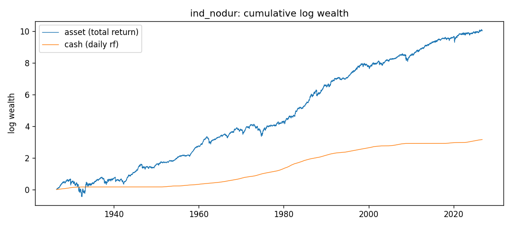
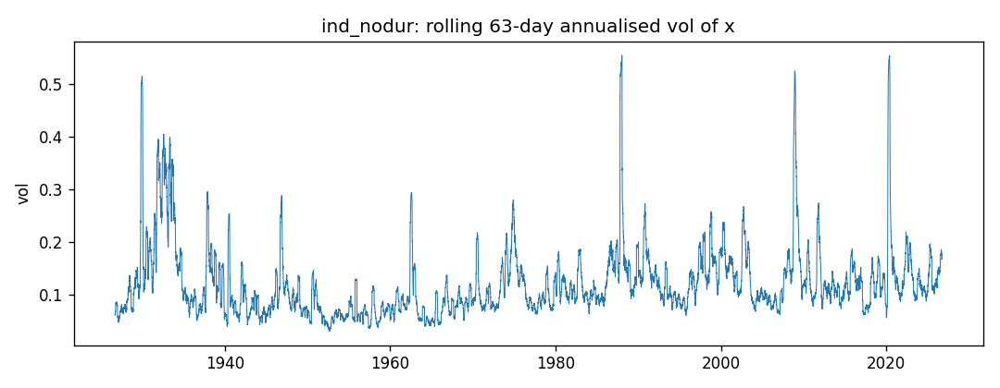

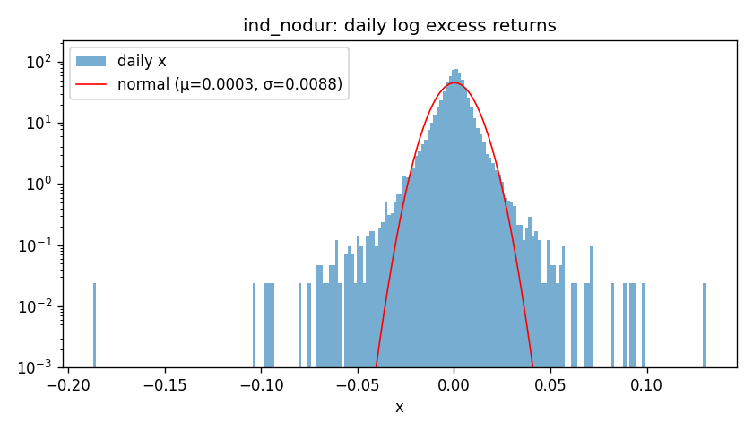
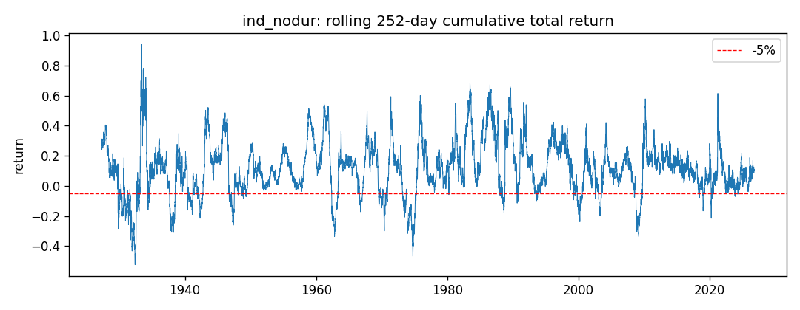

---

# Asset `ind_durbl` — WARN

Source `10_Industry_Portfolios_Daily.csv`, section “Average Value Weighted Returns -- Daily”, column `Durbl` (total return); saved to `data/processed/ind_durbl.parquet` (26338 rows).

## 1. Coverage — PASS

1926-07-01 to 2026-09-30, 26338 trading days.

| year | days | Saturdays | reason |
|---|---|---|---|
| 1926 | 150 | 23 | partial year (sample start/end) |
| 1927 | 301 | 51 | Saturday trading era (51 Saturdays) |
| 1928 | 295 | 45 | Saturday trading era (45 Saturdays) |
| 1929 | 291 | 42 | Saturday trading era (42 Saturdays) |
| 1930 | 298 | 47 | Saturday trading era (47 Saturdays) |
| 1931 | 300 | 48 | Saturday trading era (48 Saturdays) |
| 1932 | 302 | 52 | Saturday trading era (52 Saturdays) |
| 1933 | 285 | 43 | Saturday trading era (43 Saturdays) |
| 1934 | 301 | 52 | Saturday trading era (52 Saturdays) |
| 1935 | 301 | 51 | Saturday trading era (51 Saturdays) |
| 1936 | 301 | 48 | Saturday trading era (48 Saturdays) |
| 1937 | 299 | 49 | Saturday trading era (49 Saturdays) |
| 1938 | 301 | 51 | Saturday trading era (51 Saturdays) |
| 1939 | 300 | 51 | Saturday trading era (51 Saturdays) |
| 1940 | 302 | 51 | Saturday trading era (51 Saturdays) |
| 1941 | 301 | 51 | Saturday trading era (51 Saturdays) |
| 1942 | 301 | 50 | Saturday trading era (50 Saturdays) |
| 1943 | 301 | 51 | Saturday trading era (51 Saturdays) |
| 1944 | 298 | 47 | Saturday trading era (47 Saturdays) |
| 1945 | 286 | 40 | Saturday trading era (40 Saturdays) |
| 1946 | 281 | 31 | Saturday trading era (31 Saturdays) |
| 1947 | 283 | 33 | Saturday trading era (33 Saturdays) |
| 1948 | 283 | 32 | Saturday trading era (32 Saturdays) |
| 1949 | 282 | 32 | Saturday trading era (32 Saturdays) |
| 1950 | 281 | 32 | Saturday trading era (32 Saturdays) |
| 1951 | 283 | 34 | Saturday trading era (34 Saturdays) |
| 1952 | 271 | 21 | Saturday trading era (21 Saturdays) |
| 1968 | 226 | 0 | explained in config: NYSE closed on Wednesdays Jun-Dec 1968 (paperwork crisis); verified: 0-1 Wednesday sessions/month Jun-Dec in the data |
| 2026 | 187 | 0 | partial year (sample start/end) |

Trading days per year

1926: 150, 1927: 301, 1928: 295, 1929: 291, 1930: 298, 1931: 300, 1932: 302, 1933: 285, 1934: 301, 1935: 301, 1936: 301, 1937: 299, 1938: 301, 1939: 300, 1940: 302, 1941: 301, 1942: 301, 1943: 301, 1944: 298, 1945: 286, 1946: 281, 1947: 283, 1948: 283, 1949: 282, 1950: 281, 1951: 283, 1952: 271, 1953: 251, 1954: 252, 1955: 252, 1956: 251, 1957: 252, 1958: 252, 1959: 253, 1960: 252, 1961: 250, 1962: 252, 1963: 251, 1964: 253, 1965: 252, 1966: 252, 1967: 251, 1968: 226, 1969: 250, 1970: 254, 1971: 253, 1972: 251, 1973: 252, 1974: 253, 1975: 253, 1976: 253, 1977: 252, 1978: 252, 1979: 253, 1980: 253, 1981: 253, 1982: 253, 1983: 253, 1984: 253, 1985: 252, 1986: 253, 1987: 253, 1988: 253, 1989: 252, 1990: 253, 1991: 253, 1992: 254, 1993: 253, 1994: 252, 1995: 252, 1996: 254, 1997: 253, 1998: 252, 1999: 252, 2000: 252, 2001: 248, 2002: 252, 2003: 252, 2004: 252, 2005: 252, 2006: 251, 2007: 251, 2008: 253, 2009: 252, 2010: 252, 2011: 252, 2012: 250, 2013: 252, 2014: 252, 2015: 252, 2016: 252, 2017: 251, 2018: 251, 2019: 252, 2020: 253, 2021: 252, 2022: 251, 2023: 250, 2024: 252, 2025: 250, 2026: 187

## 2. Dates — PASS

Strictly increasing: True; unique: True; weekend dates after 1952: 0.

Gaps > 4 calendar days:

| last date before | next date | calendar days |
|---|---|---|
| 1929-11-27 | 1929-12-02 | 5 |
| 1933-03-03 | 1933-03-15 | 12 |
| 1956-12-21 | 1956-12-26 | 5 |
| 1958-12-24 | 1958-12-29 | 5 |
| 1961-05-26 | 1961-05-31 | 5 |
| 1968-07-03 | 1968-07-08 | 5 |
| 2001-09-10 | 2001-09-17 | 7 |
| 2006-12-29 | 2007-01-03 | 5 |
| 2012-10-26 | 2012-10-31 | 5 |

## 3. Missing values — PASS

- Sentinel (-99.99 / -999) counts: source {'NoDur': 0, 'Durbl': 0, 'Manuf': 0, 'Enrgy': 0, 'HiTec': 0, 'Telcm': 0, 'Shops': 0, 'Hlth': 0, 'Utils': 0, 'Other': 0}; rf_daily {'Mkt-RF': 0, 'SMB': 0, 'HML': 0, 'RF': 0}; rf_monthly {'Mkt-RF': 0, 'SMB': 0, 'HML': 0, 'RF': 0}
- Missing in the columns used: {'source:Durbl': 0, 'rf_daily:RF': 0}
- NaN in asset frame: {'r': 0, 'rf': 0, 'x': 0, 'rf_ann': 0}
- Rows dropped — asset_dates_not_in_rf (inner join): 0
- Rows dropped — rf_dates_not_in_asset (inner join): 0
- Rows dropped — nan_in_r_or_rf: 0
- rf_ann days filled from an earlier month (monthly rate not yet published): 0; days with no monthly rate: 0

## 4. Units sanity — PASS

median daily r = 0.00040, std = 0.01640 (bounds in config `checks.units`).

## 5. Extreme days — WARN

| rank | date | r | x |
|---|---|---|---|
| 1 | 1933-03-15 | 27.06% | 23.95% |
| 2 | 1929-10-30 | 19.87% | 18.10% |
| 3 | 2025-04-09 | 18.89% | 17.28% |
| 4 | 1987-10-19 | -17.98% | -19.85% |
| 5 | 1932-09-21 | 16.78% | 15.51% |
| 6 | 1929-10-29 | -16.70% | -18.29% |
| 7 | 1933-07-21 | -15.55% | -16.90% |
| 8 | 2020-03-24 | 14.98% | 13.95% |
| 9 | 2024-10-24 | 14.75% | 13.74% |
| 10 | 2020-03-16 | -14.49% | -15.66% |
| 11 | 1933-07-24 | 13.81% | 12.94% |
| 12 | 1934-07-26 | -12.92% | -13.83% |
| 13 | 1932-11-10 | 12.38% | 11.67% |
| 14 | 2020-09-08 | -12.21% | -13.02% |
| 15 | 1929-10-28 | -12.09% | -12.91% |
| 16 | 2001-09-17 | -11.86% | -12.64% |
| 17 | 1932-08-03 | 11.83% | 11.18% |
| 18 | 1937-10-18 | -11.69% | -12.43% |
| 19 | 2020-03-18 | -11.62% | -12.36% |
| 20 | 1940-05-14 | -11.59% | -12.32% |

Expected dates: 1987-10-19 (r = -17.98%, in top: True)

Suspicious |r| > 25%: 1933-03-15 (27.06%, 12 calendar days after the previous observation)
- 1 days with |r| > 25%

## 8. Summary statistics — PASS

Annualised with N = 252. Skew/kurtosis are of daily x. Worst-window and share columns use overlapping 252- and 504-day cumulative total returns (window assigned to the decade it ends in).

| period | days | mean r | mean x | vol x | skew x | exkurt x | min r | max r | worst 252d | worst 504d | P(252d<-5%) | P(504d<-5%) | mean rf_ann |
|---|---|---|---|---|---|---|---|---|---|---|---|---|---|
| full | 26338 | 13.06% | 6.67% | 26.00% | -0.04 | 12.3 | -17.98% | 27.06% | -74.8% | -76.5% | 26.3% | 23.0% | 3.24% |
| 1920s | 1037 | 16.11% | 9.13% | 28.57% | -0.88 | 25.0 | -16.70% | 19.87% | -56.7% | -41.0% | 15.9% | 8.4% | 3.73% |
| 1930s | 2988 | 13.66% | 4.70% | 41.49% | 0.42 | 5.8 | -15.55% | 27.06% | -74.8% | -76.5% | 50.1% | 51.2% | 0.55% |
| 1940s | 2918 | 10.38% | 8.57% | 19.04% | -0.76 | 9.9 | -11.59% | 7.52% | -35.0% | -33.6% | 24.7% | 29.3% | 0.40% |
| 1950s | 2598 | 20.35% | 17.38% | 16.19% | 0.29 | 6.4 | -7.20% | 9.63% | -22.5% | -25.2% | 11.6% | 6.4% | 1.87% |
| 1960s | 2489 | 8.75% | 3.85% | 14.55% | 0.17 | 2.4 | -4.14% | 5.83% | -27.2% | -14.0% | 19.2% | 9.6% | 3.88% |
| 1970s | 2526 | 5.86% | -1.63% | 16.71% | 0.24 | 2.4 | -4.55% | 6.94% | -46.9% | -58.0% | 33.0% | 33.3% | 6.34% |
| 1980s | 2528 | 16.84% | 6.56% | 19.40% | -1.78 | 30.5 | -17.98% | 8.08% | -24.9% | -13.2% | 14.8% | 1.3% | 8.95% |
| 1990s | 2528 | 13.61% | 7.29% | 17.98% | -0.13 | 2.1 | -6.00% | 5.64% | -31.7% | -26.1% | 15.4% | 13.3% | 4.95% |
| 2000s | 2515 | 2.36% | -4.61% | 29.19% | -0.21 | 5.4 | -11.86% | 9.68% | -69.7% | -75.5% | 49.4% | 47.1% | 2.77% |
| 2010s | 2516 | 12.57% | 9.58% | 22.30% | -0.36 | 3.0 | -8.93% | 6.73% | -30.4% | -22.0% | 22.6% | 12.8% | 0.52% |
| 2020s | 1695 | 30.81% | 17.04% | 46.64% | -0.14 | 2.8 | -14.49% | 18.89% | -61.2% | -46.1% | 19.9% | 23.2% | 2.82% |

## 9. Figures

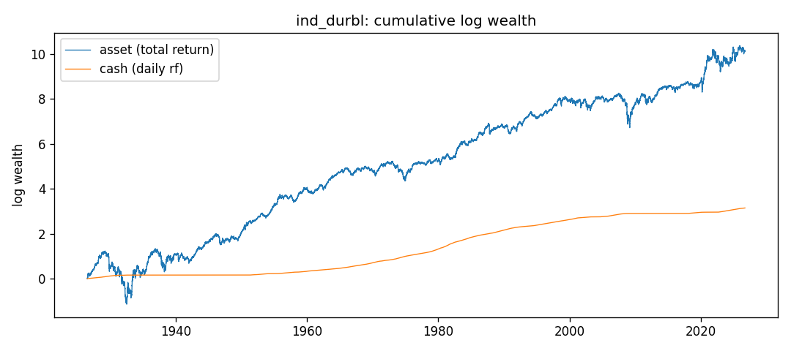
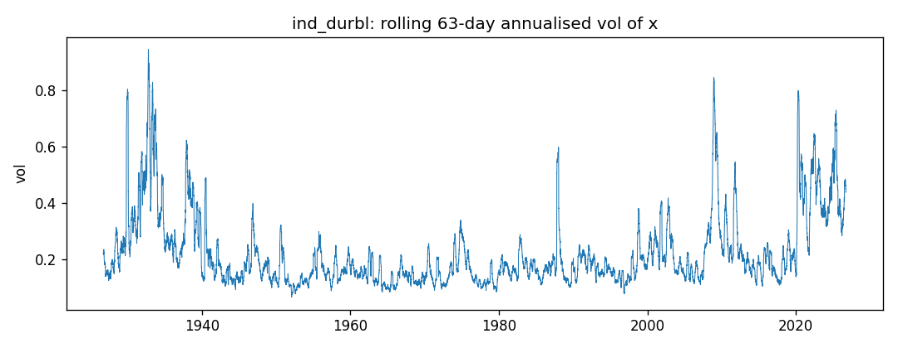

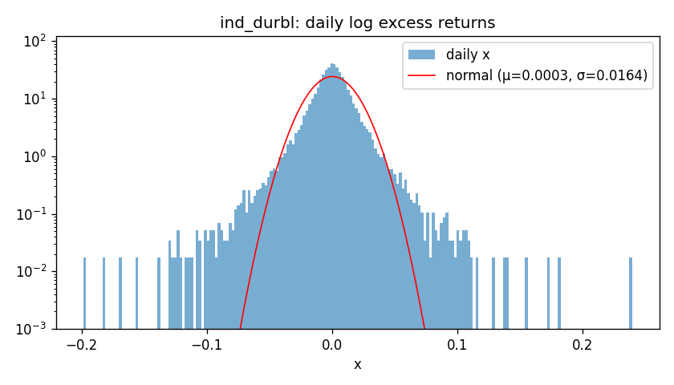
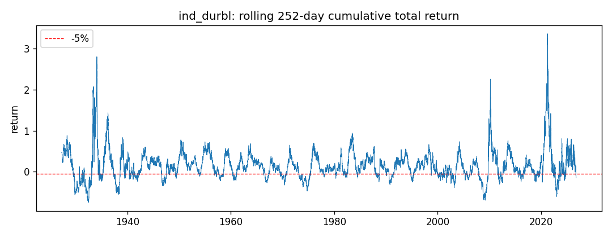

---

# Asset `ind_manuf` — PASS

Source `10_Industry_Portfolios_Daily.csv`, section “Average Value Weighted Returns -- Daily”, column `Manuf` (total return); saved to `data/processed/ind_manuf.parquet` (26338 rows).

## 1. Coverage — PASS

1926-07-01 to 2026-09-30, 26338 trading days.

| year | days | Saturdays | reason |
|---|---|---|---|
| 1926 | 150 | 23 | partial year (sample start/end) |
| 1927 | 301 | 51 | Saturday trading era (51 Saturdays) |
| 1928 | 295 | 45 | Saturday trading era (45 Saturdays) |
| 1929 | 291 | 42 | Saturday trading era (42 Saturdays) |
| 1930 | 298 | 47 | Saturday trading era (47 Saturdays) |
| 1931 | 300 | 48 | Saturday trading era (48 Saturdays) |
| 1932 | 302 | 52 | Saturday trading era (52 Saturdays) |
| 1933 | 285 | 43 | Saturday trading era (43 Saturdays) |
| 1934 | 301 | 52 | Saturday trading era (52 Saturdays) |
| 1935 | 301 | 51 | Saturday trading era (51 Saturdays) |
| 1936 | 301 | 48 | Saturday trading era (48 Saturdays) |
| 1937 | 299 | 49 | Saturday trading era (49 Saturdays) |
| 1938 | 301 | 51 | Saturday trading era (51 Saturdays) |
| 1939 | 300 | 51 | Saturday trading era (51 Saturdays) |
| 1940 | 302 | 51 | Saturday trading era (51 Saturdays) |
| 1941 | 301 | 51 | Saturday trading era (51 Saturdays) |
| 1942 | 301 | 50 | Saturday trading era (50 Saturdays) |
| 1943 | 301 | 51 | Saturday trading era (51 Saturdays) |
| 1944 | 298 | 47 | Saturday trading era (47 Saturdays) |
| 1945 | 286 | 40 | Saturday trading era (40 Saturdays) |
| 1946 | 281 | 31 | Saturday trading era (31 Saturdays) |
| 1947 | 283 | 33 | Saturday trading era (33 Saturdays) |
| 1948 | 283 | 32 | Saturday trading era (32 Saturdays) |
| 1949 | 282 | 32 | Saturday trading era (32 Saturdays) |
| 1950 | 281 | 32 | Saturday trading era (32 Saturdays) |
| 1951 | 283 | 34 | Saturday trading era (34 Saturdays) |
| 1952 | 271 | 21 | Saturday trading era (21 Saturdays) |
| 1968 | 226 | 0 | explained in config: NYSE closed on Wednesdays Jun-Dec 1968 (paperwork crisis); verified: 0-1 Wednesday sessions/month Jun-Dec in the data |
| 2026 | 187 | 0 | partial year (sample start/end) |

Trading days per year

1926: 150, 1927: 301, 1928: 295, 1929: 291, 1930: 298, 1931: 300, 1932: 302, 1933: 285, 1934: 301, 1935: 301, 1936: 301, 1937: 299, 1938: 301, 1939: 300, 1940: 302, 1941: 301, 1942: 301, 1943: 301, 1944: 298, 1945: 286, 1946: 281, 1947: 283, 1948: 283, 1949: 282, 1950: 281, 1951: 283, 1952: 271, 1953: 251, 1954: 252, 1955: 252, 1956: 251, 1957: 252, 1958: 252, 1959: 253, 1960: 252, 1961: 250, 1962: 252, 1963: 251, 1964: 253, 1965: 252, 1966: 252, 1967: 251, 1968: 226, 1969: 250, 1970: 254, 1971: 253, 1972: 251, 1973: 252, 1974: 253, 1975: 253, 1976: 253, 1977: 252, 1978: 252, 1979: 253, 1980: 253, 1981: 253, 1982: 253, 1983: 253, 1984: 253, 1985: 252, 1986: 253, 1987: 253, 1988: 253, 1989: 252, 1990: 253, 1991: 253, 1992: 254, 1993: 253, 1994: 252, 1995: 252, 1996: 254, 1997: 253, 1998: 252, 1999: 252, 2000: 252, 2001: 248, 2002: 252, 2003: 252, 2004: 252, 2005: 252, 2006: 251, 2007: 251, 2008: 253, 2009: 252, 2010: 252, 2011: 252, 2012: 250, 2013: 252, 2014: 252, 2015: 252, 2016: 252, 2017: 251, 2018: 251, 2019: 252, 2020: 253, 2021: 252, 2022: 251, 2023: 250, 2024: 252, 2025: 250, 2026: 187

## 2. Dates — PASS

Strictly increasing: True; unique: True; weekend dates after 1952: 0.

Gaps > 4 calendar days:

| last date before | next date | calendar days |
|---|---|---|
| 1929-11-27 | 1929-12-02 | 5 |
| 1933-03-03 | 1933-03-15 | 12 |
| 1956-12-21 | 1956-12-26 | 5 |
| 1958-12-24 | 1958-12-29 | 5 |
| 1961-05-26 | 1961-05-31 | 5 |
| 1968-07-03 | 1968-07-08 | 5 |
| 2001-09-10 | 2001-09-17 | 7 |
| 2006-12-29 | 2007-01-03 | 5 |
| 2012-10-26 | 2012-10-31 | 5 |

## 3. Missing values — PASS

- Sentinel (-99.99 / -999) counts: source {'NoDur': 0, 'Durbl': 0, 'Manuf': 0, 'Enrgy': 0, 'HiTec': 0, 'Telcm': 0, 'Shops': 0, 'Hlth': 0, 'Utils': 0, 'Other': 0}; rf_daily {'Mkt-RF': 0, 'SMB': 0, 'HML': 0, 'RF': 0}; rf_monthly {'Mkt-RF': 0, 'SMB': 0, 'HML': 0, 'RF': 0}
- Missing in the columns used: {'source:Manuf': 0, 'rf_daily:RF': 0}
- NaN in asset frame: {'r': 0, 'rf': 0, 'x': 0, 'rf_ann': 0}
- Rows dropped — asset_dates_not_in_rf (inner join): 0
- Rows dropped — rf_dates_not_in_asset (inner join): 0
- Rows dropped — nan_in_r_or_rf: 0
- rf_ann days filled from an earlier month (monthly rate not yet published): 0; days with no monthly rate: 0

## 4. Units sanity — PASS

median daily r = 0.00070, std = 0.01195 (bounds in config `checks.units`).

## 5. Extreme days — PASS

| rank | date | r | x |
|---|---|---|---|
| 1 | 1933-03-15 | 21.97% | 19.86% |
| 2 | 1987-10-19 | -20.08% | -22.44% |
| 3 | 1932-09-21 | 14.92% | 13.91% |
| 4 | 1939-09-05 | 12.27% | 11.57% |
| 5 | 1929-10-28 | -12.04% | -12.85% |
| 6 | 1929-10-29 | -12.00% | -12.80% |
| 7 | 1933-04-19 | 11.37% | 10.77% |
| 8 | 1931-10-06 | 11.35% | 10.75% |
| 9 | 2020-03-16 | -11.03% | -11.70% |
| 10 | 1929-10-30 | 10.99% | 10.41% |
| 11 | 1929-11-06 | -10.87% | -11.53% |
| 12 | 2008-10-13 | 10.72% | 10.18% |
| 13 | 2020-03-24 | 10.69% | 10.15% |
| 14 | 1932-10-11 | 10.51% | 9.99% |
| 15 | 2020-03-12 | -10.27% | -10.85% |
| 16 | 1932-07-15 | 10.26% | 9.77% |
| 17 | 1933-07-21 | -10.09% | -10.64% |
| 18 | 2008-10-28 | 9.94% | 9.48% |
| 19 | 2008-10-15 | -9.77% | -10.28% |
| 20 | 1932-09-02 | 9.74% | 9.29% |

Expected dates: 1987-10-19 (r = -20.08%, in top: True)

Suspicious |r| > 25%: none

## 8. Summary statistics — PASS

Annualised with N = 252. Skew/kurtosis are of daily x. Worst-window and share columns use overlapping 252- and 504-day cumulative total returns (window assigned to the decade it ends in).

| period | days | mean r | mean x | vol x | skew x | exkurt x | min r | max r | worst 252d | worst 504d | P(252d<-5%) | P(504d<-5%) | mean rf_ann |
|---|---|---|---|---|---|---|---|---|---|---|---|---|---|
| full | 26338 | 11.40% | 6.58% | 18.99% | -0.32 | 19.4 | -20.08% | 21.97% | -68.4% | -79.0% | 19.9% | 14.2% | 3.24% |
| 1920s | 1037 | 20.18% | 14.93% | 21.66% | -2.12 | 26.5 | -12.04% | 10.99% | -28.7% | 10.2% | 5.3% | 0.0% | 3.73% |
| 1930s | 2988 | 6.45% | 0.74% | 32.80% | 0.54 | 7.1 | -10.09% | 21.97% | -68.4% | -79.0% | 44.7% | 46.1% | 0.55% |
| 1940s | 2918 | 8.22% | 7.15% | 14.61% | -1.40 | 13.0 | -8.36% | 6.33% | -26.0% | -22.5% | 22.9% | 18.6% | 0.40% |
| 1950s | 2598 | 18.85% | 16.47% | 12.07% | -1.03 | 9.2 | -7.94% | 5.05% | -18.9% | -15.8% | 9.2% | 4.5% | 1.87% |
| 1960s | 2489 | 6.40% | 1.97% | 10.88% | -0.30 | 6.1 | -6.21% | 4.75% | -27.6% | -19.9% | 23.0% | 4.4% | 3.88% |
| 1970s | 2526 | 6.51% | -0.72% | 15.04% | 0.21 | 2.3 | -3.73% | 5.87% | -42.8% | -41.6% | 34.0% | 26.4% | 6.34% |
| 1980s | 2528 | 15.56% | 5.81% | 16.50% | -4.31 | 92.8 | -20.08% | 8.88% | -26.2% | -17.1% | 15.4% | 1.4% | 8.95% |
| 1990s | 2528 | 15.89% | 10.30% | 13.30% | -0.39 | 4.5 | -6.43% | 4.82% | -19.0% | 1.8% | 5.4% | 0.0% | 4.95% |
| 2000s | 2515 | 7.53% | 2.30% | 22.43% | -0.28 | 6.6 | -9.77% | 10.72% | -54.1% | -50.2% | 20.9% | 22.1% | 2.77% |
| 2010s | 2516 | 13.58% | 11.69% | 16.64% | -0.46 | 4.0 | -7.16% | 5.30% | -17.9% | -23.4% | 6.8% | 7.0% | 0.52% |
| 2020s | 1695 | 12.97% | 7.62% | 22.19% | -0.45 | 10.5 | -11.03% | 10.69% | -29.4% | -30.9% | 14.6% | 5.4% | 2.82% |

## 9. Figures

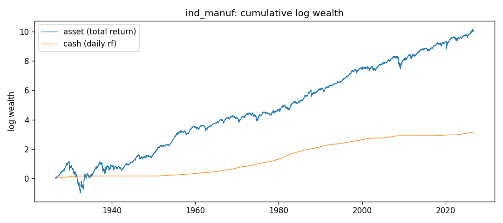
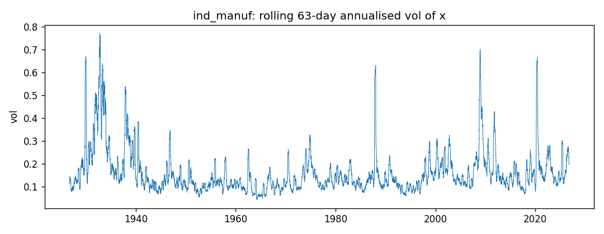

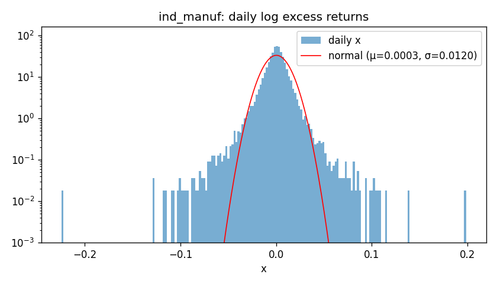
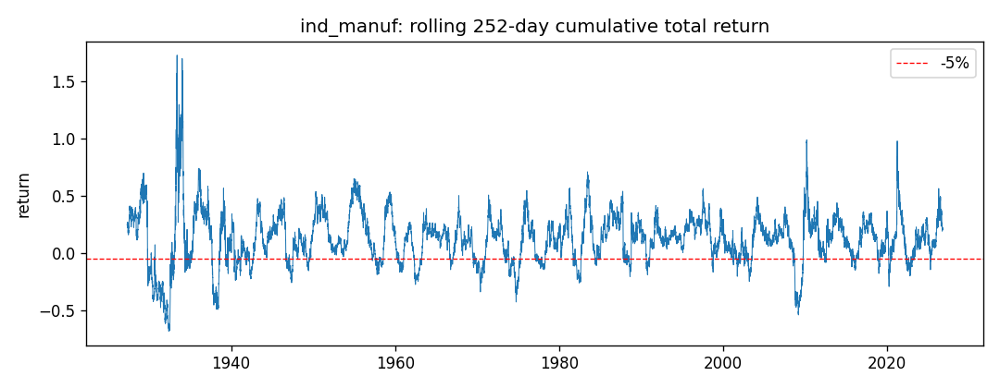

---

# Asset `ind_enrgy` — PASS

Source `10_Industry_Portfolios_Daily.csv`, section “Average Value Weighted Returns -- Daily”, column `Enrgy` (total return); saved to `data/processed/ind_enrgy.parquet` (26338 rows).

## 1. Coverage — PASS

1926-07-01 to 2026-09-30, 26338 trading days.

| year | days | Saturdays | reason |
|---|---|---|---|
| 1926 | 150 | 23 | partial year (sample start/end) |
| 1927 | 301 | 51 | Saturday trading era (51 Saturdays) |
| 1928 | 295 | 45 | Saturday trading era (45 Saturdays) |
| 1929 | 291 | 42 | Saturday trading era (42 Saturdays) |
| 1930 | 298 | 47 | Saturday trading era (47 Saturdays) |
| 1931 | 300 | 48 | Saturday trading era (48 Saturdays) |
| 1932 | 302 | 52 | Saturday trading era (52 Saturdays) |
| 1933 | 285 | 43 | Saturday trading era (43 Saturdays) |
| 1934 | 301 | 52 | Saturday trading era (52 Saturdays) |
| 1935 | 301 | 51 | Saturday trading era (51 Saturdays) |
| 1936 | 301 | 48 | Saturday trading era (48 Saturdays) |
| 1937 | 299 | 49 | Saturday trading era (49 Saturdays) |
| 1938 | 301 | 51 | Saturday trading era (51 Saturdays) |
| 1939 | 300 | 51 | Saturday trading era (51 Saturdays) |
| 1940 | 302 | 51 | Saturday trading era (51 Saturdays) |
| 1941 | 301 | 51 | Saturday trading era (51 Saturdays) |
| 1942 | 301 | 50 | Saturday trading era (50 Saturdays) |
| 1943 | 301 | 51 | Saturday trading era (51 Saturdays) |
| 1944 | 298 | 47 | Saturday trading era (47 Saturdays) |
| 1945 | 286 | 40 | Saturday trading era (40 Saturdays) |
| 1946 | 281 | 31 | Saturday trading era (31 Saturdays) |
| 1947 | 283 | 33 | Saturday trading era (33 Saturdays) |
| 1948 | 283 | 32 | Saturday trading era (32 Saturdays) |
| 1949 | 282 | 32 | Saturday trading era (32 Saturdays) |
| 1950 | 281 | 32 | Saturday trading era (32 Saturdays) |
| 1951 | 283 | 34 | Saturday trading era (34 Saturdays) |
| 1952 | 271 | 21 | Saturday trading era (21 Saturdays) |
| 1968 | 226 | 0 | explained in config: NYSE closed on Wednesdays Jun-Dec 1968 (paperwork crisis); verified: 0-1 Wednesday sessions/month Jun-Dec in the data |
| 2026 | 187 | 0 | partial year (sample start/end) |

Trading days per year

1926: 150, 1927: 301, 1928: 295, 1929: 291, 1930: 298, 1931: 300, 1932: 302, 1933: 285, 1934: 301, 1935: 301, 1936: 301, 1937: 299, 1938: 301, 1939: 300, 1940: 302, 1941: 301, 1942: 301, 1943: 301, 1944: 298, 1945: 286, 1946: 281, 1947: 283, 1948: 283, 1949: 282, 1950: 281, 1951: 283, 1952: 271, 1953: 251, 1954: 252, 1955: 252, 1956: 251, 1957: 252, 1958: 252, 1959: 253, 1960: 252, 1961: 250, 1962: 252, 1963: 251, 1964: 253, 1965: 252, 1966: 252, 1967: 251, 1968: 226, 1969: 250, 1970: 254, 1971: 253, 1972: 251, 1973: 252, 1974: 253, 1975: 253, 1976: 253, 1977: 252, 1978: 252, 1979: 253, 1980: 253, 1981: 253, 1982: 253, 1983: 253, 1984: 253, 1985: 252, 1986: 253, 1987: 253, 1988: 253, 1989: 252, 1990: 253, 1991: 253, 1992: 254, 1993: 253, 1994: 252, 1995: 252, 1996: 254, 1997: 253, 1998: 252, 1999: 252, 2000: 252, 2001: 248, 2002: 252, 2003: 252, 2004: 252, 2005: 252, 2006: 251, 2007: 251, 2008: 253, 2009: 252, 2010: 252, 2011: 252, 2012: 250, 2013: 252, 2014: 252, 2015: 252, 2016: 252, 2017: 251, 2018: 251, 2019: 252, 2020: 253, 2021: 252, 2022: 251, 2023: 250, 2024: 252, 2025: 250, 2026: 187

## 2. Dates — PASS

Strictly increasing: True; unique: True; weekend dates after 1952: 0.

Gaps > 4 calendar days:

| last date before | next date | calendar days |
|---|---|---|
| 1929-11-27 | 1929-12-02 | 5 |
| 1933-03-03 | 1933-03-15 | 12 |
| 1956-12-21 | 1956-12-26 | 5 |
| 1958-12-24 | 1958-12-29 | 5 |
| 1961-05-26 | 1961-05-31 | 5 |
| 1968-07-03 | 1968-07-08 | 5 |
| 2001-09-10 | 2001-09-17 | 7 |
| 2006-12-29 | 2007-01-03 | 5 |
| 2012-10-26 | 2012-10-31 | 5 |

## 3. Missing values — PASS

- Sentinel (-99.99 / -999) counts: source {'NoDur': 0, 'Durbl': 0, 'Manuf': 0, 'Enrgy': 0, 'HiTec': 0, 'Telcm': 0, 'Shops': 0, 'Hlth': 0, 'Utils': 0, 'Other': 0}; rf_daily {'Mkt-RF': 0, 'SMB': 0, 'HML': 0, 'RF': 0}; rf_monthly {'Mkt-RF': 0, 'SMB': 0, 'HML': 0, 'RF': 0}
- Missing in the columns used: {'source:Enrgy': 0, 'rf_daily:RF': 0}
- NaN in asset frame: {'r': 0, 'rf': 0, 'x': 0, 'rf_ann': 0}
- Rows dropped — asset_dates_not_in_rf (inner join): 0
- Rows dropped — rf_dates_not_in_asset (inner join): 0
- Rows dropped — nan_in_r_or_rf: 0
- rf_ann days filled from an earlier month (monthly rate not yet published): 0; days with no monthly rate: 0

## 4. Units sanity — PASS

median daily r = 0.00050, std = 0.01352 (bounds in config `checks.units`).

## 5. Extreme days — PASS

| rank | date | r | x |
|---|---|---|---|
| 1 | 1987-10-19 | -19.85% | -22.16% |
| 2 | 2020-03-09 | -19.68% | -21.93% |
| 3 | 2008-10-13 | 19.18% | 17.55% |
| 4 | 1939-09-05 | 17.29% | 15.95% |
| 5 | 2020-03-24 | 15.99% | 14.82% |
| 6 | 2008-10-15 | -15.29% | -16.59% |
| 7 | 2020-11-09 | 14.12% | 13.21% |
| 8 | 2020-03-16 | -13.37% | -14.36% |
| 9 | 1933-03-15 | 13.35% | 12.53% |
| 10 | 2020-03-18 | -13.08% | -14.03% |
| 11 | 2008-10-28 | 12.02% | 11.35% |
| 12 | 2008-11-21 | 11.90% | 11.24% |
| 13 | 2008-10-09 | -11.73% | -12.48% |
| 14 | 2020-03-12 | -11.58% | -12.32% |
| 15 | 2008-10-20 | 10.95% | 10.39% |
| 16 | 2008-11-20 | -10.93% | -11.57% |
| 17 | 2008-11-13 | 10.92% | 10.36% |
| 18 | 2008-09-29 | -10.71% | -11.34% |
| 19 | 2020-04-17 | 10.63% | 10.10% |
| 20 | 2008-10-22 | -10.20% | -10.76% |

Expected dates: 1987-10-19 (r = -19.85%, in top: True)

Suspicious |r| > 25%: none

## 8. Summary statistics — PASS

Annualised with N = 252. Skew/kurtosis are of daily x. Worst-window and share columns use overlapping 252- and 504-day cumulative total returns (window assigned to the decade it ends in).

| period | days | mean r | mean x | vol x | skew x | exkurt x | min r | max r | worst 252d | worst 504d | P(252d<-5%) | P(504d<-5%) | mean rf_ann |
|---|---|---|---|---|---|---|---|---|---|---|---|---|---|
| full | 26338 | 11.93% | 6.61% | 21.49% | -0.39 | 16.3 | -19.85% | 19.18% | -62.6% | -72.5% | 20.3% | 17.1% | 3.24% |
| 1920s | 1037 | 6.68% | 1.83% | 19.69% | -0.22 | 14.5 | -9.49% | 9.51% | -22.7% | -1.7% | 5.9% | 0.0% | 3.73% |
| 1930s | 2988 | 3.18% | -1.23% | 28.60% | 0.46 | 6.0 | -9.61% | 17.29% | -57.6% | -72.5% | 42.1% | 46.6% | 0.55% |
| 1940s | 2918 | 11.79% | 10.71% | 14.75% | -0.94 | 8.1 | -7.73% | 6.84% | -30.5% | -30.7% | 21.1% | 10.8% | 0.40% |
| 1950s | 2598 | 17.67% | 15.07% | 13.73% | -0.38 | 4.7 | -6.86% | 5.07% | -14.8% | -10.5% | 12.1% | 2.5% | 1.87% |
| 1960s | 2489 | 9.53% | 5.10% | 10.80% | -0.33 | 8.0 | -6.83% | 5.37% | -30.1% | -16.4% | 12.7% | 8.2% | 3.88% |
| 1970s | 2526 | 13.98% | 6.72% | 15.26% | 0.18 | 2.1 | -5.16% | 5.07% | -44.2% | -28.6% | 21.9% | 20.5% | 6.34% |
| 1980s | 2528 | 16.44% | 5.71% | 21.66% | -1.73 | 30.3 | -19.85% | 9.48% | -42.3% | -43.4% | 15.5% | 10.0% | 8.95% |
| 1990s | 2528 | 12.21% | 6.13% | 16.60% | 0.20 | 2.3 | -6.65% | 5.36% | -16.1% | -2.2% | 5.0% | 0.0% | 4.95% |
| 2000s | 2515 | 14.87% | 7.76% | 29.65% | -0.26 | 10.6 | -15.29% | 19.18% | -46.2% | -34.7% | 23.3% | 21.9% | 2.77% |
| 2010s | 2516 | 5.24% | 2.32% | 21.98% | -0.28 | 2.6 | -8.32% | 6.65% | -40.0% | -40.5% | 28.2% | 29.2% | 0.52% |
| 2020s | 1695 | 20.94% | 12.15% | 34.44% | -0.78 | 12.0 | -19.68% | 15.99% | -62.6% | -63.3% | 22.4% | 22.9% | 2.82% |

## 9. Figures

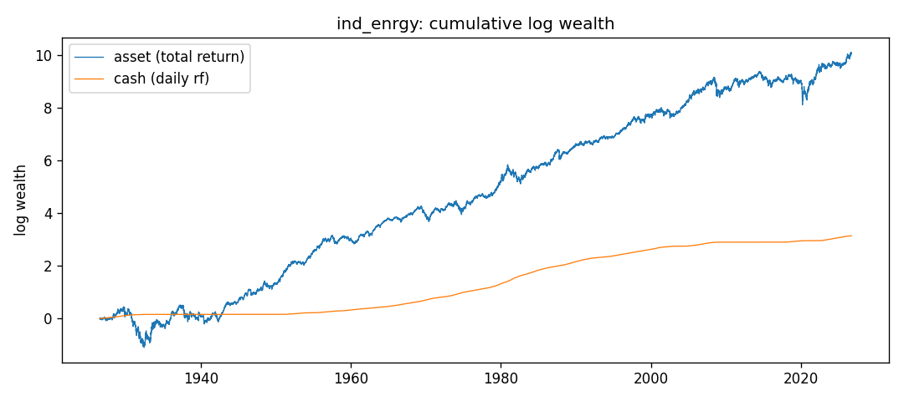
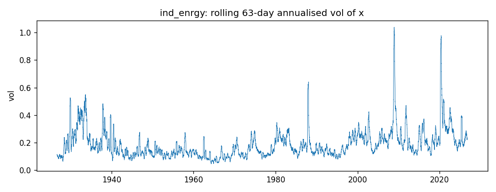

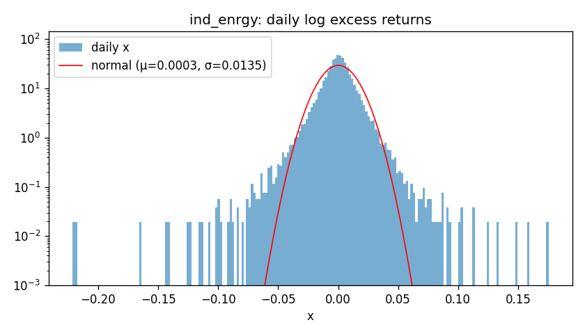
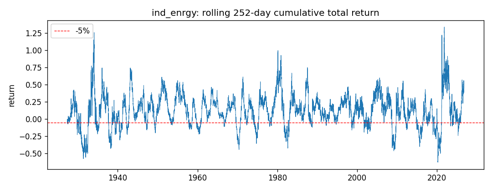

---

# Asset `ind_hitec` — PASS

Source `10_Industry_Portfolios_Daily.csv`, section “Average Value Weighted Returns -- Daily”, column `HiTec` (total return); saved to `data/processed/ind_hitec.parquet` (26338 rows).

## 1. Coverage — PASS

1926-07-01 to 2026-09-30, 26338 trading days.

| year | days | Saturdays | reason |
|---|---|---|---|
| 1926 | 150 | 23 | partial year (sample start/end) |
| 1927 | 301 | 51 | Saturday trading era (51 Saturdays) |
| 1928 | 295 | 45 | Saturday trading era (45 Saturdays) |
| 1929 | 291 | 42 | Saturday trading era (42 Saturdays) |
| 1930 | 298 | 47 | Saturday trading era (47 Saturdays) |
| 1931 | 300 | 48 | Saturday trading era (48 Saturdays) |
| 1932 | 302 | 52 | Saturday trading era (52 Saturdays) |
| 1933 | 285 | 43 | Saturday trading era (43 Saturdays) |
| 1934 | 301 | 52 | Saturday trading era (52 Saturdays) |
| 1935 | 301 | 51 | Saturday trading era (51 Saturdays) |
| 1936 | 301 | 48 | Saturday trading era (48 Saturdays) |
| 1937 | 299 | 49 | Saturday trading era (49 Saturdays) |
| 1938 | 301 | 51 | Saturday trading era (51 Saturdays) |
| 1939 | 300 | 51 | Saturday trading era (51 Saturdays) |
| 1940 | 302 | 51 | Saturday trading era (51 Saturdays) |
| 1941 | 301 | 51 | Saturday trading era (51 Saturdays) |
| 1942 | 301 | 50 | Saturday trading era (50 Saturdays) |
| 1943 | 301 | 51 | Saturday trading era (51 Saturdays) |
| 1944 | 298 | 47 | Saturday trading era (47 Saturdays) |
| 1945 | 286 | 40 | Saturday trading era (40 Saturdays) |
| 1946 | 281 | 31 | Saturday trading era (31 Saturdays) |
| 1947 | 283 | 33 | Saturday trading era (33 Saturdays) |
| 1948 | 283 | 32 | Saturday trading era (32 Saturdays) |
| 1949 | 282 | 32 | Saturday trading era (32 Saturdays) |
| 1950 | 281 | 32 | Saturday trading era (32 Saturdays) |
| 1951 | 283 | 34 | Saturday trading era (34 Saturdays) |
| 1952 | 271 | 21 | Saturday trading era (21 Saturdays) |
| 1968 | 226 | 0 | explained in config: NYSE closed on Wednesdays Jun-Dec 1968 (paperwork crisis); verified: 0-1 Wednesday sessions/month Jun-Dec in the data |
| 2026 | 187 | 0 | partial year (sample start/end) |

Trading days per year

1926: 150, 1927: 301, 1928: 295, 1929: 291, 1930: 298, 1931: 300, 1932: 302, 1933: 285, 1934: 301, 1935: 301, 1936: 301, 1937: 299, 1938: 301, 1939: 300, 1940: 302, 1941: 301, 1942: 301, 1943: 301, 1944: 298, 1945: 286, 1946: 281, 1947: 283, 1948: 283, 1949: 282, 1950: 281, 1951: 283, 1952: 271, 1953: 251, 1954: 252, 1955: 252, 1956: 251, 1957: 252, 1958: 252, 1959: 253, 1960: 252, 1961: 250, 1962: 252, 1963: 251, 1964: 253, 1965: 252, 1966: 252, 1967: 251, 1968: 226, 1969: 250, 1970: 254, 1971: 253, 1972: 251, 1973: 252, 1974: 253, 1975: 253, 1976: 253, 1977: 252, 1978: 252, 1979: 253, 1980: 253, 1981: 253, 1982: 253, 1983: 253, 1984: 253, 1985: 252, 1986: 253, 1987: 253, 1988: 253, 1989: 252, 1990: 253, 1991: 253, 1992: 254, 1993: 253, 1994: 252, 1995: 252, 1996: 254, 1997: 253, 1998: 252, 1999: 252, 2000: 252, 2001: 248, 2002: 252, 2003: 252, 2004: 252, 2005: 252, 2006: 251, 2007: 251, 2008: 253, 2009: 252, 2010: 252, 2011: 252, 2012: 250, 2013: 252, 2014: 252, 2015: 252, 2016: 252, 2017: 251, 2018: 251, 2019: 252, 2020: 253, 2021: 252, 2022: 251, 2023: 250, 2024: 252, 2025: 250, 2026: 187

## 2. Dates — PASS

Strictly increasing: True; unique: True; weekend dates after 1952: 0.

Gaps > 4 calendar days:

| last date before | next date | calendar days |
|---|---|---|
| 1929-11-27 | 1929-12-02 | 5 |
| 1933-03-03 | 1933-03-15 | 12 |
| 1956-12-21 | 1956-12-26 | 5 |
| 1958-12-24 | 1958-12-29 | 5 |
| 1961-05-26 | 1961-05-31 | 5 |
| 1968-07-03 | 1968-07-08 | 5 |
| 2001-09-10 | 2001-09-17 | 7 |
| 2006-12-29 | 2007-01-03 | 5 |
| 2012-10-26 | 2012-10-31 | 5 |

## 3. Missing values — PASS

- Sentinel (-99.99 / -999) counts: source {'NoDur': 0, 'Durbl': 0, 'Manuf': 0, 'Enrgy': 0, 'HiTec': 0, 'Telcm': 0, 'Shops': 0, 'Hlth': 0, 'Utils': 0, 'Other': 0}; rf_daily {'Mkt-RF': 0, 'SMB': 0, 'HML': 0, 'RF': 0}; rf_monthly {'Mkt-RF': 0, 'SMB': 0, 'HML': 0, 'RF': 0}
- Missing in the columns used: {'source:HiTec': 0, 'rf_daily:RF': 0}
- NaN in asset frame: {'r': 0, 'rf': 0, 'x': 0, 'rf_ann': 0}
- Rows dropped — asset_dates_not_in_rf (inner join): 0
- Rows dropped — rf_dates_not_in_asset (inner join): 0
- Rows dropped — nan_in_r_or_rf: 0
- rf_ann days filled from an earlier month (monthly rate not yet published): 0; days with no monthly rate: 0

## 4. Units sanity — PASS

median daily r = 0.00080, std = 0.01487 (bounds in config `checks.units`).

## 5. Extreme days — PASS

| rank | date | r | x |
|---|---|---|---|
| 1 | 1933-03-15 | 20.64% | 18.76% |
| 2 | 1987-10-19 | -19.97% | -22.31% |
| 3 | 1929-10-28 | -16.94% | -18.58% |
| 4 | 2001-01-03 | 16.02% | 14.83% |
| 5 | 1931-10-06 | 15.41% | 14.33% |
| 6 | 1929-10-30 | 15.19% | 14.12% |
| 7 | 1932-09-21 | 15.00% | 13.98% |
| 8 | 1929-11-06 | -14.11% | -15.23% |
| 9 | 1929-10-29 | -14.09% | -15.21% |
| 10 | 1932-02-13 | 13.93% | 13.03% |
| 11 | 2025-04-09 | 13.34% | 12.50% |
| 12 | 2020-03-16 | -13.14% | -14.10% |
| 13 | 1932-05-27 | -13.10% | -14.04% |
| 14 | 2008-10-13 | 11.88% | 11.23% |
| 15 | 1929-11-14 | 11.26% | 10.65% |
| 16 | 2000-12-05 | 11.04% | 10.44% |
| 17 | 2001-04-05 | 10.76% | 10.20% |
| 18 | 1933-07-21 | -10.69% | -11.31% |
| 19 | 2020-03-13 | 10.68% | 10.14% |
| 20 | 1987-10-26 | -10.37% | -10.98% |

Expected dates: 1987-10-19 (r = -19.97%, in top: True)

Suspicious |r| > 25%: none

## 8. Summary statistics — PASS

Annualised with N = 252. Skew/kurtosis are of daily x. Worst-window and share columns use overlapping 252- and 504-day cumulative total returns (window assigned to the decade it ends in).

| period | days | mean r | mean x | vol x | skew x | exkurt x | min r | max r | worst 252d | worst 504d | P(252d<-5%) | P(504d<-5%) | mean rf_ann |
|---|---|---|---|---|---|---|---|---|---|---|---|---|---|
| full | 26338 | 13.34% | 7.54% | 23.60% | -0.17 | 12.5 | -19.97% | 20.64% | -76.4% | -84.2% | 20.2% | 18.4% | 3.24% |
| 1920s | 1037 | 28.60% | 21.78% | 28.06% | -2.09 | 29.4 | -16.94% | 15.19% | -29.1% | 28.3% | 4.2% | 0.0% | 3.73% |
| 1930s | 2988 | 5.52% | -1.92% | 37.71% | 0.31 | 5.0 | -13.10% | 20.64% | -76.4% | -84.2% | 44.3% | 43.2% | 0.55% |
| 1940s | 2918 | 7.98% | 6.86% | 14.95% | -0.71 | 5.8 | -5.97% | 5.95% | -28.0% | -31.9% | 28.4% | 32.0% | 0.40% |
| 1950s | 2598 | 22.98% | 20.47% | 13.11% | -0.56 | 5.5 | -6.58% | 5.01% | -7.7% | 12.3% | 0.5% | 0.0% | 1.87% |
| 1960s | 2489 | 12.89% | 7.74% | 16.18% | -0.15 | 3.8 | -7.23% | 6.44% | -31.9% | -28.7% | 12.2% | 6.4% | 3.88% |
| 1970s | 2526 | 4.75% | -3.17% | 19.14% | 0.38 | 2.5 | -4.71% | 7.26% | -46.6% | -51.9% | 27.9% | 34.5% | 6.34% |
| 1980s | 2528 | 9.95% | -0.49% | 20.27% | -2.28 | 40.5 | -19.97% | 7.47% | -31.7% | -24.7% | 27.5% | 13.2% | 8.95% |
| 1990s | 2528 | 28.19% | 21.04% | 22.04% | -0.31 | 2.8 | -9.48% | 6.93% | -24.8% | -20.6% | 4.9% | 2.7% | 4.95% |
| 2000s | 2515 | -1.09% | -9.10% | 32.50% | 0.27 | 4.1 | -8.56% | 16.02% | -67.0% | -76.6% | 38.8% | 39.9% | 2.77% |
| 2010s | 2516 | 16.93% | 14.85% | 17.75% | -0.40 | 2.9 | -6.12% | 6.00% | -9.8% | -11.0% | 0.8% | 1.1% | 0.52% |
| 2020s | 1695 | 24.65% | 18.19% | 26.73% | -0.27 | 7.6 | -13.14% | 13.34% | -34.8% | -13.9% | 14.2% | 3.6% | 2.82% |

## 9. Figures

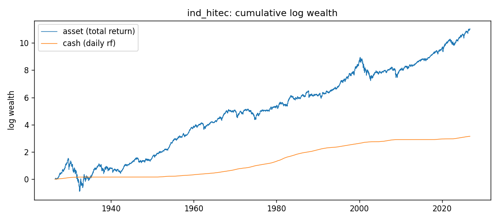
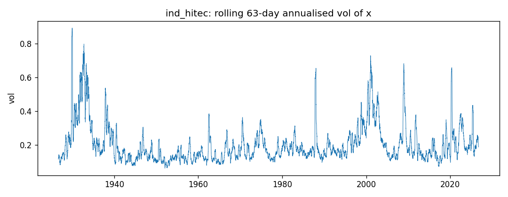

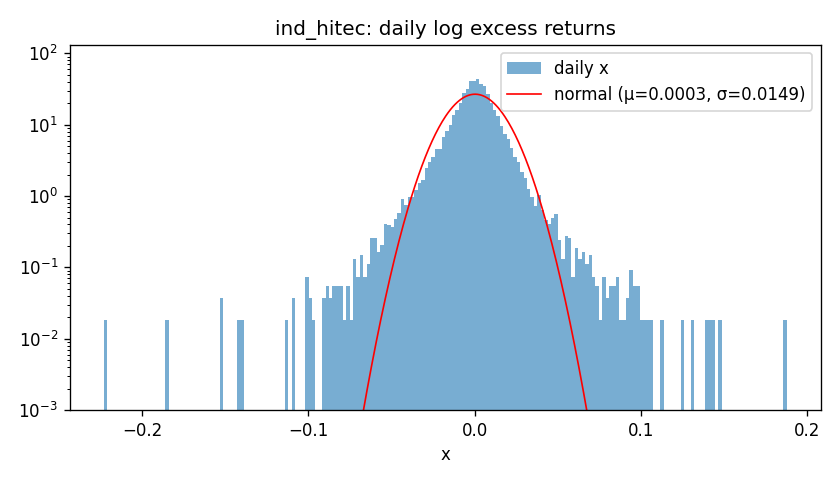
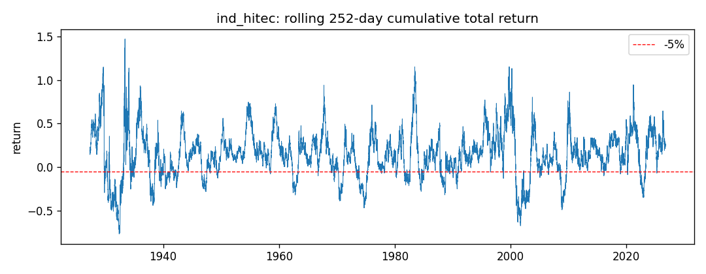

---

# Asset `ind_telcm` — PASS

Source `10_Industry_Portfolios_Daily.csv`, section “Average Value Weighted Returns -- Daily”, column `Telcm` (total return); saved to `data/processed/ind_telcm.parquet` (26338 rows).

## 1. Coverage — PASS

1926-07-01 to 2026-09-30, 26338 trading days.

| year | days | Saturdays | reason |
|---|---|---|---|
| 1926 | 150 | 23 | partial year (sample start/end) |
| 1927 | 301 | 51 | Saturday trading era (51 Saturdays) |
| 1928 | 295 | 45 | Saturday trading era (45 Saturdays) |
| 1929 | 291 | 42 | Saturday trading era (42 Saturdays) |
| 1930 | 298 | 47 | Saturday trading era (47 Saturdays) |
| 1931 | 300 | 48 | Saturday trading era (48 Saturdays) |
| 1932 | 302 | 52 | Saturday trading era (52 Saturdays) |
| 1933 | 285 | 43 | Saturday trading era (43 Saturdays) |
| 1934 | 301 | 52 | Saturday trading era (52 Saturdays) |
| 1935 | 301 | 51 | Saturday trading era (51 Saturdays) |
| 1936 | 301 | 48 | Saturday trading era (48 Saturdays) |
| 1937 | 299 | 49 | Saturday trading era (49 Saturdays) |
| 1938 | 301 | 51 | Saturday trading era (51 Saturdays) |
| 1939 | 300 | 51 | Saturday trading era (51 Saturdays) |
| 1940 | 302 | 51 | Saturday trading era (51 Saturdays) |
| 1941 | 301 | 51 | Saturday trading era (51 Saturdays) |
| 1942 | 301 | 50 | Saturday trading era (50 Saturdays) |
| 1943 | 301 | 51 | Saturday trading era (51 Saturdays) |
| 1944 | 298 | 47 | Saturday trading era (47 Saturdays) |
| 1945 | 286 | 40 | Saturday trading era (40 Saturdays) |
| 1946 | 281 | 31 | Saturday trading era (31 Saturdays) |
| 1947 | 283 | 33 | Saturday trading era (33 Saturdays) |
| 1948 | 283 | 32 | Saturday trading era (32 Saturdays) |
| 1949 | 282 | 32 | Saturday trading era (32 Saturdays) |
| 1950 | 281 | 32 | Saturday trading era (32 Saturdays) |
| 1951 | 283 | 34 | Saturday trading era (34 Saturdays) |
| 1952 | 271 | 21 | Saturday trading era (21 Saturdays) |
| 1968 | 226 | 0 | explained in config: NYSE closed on Wednesdays Jun-Dec 1968 (paperwork crisis); verified: 0-1 Wednesday sessions/month Jun-Dec in the data |
| 2026 | 187 | 0 | partial year (sample start/end) |

Trading days per year

1926: 150, 1927: 301, 1928: 295, 1929: 291, 1930: 298, 1931: 300, 1932: 302, 1933: 285, 1934: 301, 1935: 301, 1936: 301, 1937: 299, 1938: 301, 1939: 300, 1940: 302, 1941: 301, 1942: 301, 1943: 301, 1944: 298, 1945: 286, 1946: 281, 1947: 283, 1948: 283, 1949: 282, 1950: 281, 1951: 283, 1952: 271, 1953: 251, 1954: 252, 1955: 252, 1956: 251, 1957: 252, 1958: 252, 1959: 253, 1960: 252, 1961: 250, 1962: 252, 1963: 251, 1964: 253, 1965: 252, 1966: 252, 1967: 251, 1968: 226, 1969: 250, 1970: 254, 1971: 253, 1972: 251, 1973: 252, 1974: 253, 1975: 253, 1976: 253, 1977: 252, 1978: 252, 1979: 253, 1980: 253, 1981: 253, 1982: 253, 1983: 253, 1984: 253, 1985: 252, 1986: 253, 1987: 253, 1988: 253, 1989: 252, 1990: 253, 1991: 253, 1992: 254, 1993: 253, 1994: 252, 1995: 252, 1996: 254, 1997: 253, 1998: 252, 1999: 252, 2000: 252, 2001: 248, 2002: 252, 2003: 252, 2004: 252, 2005: 252, 2006: 251, 2007: 251, 2008: 253, 2009: 252, 2010: 252, 2011: 252, 2012: 250, 2013: 252, 2014: 252, 2015: 252, 2016: 252, 2017: 251, 2018: 251, 2019: 252, 2020: 253, 2021: 252, 2022: 251, 2023: 250, 2024: 252, 2025: 250, 2026: 187

## 2. Dates — PASS

Strictly increasing: True; unique: True; weekend dates after 1952: 0.

Gaps > 4 calendar days:

| last date before | next date | calendar days |
|---|---|---|
| 1929-11-27 | 1929-12-02 | 5 |
| 1933-03-03 | 1933-03-15 | 12 |
| 1956-12-21 | 1956-12-26 | 5 |
| 1958-12-24 | 1958-12-29 | 5 |
| 1961-05-26 | 1961-05-31 | 5 |
| 1968-07-03 | 1968-07-08 | 5 |
| 2001-09-10 | 2001-09-17 | 7 |
| 2006-12-29 | 2007-01-03 | 5 |
| 2012-10-26 | 2012-10-31 | 5 |

## 3. Missing values — PASS

- Sentinel (-99.99 / -999) counts: source {'NoDur': 0, 'Durbl': 0, 'Manuf': 0, 'Enrgy': 0, 'HiTec': 0, 'Telcm': 0, 'Shops': 0, 'Hlth': 0, 'Utils': 0, 'Other': 0}; rf_daily {'Mkt-RF': 0, 'SMB': 0, 'HML': 0, 'RF': 0}; rf_monthly {'Mkt-RF': 0, 'SMB': 0, 'HML': 0, 'RF': 0}
- Missing in the columns used: {'source:Telcm': 0, 'rf_daily:RF': 0}
- NaN in asset frame: {'r': 0, 'rf': 0, 'x': 0, 'rf_ann': 0}
- Rows dropped — asset_dates_not_in_rf (inner join): 0
- Rows dropped — rf_dates_not_in_asset (inner join): 0
- Rows dropped — nan_in_r_or_rf: 0
- rf_ann days filled from an earlier month (monthly rate not yet published): 0; days with no monthly rate: 0

## 4. Units sanity — PASS

median daily r = 0.00030, std = 0.01039 (bounds in config `checks.units`).

## 5. Extreme days — PASS

| rank | date | r | x |
|---|---|---|---|
| 1 | 1987-10-19 | -16.69% | -18.29% |
| 2 | 1929-10-30 | 15.98% | 14.80% |
| 3 | 2008-10-13 | 14.50% | 13.54% |
| 4 | 2008-10-28 | 13.22% | 12.42% |
| 5 | 1929-10-28 | -12.88% | -13.81% |
| 6 | 1932-02-13 | 11.83% | 11.17% |
| 7 | 1929-10-29 | -10.96% | -11.63% |
| 8 | 1962-05-28 | -9.76% | -10.28% |
| 9 | 2008-10-15 | -9.67% | -10.17% |
| 10 | 1929-11-06 | -9.26% | -9.74% |
| 11 | 2020-03-12 | -9.08% | -9.53% |
| 12 | 2020-03-13 | 9.07% | 8.67% |
| 13 | 1958-12-17 | 8.99% | 8.60% |
| 14 | 1931-10-06 | 8.93% | 8.55% |
| 15 | 2020-03-16 | -8.85% | -9.28% |
| 16 | 2001-01-03 | 8.43% | 8.06% |
| 17 | 2008-09-29 | -8.35% | -8.73% |
| 18 | 2008-12-01 | -7.96% | -8.29% |
| 19 | 1962-05-29 | 7.92% | 7.61% |
| 20 | 1987-10-21 | 7.89% | 7.56% |

Expected dates: 1987-10-19 (r = -16.69%, in top: True)

Suspicious |r| > 25%: none

## 8. Summary statistics — PASS

Annualised with N = 252. Skew/kurtosis are of daily x. Worst-window and share columns use overlapping 252- and 504-day cumulative total returns (window assigned to the decade it ends in).

| period | days | mean r | mean x | vol x | skew x | exkurt x | min r | max r | worst 252d | worst 504d | P(252d<-5%) | P(504d<-5%) | mean rf_ann |
|---|---|---|---|---|---|---|---|---|---|---|---|---|---|
| full | 26338 | 9.48% | 5.10% | 16.49% | -0.17 | 17.2 | -16.69% | 15.98% | -55.0% | -69.2% | 18.0% | 15.6% | 3.24% |
| 1920s | 1037 | 18.60% | 13.81% | 19.34% | -0.86 | 50.6 | -12.88% | 15.98% | 3.3% | 27.8% | 0.0% | 0.0% | 3.73% |
| 1930s | 2988 | 5.75% | 3.24% | 20.92% | 0.65 | 5.4 | -6.13% | 11.83% | -55.0% | -59.4% | 37.2% | 33.3% | 0.55% |
| 1940s | 2918 | 4.44% | 4.04% | 9.00% | -1.05 | 17.1 | -6.37% | 4.81% | -30.4% | -28.3% | 22.0% | 21.0% | 0.40% |
| 1950s | 2598 | 12.24% | 10.32% | 7.35% | 2.27 | 54.3 | -3.84% | 8.99% | -1.6% | 2.8% | 0.0% | 0.0% | 1.87% |
| 1960s | 2489 | 6.49% | 1.71% | 13.71% | 0.35 | 16.4 | -9.76% | 7.92% | -20.5% | -20.3% | 22.5% | 16.3% | 3.88% |
| 1970s | 2526 | 8.36% | 1.55% | 11.93% | 0.01 | 3.1 | -5.08% | 4.25% | -21.0% | -18.6% | 12.7% | 9.4% | 6.34% |
| 1980s | 2528 | 23.00% | 13.18% | 16.84% | -1.88 | 39.2 | -16.69% | 7.89% | -14.2% | -5.3% | 4.8% | 0.1% | 8.95% |
| 1990s | 2528 | 17.58% | 11.63% | 15.79% | -0.15 | 2.9 | -6.35% | 5.10% | -18.5% | -8.6% | 8.5% | 0.9% | 4.95% |
| 2000s | 2515 | -4.71% | -10.78% | 25.86% | 0.13 | 6.7 | -9.67% | 14.50% | -54.1% | -69.2% | 46.5% | 47.2% | 2.77% |
| 2010s | 2516 | 14.45% | 12.85% | 14.77% | -0.52 | 3.3 | -6.60% | 4.65% | -9.7% | -18.1% | 2.4% | 4.0% | 0.52% |
| 2020s | 1695 | 2.35% | -2.54% | 20.04% | -0.54 | 7.7 | -9.08% | 9.07% | -33.4% | -34.5% | 29.6% | 27.3% | 2.82% |

## 9. Figures

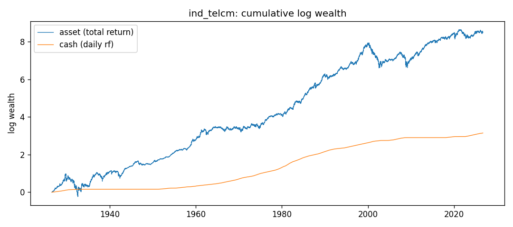
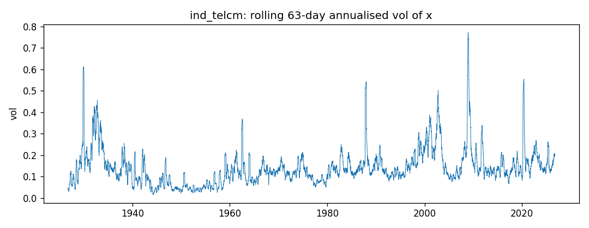

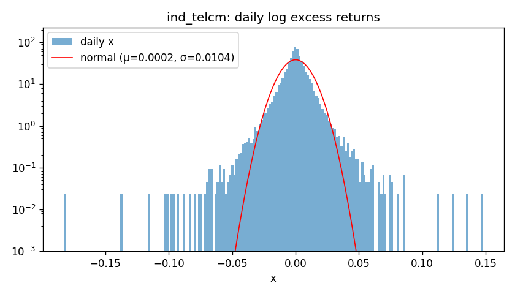
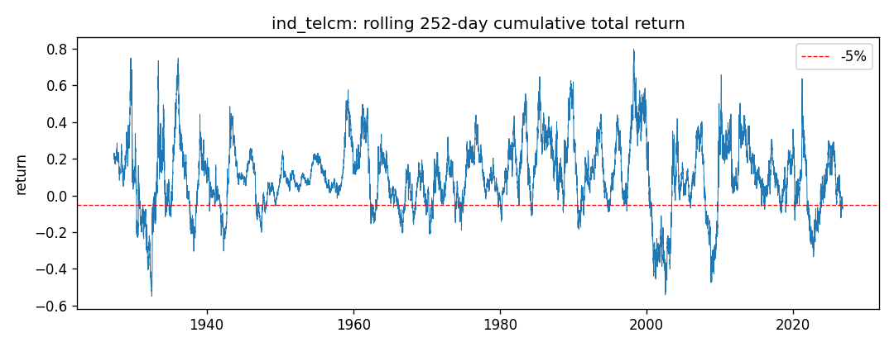

---

# Asset `ind_shops` — PASS

Source `10_Industry_Portfolios_Daily.csv`, section “Average Value Weighted Returns -- Daily”, column `Shops` (total return); saved to `data/processed/ind_shops.parquet` (26338 rows).

## 1. Coverage — PASS

1926-07-01 to 2026-09-30, 26338 trading days.

| year | days | Saturdays | reason |
|---|---|---|---|
| 1926 | 150 | 23 | partial year (sample start/end) |
| 1927 | 301 | 51 | Saturday trading era (51 Saturdays) |
| 1928 | 295 | 45 | Saturday trading era (45 Saturdays) |
| 1929 | 291 | 42 | Saturday trading era (42 Saturdays) |
| 1930 | 298 | 47 | Saturday trading era (47 Saturdays) |
| 1931 | 300 | 48 | Saturday trading era (48 Saturdays) |
| 1932 | 302 | 52 | Saturday trading era (52 Saturdays) |
| 1933 | 285 | 43 | Saturday trading era (43 Saturdays) |
| 1934 | 301 | 52 | Saturday trading era (52 Saturdays) |
| 1935 | 301 | 51 | Saturday trading era (51 Saturdays) |
| 1936 | 301 | 48 | Saturday trading era (48 Saturdays) |
| 1937 | 299 | 49 | Saturday trading era (49 Saturdays) |
| 1938 | 301 | 51 | Saturday trading era (51 Saturdays) |
| 1939 | 300 | 51 | Saturday trading era (51 Saturdays) |
| 1940 | 302 | 51 | Saturday trading era (51 Saturdays) |
| 1941 | 301 | 51 | Saturday trading era (51 Saturdays) |
| 1942 | 301 | 50 | Saturday trading era (50 Saturdays) |
| 1943 | 301 | 51 | Saturday trading era (51 Saturdays) |
| 1944 | 298 | 47 | Saturday trading era (47 Saturdays) |
| 1945 | 286 | 40 | Saturday trading era (40 Saturdays) |
| 1946 | 281 | 31 | Saturday trading era (31 Saturdays) |
| 1947 | 283 | 33 | Saturday trading era (33 Saturdays) |
| 1948 | 283 | 32 | Saturday trading era (32 Saturdays) |
| 1949 | 282 | 32 | Saturday trading era (32 Saturdays) |
| 1950 | 281 | 32 | Saturday trading era (32 Saturdays) |
| 1951 | 283 | 34 | Saturday trading era (34 Saturdays) |
| 1952 | 271 | 21 | Saturday trading era (21 Saturdays) |
| 1968 | 226 | 0 | explained in config: NYSE closed on Wednesdays Jun-Dec 1968 (paperwork crisis); verified: 0-1 Wednesday sessions/month Jun-Dec in the data |
| 2026 | 187 | 0 | partial year (sample start/end) |

Trading days per year

1926: 150, 1927: 301, 1928: 295, 1929: 291, 1930: 298, 1931: 300, 1932: 302, 1933: 285, 1934: 301, 1935: 301, 1936: 301, 1937: 299, 1938: 301, 1939: 300, 1940: 302, 1941: 301, 1942: 301, 1943: 301, 1944: 298, 1945: 286, 1946: 281, 1947: 283, 1948: 283, 1949: 282, 1950: 281, 1951: 283, 1952: 271, 1953: 251, 1954: 252, 1955: 252, 1956: 251, 1957: 252, 1958: 252, 1959: 253, 1960: 252, 1961: 250, 1962: 252, 1963: 251, 1964: 253, 1965: 252, 1966: 252, 1967: 251, 1968: 226, 1969: 250, 1970: 254, 1971: 253, 1972: 251, 1973: 252, 1974: 253, 1975: 253, 1976: 253, 1977: 252, 1978: 252, 1979: 253, 1980: 253, 1981: 253, 1982: 253, 1983: 253, 1984: 253, 1985: 252, 1986: 253, 1987: 253, 1988: 253, 1989: 252, 1990: 253, 1991: 253, 1992: 254, 1993: 253, 1994: 252, 1995: 252, 1996: 254, 1997: 253, 1998: 252, 1999: 252, 2000: 252, 2001: 248, 2002: 252, 2003: 252, 2004: 252, 2005: 252, 2006: 251, 2007: 251, 2008: 253, 2009: 252, 2010: 252, 2011: 252, 2012: 250, 2013: 252, 2014: 252, 2015: 252, 2016: 252, 2017: 251, 2018: 251, 2019: 252, 2020: 253, 2021: 252, 2022: 251, 2023: 250, 2024: 252, 2025: 250, 2026: 187

## 2. Dates — PASS

Strictly increasing: True; unique: True; weekend dates after 1952: 0.

Gaps > 4 calendar days:

| last date before | next date | calendar days |
|---|---|---|
| 1929-11-27 | 1929-12-02 | 5 |
| 1933-03-03 | 1933-03-15 | 12 |
| 1956-12-21 | 1956-12-26 | 5 |
| 1958-12-24 | 1958-12-29 | 5 |
| 1961-05-26 | 1961-05-31 | 5 |
| 1968-07-03 | 1968-07-08 | 5 |
| 2001-09-10 | 2001-09-17 | 7 |
| 2006-12-29 | 2007-01-03 | 5 |
| 2012-10-26 | 2012-10-31 | 5 |

## 3. Missing values — PASS

- Sentinel (-99.99 / -999) counts: source {'NoDur': 0, 'Durbl': 0, 'Manuf': 0, 'Enrgy': 0, 'HiTec': 0, 'Telcm': 0, 'Shops': 0, 'Hlth': 0, 'Utils': 0, 'Other': 0}; rf_daily {'Mkt-RF': 0, 'SMB': 0, 'HML': 0, 'RF': 0}; rf_monthly {'Mkt-RF': 0, 'SMB': 0, 'HML': 0, 'RF': 0}
- Missing in the columns used: {'source:Shops': 0, 'rf_daily:RF': 0}
- NaN in asset frame: {'r': 0, 'rf': 0, 'x': 0, 'rf_ann': 0}
- Rows dropped — asset_dates_not_in_rf (inner join): 0
- Rows dropped — rf_dates_not_in_asset (inner join): 0
- Rows dropped — nan_in_r_or_rf: 0
- rf_ann days filled from an earlier month (monthly rate not yet published): 0; days with no monthly rate: 0

## 4. Units sanity — PASS

median daily r = 0.00070, std = 0.01101 (bounds in config `checks.units`).

## 5. Extreme days — PASS

| rank | date | r | x |
|---|---|---|---|
| 1 | 1933-03-15 | 17.85% | 16.42% |
| 2 | 1987-10-19 | -16.59% | -18.17% |
| 3 | 1929-10-29 | -11.79% | -12.56% |
| 4 | 2008-10-28 | 10.99% | 10.43% |
| 5 | 2020-03-16 | -10.66% | -11.28% |
| 6 | 1937-10-20 | 10.13% | 9.65% |
| 7 | 1931-10-06 | 10.13% | 9.65% |
| 8 | 1929-10-28 | -10.09% | -10.66% |
| 9 | 1987-10-21 | 10.03% | 9.53% |
| 10 | 1929-11-14 | 9.62% | 9.16% |
| 11 | 1932-09-21 | 9.51% | 9.08% |
| 12 | 1929-11-06 | -9.48% | -9.98% |
| 13 | 2020-03-12 | -9.25% | -9.72% |
| 14 | 1987-10-26 | -9.20% | -9.68% |
| 15 | 1933-07-21 | -9.15% | -9.60% |
| 16 | 1929-10-31 | 8.77% | 8.39% |
| 17 | 2025-04-09 | 8.54% | 8.17% |
| 18 | 1998-08-31 | -8.47% | -8.87% |
| 19 | 2008-10-15 | -8.21% | -8.57% |
| 20 | 1932-05-31 | -8.04% | -8.38% |

Expected dates: 1987-10-19 (r = -16.59%, in top: True)

Suspicious |r| > 25%: none

## 8. Summary statistics — PASS

Annualised with N = 252. Skew/kurtosis are of daily x. Worst-window and share columns use overlapping 252- and 504-day cumulative total returns (window assigned to the decade it ends in).

| period | days | mean r | mean x | vol x | skew x | exkurt x | min r | max r | worst 252d | worst 504d | P(252d<-5%) | P(504d<-5%) | mean rf_ann |
|---|---|---|---|---|---|---|---|---|---|---|---|---|---|
| full | 26338 | 11.43% | 6.89% | 17.49% | -0.32 | 14.1 | -16.59% | 17.85% | -66.2% | -67.8% | 19.2% | 15.1% | 3.24% |
| 1920s | 1037 | 9.88% | 4.68% | 21.47% | -1.64 | 20.8 | -11.79% | 9.62% | -48.4% | -18.9% | 7.4% | 3.6% | 3.73% |
| 1930s | 2988 | 5.06% | 1.14% | 26.82% | 0.42 | 6.7 | -9.15% | 17.85% | -66.2% | -67.8% | 39.7% | 48.3% | 0.55% |
| 1940s | 2918 | 10.85% | 10.06% | 12.55% | -1.41 | 12.5 | -7.08% | 4.84% | -31.7% | -32.1% | 23.3% | 20.3% | 0.40% |
| 1950s | 2598 | 13.27% | 11.29% | 8.09% | -1.05 | 9.8 | -5.47% | 2.77% | -10.2% | -15.0% | 6.7% | 2.9% | 1.87% |
| 1960s | 2489 | 11.41% | 6.99% | 10.76% | -0.59 | 8.2 | -6.78% | 4.28% | -26.5% | -17.5% | 18.1% | 7.1% | 3.88% |
| 1970s | 2526 | 4.31% | -2.92% | 15.13% | 0.15 | 2.3 | -4.26% | 5.41% | -52.0% | -59.7% | 34.8% | 31.7% | 6.34% |
| 1980s | 2528 | 20.61% | 10.79% | 16.84% | -2.29 | 41.9 | -16.59% | 10.03% | -23.1% | -5.2% | 14.4% | 0.1% | 8.95% |
| 1990s | 2528 | 16.92% | 10.93% | 16.06% | -0.31 | 5.1 | -8.47% | 6.52% | -22.0% | -5.8% | 6.7% | 0.3% | 4.95% |
| 2000s | 2515 | 4.60% | -0.68% | 22.60% | 0.10 | 4.1 | -8.21% | 10.99% | -35.1% | -38.7% | 31.1% | 24.0% | 2.77% |
| 2010s | 2516 | 15.79% | 14.23% | 14.51% | -0.41 | 3.7 | -5.99% | 6.06% | -7.2% | -4.0% | 0.2% | 0.0% | 0.52% |
| 2020s | 1695 | 14.18% | 9.09% | 21.01% | -0.57 | 8.4 | -10.66% | 8.54% | -26.0% | -13.4% | 15.2% | 11.3% | 2.82% |

## 9. Figures

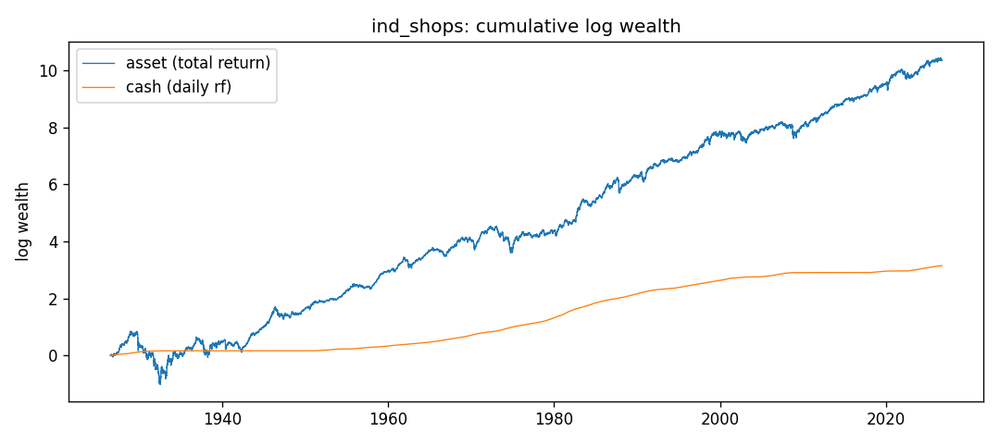
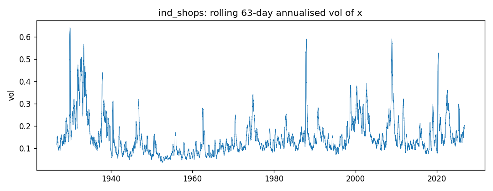

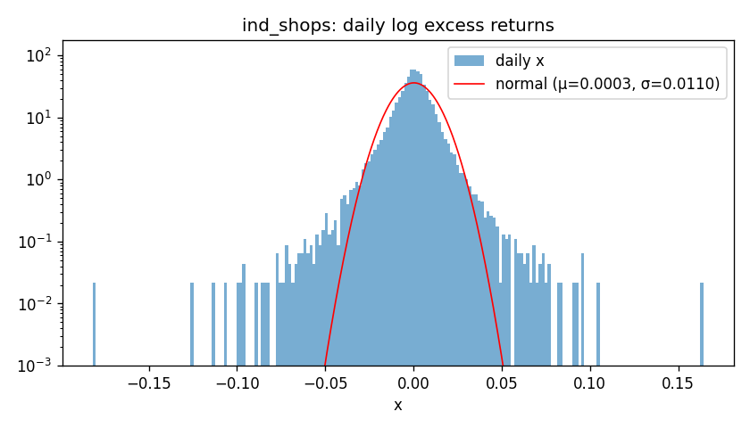
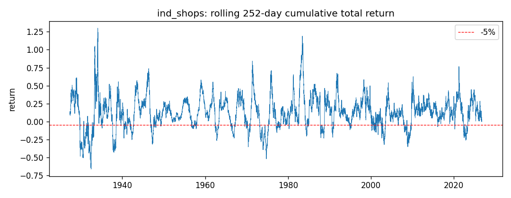

---

# Asset `ind_hlth` — PASS

Source `10_Industry_Portfolios_Daily.csv`, section “Average Value Weighted Returns -- Daily”, column `Hlth` (total return); saved to `data/processed/ind_hlth.parquet` (26338 rows).

## 1. Coverage — PASS

1926-07-01 to 2026-09-30, 26338 trading days.

| year | days | Saturdays | reason |
|---|---|---|---|
| 1926 | 150 | 23 | partial year (sample start/end) |
| 1927 | 301 | 51 | Saturday trading era (51 Saturdays) |
| 1928 | 295 | 45 | Saturday trading era (45 Saturdays) |
| 1929 | 291 | 42 | Saturday trading era (42 Saturdays) |
| 1930 | 298 | 47 | Saturday trading era (47 Saturdays) |
| 1931 | 300 | 48 | Saturday trading era (48 Saturdays) |
| 1932 | 302 | 52 | Saturday trading era (52 Saturdays) |
| 1933 | 285 | 43 | Saturday trading era (43 Saturdays) |
| 1934 | 301 | 52 | Saturday trading era (52 Saturdays) |
| 1935 | 301 | 51 | Saturday trading era (51 Saturdays) |
| 1936 | 301 | 48 | Saturday trading era (48 Saturdays) |
| 1937 | 299 | 49 | Saturday trading era (49 Saturdays) |
| 1938 | 301 | 51 | Saturday trading era (51 Saturdays) |
| 1939 | 300 | 51 | Saturday trading era (51 Saturdays) |
| 1940 | 302 | 51 | Saturday trading era (51 Saturdays) |
| 1941 | 301 | 51 | Saturday trading era (51 Saturdays) |
| 1942 | 301 | 50 | Saturday trading era (50 Saturdays) |
| 1943 | 301 | 51 | Saturday trading era (51 Saturdays) |
| 1944 | 298 | 47 | Saturday trading era (47 Saturdays) |
| 1945 | 286 | 40 | Saturday trading era (40 Saturdays) |
| 1946 | 281 | 31 | Saturday trading era (31 Saturdays) |
| 1947 | 283 | 33 | Saturday trading era (33 Saturdays) |
| 1948 | 283 | 32 | Saturday trading era (32 Saturdays) |
| 1949 | 282 | 32 | Saturday trading era (32 Saturdays) |
| 1950 | 281 | 32 | Saturday trading era (32 Saturdays) |
| 1951 | 283 | 34 | Saturday trading era (34 Saturdays) |
| 1952 | 271 | 21 | Saturday trading era (21 Saturdays) |
| 1968 | 226 | 0 | explained in config: NYSE closed on Wednesdays Jun-Dec 1968 (paperwork crisis); verified: 0-1 Wednesday sessions/month Jun-Dec in the data |
| 2026 | 187 | 0 | partial year (sample start/end) |

Trading days per year

1926: 150, 1927: 301, 1928: 295, 1929: 291, 1930: 298, 1931: 300, 1932: 302, 1933: 285, 1934: 301, 1935: 301, 1936: 301, 1937: 299, 1938: 301, 1939: 300, 1940: 302, 1941: 301, 1942: 301, 1943: 301, 1944: 298, 1945: 286, 1946: 281, 1947: 283, 1948: 283, 1949: 282, 1950: 281, 1951: 283, 1952: 271, 1953: 251, 1954: 252, 1955: 252, 1956: 251, 1957: 252, 1958: 252, 1959: 253, 1960: 252, 1961: 250, 1962: 252, 1963: 251, 1964: 253, 1965: 252, 1966: 252, 1967: 251, 1968: 226, 1969: 250, 1970: 254, 1971: 253, 1972: 251, 1973: 252, 1974: 253, 1975: 253, 1976: 253, 1977: 252, 1978: 252, 1979: 253, 1980: 253, 1981: 253, 1982: 253, 1983: 253, 1984: 253, 1985: 252, 1986: 253, 1987: 253, 1988: 253, 1989: 252, 1990: 253, 1991: 253, 1992: 254, 1993: 253, 1994: 252, 1995: 252, 1996: 254, 1997: 253, 1998: 252, 1999: 252, 2000: 252, 2001: 248, 2002: 252, 2003: 252, 2004: 252, 2005: 252, 2006: 251, 2007: 251, 2008: 253, 2009: 252, 2010: 252, 2011: 252, 2012: 250, 2013: 252, 2014: 252, 2015: 252, 2016: 252, 2017: 251, 2018: 251, 2019: 252, 2020: 253, 2021: 252, 2022: 251, 2023: 250, 2024: 252, 2025: 250, 2026: 187

## 2. Dates — PASS

Strictly increasing: True; unique: True; weekend dates after 1952: 0.

Gaps > 4 calendar days:

| last date before | next date | calendar days |
|---|---|---|
| 1929-11-27 | 1929-12-02 | 5 |
| 1933-03-03 | 1933-03-15 | 12 |
| 1956-12-21 | 1956-12-26 | 5 |
| 1958-12-24 | 1958-12-29 | 5 |
| 1961-05-26 | 1961-05-31 | 5 |
| 1968-07-03 | 1968-07-08 | 5 |
| 2001-09-10 | 2001-09-17 | 7 |
| 2006-12-29 | 2007-01-03 | 5 |
| 2012-10-26 | 2012-10-31 | 5 |

## 3. Missing values — PASS

- Sentinel (-99.99 / -999) counts: source {'NoDur': 0, 'Durbl': 0, 'Manuf': 0, 'Enrgy': 0, 'HiTec': 0, 'Telcm': 0, 'Shops': 0, 'Hlth': 0, 'Utils': 0, 'Other': 0}; rf_daily {'Mkt-RF': 0, 'SMB': 0, 'HML': 0, 'RF': 0}; rf_monthly {'Mkt-RF': 0, 'SMB': 0, 'HML': 0, 'RF': 0}
- Missing in the columns used: {'source:Hlth': 0, 'rf_daily:RF': 0}
- NaN in asset frame: {'r': 0, 'rf': 0, 'x': 0, 'rf_ann': 0}
- Rows dropped — asset_dates_not_in_rf (inner join): 0
- Rows dropped — rf_dates_not_in_asset (inner join): 0
- Rows dropped — nan_in_r_or_rf: 0
- rf_ann days filled from an earlier month (monthly rate not yet published): 0; days with no monthly rate: 0

## 4. Units sanity — PASS

median daily r = 0.00060, std = 0.01100 (bounds in config `checks.units`).

## 5. Extreme days — PASS

| rank | date | r | x |
|---|---|---|---|
| 1 | 1987-10-19 | -17.89% | -19.74% |
| 2 | 1932-05-31 | -14.40% | -15.55% |
| 3 | 1929-10-29 | -13.82% | -14.89% |
| 4 | 1929-10-30 | 12.62% | 11.86% |
| 5 | 1933-03-15 | 12.03% | 11.36% |
| 6 | 1932-08-03 | 12.00% | 11.33% |
| 7 | 1932-09-21 | 11.66% | 11.03% |
| 8 | 1931-10-06 | 11.57% | 10.95% |
| 9 | 1929-10-28 | -11.42% | -12.15% |
| 10 | 1931-03-26 | -11.12% | -11.79% |
| 11 | 2008-10-13 | 11.10% | 10.53% |
| 12 | 1933-04-19 | 11.05% | 10.48% |
| 13 | 1931-10-05 | -10.86% | -11.50% |
| 14 | 1931-03-27 | 10.31% | 9.81% |
| 15 | 1987-10-21 | 9.94% | 9.45% |
| 16 | 2020-03-16 | -9.62% | -10.12% |
| 17 | 1998-08-31 | -8.63% | -9.05% |
| 18 | 1932-09-27 | -8.61% | -9.00% |
| 19 | 1933-07-21 | -8.58% | -8.97% |
| 20 | 1931-10-08 | 8.52% | 8.18% |

Expected dates: 1987-10-19 (r = -17.89%, in top: True)

Suspicious |r| > 25%: none

## 8. Summary statistics — PASS

Annualised with N = 252. Skew/kurtosis are of daily x. Worst-window and share columns use overlapping 252- and 504-day cumulative total returns (window assigned to the decade it ends in).

| period | days | mean r | mean x | vol x | skew x | exkurt x | min r | max r | worst 252d | worst 504d | P(252d<-5%) | P(504d<-5%) | mean rf_ann |
|---|---|---|---|---|---|---|---|---|---|---|---|---|---|
| full | 26338 | 12.08% | 7.53% | 17.50% | -0.57 | 17.1 | -17.89% | 12.62% | -63.6% | -65.8% | 19.4% | 17.4% | 3.24% |
| 1920s | 1037 | 16.03% | 11.15% | 19.90% | -2.50 | 41.8 | -13.82% | 12.62% | -36.9% | -7.4% | 6.4% | 0.6% | 3.73% |
| 1930s | 2988 | 5.49% | 1.88% | 25.69% | -0.04 | 12.0 | -14.40% | 12.03% | -63.6% | -65.8% | 37.7% | 42.1% | 0.55% |
| 1940s | 2918 | 8.15% | 7.43% | 11.97% | -1.19 | 11.2 | -7.85% | 4.30% | -28.8% | -37.3% | 29.0% | 30.3% | 0.40% |
| 1950s | 2598 | 20.32% | 17.90% | 12.35% | -0.43 | 4.7 | -6.36% | 4.89% | -18.4% | -26.2% | 12.7% | 8.7% | 1.87% |
| 1960s | 2489 | 12.67% | 8.08% | 12.31% | -0.64 | 8.2 | -7.55% | 4.55% | -36.0% | -24.5% | 10.5% | 8.6% | 3.88% |
| 1970s | 2526 | 5.06% | -2.38% | 16.44% | 0.25 | 3.0 | -4.50% | 6.49% | -43.8% | -43.8% | 31.1% | 31.9% | 6.34% |
| 1980s | 2528 | 19.02% | 9.07% | 17.65% | -2.30 | 44.6 | -17.89% | 9.94% | -23.0% | -4.5% | 15.2% | 0.0% | 8.95% |
| 1990s | 2528 | 18.66% | 12.31% | 18.11% | -0.43 | 4.0 | -8.63% | 4.96% | -25.1% | -21.9% | 11.0% | 12.5% | 4.95% |
| 2000s | 2515 | 4.75% | 0.06% | 19.90% | -0.06 | 5.6 | -6.70% | 11.10% | -33.7% | -38.5% | 28.9% | 28.2% | 2.77% |
| 2010s | 2516 | 14.90% | 13.18% | 15.56% | -0.43 | 2.5 | -5.42% | 4.80% | -13.2% | -9.5% | 4.1% | 0.8% | 0.52% |
| 2020s | 1695 | 11.47% | 6.84% | 18.66% | -0.36 | 7.8 | -9.62% | 6.99% | -17.3% | -11.4% | 9.1% | 3.6% | 2.82% |

## 9. Figures

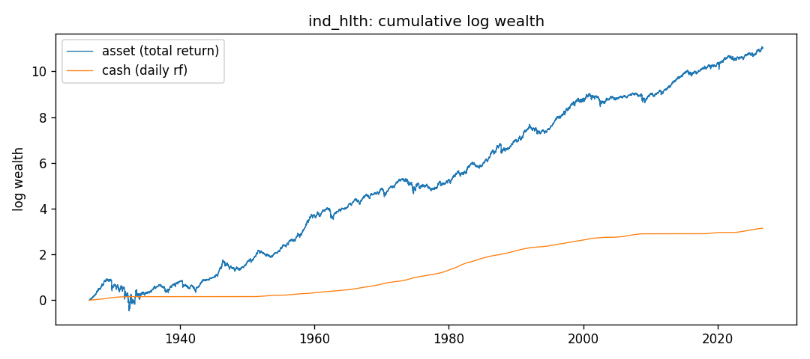
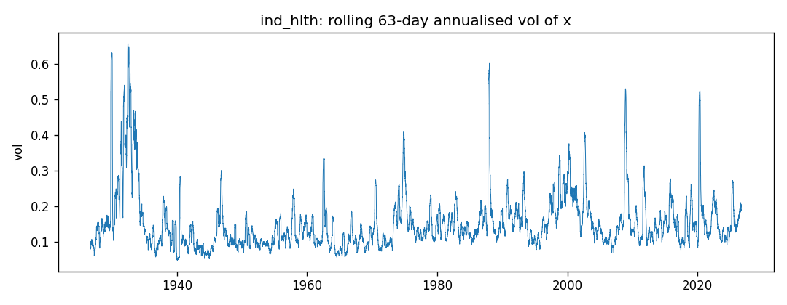

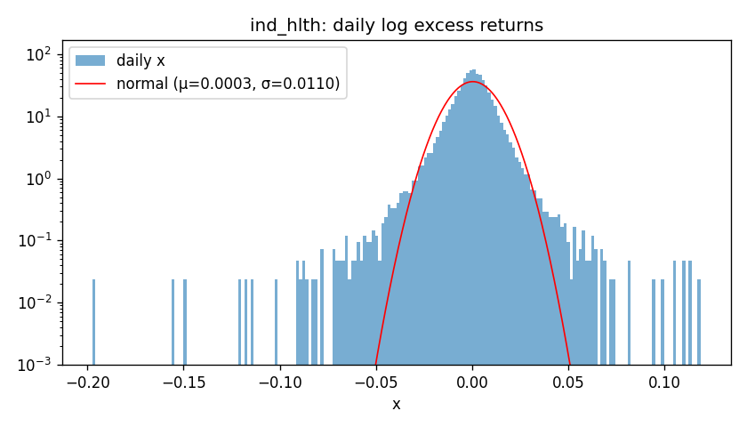
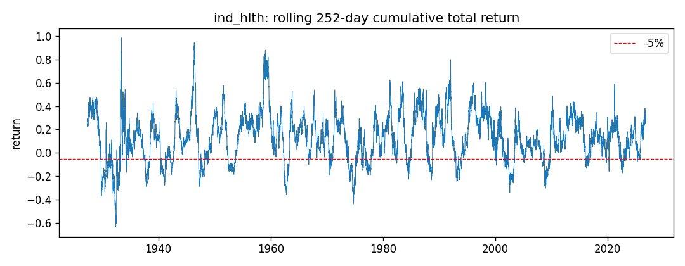

---

# Asset `ind_utils` — PASS

Source `10_Industry_Portfolios_Daily.csv`, section “Average Value Weighted Returns -- Daily”, column `Utils` (total return); saved to `data/processed/ind_utils.parquet` (26338 rows).

## 1. Coverage — PASS

1926-07-01 to 2026-09-30, 26338 trading days.

| year | days | Saturdays | reason |
|---|---|---|---|
| 1926 | 150 | 23 | partial year (sample start/end) |
| 1927 | 301 | 51 | Saturday trading era (51 Saturdays) |
| 1928 | 295 | 45 | Saturday trading era (45 Saturdays) |
| 1929 | 291 | 42 | Saturday trading era (42 Saturdays) |
| 1930 | 298 | 47 | Saturday trading era (47 Saturdays) |
| 1931 | 300 | 48 | Saturday trading era (48 Saturdays) |
| 1932 | 302 | 52 | Saturday trading era (52 Saturdays) |
| 1933 | 285 | 43 | Saturday trading era (43 Saturdays) |
| 1934 | 301 | 52 | Saturday trading era (52 Saturdays) |
| 1935 | 301 | 51 | Saturday trading era (51 Saturdays) |
| 1936 | 301 | 48 | Saturday trading era (48 Saturdays) |
| 1937 | 299 | 49 | Saturday trading era (49 Saturdays) |
| 1938 | 301 | 51 | Saturday trading era (51 Saturdays) |
| 1939 | 300 | 51 | Saturday trading era (51 Saturdays) |
| 1940 | 302 | 51 | Saturday trading era (51 Saturdays) |
| 1941 | 301 | 51 | Saturday trading era (51 Saturdays) |
| 1942 | 301 | 50 | Saturday trading era (50 Saturdays) |
| 1943 | 301 | 51 | Saturday trading era (51 Saturdays) |
| 1944 | 298 | 47 | Saturday trading era (47 Saturdays) |
| 1945 | 286 | 40 | Saturday trading era (40 Saturdays) |
| 1946 | 281 | 31 | Saturday trading era (31 Saturdays) |
| 1947 | 283 | 33 | Saturday trading era (33 Saturdays) |
| 1948 | 283 | 32 | Saturday trading era (32 Saturdays) |
| 1949 | 282 | 32 | Saturday trading era (32 Saturdays) |
| 1950 | 281 | 32 | Saturday trading era (32 Saturdays) |
| 1951 | 283 | 34 | Saturday trading era (34 Saturdays) |
| 1952 | 271 | 21 | Saturday trading era (21 Saturdays) |
| 1968 | 226 | 0 | explained in config: NYSE closed on Wednesdays Jun-Dec 1968 (paperwork crisis); verified: 0-1 Wednesday sessions/month Jun-Dec in the data |
| 2026 | 187 | 0 | partial year (sample start/end) |

Trading days per year

1926: 150, 1927: 301, 1928: 295, 1929: 291, 1930: 298, 1931: 300, 1932: 302, 1933: 285, 1934: 301, 1935: 301, 1936: 301, 1937: 299, 1938: 301, 1939: 300, 1940: 302, 1941: 301, 1942: 301, 1943: 301, 1944: 298, 1945: 286, 1946: 281, 1947: 283, 1948: 283, 1949: 282, 1950: 281, 1951: 283, 1952: 271, 1953: 251, 1954: 252, 1955: 252, 1956: 251, 1957: 252, 1958: 252, 1959: 253, 1960: 252, 1961: 250, 1962: 252, 1963: 251, 1964: 253, 1965: 252, 1966: 252, 1967: 251, 1968: 226, 1969: 250, 1970: 254, 1971: 253, 1972: 251, 1973: 252, 1974: 253, 1975: 253, 1976: 253, 1977: 252, 1978: 252, 1979: 253, 1980: 253, 1981: 253, 1982: 253, 1983: 253, 1984: 253, 1985: 252, 1986: 253, 1987: 253, 1988: 253, 1989: 252, 1990: 253, 1991: 253, 1992: 254, 1993: 253, 1994: 252, 1995: 252, 1996: 254, 1997: 253, 1998: 252, 1999: 252, 2000: 252, 2001: 248, 2002: 252, 2003: 252, 2004: 252, 2005: 252, 2006: 251, 2007: 251, 2008: 253, 2009: 252, 2010: 252, 2011: 252, 2012: 250, 2013: 252, 2014: 252, 2015: 252, 2016: 252, 2017: 251, 2018: 251, 2019: 252, 2020: 253, 2021: 252, 2022: 251, 2023: 250, 2024: 252, 2025: 250, 2026: 187

## 2. Dates — PASS

Strictly increasing: True; unique: True; weekend dates after 1952: 0.

Gaps > 4 calendar days:

| last date before | next date | calendar days |
|---|---|---|
| 1929-11-27 | 1929-12-02 | 5 |
| 1933-03-03 | 1933-03-15 | 12 |
| 1956-12-21 | 1956-12-26 | 5 |
| 1958-12-24 | 1958-12-29 | 5 |
| 1961-05-26 | 1961-05-31 | 5 |
| 1968-07-03 | 1968-07-08 | 5 |
| 2001-09-10 | 2001-09-17 | 7 |
| 2006-12-29 | 2007-01-03 | 5 |
| 2012-10-26 | 2012-10-31 | 5 |

## 3. Missing values — PASS

- Sentinel (-99.99 / -999) counts: source {'NoDur': 0, 'Durbl': 0, 'Manuf': 0, 'Enrgy': 0, 'HiTec': 0, 'Telcm': 0, 'Shops': 0, 'Hlth': 0, 'Utils': 0, 'Other': 0}; rf_daily {'Mkt-RF': 0, 'SMB': 0, 'HML': 0, 'RF': 0}; rf_monthly {'Mkt-RF': 0, 'SMB': 0, 'HML': 0, 'RF': 0}
- Missing in the columns used: {'source:Utils': 0, 'rf_daily:RF': 0}
- NaN in asset frame: {'r': 0, 'rf': 0, 'x': 0, 'rf_ann': 0}
- Rows dropped — asset_dates_not_in_rf (inner join): 0
- Rows dropped — rf_dates_not_in_asset (inner join): 0
- Rows dropped — nan_in_r_or_rf: 0
- rf_ann days filled from an earlier month (monthly rate not yet published): 0; days with no monthly rate: 0

## 4. Units sanity — PASS

median daily r = 0.00060, std = 0.01099 (bounds in config `checks.units`).

## 5. Extreme days — PASS

| rank | date | r | x |
|---|---|---|---|
| 1 | 1933-04-20 | 17.92% | 16.48% |
| 2 | 1929-10-28 | -15.26% | -16.58% |
| 3 | 1929-10-30 | 14.99% | 13.95% |
| 4 | 2008-10-13 | 14.46% | 13.51% |
| 5 | 1987-10-19 | -12.86% | -13.80% |
| 6 | 1929-11-14 | 12.68% | 11.92% |
| 7 | 1937-10-20 | 12.67% | 11.93% |
| 8 | 1929-10-29 | -12.54% | -13.42% |
| 9 | 1931-10-06 | 12.36% | 11.65% |
| 10 | 1929-11-06 | -12.34% | -13.19% |
| 11 | 2020-03-17 | 11.78% | 11.13% |
| 12 | 2020-03-16 | -11.65% | -12.40% |
| 13 | 1932-06-03 | 11.08% | 10.51% |
| 14 | 2020-03-24 | 10.94% | 10.37% |
| 15 | 1933-03-15 | 10.93% | 10.37% |
| 16 | 1933-04-21 | -10.81% | -11.44% |
| 17 | 2020-03-12 | -10.55% | -11.16% |
| 18 | 2008-10-28 | 10.17% | 9.69% |
| 19 | 1932-09-21 | 10.02% | 9.55% |
| 20 | 1933-07-20 | -9.76% | -10.27% |

Expected dates: 1987-10-19 (r = -12.86%, in top: True)

Suspicious |r| > 25%: none

## 8. Summary statistics — PASS

Annualised with N = 252. Skew/kurtosis are of daily x. Worst-window and share columns use overlapping 252- and 504-day cumulative total returns (window assigned to the decade it ends in).

| period | days | mean r | mean x | vol x | skew x | exkurt x | min r | max r | worst 252d | worst 504d | P(252d<-5%) | P(504d<-5%) | mean rf_ann |
|---|---|---|---|---|---|---|---|---|---|---|---|---|---|
| full | 26338 | 9.84% | 5.30% | 17.44% | -0.15 | 22.3 | -15.26% | 17.92% | -66.5% | -73.9% | 18.8% | 16.1% | 3.24% |
| 1920s | 1037 | 26.81% | 20.65% | 25.56% | -1.75 | 31.6 | -15.26% | 14.99% | -18.6% | 26.1% | 1.8% | 0.0% | 3.73% |
| 1930s | 2988 | 0.09% | -5.86% | 33.54% | 0.38 | 4.3 | -10.81% | 17.92% | -66.5% | -73.9% | 55.1% | 58.2% | 0.55% |
| 1940s | 2918 | 8.09% | 7.12% | 13.96% | -0.94 | 10.4 | -7.43% | 6.20% | -34.6% | -49.6% | 31.3% | 28.1% | 0.40% |
| 1950s | 2598 | 13.71% | 11.87% | 6.23% | -1.98 | 19.3 | -4.23% | 3.13% | -4.4% | 4.3% | 0.0% | 0.0% | 1.87% |
| 1960s | 2489 | 6.70% | 2.60% | 7.36% | -2.03 | 61.3 | -8.24% | 5.60% | -19.0% | -13.0% | 16.3% | 6.1% | 3.88% |
| 1970s | 2526 | 6.95% | 0.43% | 9.24% | 0.70 | 7.2 | -3.58% | 5.15% | -37.3% | -37.4% | 21.8% | 21.7% | 6.34% |
| 1980s | 2528 | 17.26% | 8.21% | 11.32% | -2.61 | 62.2 | -12.86% | 7.51% | -12.3% | -5.9% | 4.7% | 0.1% | 8.95% |
| 1990s | 2528 | 8.72% | 3.53% | 9.90% | -0.17 | 2.3 | -3.21% | 2.78% | -21.4% | -6.0% | 10.4% | 0.5% | 4.95% |
| 2000s | 2515 | 10.67% | 5.65% | 21.43% | 0.05 | 10.6 | -8.92% | 14.46% | -38.7% | -37.6% | 25.5% | 27.6% | 2.77% |
| 2010s | 2516 | 11.44% | 10.00% | 13.63% | -0.41 | 3.2 | -6.05% | 4.54% | -18.0% | -24.5% | 3.8% | 6.7% | 0.52% |
| 2020s | 1695 | 9.61% | 4.48% | 21.17% | -0.47 | 15.7 | -11.65% | 11.78% | -26.7% | -11.0% | 15.5% | 0.6% | 2.82% |

## 9. Figures

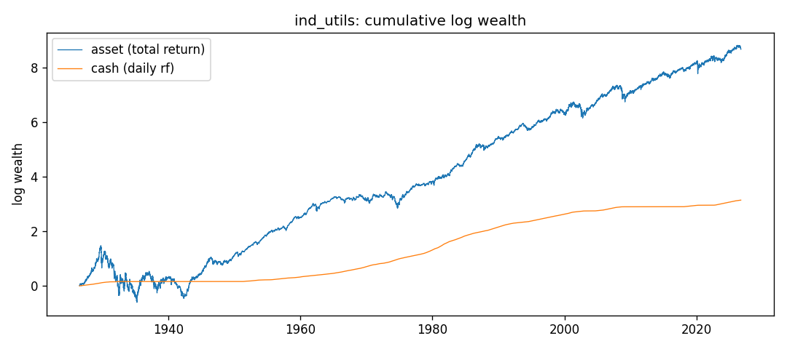
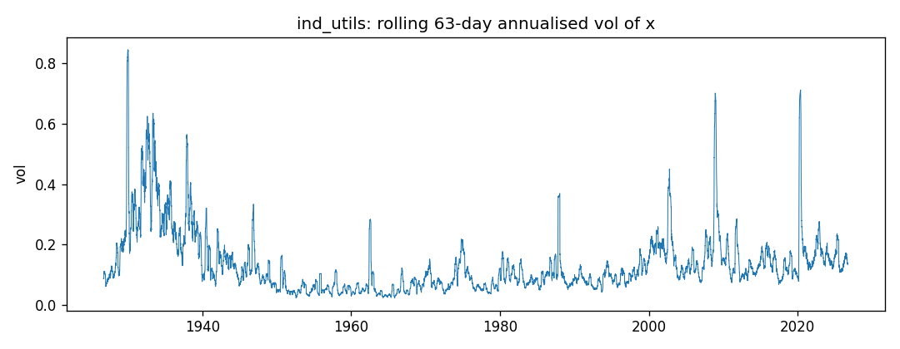

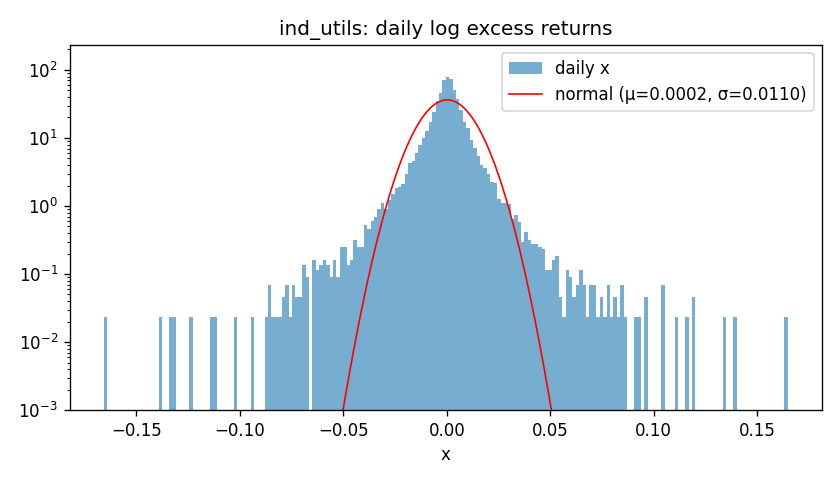
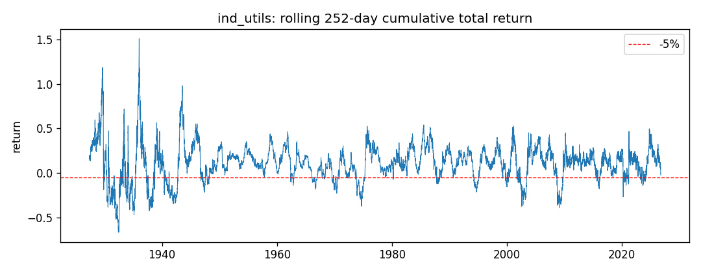

---

# Asset `ind_other` — PASS

Source `10_Industry_Portfolios_Daily.csv`, section “Average Value Weighted Returns -- Daily”, column `Other` (total return); saved to `data/processed/ind_other.parquet` (26338 rows).

## 1. Coverage — PASS

1926-07-01 to 2026-09-30, 26338 trading days.

| year | days | Saturdays | reason |
|---|---|---|---|
| 1926 | 150 | 23 | partial year (sample start/end) |
| 1927 | 301 | 51 | Saturday trading era (51 Saturdays) |
| 1928 | 295 | 45 | Saturday trading era (45 Saturdays) |
| 1929 | 291 | 42 | Saturday trading era (42 Saturdays) |
| 1930 | 298 | 47 | Saturday trading era (47 Saturdays) |
| 1931 | 300 | 48 | Saturday trading era (48 Saturdays) |
| 1932 | 302 | 52 | Saturday trading era (52 Saturdays) |
| 1933 | 285 | 43 | Saturday trading era (43 Saturdays) |
| 1934 | 301 | 52 | Saturday trading era (52 Saturdays) |
| 1935 | 301 | 51 | Saturday trading era (51 Saturdays) |
| 1936 | 301 | 48 | Saturday trading era (48 Saturdays) |
| 1937 | 299 | 49 | Saturday trading era (49 Saturdays) |
| 1938 | 301 | 51 | Saturday trading era (51 Saturdays) |
| 1939 | 300 | 51 | Saturday trading era (51 Saturdays) |
| 1940 | 302 | 51 | Saturday trading era (51 Saturdays) |
| 1941 | 301 | 51 | Saturday trading era (51 Saturdays) |
| 1942 | 301 | 50 | Saturday trading era (50 Saturdays) |
| 1943 | 301 | 51 | Saturday trading era (51 Saturdays) |
| 1944 | 298 | 47 | Saturday trading era (47 Saturdays) |
| 1945 | 286 | 40 | Saturday trading era (40 Saturdays) |
| 1946 | 281 | 31 | Saturday trading era (31 Saturdays) |
| 1947 | 283 | 33 | Saturday trading era (33 Saturdays) |
| 1948 | 283 | 32 | Saturday trading era (32 Saturdays) |
| 1949 | 282 | 32 | Saturday trading era (32 Saturdays) |
| 1950 | 281 | 32 | Saturday trading era (32 Saturdays) |
| 1951 | 283 | 34 | Saturday trading era (34 Saturdays) |
| 1952 | 271 | 21 | Saturday trading era (21 Saturdays) |
| 1968 | 226 | 0 | explained in config: NYSE closed on Wednesdays Jun-Dec 1968 (paperwork crisis); verified: 0-1 Wednesday sessions/month Jun-Dec in the data |
| 2026 | 187 | 0 | partial year (sample start/end) |

Trading days per year

1926: 150, 1927: 301, 1928: 295, 1929: 291, 1930: 298, 1931: 300, 1932: 302, 1933: 285, 1934: 301, 1935: 301, 1936: 301, 1937: 299, 1938: 301, 1939: 300, 1940: 302, 1941: 301, 1942: 301, 1943: 301, 1944: 298, 1945: 286, 1946: 281, 1947: 283, 1948: 283, 1949: 282, 1950: 281, 1951: 283, 1952: 271, 1953: 251, 1954: 252, 1955: 252, 1956: 251, 1957: 252, 1958: 252, 1959: 253, 1960: 252, 1961: 250, 1962: 252, 1963: 251, 1964: 253, 1965: 252, 1966: 252, 1967: 251, 1968: 226, 1969: 250, 1970: 254, 1971: 253, 1972: 251, 1973: 252, 1974: 253, 1975: 253, 1976: 253, 1977: 252, 1978: 252, 1979: 253, 1980: 253, 1981: 253, 1982: 253, 1983: 253, 1984: 253, 1985: 252, 1986: 253, 1987: 253, 1988: 253, 1989: 252, 1990: 253, 1991: 253, 1992: 254, 1993: 253, 1994: 252, 1995: 252, 1996: 254, 1997: 253, 1998: 252, 1999: 252, 2000: 252, 2001: 248, 2002: 252, 2003: 252, 2004: 252, 2005: 252, 2006: 251, 2007: 251, 2008: 253, 2009: 252, 2010: 252, 2011: 252, 2012: 250, 2013: 252, 2014: 252, 2015: 252, 2016: 252, 2017: 251, 2018: 251, 2019: 252, 2020: 253, 2021: 252, 2022: 251, 2023: 250, 2024: 252, 2025: 250, 2026: 187

## 2. Dates — PASS

Strictly increasing: True; unique: True; weekend dates after 1952: 0.

Gaps > 4 calendar days:

| last date before | next date | calendar days |
|---|---|---|
| 1929-11-27 | 1929-12-02 | 5 |
| 1933-03-03 | 1933-03-15 | 12 |
| 1956-12-21 | 1956-12-26 | 5 |
| 1958-12-24 | 1958-12-29 | 5 |
| 1961-05-26 | 1961-05-31 | 5 |
| 1968-07-03 | 1968-07-08 | 5 |
| 2001-09-10 | 2001-09-17 | 7 |
| 2006-12-29 | 2007-01-03 | 5 |
| 2012-10-26 | 2012-10-31 | 5 |

## 3. Missing values — PASS

- Sentinel (-99.99 / -999) counts: source {'NoDur': 0, 'Durbl': 0, 'Manuf': 0, 'Enrgy': 0, 'HiTec': 0, 'Telcm': 0, 'Shops': 0, 'Hlth': 0, 'Utils': 0, 'Other': 0}; rf_daily {'Mkt-RF': 0, 'SMB': 0, 'HML': 0, 'RF': 0}; rf_monthly {'Mkt-RF': 0, 'SMB': 0, 'HML': 0, 'RF': 0}
- Missing in the columns used: {'source:Other': 0, 'rf_daily:RF': 0}
- NaN in asset frame: {'r': 0, 'rf': 0, 'x': 0, 'rf_ann': 0}
- Rows dropped — asset_dates_not_in_rf (inner join): 0
- Rows dropped — rf_dates_not_in_asset (inner join): 0
- Rows dropped — nan_in_r_or_rf: 0
- rf_ann days filled from an earlier month (monthly rate not yet published): 0; days with no monthly rate: 0

## 4. Units sanity — PASS

median daily r = 0.00070, std = 0.01231 (bounds in config `checks.units`).

## 5. Extreme days — PASS

| rank | date | r | x |
|---|---|---|---|
| 1 | 1933-03-15 | 18.00% | 16.55% |
| 2 | 1987-10-19 | -15.22% | -16.54% |
| 3 | 2020-03-16 | -13.55% | -14.57% |
| 4 | 1932-09-21 | 13.23% | 12.43% |
| 5 | 1931-10-06 | 12.84% | 12.08% |
| 6 | 2008-12-01 | -12.49% | -13.34% |
| 7 | 2020-03-24 | 12.33% | 11.62% |
| 8 | 1933-07-21 | -11.63% | -12.36% |
| 9 | 2009-03-10 | 11.45% | 10.84% |
| 10 | 1931-12-18 | 11.43% | 10.82% |
| 11 | 1931-09-23 | 11.32% | 10.72% |
| 12 | 2008-09-29 | -11.20% | -11.89% |
| 13 | 2009-03-23 | 11.16% | 10.58% |
| 14 | 2008-11-24 | 11.16% | 10.58% |
| 15 | 1932-06-04 | 10.86% | 10.31% |
| 16 | 1937-10-20 | 10.73% | 10.19% |
| 17 | 2020-03-13 | 10.63% | 10.09% |
| 18 | 2020-03-12 | -10.26% | -10.84% |
| 19 | 2009-01-20 | -10.02% | -10.56% |
| 20 | 1932-10-05 | -10.01% | -10.55% |

Expected dates: 1987-10-19 (r = -15.22%, in top: True)

Suspicious |r| > 25%: none

## 8. Summary statistics — PASS

Annualised with N = 252. Skew/kurtosis are of daily x. Worst-window and share columns use overlapping 252- and 504-day cumulative total returns (window assigned to the decade it ends in).

| period | days | mean r | mean x | vol x | skew x | exkurt x | min r | max r | worst 252d | worst 504d | P(252d<-5%) | P(504d<-5%) | mean rf_ann |
|---|---|---|---|---|---|---|---|---|---|---|---|---|---|
| full | 26338 | 10.20% | 5.27% | 19.56% | -0.28 | 15.5 | -15.22% | 18.00% | -77.5% | -85.5% | 21.9% | 16.6% | 3.24% |
| 1920s | 1037 | 11.92% | 7.77% | 15.73% | -1.60 | 23.5 | -9.16% | 6.76% | -20.2% | -0.5% | 5.1% | 0.0% | 3.73% |
| 1930s | 2988 | -0.50% | -6.22% | 32.88% | 0.32 | 6.0 | -11.63% | 18.00% | -77.5% | -85.5% | 48.9% | 51.0% | 0.55% |
| 1940s | 2918 | 9.89% | 8.71% | 15.41% | -1.34 | 9.7 | -8.09% | 5.57% | -35.7% | -32.4% | 25.8% | 19.7% | 0.40% |
| 1950s | 2598 | 14.48% | 12.21% | 11.20% | -0.95 | 7.8 | -6.78% | 4.72% | -19.2% | -18.9% | 8.0% | 5.9% | 1.87% |
| 1960s | 2489 | 11.14% | 6.66% | 11.36% | -0.53 | 4.9 | -6.03% | 3.66% | -24.3% | -4.2% | 18.0% | 0.0% | 3.88% |
| 1970s | 2526 | 5.89% | -1.18% | 14.02% | -0.01 | 3.3 | -4.55% | 6.84% | -48.1% | -52.1% | 32.3% | 34.1% | 6.34% |
| 1980s | 2528 | 16.53% | 7.08% | 14.51% | -2.79 | 49.6 | -15.22% | 8.13% | -21.9% | -8.0% | 17.5% | 0.5% | 8.95% |
| 1990s | 2528 | 16.03% | 10.21% | 14.94% | -0.26 | 4.7 | -6.48% | 5.47% | -36.0% | -13.1% | 6.1% | 1.3% | 4.95% |
| 2000s | 2515 | 3.73% | -2.85% | 27.81% | -0.18 | 8.5 | -12.49% | 11.45% | -63.7% | -70.0% | 34.0% | 30.3% | 2.77% |
| 2010s | 2516 | 14.03% | 11.88% | 18.14% | -0.48 | 4.9 | -8.74% | 6.62% | -16.1% | -35.7% | 8.7% | 7.9% | 0.52% |
| 2020s | 1695 | 12.70% | 7.22% | 22.82% | -0.72 | 16.3 | -13.55% | 12.33% | -27.8% | -30.9% | 18.2% | 9.9% | 2.82% |

## 9. Figures

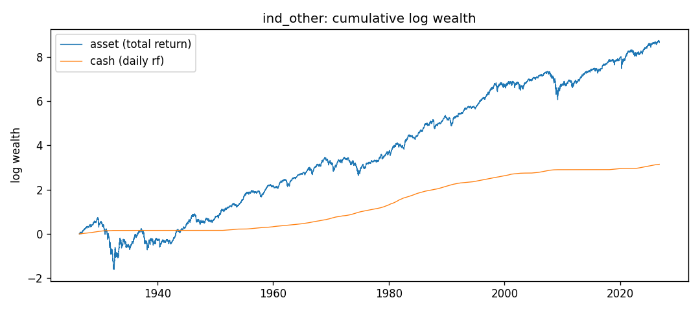
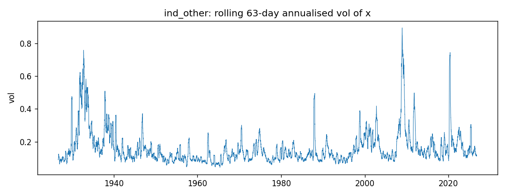

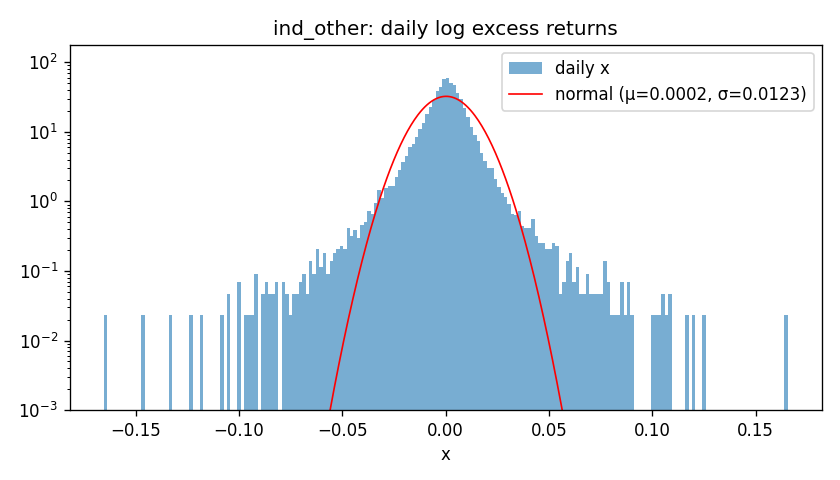
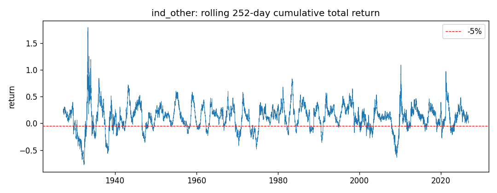
