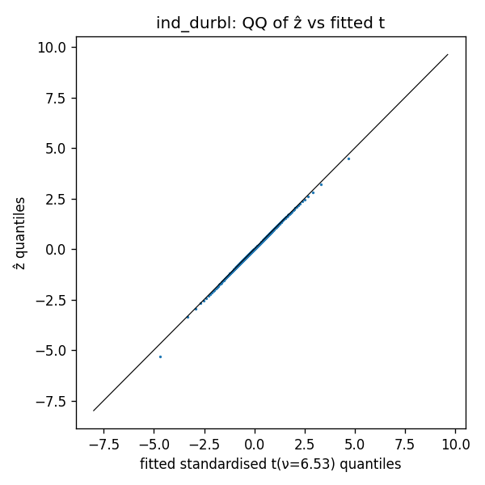
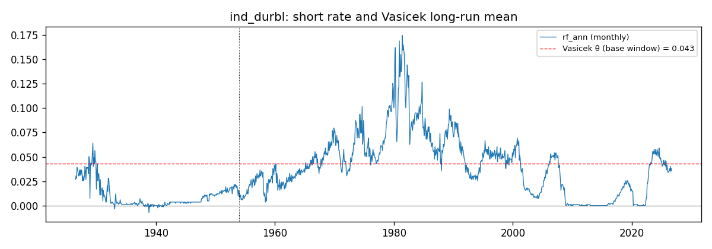
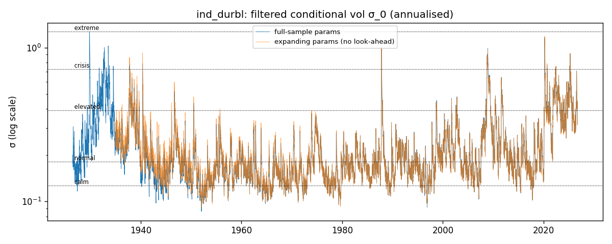
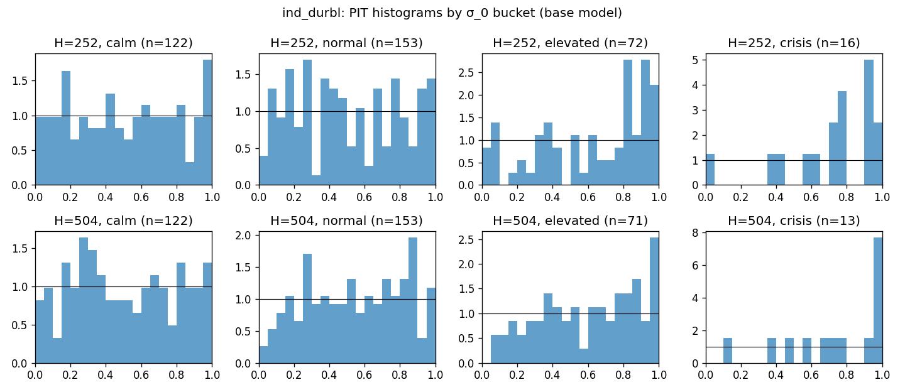
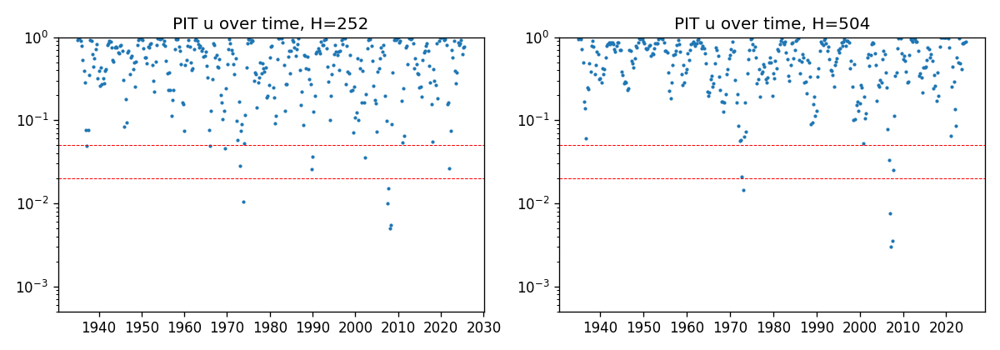
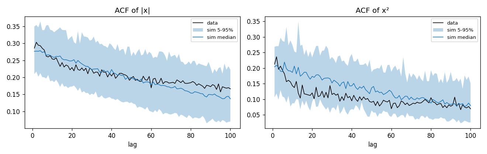
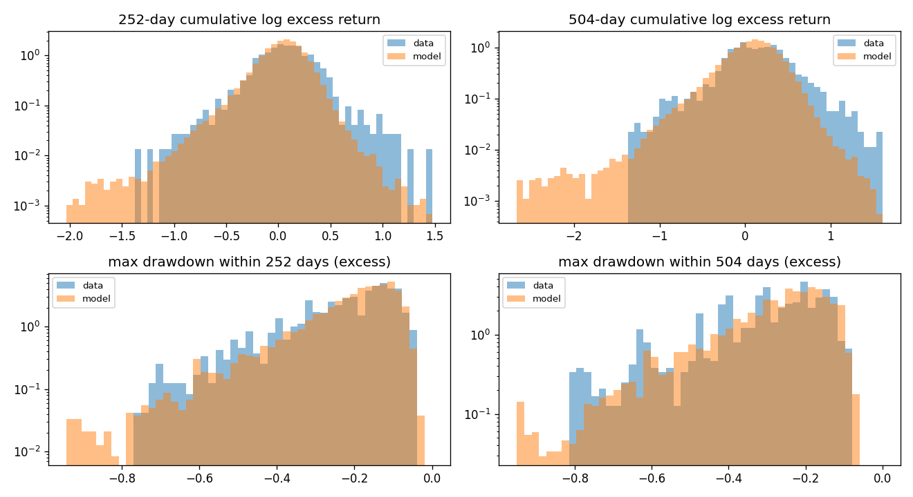
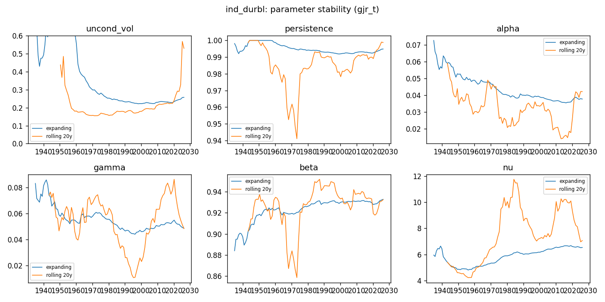

# Model report (Spec 02): `ind_durbl`

Generated 2026-11-21T13:52:04 by `scripts/02_fit_model.py --asset ind_durbl` in 114s. Estimation window 1926-07-01 – 2026-09-30 (26338 days). Base model **gjr_t**, gap variant **scale**, innovations **t**. Data hashes: `F-F_Research_Data_Factors_daily.csv` 3f7910502dd6…, `F-F_Research_Data_Factors.csv` a3894d74d553…, `10_Industry_Portfolios_Daily.csv` 01cfe3d5e54f….

**Fallback-window rule**: full-history base fit persistence 0.99500, valid parameter draws 100% → not triggered; full history used.

## 1. Model comparison

Log-likelihoods are for the *unscaled decimal* x; for the `scale` gap variant the Jacobian (−½ Σ log k) is added so log-likelihood/BIC are comparable across variants. PIT columns: observed share of historical starts with u below the level (nominal = the level), expanding-window parameters. PIT score = mean |obs − nominal|/nominal over σ_0 buckets at levels ≤ 5% (lower is better). 'buckets thin/fat' counts bucket×level cells whose CI excludes the nominal.

| model | gap_variant | nobs | loglik | bic | nu | persistence | half_life_days | uncond_vol_ann | PIT u<0.02 H252 | PIT u<0.05 H252 | PIT u<0.02 H504 | PIT u<0.05 H504 | PIT score | buckets thin/fat | VaR0.01 hit rate | VaR0.01 p_uc | VaR0.001 hit rate | VaR0.001 p_uc |
|---|---|---|---|---|---|---|---|---|---|---|---|---|---|---|---|---|---|---|
| garch_n | none | 26338 | 77379.4 | -154718.1 | n/a | 0.9946 | 127.2 | 27.2% | 1.65% | 3.31% | 1.67% | 1.95% | 0.69 | H252: 0/0, H504: 0/0 | 1.51% | 0.000 | 0.43% | 0.000 |
| garch_t | none | 26338 | 78101.4 | -156152.0 | 6.27 | 0.9955 | 153.2 | 26.6% | 2.20% | 4.41% | 1.39% | 3.06% | 0.64 | H252: 0/0, H504: 0/0 | 0.97% | 0.686 | 0.10% | 0.866 |
| gjr_t | none | 26338 | 78170.0 | -156279.0 | 6.46 | 0.9949 | 136.0 | 25.8% | 1.38% | 3.31% | 1.11% | 1.95% | 0.70 | H252: 0/0, H504: 0/0 | 0.91% | 0.161 | 0.10% | 0.970 |
| egarch_t | none | 26338 | 78172.8 | -156284.4 | 6.32 | 0.9934 | 104.9 | 20.3% | 1.65% | 3.31% | 1.39% | 1.95% | 0.87 | H252: 0/0, H504: 0/0 | 0.89% | 0.071 | 0.11% | 0.523 |
| garch_n | scale | 26338 | 77425.1 | -154809.4 | n/a | 0.9944 | 123.8 | 26.6% | 1.65% | 3.58% | 1.67% | 2.23% | 0.71 | H252: 0/0, H504: 0/0 | 1.52% | 0.000 | 0.42% | 0.000 |
| garch_t | scale | 26338 | 78113.4 | -156175.9 | 6.35 | 0.9956 | 156.5 | 26.7% | 1.93% | 4.41% | 1.67% | 2.51% | 0.61 | H252: 0/0, H504: 0/0 | 0.98% | 0.735 | 0.10% | 0.866 |
| gjr_t | scale | 26338 | 78181.6 | -156302.2 | 6.53 | 0.9950 | 138.3 | 25.9% | 1.38% | 3.58% | 1.11% | 1.95% | 0.70 | H252: 0/0, H504: 0/0 | 0.92% | 0.230 | 0.10% | 0.866 |
| egarch_t | scale | 26338 | 78182.3 | -156303.6 | 6.38 | 0.9934 | 105.4 | 20.3% | 1.38% | 3.58% | 1.39% | 2.23% | 0.82 | H252: 0/0, H504: 0/0 | 0.89% | 0.071 | 0.11% | 0.523 |
| gjr_t (FHS innovations) | scale | 26338 | 78181.6 | -156302.2 | 6.53 | 0.9950 | 138.3 | 25.9% | 1.38% | 3.58% | 1.11% | 2.23% | 0.68 | H252: 0/0, H504: 0/0 | n/a | n/a | n/a | n/a |

### Base model parameters (gjr_t, decimal daily units, robust SEs)

| param | estimate | se |
|---|---|---|
| mu | 0.0003466 | 6.34e-05 |
| omega | 1.32977e-06 | 1.96e-07 |
| alpha | 0.0377718 | 0.00369 |
| gamma | 0.0483124 | 0.00518 |
| beta | 0.933073 | 0.00516 |
| nu | 6.5287 | 0.26 |

log-lik 78187.3, AIC -156362.6, BIC -156313.6; persistence 0.9950; half-life 138.3 days; unconditional vol 25.9%; ν = 6.53.

## 2. Expected excess return (premium)

Raw estimate (mean of r − rf × 252): **10.05%** p.a., SE 2.55% (t = 3.95, 104.5 years). Shrunk 0.5 toward 0.0: **5.02%** used (mode `constant_arith`). Resolved coefficients for all modes (same average premium): `constant_arith` mu_e_daily=0.0001994; `prop_variance` mu_e_daily=0.0001994, lambda=0.7447; `constant_sharpe` mu_e_daily=0.0001994, S=0.01401

## 3. Standardised residuals (FHS pool)

n = 26338, mean -0.006, sd 1.001, skew -0.07, excess kurtosis 2.48 (fitted t implies 2.37); min -7.88 on 1989-10-13. The FHS pool is demeaned and scaled to unit variance before resampling.

## 4. Interest-rate model (Vasicek on monthly rf_ann)

| window | start | end | months | kappa | se_kappa | theta | s | half-life (y) | neg. months | rho used | rho same-month | rho prev-month |
|---|---|---|---|---|---|---|---|---|---|---|---|---|
| base | 1954-01 | 2026-09 | 872 | 0.338 | 0.095 | 4.30% | 2.57% | 2.0 | 0 | -0.096 | -0.096 | -0.008 |
| full_sample | 1926-07 | 2026-09 | 1202 | 0.298 | 0.077 | 3.37% | 2.39% | 2.3 | 12 | -0.051 | -0.051 | -0.023 |
| from_1952-07 | 1952-07 | 2026-09 | 890 | 0.334 | 0.094 | 4.23% | 2.55% | 2.1 | 0 | -0.097 | -0.097 | -0.007 |

Negative monthly rf months in the data: 1933-02, 1938-03, 1938-07, 1938-11, 1939-01, 1939-03, 1939-08, 1940-05, 1940-08, 1941-01, 1941-02, 1941-04. Base window (1954-01-01+) excludes them: **True**. `floor_at_zero = False`.

## 5. Starting states (σ_0, r_0)

Under GJR-GARCH the one-step-ahead conditional variance σ_0² is the complete equity state (the sign of the last shock is already inside it); r_0 is the Vasicek state. Both are observable at t = 0. Named states are percentiles of the asset's own filtered σ history (full-sample params), so they transfer across assets. Annualised with N = 252 (see note on pre-1952 data in DECISIONS).

| state_name | sigma0_ann | r0_ann | definition |
|---|---|---|---|
| calm | 12.7% | 2.67% | P10 of filtered sigma; r0 = median rf_ann of estimation window |
| normal | 18.1% | 2.67% | P50 of filtered sigma; r0 = median rf_ann of estimation window |
| elevated | 39.0% | 2.67% | P90 of filtered sigma; r0 = median rf_ann of estimation window |
| crisis | 72.6% | 2.67% | P99 of filtered sigma; r0 = median rf_ann of estimation window |
| extreme | 126.7% | 2.67% | historical max of filtered sigma (1929-11-06); r0 = median rf_ann of estimation window |

Anchor dates (σ_0 = next-day vol at the close of the date):

| state_name | sigma0_ann | r0_ann | sigma0_ann_expanding | rv63_ann | dd252 |
|---|---|---|---|---|---|
| anchor_2006-12-29 | 13.7% | 4.9% | 13.7% | 12.3% | -4.3% |
| anchor_1987-10-16 | 40.1% | 7.4% | 40.0% | 23.4% | -21.5% |
| anchor_1987-10-19 | 100.4% | 7.4% | 100.4% | 45.7% | -35.6% |
| anchor_2008-10-10 | 77.8% | 1.0% | 77.0% | 51.8% | -58.6% |
| anchor_2008-11-20 | 91.1% | 0.4% | 89.7% | 70.0% | -71.0% |
| anchor_2020-03-16 | 108.0% | 1.4% | 109.3% | 58.4% | -40.6% |
| anchor_2022-06-16 | 75.5% | 0.7% | 75.5% | 63.3% | -45.3% |
| anchor_2026-09-30 | 32.8% | 3.8% | 32.8% | 43.9% | -23.2% |

σ_0 bucket edges used in the PIT/VaR tests (annualised): calm: [8.6%, 15.4%), normal: [15.4%, 23.2%), elevated: [23.2%, 49.3%), crisis: [49.3%, n/a)

## 6. Conditional tail calibration (PIT test)

Quarterly start dates; at each start the model is re-estimated on data **before** the start (expanding window, refit every 252 days; premium and rate model also expanding). 2000 paths per start. u = model CDF of the realised cumulative log total return over H days. Effective n = non-overlapping windows = n_starts × 63/H; CIs are Wilson 95% on the effective n. 'too thin' = more realised left-tail outcomes than the model predicts (dangerous for the floor).

### gjr_t / scale / t

| group_type | group | H | n_starts | n_eff | u<0.01 | u<0.02 | u<0.05 | u<0.1 |
|---|---|---|---|---|---|---|---|---|
| overall | all | 252 | 363 | 90.8 | 0.6% (0.1%–5.1%) | 1.4% (0.3%–6.4%) | 3.6% (1.3%–9.7%) | 9.4% (4.9%–17.1%) |
| bucket | calm | 252 | 122 | 30.5 | 0.0% (0.0%–11.2%) | 1.6% (0.2%–13.9%) | 4.9% (1.1%–18.8%) | 9.8% (3.4%–25.3%) |
| bucket | crisis | 252 | 16 | 4.0 | 0.0% (0.0%–49.0%) | 0.0% (0.0%–49.0%) | 6.2% (0.4%–55.0%) | 6.2% (0.4%–55.0%) |
| bucket | elevated | 252 | 72 | 18.0 | 2.8% (0.3%–21.9%) | 2.8% (0.3%–21.9%) | 4.2% (0.6%–23.9%) | 11.1% (3.1%–32.8%) |
| bucket | normal | 252 | 153 | 38.2 | 0.0% (0.0%–9.1%) | 0.7% (0.0%–10.3%) | 2.0% (0.3%–12.4%) | 8.5% (3.0%–21.5%) |
| bucket_group | high | 252 | 88 | 22.0 | 2.3% (0.2%–18.5%) | 2.3% (0.2%–18.5%) | 4.5% (0.8%–21.8%) | 10.2% (3.0%–29.2%) |
| era | 1952-1999 | 252 | 192 | 48.0 | 0.0% (0.0%–7.4%) | 0.5% (0.0%–8.3%) | 3.1% (0.7%–12.5%) | 8.3% (3.3%–19.6%) |
| era | 2000- | 252 | 103 | 25.8 | 1.9% (0.2%–16.2%) | 3.9% (0.7%–19.1%) | 5.8% (1.4%–21.8%) | 12.6% (4.6%–30.4%) |
| era | pre-1952 | 252 | 68 | 17.0 | 0.0% (0.0%–18.4%) | 0.0% (0.0%–18.4%) | 1.5% (0.1%–20.7%) | 7.4% (1.5%–28.9%) |
| overall | all | 504 | 359 | 44.9 | 0.8% (0.1%–9.4%) | 1.1% (0.1%–9.8%) | 1.9% (0.3%–11.2%) | 5.3% (1.6%–16.0%) |
| bucket | calm | 504 | 122 | 15.2 | 1.6% (0.1%–22.6%) | 2.5% (0.2%–23.8%) | 4.1% (0.5%–26.2%) | 9.0% (2.0%–32.5%) |
| bucket | crisis | 504 | 13 | 1.6 | 0.0% (0.0%–70.3%) | 0.0% (0.0%–70.3%) | 0.0% (0.0%–70.3%) | 0.0% (0.0%–70.3%) |
| bucket | elevated | 504 | 71 | 8.9 | 0.0% (0.0%–30.2%) | 0.0% (0.0%–30.2%) | 0.0% (0.0%–30.2%) | 2.8% (0.2%–34.0%) |
| bucket | normal | 504 | 153 | 19.1 | 0.7% (0.0%–17.8%) | 0.7% (0.0%–17.8%) | 1.3% (0.1%–18.8%) | 3.9% (0.6%–22.7%) |
| bucket_group | high | 504 | 84 | 10.5 | 0.0% (0.0%–26.8%) | 0.0% (0.0%–26.8%) | 0.0% (0.0%–26.8%) | 2.4% (0.1%–30.1%) |
| era | 1952-1999 | 504 | 192 | 24.0 | 0.0% (0.0%–13.8%) | 0.5% (0.0%–14.7%) | 1.0% (0.1%–15.5%) | 4.7% (0.9%–21.0%) |
| era | 2000- | 504 | 99 | 12.4 | 3.0% (0.2%–28.1%) | 3.0% (0.2%–28.1%) | 5.1% (0.6%–30.8%) | 9.1% (1.8%–35.8%) |
| era | pre-1952 | 504 | 68 | 8.5 | 0.0% (0.0%–31.1%) | 0.0% (0.0%–31.1%) | 0.0% (0.0%–31.1%) | 1.5% (0.0%–33.1%) |

**Verdicts:**

- H=252, bucket `calm`: no evidence of miscalibration (nominal inside the CI at all levels), but low power: the CI at the 2% level spans 14%
- H=252, bucket `normal`: no evidence of miscalibration (nominal inside the CI at all levels), but low power: the CI at the 2% level spans 10%
- H=252, bucket `elevated`: no evidence of miscalibration (nominal inside the CI at all levels), but low power: the CI at the 2% level spans 22%
- H=252, bucket `crisis`: inconclusive: too few independent windows to test (CI would include 0% and >20%)
- H=252, bucket_group `high`: no evidence of miscalibration (nominal inside the CI at all levels), but low power: the CI at the 2% level spans 18%
- H=252, era `pre-1952`: no evidence of miscalibration (nominal inside the CI at all levels), but low power: the CI at the 2% level spans 18%
- H=252, era `1952-1999`: no evidence of miscalibration (nominal inside the CI at all levels), but low power: the CI at the 2% level spans 8%
- H=252, era `2000-`: no evidence of miscalibration (nominal inside the CI at all levels), but low power: the CI at the 2% level spans 18%
- H=504, bucket `calm`: no evidence of miscalibration (nominal inside the CI at all levels), but low power: the CI at the 2% level spans 24%
- H=504, bucket `normal`: no evidence of miscalibration (nominal inside the CI at all levels), but low power: the CI at the 2% level spans 18%
- H=504, bucket `elevated`: no evidence of miscalibration (nominal inside the CI at all levels), but low power: the CI at the 2% level spans 30%
- H=504, bucket `crisis`: inconclusive: too few independent windows to test (CI would include 0% and >20%)
- H=504, bucket_group `high`: no evidence of miscalibration (nominal inside the CI at all levels), but low power: the CI at the 2% level spans 27%
- H=504, era `pre-1952`: no evidence of miscalibration (nominal inside the CI at all levels), but low power: the CI at the 2% level spans 31%
- H=504, era `1952-1999`: no evidence of miscalibration (nominal inside the CI at all levels), but low power: the CI at the 2% level spans 15%
- H=504, era `2000-`: no evidence of miscalibration (nominal inside the CI at all levels), but low power: the CI at the 2% level spans 28%

### gjr_t / scale / fhs

| group_type | group | H | n_starts | n_eff | u<0.01 | u<0.02 | u<0.05 | u<0.1 |
|---|---|---|---|---|---|---|---|---|
| overall | all | 252 | 363 | 90.8 | 0.8% (0.1%–5.5%) | 1.4% (0.3%–6.4%) | 3.6% (1.3%–9.7%) | 9.4% (4.9%–17.1%) |
| bucket | calm | 252 | 122 | 30.5 | 0.8% (0.0%–12.6%) | 2.5% (0.4%–15.2%) | 4.9% (1.1%–18.8%) | 9.0% (3.0%–24.2%) |
| bucket | crisis | 252 | 16 | 4.0 | 0.0% (0.0%–49.0%) | 0.0% (0.0%–49.0%) | 6.2% (0.4%–55.0%) | 6.2% (0.4%–55.0%) |
| bucket | elevated | 252 | 72 | 18.0 | 2.8% (0.3%–21.9%) | 2.8% (0.3%–21.9%) | 4.2% (0.6%–23.9%) | 11.1% (3.1%–32.8%) |
| bucket | normal | 252 | 153 | 38.2 | 0.0% (0.0%–9.1%) | 0.0% (0.0%–9.1%) | 2.0% (0.3%–12.4%) | 9.2% (3.4%–22.4%) |
| bucket_group | high | 252 | 88 | 22.0 | 2.3% (0.2%–18.5%) | 2.3% (0.2%–18.5%) | 4.5% (0.8%–21.8%) | 10.2% (3.0%–29.2%) |
| era | 1952-1999 | 252 | 192 | 48.0 | 0.5% (0.0%–8.3%) | 1.0% (0.1%–9.2%) | 3.1% (0.7%–12.5%) | 7.3% (2.7%–18.2%) |
| era | 2000- | 252 | 103 | 25.8 | 1.9% (0.2%–16.2%) | 2.9% (0.4%–17.6%) | 5.8% (1.4%–21.8%) | 14.6% (5.6%–32.7%) |
| era | pre-1952 | 252 | 68 | 17.0 | 0.0% (0.0%–18.4%) | 0.0% (0.0%–18.4%) | 1.5% (0.1%–20.7%) | 7.4% (1.5%–28.9%) |
| overall | all | 504 | 359 | 44.9 | 0.8% (0.1%–9.4%) | 1.1% (0.1%–9.8%) | 2.2% (0.4%–11.6%) | 5.6% (1.7%–16.4%) |
| bucket | calm | 504 | 122 | 15.2 | 1.6% (0.1%–22.6%) | 2.5% (0.2%–23.8%) | 4.9% (0.7%–27.3%) | 9.0% (2.0%–32.5%) |
| bucket | crisis | 504 | 13 | 1.6 | 0.0% (0.0%–70.3%) | 0.0% (0.0%–70.3%) | 0.0% (0.0%–70.3%) | 0.0% (0.0%–70.3%) |
| bucket | elevated | 504 | 71 | 8.9 | 0.0% (0.0%–30.2%) | 0.0% (0.0%–30.2%) | 0.0% (0.0%–30.2%) | 2.8% (0.2%–34.0%) |
| bucket | normal | 504 | 153 | 19.1 | 0.7% (0.0%–17.8%) | 0.7% (0.0%–17.8%) | 1.3% (0.1%–18.8%) | 4.6% (0.7%–23.6%) |
| bucket_group | high | 504 | 84 | 10.5 | 0.0% (0.0%–26.8%) | 0.0% (0.0%–26.8%) | 0.0% (0.0%–26.8%) | 2.4% (0.1%–30.1%) |
| era | 1952-1999 | 504 | 192 | 24.0 | 0.0% (0.0%–13.8%) | 0.5% (0.0%–14.7%) | 1.6% (0.1%–16.4%) | 5.2% (1.1%–21.7%) |
| era | 2000- | 504 | 99 | 12.4 | 3.0% (0.2%–28.1%) | 3.0% (0.2%–28.1%) | 5.1% (0.6%–30.8%) | 9.1% (1.8%–35.8%) |
| era | pre-1952 | 504 | 68 | 8.5 | 0.0% (0.0%–31.1%) | 0.0% (0.0%–31.1%) | 0.0% (0.0%–31.1%) | 1.5% (0.0%–33.1%) |

**Verdicts:**

- H=252, bucket `calm`: no evidence of miscalibration (nominal inside the CI at all levels), but low power: the CI at the 2% level spans 15%
- H=252, bucket `normal`: no evidence of miscalibration (nominal inside the CI at all levels), but low power: the CI at the 2% level spans 9%
- H=252, bucket `elevated`: no evidence of miscalibration (nominal inside the CI at all levels), but low power: the CI at the 2% level spans 22%
- H=252, bucket `crisis`: inconclusive: too few independent windows to test (CI would include 0% and >20%)
- H=252, bucket_group `high`: no evidence of miscalibration (nominal inside the CI at all levels), but low power: the CI at the 2% level spans 18%
- H=252, era `pre-1952`: no evidence of miscalibration (nominal inside the CI at all levels), but low power: the CI at the 2% level spans 18%
- H=252, era `1952-1999`: no evidence of miscalibration (nominal inside the CI at all levels), but low power: the CI at the 2% level spans 9%
- H=252, era `2000-`: no evidence of miscalibration (nominal inside the CI at all levels), but low power: the CI at the 2% level spans 17%
- H=504, bucket `calm`: no evidence of miscalibration (nominal inside the CI at all levels), but low power: the CI at the 2% level spans 24%
- H=504, bucket `normal`: no evidence of miscalibration (nominal inside the CI at all levels), but low power: the CI at the 2% level spans 18%
- H=504, bucket `elevated`: no evidence of miscalibration (nominal inside the CI at all levels), but low power: the CI at the 2% level spans 30%
- H=504, bucket `crisis`: inconclusive: too few independent windows to test (CI would include 0% and >20%)
- H=504, bucket_group `high`: no evidence of miscalibration (nominal inside the CI at all levels), but low power: the CI at the 2% level spans 27%
- H=504, era `pre-1952`: no evidence of miscalibration (nominal inside the CI at all levels), but low power: the CI at the 2% level spans 31%
- H=504, era `1952-1999`: no evidence of miscalibration (nominal inside the CI at all levels), but low power: the CI at the 2% level spans 15%
- H=504, era `2000-`: no evidence of miscalibration (nominal inside the CI at all levels), but low power: the CI at the 2% level spans 28%

## 7. One-day tail check

| level | bucket | n | hits | rate | LR_uc | p_uc | LR_ind | p_ind |
|---|---|---|---|---|---|---|---|---|
| 0.01 | all | 23818 | 220 | 0.924% | 1.44 | 0.230 | 1.52 | 0.218 |
| 0.01 | calm | 7162 | 63 | 0.880% | 1.09 | 0.296 | 0.30 | 0.587 |
| 0.01 | crisis | 847 | 6 | 0.708% | 0.81 | 0.368 | 0.09 | 0.770 |
| 0.01 | elevated | 5580 | 62 | 1.111% | 0.67 | 0.412 | 1.39 | 0.238 |
| 0.01 | normal | 10229 | 89 | 0.870% | 1.82 | 0.177 | 1.56 | 0.211 |
| 0.001 | all | 23818 | 23 | 0.097% | 0.03 | 0.866 | 0.04 | 0.833 |
| 0.001 | calm | 7162 | 5 | 0.070% | 0.73 | 0.393 | 0.01 | 0.933 |
| 0.001 | crisis | 847 | 1 | 0.118% | 0.03 | 0.872 | 0.00 | 0.961 |
| 0.001 | elevated | 5580 | 7 | 0.125% | 0.33 | 0.563 | 0.02 | 0.894 |
| 0.001 | normal | 10229 | 10 | 0.098% | 0.01 | 0.943 | 0.02 | 0.889 |

(Christoffersen independence within a bucket uses consecutive days of that bucket's sub-sequence.)

- **full_sample_params**: σ for 1987-10-19 = 40.1% (ann.), ν = 6.53. P(one-day loss ≥ 17%) = 3.50e-05 (once in 113 years at that σ). Realised standardised shock = -7.9; model probability of a shock that size or worse = 2.40e-05.
- **expanding_params**: σ for 1987-10-19 = 40.0% (ann.), ν = 6.15. P(one-day loss ≥ 17%) = 4.49e-05 (once in 88.3 years at that σ). Realised standardised shock = -7.9; model probability of a shock that size or worse = 3.15e-05.
- P(one-day loss ≥ 17%) from named states: calm: 2.41e-08, normal: 2.34e-07, elevated: 2.96e-05, crisis: 1.06e-03, extreme: 1.40e-02

## 8. Stylised facts: data vs simulated long paths

40 simulated paths of the estimation-window length from the base model (t innovations, base premium and rate model).

| statistic | data | model |
|---|---|---|
| annualised vol of x | 26.0% | 24.9% (5–95%: 21.4%–30.1%) |
| excess kurtosis of daily x | 12.3 | 15.6 (5–95%: 6.8–57.9) |
| skew of daily x | -0.04 | 0.01 |
| ACF |x| lags 1/10/50/100 | 0.29 / 0.25 / 0.20 / 0.17 | 0.28 / 0.26 / 0.20 / 0.14 |

252-day windows (start every 21 days) — quantiles:

| quantile | cum log excess, data | cum log excess, model | max DD, data | max DD, model |
|---|---|---|---|---|
| 0.01 | -77.5% | -77.7% | -68.3% | -66.5% |
| 0.02 | -62.2% | -58.9% | -60.4% | -59.0% |
| 0.05 | -38.3% | -37.8% | -50.6% | -46.2% |
| 0.1 | -24.6% | -24.8% | -42.1% | -37.0% |
| 0.5 | 6.7% | 5.1% | -19.4% | -17.7% |

504-day windows (start every 21 days) — quantiles:

| quantile | cum log excess, data | cum log excess, model | max DD, data | max DD, model |
|---|---|---|---|---|
| 0.01 | -100.7% | -107.3% | -79.2% | -77.4% |
| 0.02 | -91.2% | -83.5% | -75.8% | -71.0% |
| 0.05 | -59.8% | -54.1% | -63.6% | -60.2% |
| 0.1 | -30.7% | -35.0% | -55.8% | -50.1% |
| 0.5 | 12.8% | 9.1% | -27.2% | -24.8% |

Simulated x clipped at −99% simple return: 0 times.

## 9. Parameter stability

| sample | start | end | nobs | mu | omega | alpha | gamma | beta | nu | persistence | half_life_days | uncond_vol_ann | loglik |
|---|---|---|---|---|---|---|---|---|---|---|---|---|---|
| estimation window (base) | 1926-07-01 | 2026-09-30 | 26338 | 3.47e-04 | 1.33e-06 | 0.038 | 0.048 | 0.933 | 6.53 | 0.9950 | 138 | 25.9% | 78187 |
| pre-1963 | 1926-07-01 | 1962-12-31 | 10295 | 5.45e-04 | 1.74e-06 | 0.047 | 0.058 | 0.921 | 5.08 | 0.9971 | 243 | 39.2% | 30187 |
| 1963-1999 | 1963-01-02 | 1999-12-31 | 9317 | 1.59e-04 | 1.57e-06 | 0.031 | 0.037 | 0.937 | 8.28 | 0.9864 | 51 | 17.1% | 29832 |
| 2000-end | 2000-01-03 | 2026-09-30 | 6726 | 4.26e-04 | 1.39e-06 | 0.037 | 0.053 | 0.934 | 7.84 | 0.9973 | 256 | 36.1% | 18208 |
| from 1952-07-01 | 1952-07-01 | 2026-09-30 | 18685 | 2.63e-04 | 1.24e-06 | 0.033 | 0.044 | 0.939 | 7.71 | 0.9935 | 106 | 21.9% | 56513 |
| from 1963-07-01 | 1963-07-01 | 2026-09-30 | 15918 | 2.01e-04 | 1.12e-06 | 0.034 | 0.044 | 0.939 | 8.05 | 0.9948 | 133 | 23.3% | 47595 |
| from 1990-01-01 | 1990-01-02 | 2026-09-30 | 9254 | 3.99e-04 | 1.42e-06 | 0.035 | 0.051 | 0.935 | 7.75 | 0.9956 | 158 | 28.6% | 26102 |

## 10. Parameter-uncertainty draws

200 draws from the asymptotic normal of the robust covariance (acceptance 100.0%; rejected: non-stationary, ω ≤ 0, negative ARCH terms, ν ≤ 2.5). Unconditional vol 5–95%: 22.3%–32.5%; ν 5–95%: 6.07–6.93. Saved to `results/model/param_draws_ind_durbl.npy` (columns ['mu', 'omega', 'alpha', 'gamma', 'beta', 'nu']).

## 11. Closure-gap returns

| date | from | calendar_days | busdays | x |
|---|---|---|---|---|
| 1929-12-02 | 1929-11-27 | 5 | 3 | -0.38% |
| 1933-03-15 | 1933-03-03 | 12 | 8 | 23.95% |
| 1956-12-26 | 1956-12-21 | 5 | 3 | -0.73% |
| 1958-12-29 | 1958-12-24 | 5 | 3 | 2.13% |
| 1961-05-31 | 1961-05-26 | 5 | 3 | -0.39% |
| 1968-07-08 | 1968-07-03 | 5 | 3 | 0.45% |
| 2001-09-17 | 2001-09-10 | 7 | 5 | -12.64% |
| 2007-01-03 | 2006-12-29 | 5 | 3 | -0.31% |
| 2012-10-31 | 2012-10-26 | 5 | 3 | 4.41% |

Variant `scale` divides these returns by sqrt(busdays) before fitting; `none` uses them as is. Compare the rows of the model comparison table with the same model name.

