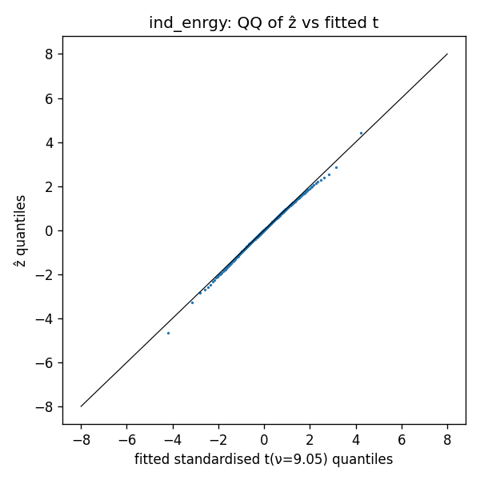
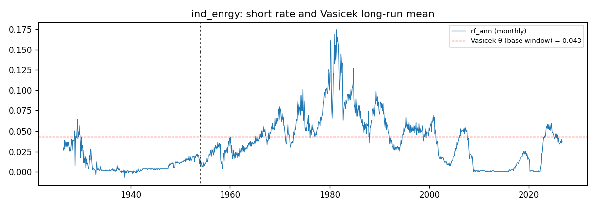
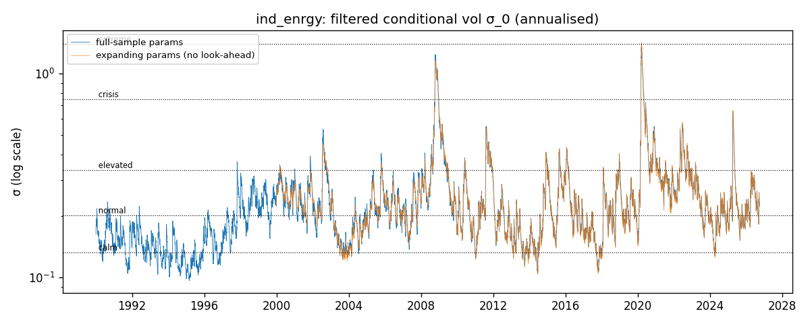
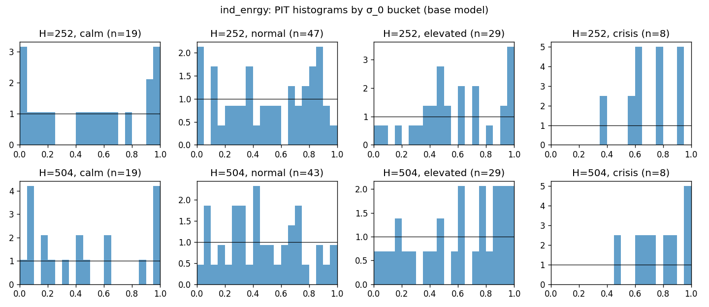
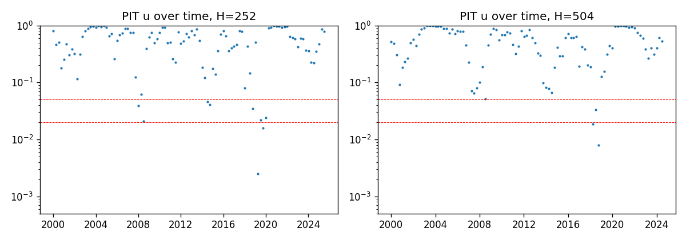
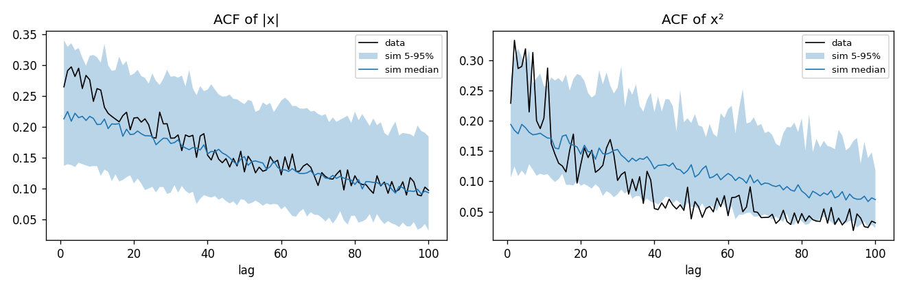
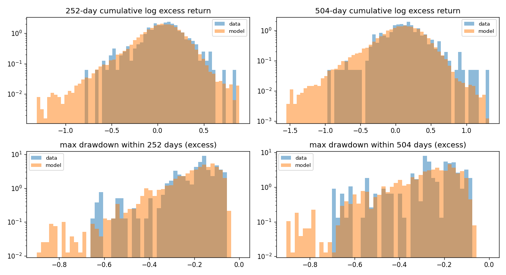
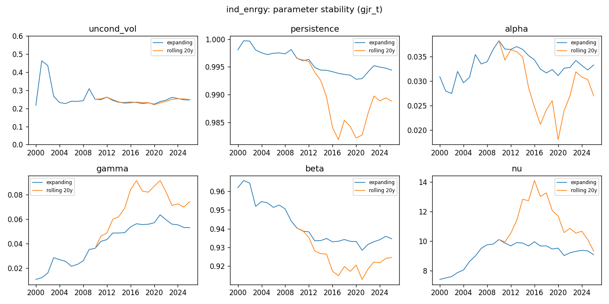

# Model report (Spec 02): `ind_enrgy`

Generated 2026-11-21T13:55:51 by `scripts/02_fit_model.py --asset ind_enrgy` in 42s. Estimation window 1990-01-02 – 2026-09-30 (9254 days). Base model **gjr_t**, gap variant **scale**, innovations **t**. Data hashes: `F-F_Research_Data_Factors_daily.csv` 3f7910502dd6…, `F-F_Research_Data_Factors.csv` a3894d74d553…, `10_Industry_Portfolios_Daily.csv` 01cfe3d5e54f….

**Fallback-window rule**: full-history base fit persistence 0.99748, valid parameter draws 50% → **triggered** (valid draws 0.50 < 0.7); all equity estimation uses data from 1990-01-01.

## 1. Model comparison

Log-likelihoods are for the *unscaled decimal* x; for the `scale` gap variant the Jacobian (−½ Σ log k) is added so log-likelihood/BIC are comparable across variants. PIT columns: observed share of historical starts with u below the level (nominal = the level), expanding-window parameters. PIT score = mean |obs − nominal|/nominal over σ_0 buckets at levels ≤ 5% (lower is better). 'buckets thin/fat' counts bucket×level cells whose CI excludes the nominal.

| model | gap_variant | nobs | loglik | bic | nu | persistence | half_life_days | uncond_vol_ann | PIT u<0.02 H252 | PIT u<0.05 H252 | PIT u<0.02 H504 | PIT u<0.05 H504 | PIT score | buckets thin/fat | VaR0.01 hit rate | VaR0.01 p_uc | VaR0.001 hit rate | VaR0.001 p_uc |
|---|---|---|---|---|---|---|---|---|---|---|---|---|---|---|---|---|---|---|
| garch_n | none | 9254 | 26821.8 | -53607.1 | n/a | 0.9949 | 135.6 | 27.4% | 5.83% | 9.71% | 3.03% | 5.05% | 1.21 | H252: 0/0, H504: 0/0 | 2.09% | 0.000 | 0.46% | 0.000 |
| garch_t | none | 9254 | 26959.9 | -53874.2 | 8.67 | 0.9967 | 210.3 | 29.3% | 3.88% | 8.74% | 2.02% | 3.03% | 1.16 | H252: 0/0, H504: 0/0 | 1.51% | 0.000 | 0.19% | 0.032 |
| gjr_t | none | 9254 | 26982.3 | -53909.7 | 9.02 | 0.9947 | 129.7 | 24.8% | 2.91% | 8.74% | 2.02% | 3.03% | 1.09 | H252: 0/0, H504: 0/0 | 1.50% | 0.000 | 0.16% | 0.132 |
| egarch_t | none | 9254 | 26994.6 | -53934.4 | 9.16 | 0.9914 | 80.1 | 20.7% | 2.91% | 9.71% | 2.02% | 5.05% | 1.10 | H252: 0/0, H504: 0/0 | 1.53% | 0.000 | 0.19% | 0.032 |
| garch_n | scale | 9254 | 26824.1 | -53611.6 | n/a | 0.9949 | 135.1 | 27.3% | 5.83% | 9.71% | 3.03% | 5.05% | 1.21 | H252: 0/0, H504: 0/0 | 2.08% | 0.000 | 0.45% | 0.000 |
| garch_t | scale | 9254 | 26961.6 | -53877.6 | 8.70 | 0.9967 | 209.9 | 29.2% | 4.85% | 8.74% | 2.02% | 3.03% | 1.19 | H252: 0/0, H504: 0/0 | 1.49% | 0.000 | 0.21% | 0.015 |
| gjr_t | scale | 9254 | 26984.0 | -53913.2 | 9.05 | 0.9947 | 130.1 | 24.8% | 1.94% | 8.74% | 2.02% | 3.03% | 1.10 | H252: 0/0, H504: 0/0 | 1.49% | 0.000 | 0.18% | 0.068 |
| egarch_t | scale | 9254 | 26996.6 | -53938.3 | 9.20 | 0.9914 | 80.2 | 20.7% | 2.91% | 8.74% | 2.02% | 5.05% | 1.09 | H252: 0/0, H504: 0/0 | 1.51% | 0.000 | 0.19% | 0.032 |
| gjr_t (FHS innovations) | scale | 9254 | 26984.0 | -53913.2 | 9.05 | 0.9947 | 130.1 | 24.8% | 0.97% | 5.83% | 1.01% | 3.03% | 0.82 | H252: 0/0, H504: 0/0 | n/a | n/a | n/a | n/a |

### Base model parameters (gjr_t, decimal daily units, robust SEs)

| param | estimate | se |
|---|---|---|
| mu | 0.000335905 | 0.000117 |
| omega | 1.29699e-06 | 3.04e-07 |
| alpha | 0.0338752 | 0.00501 |
| gamma | 0.0497844 | 0.0083 |
| beta | 0.93592 | 0.00624 |
| nu | 9.05273 | 0.832 |

log-lik 26985.9, AIC -53959.8, BIC -53917.0; persistence 0.9947; half-life 130.1 days; unconditional vol 24.8%; ν = 9.05.

## 2. Expected excess return (premium)

Raw estimate (mean of r − rf × 252): **9.95%** p.a., SE 4.24% (t = 2.35, 36.7 years). Shrunk 0.5 toward 0.0: **4.97%** used (mode `constant_arith`). Resolved coefficients for all modes (same average premium): `constant_arith` mu_e_daily=0.0001974; `prop_variance` mu_e_daily=0.0001974, lambda=0.7381; `constant_sharpe` mu_e_daily=0.0001974, S=0.01365

## 3. Standardised residuals (FHS pool)

n = 9254, mean -0.009, sd 1.002, skew -0.21, excess kurtosis 1.55 (fitted t implies 1.19); min -6.99 on 2025-04-03. The FHS pool is demeaned and scaled to unit variance before resampling.

## 4. Interest-rate model (Vasicek on monthly rf_ann)

| window | start | end | months | kappa | se_kappa | theta | s | half-life (y) | neg. months | rho used | rho same-month | rho prev-month |
|---|---|---|---|---|---|---|---|---|---|---|---|---|
| base | 1954-01 | 2026-09 | 440 | 0.338 | 0.095 | 4.30% | 2.57% | 2.0 | 0 | 0.015 | 0.015 | 0.051 |
| full_sample | 1926-07 | 2026-09 | 440 | 0.298 | 0.077 | 3.37% | 2.39% | 2.3 | 12 | 0.016 | 0.016 | 0.051 |
| from_1952-07 | 1952-07 | 2026-09 | 440 | 0.334 | 0.094 | 4.23% | 2.55% | 2.1 | 0 | 0.015 | 0.015 | 0.051 |

Negative monthly rf months in the data: 1933-02, 1938-03, 1938-07, 1938-11, 1939-01, 1939-03, 1939-08, 1940-05, 1940-08, 1941-01, 1941-02, 1941-04. Base window (1954-01-01+) excludes them: **True**. `floor_at_zero = False`.

## 5. Starting states (σ_0, r_0)

Under GJR-GARCH the one-step-ahead conditional variance σ_0² is the complete equity state (the sign of the last shock is already inside it); r_0 is the Vasicek state. Both are observable at t = 0. Named states are percentiles of the asset's own filtered σ history (full-sample params), so they transfer across assets. Annualised with N = 252 (see note on pre-1952 data in DECISIONS).

| state_name | sigma0_ann | r0_ann | definition |
|---|---|---|---|
| calm | 13.3% | 2.67% | P10 of filtered sigma; r0 = median rf_ann of estimation window |
| normal | 20.3% | 2.67% | P50 of filtered sigma; r0 = median rf_ann of estimation window |
| elevated | 33.6% | 2.67% | P90 of filtered sigma; r0 = median rf_ann of estimation window |
| crisis | 75.1% | 2.67% | P99 of filtered sigma; r0 = median rf_ann of estimation window |
| extreme | 140.5% | 2.67% | historical max of filtered sigma (2020-03-18); r0 = median rf_ann of estimation window |

Anchor dates (σ_0 = next-day vol at the close of the date):

| state_name | sigma0_ann | r0_ann | sigma0_ann_expanding | rv63_ann | dd252 |
|---|---|---|---|---|---|
| anchor_2006-12-29 | 19.3% | 4.9% | 19.2% | 20.1% | -4.3% |
| anchor_2008-10-10 | 94.3% | 1.0% | 84.7% | 59.0% | -50.2% |
| anchor_2008-11-20 | 104.9% | 0.4% | 103.1% | 97.0% | -51.2% |
| anchor_2020-03-16 | 133.2% | 1.4% | 135.5% | 67.4% | -59.1% |
| anchor_2022-06-16 | 46.3% | 0.7% | 47.2% | 38.9% | -15.1% |
| anchor_2026-09-30 | 22.4% | 3.8% | 22.4% | 23.2% | -6.5% |

σ_0 bucket edges used in the PIT/VaR tests (annualised): calm: [9.6%, 16.8%), normal: [16.8%, 24.6%), elevated: [24.6%, 40.6%), crisis: [40.6%, n/a)

## 6. Conditional tail calibration (PIT test)

Quarterly start dates; at each start the model is re-estimated on data **before** the start (expanding window, refit every 252 days; premium and rate model also expanding). 2000 paths per start. u = model CDF of the realised cumulative log total return over H days. Effective n = non-overlapping windows = n_starts × 63/H; CIs are Wilson 95% on the effective n. 'too thin' = more realised left-tail outcomes than the model predicts (dangerous for the floor).

### gjr_t / scale / t

| group_type | group | H | n_starts | n_eff | u<0.01 | u<0.02 | u<0.05 | u<0.1 |
|---|---|---|---|---|---|---|---|---|
| overall | all | 252 | 103 | 25.8 | 1.0% (0.1%–14.6%) | 1.9% (0.2%–16.2%) | 8.7% (2.6%–25.6%) | 10.7% (3.5%–28.0%) |
| bucket | calm | 252 | 19 | 4.8 | 0.0% (0.0%–44.7%) | 0.0% (0.0%–44.7%) | 15.8% (2.3%–59.9%) | 21.1% (3.8%–64.2%) |
| bucket | crisis | 252 | 8 | 2.0 | 0.0% (0.0%–65.8%) | 0.0% (0.0%–65.8%) | 0.0% (0.0%–65.8%) | 0.0% (0.0%–65.8%) |
| bucket | elevated | 252 | 29 | 7.2 | 0.0% (0.0%–34.6%) | 0.0% (0.0%–34.6%) | 3.4% (0.2%–38.9%) | 6.9% (0.7%–42.9%) |
| bucket | normal | 252 | 47 | 11.8 | 2.1% (0.1%–27.7%) | 4.3% (0.4%–30.6%) | 10.6% (2.2%–38.5%) | 10.6% (2.2%–38.5%) |
| bucket_group | high | 252 | 37 | 9.2 | 0.0% (0.0%–29.3%) | 0.0% (0.0%–29.3%) | 2.7% (0.2%–33.0%) | 5.4% (0.6%–36.4%) |
| era | 1952-1999 | 252 | 0 | 0.0 | n/a (n/a–n/a) | n/a (n/a–n/a) | n/a (n/a–n/a) | n/a (n/a–n/a) |
| era | 2000- | 252 | 103 | 25.8 | 1.0% (0.1%–14.6%) | 1.9% (0.2%–16.2%) | 8.7% (2.6%–25.6%) | 10.7% (3.5%–28.0%) |
| era | pre-1952 | 252 | 0 | 0.0 | n/a (n/a–n/a) | n/a (n/a–n/a) | n/a (n/a–n/a) | n/a (n/a–n/a) |
| overall | all | 504 | 99 | 12.4 | 1.0% (0.0%–25.2%) | 2.0% (0.1%–26.7%) | 3.0% (0.2%–28.1%) | 12.1% (2.9%–39.3%) |
| bucket | calm | 504 | 19 | 2.4 | 5.3% (0.2%–65.7%) | 5.3% (0.2%–65.7%) | 5.3% (0.2%–65.7%) | 26.3% (3.4%–78.5%) |
| bucket | crisis | 504 | 8 | 1.0 | 0.0% (0.0%–79.3%) | 0.0% (0.0%–79.3%) | 0.0% (0.0%–79.3%) | 0.0% (0.0%–79.3%) |
| bucket | elevated | 504 | 29 | 3.6 | 0.0% (0.0%–51.4%) | 3.4% (0.1%–54.7%) | 3.4% (0.1%–54.7%) | 6.9% (0.4%–57.7%) |
| bucket | normal | 504 | 43 | 5.4 | 0.0% (0.0%–41.7%) | 0.0% (0.0%–41.7%) | 2.3% (0.1%–44.3%) | 11.6% (1.5%–53.8%) |
| bucket_group | high | 504 | 37 | 4.6 | 0.0% (0.0%–45.4%) | 2.7% (0.1%–48.2%) | 2.7% (0.1%–48.2%) | 5.4% (0.3%–51.0%) |
| era | 1952-1999 | 504 | 0 | 0.0 | n/a (n/a–n/a) | n/a (n/a–n/a) | n/a (n/a–n/a) | n/a (n/a–n/a) |
| era | 2000- | 504 | 99 | 12.4 | 1.0% (0.0%–25.2%) | 2.0% (0.1%–26.7%) | 3.0% (0.2%–28.1%) | 12.1% (2.9%–39.3%) |
| era | pre-1952 | 504 | 0 | 0.0 | n/a (n/a–n/a) | n/a (n/a–n/a) | n/a (n/a–n/a) | n/a (n/a–n/a) |

**Verdicts:**

- H=252, bucket `calm`: inconclusive: too few independent windows to test (CI would include 0% and >20%)
- H=252, bucket `normal`: no evidence of miscalibration (nominal inside the CI at all levels), but low power: the CI at the 2% level spans 30%
- H=252, bucket `elevated`: inconclusive: too few independent windows to test (CI would include 0% and >20%)
- H=252, bucket `crisis`: inconclusive: too few independent windows to test (CI would include 0% and >20%)
- H=252, bucket_group `high`: no evidence of miscalibration (nominal inside the CI at all levels), but low power: the CI at the 2% level spans 29%
- H=252, era `pre-1952`: no data
- H=252, era `1952-1999`: no data
- H=252, era `2000-`: no evidence of miscalibration (nominal inside the CI at all levels), but low power: the CI at the 2% level spans 16%
- H=504, bucket `calm`: inconclusive: too few independent windows to test (CI would include 0% and >20%)
- H=504, bucket `normal`: inconclusive: too few independent windows to test (CI would include 0% and >20%)
- H=504, bucket `elevated`: inconclusive: too few independent windows to test (CI would include 0% and >20%)
- H=504, bucket `crisis`: inconclusive: too few independent windows to test (CI would include 0% and >20%)
- H=504, bucket_group `high`: inconclusive: too few independent windows to test (CI would include 0% and >20%)
- H=504, era `pre-1952`: no data
- H=504, era `1952-1999`: no data
- H=504, era `2000-`: no evidence of miscalibration (nominal inside the CI at all levels), but low power: the CI at the 2% level spans 27%

### gjr_t / scale / fhs

| group_type | group | H | n_starts | n_eff | u<0.01 | u<0.02 | u<0.05 | u<0.1 |
|---|---|---|---|---|---|---|---|---|
| overall | all | 252 | 103 | 25.8 | 0.0% (0.0%–13.0%) | 1.0% (0.1%–14.6%) | 5.8% (1.4%–21.8%) | 9.7% (3.1%–26.8%) |
| bucket | calm | 252 | 19 | 4.8 | 0.0% (0.0%–44.7%) | 0.0% (0.0%–44.7%) | 5.3% (0.3%–50.2%) | 15.8% (2.3%–59.9%) |
| bucket | crisis | 252 | 8 | 2.0 | 0.0% (0.0%–65.8%) | 0.0% (0.0%–65.8%) | 0.0% (0.0%–65.8%) | 0.0% (0.0%–65.8%) |
| bucket | elevated | 252 | 29 | 7.2 | 0.0% (0.0%–34.6%) | 0.0% (0.0%–34.6%) | 3.4% (0.2%–38.9%) | 6.9% (0.7%–42.9%) |
| bucket | normal | 252 | 47 | 11.8 | 0.0% (0.0%–24.6%) | 2.1% (0.1%–27.7%) | 8.5% (1.5%–35.9%) | 10.6% (2.2%–38.5%) |
| bucket_group | high | 252 | 37 | 9.2 | 0.0% (0.0%–29.3%) | 0.0% (0.0%–29.3%) | 2.7% (0.2%–33.0%) | 5.4% (0.6%–36.4%) |
| era | 1952-1999 | 252 | 0 | 0.0 | n/a (n/a–n/a) | n/a (n/a–n/a) | n/a (n/a–n/a) | n/a (n/a–n/a) |
| era | 2000- | 252 | 103 | 25.8 | 0.0% (0.0%–13.0%) | 1.0% (0.1%–14.6%) | 5.8% (1.4%–21.8%) | 9.7% (3.1%–26.8%) |
| era | pre-1952 | 252 | 0 | 0.0 | n/a (n/a–n/a) | n/a (n/a–n/a) | n/a (n/a–n/a) | n/a (n/a–n/a) |
| overall | all | 504 | 99 | 12.4 | 0.0% (0.0%–23.7%) | 1.0% (0.0%–25.2%) | 3.0% (0.2%–28.1%) | 9.1% (1.8%–35.8%) |
| bucket | calm | 504 | 19 | 2.4 | 0.0% (0.0%–61.8%) | 5.3% (0.2%–65.7%) | 5.3% (0.2%–65.7%) | 15.8% (1.3%–72.5%) |
| bucket | crisis | 504 | 8 | 1.0 | 0.0% (0.0%–79.3%) | 0.0% (0.0%–79.3%) | 0.0% (0.0%–79.3%) | 0.0% (0.0%–79.3%) |
| bucket | elevated | 504 | 29 | 3.6 | 0.0% (0.0%–51.4%) | 0.0% (0.0%–51.4%) | 3.4% (0.1%–54.7%) | 6.9% (0.4%–57.7%) |
| bucket | normal | 504 | 43 | 5.4 | 0.0% (0.0%–41.7%) | 0.0% (0.0%–41.7%) | 2.3% (0.1%–44.3%) | 9.3% (1.0%–51.6%) |
| bucket_group | high | 504 | 37 | 4.6 | 0.0% (0.0%–45.4%) | 0.0% (0.0%–45.4%) | 2.7% (0.1%–48.2%) | 5.4% (0.3%–51.0%) |
| era | 1952-1999 | 504 | 0 | 0.0 | n/a (n/a–n/a) | n/a (n/a–n/a) | n/a (n/a–n/a) | n/a (n/a–n/a) |
| era | 2000- | 504 | 99 | 12.4 | 0.0% (0.0%–23.7%) | 1.0% (0.0%–25.2%) | 3.0% (0.2%–28.1%) | 9.1% (1.8%–35.8%) |
| era | pre-1952 | 504 | 0 | 0.0 | n/a (n/a–n/a) | n/a (n/a–n/a) | n/a (n/a–n/a) | n/a (n/a–n/a) |

**Verdicts:**

- H=252, bucket `calm`: inconclusive: too few independent windows to test (CI would include 0% and >20%)
- H=252, bucket `normal`: no evidence of miscalibration (nominal inside the CI at all levels), but low power: the CI at the 2% level spans 28%
- H=252, bucket `elevated`: inconclusive: too few independent windows to test (CI would include 0% and >20%)
- H=252, bucket `crisis`: inconclusive: too few independent windows to test (CI would include 0% and >20%)
- H=252, bucket_group `high`: no evidence of miscalibration (nominal inside the CI at all levels), but low power: the CI at the 2% level spans 29%
- H=252, era `pre-1952`: no data
- H=252, era `1952-1999`: no data
- H=252, era `2000-`: no evidence of miscalibration (nominal inside the CI at all levels), but low power: the CI at the 2% level spans 15%
- H=504, bucket `calm`: inconclusive: too few independent windows to test (CI would include 0% and >20%)
- H=504, bucket `normal`: inconclusive: too few independent windows to test (CI would include 0% and >20%)
- H=504, bucket `elevated`: inconclusive: too few independent windows to test (CI would include 0% and >20%)
- H=504, bucket `crisis`: inconclusive: too few independent windows to test (CI would include 0% and >20%)
- H=504, bucket_group `high`: inconclusive: too few independent windows to test (CI would include 0% and >20%)
- H=504, era `pre-1952`: no data
- H=504, era `1952-1999`: no data
- H=504, era `2000-`: no evidence of miscalibration (nominal inside the CI at all levels), but low power: the CI at the 2% level spans 25%

## 7. One-day tail check

| level | bucket | n | hits | rate | LR_uc | p_uc | LR_ind | p_ind |
|---|---|---|---|---|---|---|---|---|
| 0.01 | all | 6734 | 100 | 1.485% | 13.92 | 0.000 | 5.36 | 0.021 |
| 0.01 | calm | 1237 | 19 | 1.536% | 3.08 | 0.079 | 0.56 | 0.454 |
| 0.01 | crisis | 452 | 7 | 1.549% | 1.18 | 0.278 | 0.22 | 0.638 |
| 0.01 | elevated | 2131 | 23 | 1.079% | 0.13 | 0.716 | 1.33 | 0.248 |
| 0.01 | normal | 2914 | 51 | 1.750% | 13.54 | 0.000 | 0.01 | 0.910 |
| 0.001 | all | 6734 | 12 | 0.178% | 3.34 | 0.068 | 0.04 | 0.836 |
| 0.001 | calm | 1237 | 5 | 0.404% | 6.45 | 0.011 | 0.04 | 0.840 |
| 0.001 | crisis | 452 | 2 | 0.442% | 2.86 | 0.091 | 0.02 | 0.894 |
| 0.001 | elevated | 2131 | 1 | 0.047% | 0.75 | 0.387 | 0.00 | 0.976 |
| 0.001 | normal | 2914 | 4 | 0.137% | 0.36 | 0.547 | 0.01 | 0.916 |

(Christoffersen independence within a bucket uses consecutive days of that bucket's sub-sequence.)

## 8. Stylised facts: data vs simulated long paths

40 simulated paths of the estimation-window length from the base model (t innovations, base premium and rate model).

| statistic | data | model |
|---|---|---|
| annualised vol of x | 25.7% | 23.5% (5–95%: 19.9%–28.7%) |
| excess kurtosis of daily x | 13.3 | 5.1 (5–95%: 2.1–13.0) |
| skew of daily x | -0.48 | 0.02 |
| ACF |x| lags 1/10/50/100 | 0.26 / 0.26 / 0.13 / 0.10 | 0.21 / 0.20 / 0.15 / 0.09 |

252-day windows (start every 21 days) — quantiles:

| quantile | cum log excess, data | cum log excess, model | max DD, data | max DD, model |
|---|---|---|---|---|
| 0.01 | -54.4% | -70.0% | -61.4% | -65.6% |
| 0.02 | -47.9% | -56.7% | -61.1% | -54.8% |
| 0.05 | -33.4% | -37.6% | -45.9% | -43.2% |
| 0.1 | -18.7% | -24.4% | -32.0% | -37.1% |
| 0.5 | 8.1% | 5.0% | -17.1% | -17.8% |

504-day windows (start every 21 days) — quantiles:

| quantile | cum log excess, data | cum log excess, model | max DD, data | max DD, model |
|---|---|---|---|---|
| 0.01 | -71.5% | -94.5% | -69.9% | -78.0% |
| 0.02 | -53.2% | -77.0% | -65.3% | -65.6% |
| 0.05 | -32.9% | -53.7% | -61.1% | -57.9% |
| 0.1 | -22.6% | -33.9% | -51.6% | -48.7% |
| 0.5 | 11.8% | 9.5% | -25.6% | -24.7% |

Simulated x clipped at −99% simple return: 0 times.

## 9. Parameter stability

| sample | start | end | nobs | mu | omega | alpha | gamma | beta | nu | persistence | half_life_days | uncond_vol_ann | loglik |
|---|---|---|---|---|---|---|---|---|---|---|---|---|---|
| estimation window (base) | 1990-01-02 | 2026-09-30 | 9254 | 3.36e-04 | 1.30e-06 | 0.034 | 0.050 | 0.936 | 9.05 | 0.9947 | 130 | 24.8% | 26986 |
| pre-1963 (skipped: 0 obs) | n/a | n/a | n/a | n/a | n/a | n/a | n/a | n/a | n/a | n/a | n/a | n/a | n/a |
| 1963-1999 | 1990-01-02 | 1999-12-31 | 2528 | 9.20e-05 | 3.60e-07 | 0.031 | 0.011 | 0.962 | 7.42 | 0.9980 | 349 | 21.4% | 8175 |
| 2000-end | 2000-01-03 | 2026-09-30 | 6726 | 5.08e-04 | 2.84e-06 | 0.029 | 0.064 | 0.926 | 10.03 | 0.9877 | 56 | 24.1% | 18832 |

## 10. Parameter-uncertainty draws

200 draws from the asymptotic normal of the robust covariance (acceptance 50.0%; rejected: non-stationary, ω ≤ 0, negative ARCH terms, ν ≤ 2.5). Unconditional vol 5–95%: 20.9%–36.5%; ν 5–95%: 7.75–10.52. Saved to `results/model/param_draws_ind_enrgy.npy` (columns ['mu', 'omega', 'alpha', 'gamma', 'beta', 'nu']).

## 11. Closure-gap returns

| date | from | calendar_days | busdays | x |
|---|---|---|---|---|
| 2001-09-17 | 2001-09-10 | 7 | 5 | -2.70% |
| 2007-01-03 | 2006-12-29 | 5 | 3 | -3.83% |
| 2012-10-31 | 2012-10-26 | 5 | 3 | 0.00% |

Variant `scale` divides these returns by sqrt(busdays) before fitting; `none` uses them as is. Compare the rows of the model comparison table with the same model name.

