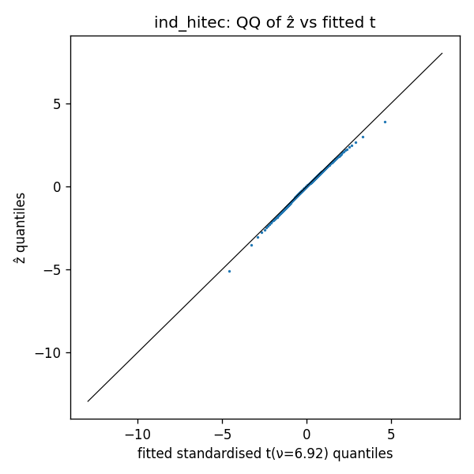
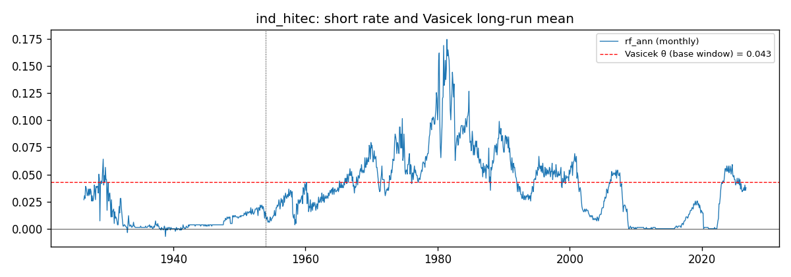
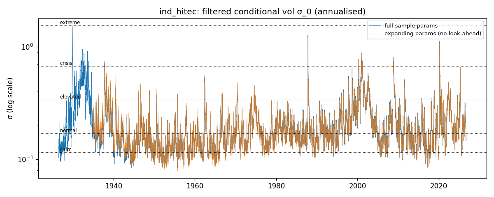
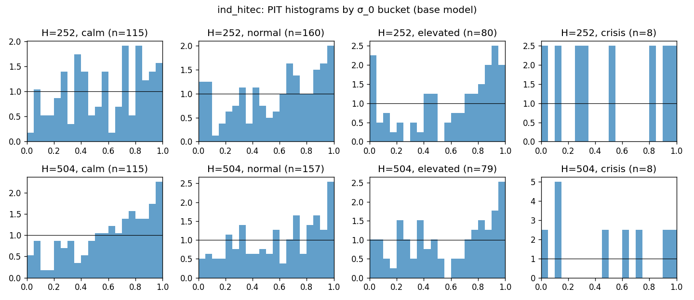
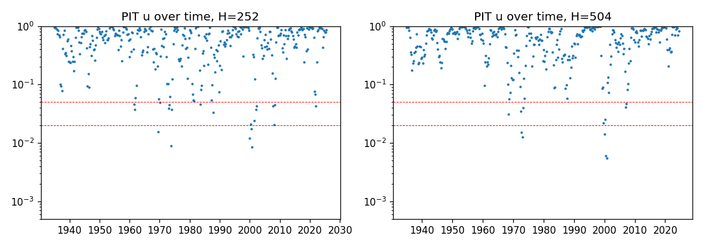
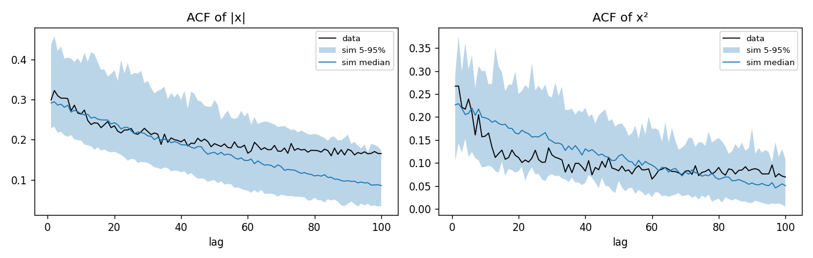
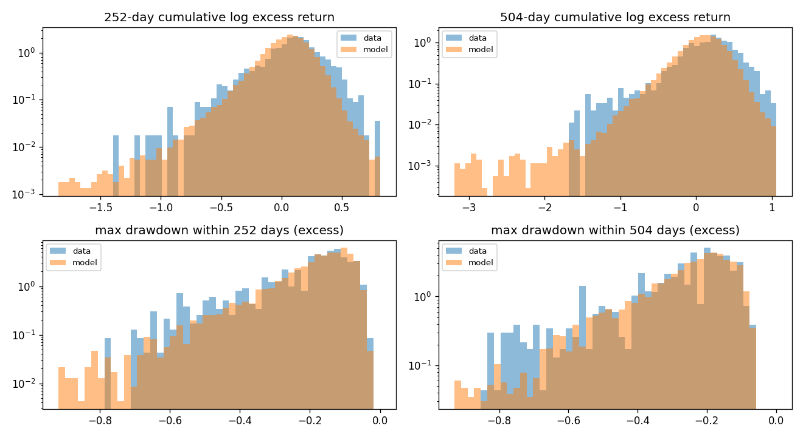
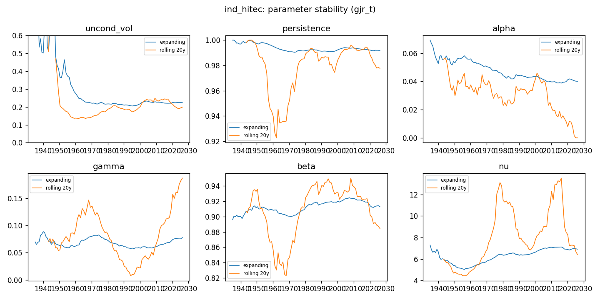

# Model report (Spec 02): `ind_hitec`

Generated 2026-11-21T13:56:33 by `scripts/02_fit_model.py --asset ind_hitec` in 117s. Estimation window 1926-07-01 – 2026-09-30 (26338 days). Base model **gjr_t**, gap variant **scale**, innovations **t**. Data hashes: `F-F_Research_Data_Factors_daily.csv` 3f7910502dd6…, `F-F_Research_Data_Factors.csv` a3894d74d553…, `10_Industry_Portfolios_Daily.csv` 01cfe3d5e54f….

**Fallback-window rule**: full-history base fit persistence 0.99171, valid parameter draws 100% → not triggered; full history used.

## 1. Model comparison

Log-likelihoods are for the *unscaled decimal* x; for the `scale` gap variant the Jacobian (−½ Σ log k) is added so log-likelihood/BIC are comparable across variants. PIT columns: observed share of historical starts with u below the level (nominal = the level), expanding-window parameters. PIT score = mean |obs − nominal|/nominal over σ_0 buckets at levels ≤ 5% (lower is better). 'buckets thin/fat' counts bucket×level cells whose CI excludes the nominal.

| model | gap_variant | nobs | loglik | bic | nu | persistence | half_life_days | uncond_vol_ann | PIT u<0.02 H252 | PIT u<0.05 H252 | PIT u<0.02 H504 | PIT u<0.05 H504 | PIT score | buckets thin/fat | VaR0.01 hit rate | VaR0.01 p_uc | VaR0.001 hit rate | VaR0.001 p_uc |
|---|---|---|---|---|---|---|---|---|---|---|---|---|---|---|---|---|---|---|
| garch_n | none | 26338 | 79632.7 | -159224.7 | n/a | 0.9887 | 61.1 | 22.4% | 2.20% | 6.34% | 2.23% | 3.34% | 2.38 | H252: 1/0, H504: 0/0 | 1.74% | 0.000 | 0.54% | 0.000 |
| garch_t | none | 26338 | 80284.0 | -160517.2 | 6.56 | 0.9954 | 149.1 | 27.3% | 1.93% | 6.06% | 1.95% | 3.34% | 1.27 | H252: 0/0, H504: 0/0 | 1.15% | 0.027 | 0.12% | 0.404 |
| gjr_t | none | 26338 | 80399.8 | -160738.5 | 6.89 | 0.9917 | 83.2 | 22.4% | 1.38% | 6.06% | 1.67% | 3.34% | 1.15 | H252: 0/0, H504: 0/0 | 1.12% | 0.075 | 0.11% | 0.659 |
| egarch_t | none | 26338 | 80422.9 | -160784.7 | 6.81 | 0.9891 | 63.0 | 17.7% | 1.65% | 4.41% | 1.95% | 3.06% | 1.78 | H252: 0/0, H504: 0/0 | 1.07% | 0.279 | 0.13% | 0.223 |
| garch_n | scale | 26338 | 79649.7 | -159258.8 | n/a | 0.9886 | 60.6 | 22.3% | 2.20% | 6.34% | 2.23% | 3.62% | 2.61 | H252: 1/0, H504: 0/0 | 1.74% | 0.000 | 0.54% | 0.000 |
| garch_t | scale | 26338 | 80291.4 | -160532.0 | 6.60 | 0.9954 | 150.2 | 27.3% | 1.93% | 5.79% | 1.67% | 3.34% | 1.18 | H252: 0/0, H504: 0/0 | 1.15% | 0.023 | 0.12% | 0.404 |
| gjr_t | scale | 26338 | 80405.4 | -160749.8 | 6.92 | 0.9917 | 83.3 | 22.4% | 1.38% | 5.79% | 1.39% | 3.34% | 0.87 | H252: 0/0, H504: 0/0 | 1.12% | 0.066 | 0.12% | 0.404 |
| egarch_t | scale | 26338 | 80428.6 | -160796.2 | 6.85 | 0.9891 | 63.0 | 17.7% | 1.93% | 4.41% | 1.95% | 3.06% | 1.81 | H252: 0/0, H504: 0/0 | 1.07% | 0.252 | 0.13% | 0.111 |
| gjr_t (FHS innovations) | scale | 26338 | 80405.4 | -160749.8 | 6.92 | 0.9917 | 83.3 | 22.4% | 1.10% | 4.41% | 1.11% | 2.51% | 1.20 | H252: 0/0, H504: 0/0 | n/a | n/a | n/a | n/a |

### Base model parameters (gjr_t, decimal daily units, robust SEs)

| param | estimate | se |
|---|---|---|
| mu | 0.000566068 | 5.85e-05 |
| omega | 1.65099e-06 | 2.17e-07 |
| alpha | 0.0398691 | 0.00358 |
| gamma | 0.0773496 | 0.00703 |
| beta | 0.913171 | 0.00569 |
| nu | 6.92348 | 0.295 |

log-lik 80411.1, AIC -160810.3, BIC -160761.2; persistence 0.9917; half-life 83.3 days; unconditional vol 22.4%; ν = 6.92.

## 2. Expected excess return (premium)

Raw estimate (mean of r − rf × 252): **10.33%** p.a., SE 2.31% (t = 4.47, 104.5 years). Shrunk 0.5 toward 0.0: **5.16%** used (mode `constant_arith`). Resolved coefficients for all modes (same average premium): `constant_arith` mu_e_daily=0.0002049; `prop_variance` mu_e_daily=0.0002049, lambda=0.9146; `constant_sharpe` mu_e_daily=0.0002049, S=0.01576

## 3. Standardised residuals (FHS pool)

n = 26338, mean -0.021, sd 1.001, skew -0.36, excess kurtosis 2.93 (fitted t implies 2.05); min -12.93 on 1955-09-26. The FHS pool is demeaned and scaled to unit variance before resampling.

## 4. Interest-rate model (Vasicek on monthly rf_ann)

| window | start | end | months | kappa | se_kappa | theta | s | half-life (y) | neg. months | rho used | rho same-month | rho prev-month |
|---|---|---|---|---|---|---|---|---|---|---|---|---|
| base | 1954-01 | 2026-09 | 872 | 0.338 | 0.095 | 4.30% | 2.57% | 2.0 | 0 | -0.088 | -0.088 | -0.023 |
| full_sample | 1926-07 | 2026-09 | 1202 | 0.298 | 0.077 | 3.37% | 2.39% | 2.3 | 12 | -0.054 | -0.054 | -0.031 |
| from_1952-07 | 1952-07 | 2026-09 | 890 | 0.334 | 0.094 | 4.23% | 2.55% | 2.1 | 0 | -0.090 | -0.090 | -0.021 |

Negative monthly rf months in the data: 1933-02, 1938-03, 1938-07, 1938-11, 1939-01, 1939-03, 1939-08, 1940-05, 1940-08, 1941-01, 1941-02, 1941-04. Base window (1954-01-01+) excludes them: **True**. `floor_at_zero = False`.

## 5. Starting states (σ_0, r_0)

Under GJR-GARCH the one-step-ahead conditional variance σ_0² is the complete equity state (the sign of the last shock is already inside it); r_0 is the Vasicek state. Both are observable at t = 0. Named states are percentiles of the asset's own filtered σ history (full-sample params), so they transfer across assets. Annualised with N = 252 (see note on pre-1952 data in DECISIONS).

| state_name | sigma0_ann | r0_ann | definition |
|---|---|---|---|
| calm | 11.6% | 2.67% | P10 of filtered sigma; r0 = median rf_ann of estimation window |
| normal | 17.0% | 2.67% | P50 of filtered sigma; r0 = median rf_ann of estimation window |
| elevated | 33.9% | 2.67% | P90 of filtered sigma; r0 = median rf_ann of estimation window |
| crisis | 67.4% | 2.67% | P99 of filtered sigma; r0 = median rf_ann of estimation window |
| extreme | 154.5% | 2.67% | historical max of filtered sigma (1929-11-06); r0 = median rf_ann of estimation window |

Anchor dates (σ_0 = next-day vol at the close of the date):

| state_name | sigma0_ann | r0_ann | sigma0_ann_expanding | rv63_ann | dd252 |
|---|---|---|---|---|---|
| anchor_2006-12-29 | 12.3% | 4.9% | 12.2% | 11.5% | -2.5% |
| anchor_1987-10-16 | 38.8% | 7.4% | 37.0% | 21.6% | -14.6% |
| anchor_1987-10-19 | 127.1% | 7.4% | 120.0% | 49.3% | -31.6% |
| anchor_2008-10-10 | 62.4% | 1.0% | 60.1% | 37.1% | -42.4% |
| anchor_2008-11-20 | 72.4% | 0.4% | 71.2% | 60.4% | -52.3% |
| anchor_2020-03-16 | 111.7% | 1.4% | 109.3% | 52.2% | -30.0% |
| anchor_2022-06-16 | 47.3% | 0.7% | 47.2% | 37.7% | -32.8% |
| anchor_2026-09-30 | 14.7% | 3.8% | 14.7% | 18.8% | -0.9% |

σ_0 bucket edges used in the PIT/VaR tests (annualised): calm: [8.4%, 14.1%), normal: [14.1%, 21.5%), elevated: [21.5%, 44.1%), crisis: [44.1%, n/a)

## 6. Conditional tail calibration (PIT test)

Quarterly start dates; at each start the model is re-estimated on data **before** the start (expanding window, refit every 252 days; premium and rate model also expanding). 2000 paths per start. u = model CDF of the realised cumulative log total return over H days. Effective n = non-overlapping windows = n_starts × 63/H; CIs are Wilson 95% on the effective n. 'too thin' = more realised left-tail outcomes than the model predicts (dangerous for the floor).

### gjr_t / scale / t

| group_type | group | H | n_starts | n_eff | u<0.01 | u<0.02 | u<0.05 | u<0.1 |
|---|---|---|---|---|---|---|---|---|
| overall | all | 252 | 363 | 90.8 | 0.6% (0.1%–5.1%) | 1.4% (0.3%–6.4%) | 5.8% (2.5%–12.6%) | 10.7% (5.9%–18.8%) |
| bucket | calm | 252 | 115 | 28.8 | 0.0% (0.0%–11.8%) | 0.0% (0.0%–11.8%) | 0.9% (0.1%–13.3%) | 6.1% (1.6%–21.0%) |
| bucket | crisis | 252 | 8 | 2.0 | 0.0% (0.0%–65.8%) | 0.0% (0.0%–65.8%) | 12.5% (0.7%–73.6%) | 12.5% (0.7%–73.6%) |
| bucket | elevated | 252 | 80 | 20.0 | 2.5% (0.3%–20.0%) | 3.8% (0.5%–21.9%) | 11.2% (3.4%–31.6%) | 13.8% (4.6%–34.6%) |
| bucket | normal | 252 | 160 | 40.0 | 0.0% (0.0%–8.8%) | 1.2% (0.1%–10.9%) | 6.2% (2.0%–18.2%) | 12.5% (5.5%–26.1%) |
| bucket_group | high | 252 | 88 | 22.0 | 2.3% (0.2%–18.5%) | 3.4% (0.5%–20.2%) | 11.4% (3.6%–30.6%) | 13.6% (4.7%–33.3%) |
| era | 1952-1999 | 252 | 192 | 48.0 | 0.5% (0.0%–8.3%) | 1.0% (0.1%–9.2%) | 5.2% (1.6%–15.4%) | 11.5% (5.2%–23.4%) |
| era | 2000- | 252 | 103 | 25.8 | 1.0% (0.1%–14.6%) | 2.9% (0.4%–17.6%) | 10.7% (3.5%–28.0%) | 12.6% (4.6%–30.4%) |
| era | pre-1952 | 252 | 68 | 17.0 | 0.0% (0.0%–18.4%) | 0.0% (0.0%–18.4%) | 0.0% (0.0%–18.4%) | 5.9% (1.0%–27.0%) |
| overall | all | 504 | 359 | 44.9 | 0.6% (0.0%–8.9%) | 1.4% (0.2%–10.3%) | 3.3% (0.8%–13.3%) | 7.2% (2.6%–18.6%) |
| bucket | calm | 504 | 115 | 14.4 | 0.0% (0.0%–21.1%) | 0.9% (0.0%–22.4%) | 2.6% (0.2%–25.0%) | 7.0% (1.2%–30.8%) |
| bucket | crisis | 504 | 8 | 1.0 | 0.0% (0.0%–79.3%) | 0.0% (0.0%–79.3%) | 12.5% (0.4%–84.1%) | 12.5% (0.4%–84.1%) |
| bucket | elevated | 504 | 79 | 9.9 | 2.5% (0.1%–31.5%) | 2.5% (0.1%–31.5%) | 5.1% (0.5%–34.8%) | 10.1% (1.8%–40.8%) |
| bucket | normal | 504 | 157 | 19.6 | 0.0% (0.0%–16.4%) | 1.3% (0.1%–18.4%) | 2.5% (0.3%–20.4%) | 5.7% (1.1%–24.9%) |
| bucket_group | high | 504 | 87 | 10.9 | 2.3% (0.1%–29.4%) | 2.3% (0.1%–29.4%) | 5.7% (0.7%–33.9%) | 10.3% (2.0%–39.4%) |
| era | 1952-1999 | 504 | 192 | 24.0 | 0.0% (0.0%–13.8%) | 1.0% (0.1%–15.5%) | 3.1% (0.4%–18.7%) | 9.4% (2.8%–27.2%) |
| era | 2000- | 504 | 99 | 12.4 | 2.0% (0.1%–26.7%) | 3.0% (0.2%–28.1%) | 6.1% (0.9%–32.1%) | 8.1% (1.4%–34.6%) |
| era | pre-1952 | 504 | 68 | 8.5 | 0.0% (0.0%–31.1%) | 0.0% (0.0%–31.1%) | 0.0% (0.0%–31.1%) | 0.0% (0.0%–31.1%) |

**Verdicts:**

- H=252, bucket `calm`: no evidence of miscalibration (nominal inside the CI at all levels), but low power: the CI at the 2% level spans 12%
- H=252, bucket `normal`: no evidence of miscalibration (nominal inside the CI at all levels), but low power: the CI at the 2% level spans 11%
- H=252, bucket `elevated`: no evidence of miscalibration (nominal inside the CI at all levels), but low power: the CI at the 2% level spans 21%
- H=252, bucket `crisis`: inconclusive: too few independent windows to test (CI would include 0% and >20%)
- H=252, bucket_group `high`: no evidence of miscalibration (nominal inside the CI at all levels), but low power: the CI at the 2% level spans 20%
- H=252, era `pre-1952`: no evidence of miscalibration (nominal inside the CI at all levels), but low power: the CI at the 2% level spans 18%
- H=252, era `1952-1999`: no evidence of miscalibration (nominal inside the CI at all levels), but low power: the CI at the 2% level spans 9%
- H=252, era `2000-`: no evidence of miscalibration (nominal inside the CI at all levels), but low power: the CI at the 2% level spans 17%
- H=504, bucket `calm`: no evidence of miscalibration (nominal inside the CI at all levels), but low power: the CI at the 2% level spans 22%
- H=504, bucket `normal`: no evidence of miscalibration (nominal inside the CI at all levels), but low power: the CI at the 2% level spans 18%
- H=504, bucket `elevated`: no evidence of miscalibration (nominal inside the CI at all levels), but low power: the CI at the 2% level spans 31%
- H=504, bucket `crisis`: inconclusive: too few independent windows to test (CI would include 0% and >20%)
- H=504, bucket_group `high`: no evidence of miscalibration (nominal inside the CI at all levels), but low power: the CI at the 2% level spans 29%
- H=504, era `pre-1952`: no evidence of miscalibration (nominal inside the CI at all levels), but low power: the CI at the 2% level spans 31%
- H=504, era `1952-1999`: no evidence of miscalibration (nominal inside the CI at all levels), but low power: the CI at the 2% level spans 15%
- H=504, era `2000-`: no evidence of miscalibration (nominal inside the CI at all levels), but low power: the CI at the 2% level spans 28%

### gjr_t / scale / fhs

| group_type | group | H | n_starts | n_eff | u<0.01 | u<0.02 | u<0.05 | u<0.1 |
|---|---|---|---|---|---|---|---|---|
| overall | all | 252 | 363 | 90.8 | 0.0% (0.0%–4.1%) | 1.1% (0.2%–6.0%) | 4.4% (1.7%–10.8%) | 9.9% (5.3%–17.8%) |
| bucket | calm | 252 | 115 | 28.8 | 0.0% (0.0%–11.8%) | 0.0% (0.0%–11.8%) | 0.0% (0.0%–11.8%) | 4.3% (0.9%–18.6%) |
| bucket | crisis | 252 | 8 | 2.0 | 0.0% (0.0%–65.8%) | 12.5% (0.7%–73.6%) | 12.5% (0.7%–73.6%) | 12.5% (0.7%–73.6%) |
| bucket | elevated | 252 | 80 | 20.0 | 0.0% (0.0%–16.1%) | 2.5% (0.3%–20.0%) | 10.0% (2.8%–30.1%) | 13.8% (4.6%–34.6%) |
| bucket | normal | 252 | 160 | 40.0 | 0.0% (0.0%–8.8%) | 0.6% (0.0%–9.9%) | 4.4% (1.1%–15.6%) | 11.9% (5.1%–25.4%) |
| bucket_group | high | 252 | 88 | 22.0 | 0.0% (0.0%–14.9%) | 3.4% (0.5%–20.2%) | 10.2% (3.0%–29.2%) | 13.6% (4.7%–33.3%) |
| era | 1952-1999 | 252 | 192 | 48.0 | 0.0% (0.0%–7.4%) | 0.5% (0.0%–8.3%) | 3.6% (0.9%–13.2%) | 10.4% (4.5%–22.2%) |
| era | 2000- | 252 | 103 | 25.8 | 0.0% (0.0%–13.0%) | 2.9% (0.4%–17.6%) | 8.7% (2.6%–25.6%) | 12.6% (4.6%–30.4%) |
| era | pre-1952 | 252 | 68 | 17.0 | 0.0% (0.0%–18.4%) | 0.0% (0.0%–18.4%) | 0.0% (0.0%–18.4%) | 4.4% (0.6%–25.0%) |
| overall | all | 504 | 359 | 44.9 | 0.0% (0.0%–7.9%) | 1.1% (0.1%–9.8%) | 2.5% (0.5%–12.0%) | 7.0% (2.4%–18.3%) |
| bucket | calm | 504 | 115 | 14.4 | 0.0% (0.0%–21.1%) | 0.0% (0.0%–21.1%) | 1.7% (0.1%–23.7%) | 6.1% (1.0%–29.7%) |
| bucket | crisis | 504 | 8 | 1.0 | 0.0% (0.0%–79.3%) | 12.5% (0.4%–84.1%) | 12.5% (0.4%–84.1%) | 12.5% (0.4%–84.1%) |
| bucket | elevated | 504 | 79 | 9.9 | 0.0% (0.0%–28.0%) | 2.5% (0.1%–31.5%) | 5.1% (0.5%–34.8%) | 11.4% (2.2%–42.2%) |
| bucket | normal | 504 | 157 | 19.6 | 0.0% (0.0%–16.4%) | 0.6% (0.0%–17.4%) | 1.3% (0.1%–18.4%) | 5.1% (0.9%–24.0%) |
| bucket_group | high | 504 | 87 | 10.9 | 0.0% (0.0%–26.1%) | 3.4% (0.3%–30.9%) | 5.7% (0.7%–33.9%) | 11.5% (2.4%–40.7%) |
| era | 1952-1999 | 504 | 192 | 24.0 | 0.0% (0.0%–13.8%) | 0.0% (0.0%–13.8%) | 2.6% (0.3%–18.0%) | 8.9% (2.5%–26.5%) |
| era | 2000- | 504 | 99 | 12.4 | 0.0% (0.0%–23.7%) | 4.0% (0.4%–29.4%) | 4.0% (0.4%–29.4%) | 8.1% (1.4%–34.6%) |
| era | pre-1952 | 504 | 68 | 8.5 | 0.0% (0.0%–31.1%) | 0.0% (0.0%–31.1%) | 0.0% (0.0%–31.1%) | 0.0% (0.0%–31.1%) |

**Verdicts:**

- H=252, bucket `calm`: no evidence of miscalibration (nominal inside the CI at all levels), but low power: the CI at the 2% level spans 12%
- H=252, bucket `normal`: no evidence of miscalibration (nominal inside the CI at all levels), but low power: the CI at the 2% level spans 10%
- H=252, bucket `elevated`: no evidence of miscalibration (nominal inside the CI at all levels), but low power: the CI at the 2% level spans 20%
- H=252, bucket `crisis`: inconclusive: too few independent windows to test (CI would include 0% and >20%)
- H=252, bucket_group `high`: no evidence of miscalibration (nominal inside the CI at all levels), but low power: the CI at the 2% level spans 20%
- H=252, era `pre-1952`: no evidence of miscalibration (nominal inside the CI at all levels), but low power: the CI at the 2% level spans 18%
- H=252, era `1952-1999`: no evidence of miscalibration (nominal inside the CI at all levels), but low power: the CI at the 2% level spans 8%
- H=252, era `2000-`: no evidence of miscalibration (nominal inside the CI at all levels), but low power: the CI at the 2% level spans 17%
- H=504, bucket `calm`: no evidence of miscalibration (nominal inside the CI at all levels), but low power: the CI at the 2% level spans 21%
- H=504, bucket `normal`: no evidence of miscalibration (nominal inside the CI at all levels), but low power: the CI at the 2% level spans 17%
- H=504, bucket `elevated`: no evidence of miscalibration (nominal inside the CI at all levels), but low power: the CI at the 2% level spans 31%
- H=504, bucket `crisis`: inconclusive: too few independent windows to test (CI would include 0% and >20%)
- H=504, bucket_group `high`: no evidence of miscalibration (nominal inside the CI at all levels), but low power: the CI at the 2% level spans 31%
- H=504, era `pre-1952`: no evidence of miscalibration (nominal inside the CI at all levels), but low power: the CI at the 2% level spans 31%
- H=504, era `1952-1999`: no evidence of miscalibration (nominal inside the CI at all levels), but low power: the CI at the 2% level spans 14%
- H=504, era `2000-`: no evidence of miscalibration (nominal inside the CI at all levels), but low power: the CI at the 2% level spans 29%

## 7. One-day tail check

| level | bucket | n | hits | rate | LR_uc | p_uc | LR_ind | p_ind |
|---|---|---|---|---|---|---|---|---|
| 0.01 | all | 23818 | 267 | 1.121% | 3.39 | 0.066 | 1.15 | 0.284 |
| 0.01 | calm | 7283 | 112 | 1.538% | 18.28 | 0.000 | 0.05 | 0.825 |
| 0.01 | crisis | 670 | 3 | 0.448% | 2.60 | 0.107 | 0.03 | 0.869 |
| 0.01 | elevated | 5651 | 48 | 0.849% | 1.36 | 0.243 | 0.62 | 0.429 |
| 0.01 | normal | 10214 | 104 | 1.018% | 0.03 | 0.854 | 0.68 | 0.410 |
| 0.001 | all | 23818 | 28 | 0.118% | 0.70 | 0.404 | 0.07 | 0.797 |
| 0.001 | calm | 7283 | 13 | 0.178% | 3.64 | 0.057 | 0.04 | 0.836 |
| 0.001 | crisis | 670 | 0 | 0.000% | 1.34 | 0.247 | -0.00 | 1.000 |
| 0.001 | elevated | 5651 | 7 | 0.124% | 0.30 | 0.584 | 0.02 | 0.895 |
| 0.001 | normal | 10214 | 8 | 0.078% | 0.52 | 0.471 | 0.01 | 0.911 |

(Christoffersen independence within a bucket uses consecutive days of that bucket's sub-sequence.)

- **full_sample_params**: σ for 1987-10-19 = 38.8% (ann.), ν = 6.92. P(one-day loss ≥ 17%) = 2.13e-05 (once in 186 years at that σ). Realised standardised shock = -9.2; model probability of a shock that size or worse = 6.69e-06.
- **expanding_params**: σ for 1987-10-19 = 37.0% (ann.), ν = 6.53. P(one-day loss ≥ 17%) = 2.11e-05 (once in 188 years at that σ). Realised standardised shock = -9.6; model probability of a shock that size or worse = 6.99e-06.
- P(one-day loss ≥ 17%) from named states: calm: 6.32e-09, normal: 8.57e-08, elevated: 9.00e-06, crisis: 6.28e-04, extreme: 2.85e-02

## 8. Stylised facts: data vs simulated long paths

40 simulated paths of the estimation-window length from the base model (t innovations, base premium and rate model).

| statistic | data | model |
|---|---|---|
| annualised vol of x | 23.6% | 22.0% (5–95%: 18.9%–26.5%) |
| excess kurtosis of daily x | 12.4 | 15.9 (5–95%: 6.2–104.8) |
| skew of daily x | -0.17 | 0.05 |
| ACF |x| lags 1/10/50/100 | 0.30 / 0.26 / 0.19 / 0.17 | 0.29 / 0.26 / 0.17 / 0.09 |

252-day windows (start every 21 days) — quantiles:

| quantile | cum log excess, data | cum log excess, model | max DD, data | max DD, model |
|---|---|---|---|---|
| 0.01 | -71.6% | -67.9% | -65.1% | -60.1% |
| 0.02 | -56.5% | -50.7% | -57.3% | -52.1% |
| 0.05 | -40.5% | -32.6% | -50.1% | -41.8% |
| 0.1 | -26.9% | -21.0% | -39.7% | -33.1% |
| 0.5 | 10.4% | 5.8% | -16.7% | -15.7% |

504-day windows (start every 21 days) — quantiles:

| quantile | cum log excess, data | cum log excess, model | max DD, data | max DD, model |
|---|---|---|---|---|
| 0.01 | -124.4% | -91.2% | -79.1% | -72.9% |
| 0.02 | -100.7% | -69.5% | -75.4% | -64.1% |
| 0.05 | -56.0% | -45.8% | -62.8% | -53.7% |
| 0.1 | -28.5% | -29.2% | -51.5% | -45.0% |
| 0.5 | 20.5% | 10.2% | -23.8% | -22.2% |

Simulated x clipped at −99% simple return: 0 times.

## 9. Parameter stability

| sample | start | end | nobs | mu | omega | alpha | gamma | beta | nu | persistence | half_life_days | uncond_vol_ann | loglik |
|---|---|---|---|---|---|---|---|---|---|---|---|---|---|
| estimation window (base) | 1926-07-01 | 2026-09-30 | 26338 | 5.66e-04 | 1.65e-06 | 0.040 | 0.077 | 0.913 | 6.92 | 0.9917 | 83 | 22.4% | 80411 |
| pre-1963 | 1926-07-01 | 1962-12-31 | 10295 | 6.76e-04 | 1.59e-06 | 0.054 | 0.070 | 0.905 | 5.42 | 0.9935 | 107 | 24.9% | 31954 |
| 1963-1999 | 1963-01-02 | 1999-12-31 | 9317 | 2.60e-04 | 1.61e-06 | 0.033 | 0.046 | 0.933 | 8.88 | 0.9894 | 65 | 19.6% | 28802 |
| 2000-end | 2000-01-03 | 2026-09-30 | 6726 | 7.69e-04 | 2.29e-06 | 0.010 | 0.145 | 0.905 | 8.04 | 0.9877 | 56 | 21.7% | 19720 |
| from 1952-07-01 | 1952-07-01 | 2026-09-30 | 18685 | 5.36e-04 | 1.93e-06 | 0.033 | 0.084 | 0.913 | 8.07 | 0.9882 | 58 | 20.3% | 57377 |
| from 1963-07-01 | 1963-07-01 | 2026-09-30 | 15918 | 4.61e-04 | 2.10e-06 | 0.032 | 0.083 | 0.915 | 8.63 | 0.9882 | 58 | 21.2% | 48044 |
| from 1990-01-01 | 1990-01-02 | 2026-09-30 | 9254 | 7.94e-04 | 2.45e-06 | 0.025 | 0.115 | 0.906 | 8.44 | 0.9877 | 56 | 22.4% | 27145 |

## 10. Parameter-uncertainty draws

200 draws from the asymptotic normal of the robust covariance (acceptance 100.0%; rejected: non-stationary, ω ≤ 0, negative ARCH terms, ν ≤ 2.5). Unconditional vol 5–95%: 20.2%–26.0%; ν 5–95%: 6.46–7.44. Saved to `results/model/param_draws_ind_hitec.npy` (columns ['mu', 'omega', 'alpha', 'gamma', 'beta', 'nu']).

## 11. Closure-gap returns

| date | from | calendar_days | busdays | x |
|---|---|---|---|---|
| 1929-12-02 | 1929-11-27 | 5 | 3 | 1.80% |
| 1933-03-15 | 1933-03-03 | 12 | 8 | 18.76% |
| 1956-12-26 | 1956-12-21 | 5 | 3 | 0.22% |
| 1958-12-29 | 1958-12-24 | 5 | 3 | 2.71% |
| 1961-05-31 | 1961-05-26 | 5 | 3 | 0.28% |
| 1968-07-08 | 1968-07-03 | 5 | 3 | 1.65% |
| 2001-09-17 | 2001-09-10 | 7 | 5 | -7.21% |
| 2007-01-03 | 2006-12-29 | 5 | 3 | 0.26% |
| 2012-10-31 | 2012-10-26 | 5 | 3 | -0.32% |

Variant `scale` divides these returns by sqrt(busdays) before fitting; `none` uses them as is. Compare the rows of the model comparison table with the same model name.

