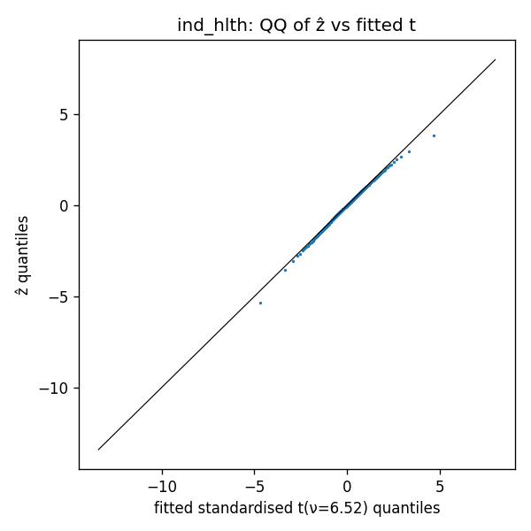
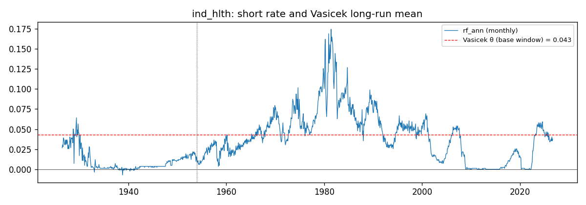
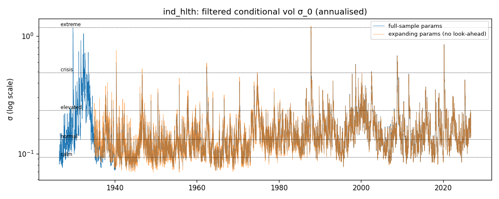
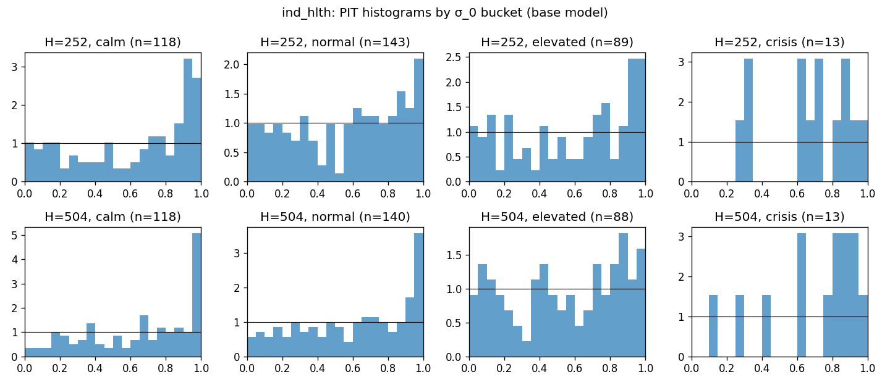
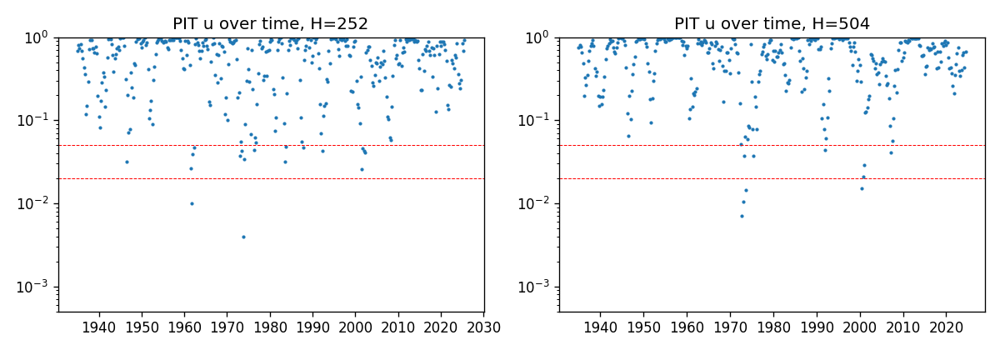
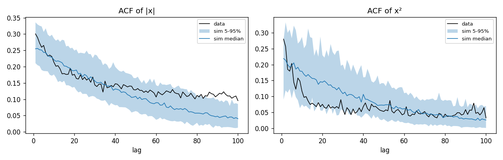
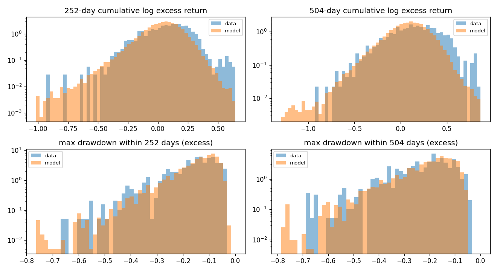
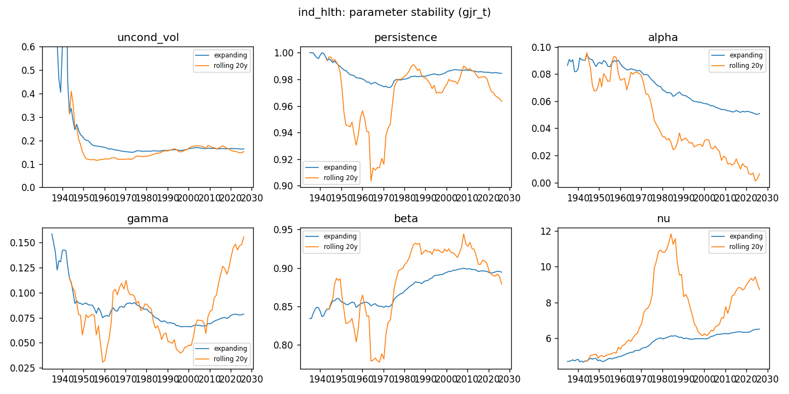

# Model report (Spec 02): `ind_hlth`

Generated 2026-11-21T13:59:47 by `scripts/02_fit_model.py --asset ind_hlth` in 120s. Estimation window 1926-07-01 – 2026-09-30 (26338 days). Base model **gjr_t**, gap variant **scale**, innovations **t**. Data hashes: `F-F_Research_Data_Factors_daily.csv` 3f7910502dd6…, `F-F_Research_Data_Factors.csv` a3894d74d553…, `10_Industry_Portfolios_Daily.csv` 01cfe3d5e54f….

**Fallback-window rule**: full-history base fit persistence 0.98483, valid parameter draws 100% → not triggered; full history used.

## 1. Model comparison

Log-likelihoods are for the *unscaled decimal* x; for the `scale` gap variant the Jacobian (−½ Σ log k) is added so log-likelihood/BIC are comparable across variants. PIT columns: observed share of historical starts with u below the level (nominal = the level), expanding-window parameters. PIT score = mean |obs − nominal|/nominal over σ_0 buckets at levels ≤ 5% (lower is better). 'buckets thin/fat' counts bucket×level cells whose CI excludes the nominal.

| model | gap_variant | nobs | loglik | bic | nu | persistence | half_life_days | uncond_vol_ann | PIT u<0.02 H252 | PIT u<0.05 H252 | PIT u<0.02 H504 | PIT u<0.05 H504 | PIT score | buckets thin/fat | VaR0.01 hit rate | VaR0.01 p_uc | VaR0.001 hit rate | VaR0.001 p_uc |
|---|---|---|---|---|---|---|---|---|---|---|---|---|---|---|---|---|---|---|
| garch_n | none | 26338 | 86654.5 | -173268.2 | n/a | 0.9856 | 47.7 | 18.0% | 0.55% | 3.31% | 1.11% | 2.51% | 0.65 | H252: 0/0, H504: 0/0 | 1.77% | 0.000 | 0.54% | 0.000 |
| garch_t | none | 26338 | 87410.9 | -174770.9 | 6.26 | 0.9893 | 64.5 | 18.5% | 0.55% | 4.13% | 1.39% | 2.51% | 0.61 | H252: 0/0, H504: 0/0 | 1.18% | 0.008 | 0.10% | 0.970 |
| gjr_t | none | 26338 | 87503.2 | -174945.3 | 6.50 | 0.9848 | 45.3 | 16.5% | 0.55% | 4.41% | 1.11% | 2.79% | 0.62 | H252: 0/0, H504: 0/0 | 1.11% | 0.086 | 0.10% | 0.810 |
| egarch_t | none | 26338 | 87538.4 | -175015.8 | 6.48 | 0.9832 | 40.8 | 13.8% | 0.55% | 3.58% | 1.39% | 3.06% | 0.62 | H252: 0/0, H504: 0/0 | 1.11% | 0.098 | 0.10% | 0.970 |
| garch_n | scale | 26338 | 86660.8 | -173280.8 | n/a | 0.9855 | 47.4 | 18.0% | 0.55% | 3.31% | 1.11% | 2.51% | 0.65 | H252: 0/0, H504: 0/0 | 1.77% | 0.000 | 0.54% | 0.000 |
| garch_t | scale | 26338 | 87412.8 | -174774.6 | 6.27 | 0.9894 | 64.8 | 18.6% | 0.55% | 4.41% | 1.11% | 2.79% | 0.58 | H252: 0/0, H504: 0/0 | 1.19% | 0.005 | 0.10% | 0.970 |
| gjr_t | scale | 26338 | 87504.5 | -174947.9 | 6.52 | 0.9848 | 45.4 | 16.5% | 0.55% | 4.96% | 1.11% | 2.79% | 0.64 | H252: 0/0, H504: 0/0 | 1.11% | 0.086 | 0.11% | 0.659 |
| egarch_t | scale | 26338 | 87540.1 | -175019.1 | 6.49 | 0.9832 | 40.9 | 13.8% | 0.55% | 3.86% | 1.39% | 3.06% | 0.61 | H252: 0/0, H504: 0/0 | 1.11% | 0.086 | 0.10% | 0.970 |
| gjr_t (FHS innovations) | scale | 26338 | 87504.5 | -174947.9 | 6.52 | 0.9848 | 45.4 | 16.5% | 0.55% | 3.31% | 0.84% | 2.23% | 0.73 | H252: 0/0, H504: 0/0 | n/a | n/a | n/a | n/a |

### Base model parameters (gjr_t, decimal daily units, robust SEs)

| param | estimate | se |
|---|---|---|
| mu | 0.000489822 | 4.58e-05 |
| omega | 1.63106e-06 | 1.97e-07 |
| alpha | 0.0511202 | 0.00476 |
| gamma | 0.0776375 | 0.00731 |
| beta | 0.894895 | 0.00711 |
| nu | 6.51615 | 0.265 |

log-lik 87510.2, AIC -175008.4, BIC -174959.3; persistence 0.9848; half-life 45.4 days; unconditional vol 16.5%; ν = 6.52.

## 2. Expected excess return (premium)

Raw estimate (mean of r − rf × 252): **9.06%** p.a., SE 1.71% (t = 5.30, 104.5 years). Shrunk 0.5 toward 0.0: **4.53%** used (mode `constant_arith`). Resolved coefficients for all modes (same average premium): `constant_arith` mu_e_daily=0.0001798; `prop_variance` mu_e_daily=0.0001798, lambda=1.46; `constant_sharpe` mu_e_daily=0.0001798, S=0.0184

## 3. Standardised residuals (FHS pool)

n = 26338, mean -0.020, sd 1.003, skew -0.44, excess kurtosis 4.01 (fitted t implies 2.38); min -13.41 on 1955-09-26. The FHS pool is demeaned and scaled to unit variance before resampling.

## 4. Interest-rate model (Vasicek on monthly rf_ann)

| window | start | end | months | kappa | se_kappa | theta | s | half-life (y) | neg. months | rho used | rho same-month | rho prev-month |
|---|---|---|---|---|---|---|---|---|---|---|---|---|
| base | 1954-01 | 2026-09 | 872 | 0.338 | 0.095 | 4.30% | 2.57% | 2.0 | 0 | -0.128 | -0.128 | -0.005 |
| full_sample | 1926-07 | 2026-09 | 1202 | 0.298 | 0.077 | 3.37% | 2.39% | 2.3 | 12 | -0.077 | -0.077 | -0.016 |
| from_1952-07 | 1952-07 | 2026-09 | 890 | 0.334 | 0.094 | 4.23% | 2.55% | 2.1 | 0 | -0.130 | -0.130 | -0.000 |

Negative monthly rf months in the data: 1933-02, 1938-03, 1938-07, 1938-11, 1939-01, 1939-03, 1939-08, 1940-05, 1940-08, 1941-01, 1941-02, 1941-04. Base window (1954-01-01+) excludes them: **True**. `floor_at_zero = False`.

## 5. Starting states (σ_0, r_0)

Under GJR-GARCH the one-step-ahead conditional variance σ_0² is the complete equity state (the sign of the last shock is already inside it); r_0 is the Vasicek state. Both are observable at t = 0. Named states are percentiles of the asset's own filtered σ history (full-sample params), so they transfer across assets. Annualised with N = 252 (see note on pre-1952 data in DECISIONS).

| state_name | sigma0_ann | r0_ann | definition |
|---|---|---|---|
| calm | 9.3% | 2.67% | P10 of filtered sigma; r0 = median rf_ann of estimation window |
| normal | 13.2% | 2.67% | P50 of filtered sigma; r0 = median rf_ann of estimation window |
| elevated | 23.5% | 2.67% | P90 of filtered sigma; r0 = median rf_ann of estimation window |
| crisis | 49.0% | 2.67% | P99 of filtered sigma; r0 = median rf_ann of estimation window |
| extreme | 119.2% | 2.67% | historical max of filtered sigma (1987-10-19); r0 = median rf_ann of estimation window |

Anchor dates (σ_0 = next-day vol at the close of the date):

| state_name | sigma0_ann | r0_ann | sigma0_ann_expanding | rv63_ann | dd252 |
|---|---|---|---|---|---|
| anchor_2006-12-29 | 8.5% | 4.9% | 8.4% | 8.5% | -1.0% |
| anchor_1987-10-16 | 41.0% | 7.4% | 41.6% | 20.5% | -17.7% |
| anchor_1987-10-19 | 119.2% | 7.4% | 122.5% | 44.1% | -32.4% |
| anchor_2008-10-10 | 56.7% | 1.0% | 55.4% | 28.1% | -28.0% |
| anchor_2008-11-20 | 60.5% | 0.4% | 59.9% | 48.5% | -32.2% |
| anchor_2020-03-16 | 85.2% | 1.4% | 85.0% | 38.3% | -22.3% |
| anchor_2022-06-16 | 28.6% | 0.7% | 28.7% | 22.7% | -21.5% |
| anchor_2026-09-30 | 15.3% | 3.8% | 15.3% | 19.0% | -5.6% |

σ_0 bucket edges used in the PIT/VaR tests (annualised): calm: [7.2%, 11.2%), normal: [11.2%, 16.1%), elevated: [16.1%, 30.2%), crisis: [30.2%, n/a)

## 6. Conditional tail calibration (PIT test)

Quarterly start dates; at each start the model is re-estimated on data **before** the start (expanding window, refit every 252 days; premium and rate model also expanding). 2000 paths per start. u = model CDF of the realised cumulative log total return over H days. Effective n = non-overlapping windows = n_starts × 63/H; CIs are Wilson 95% on the effective n. 'too thin' = more realised left-tail outcomes than the model predicts (dangerous for the floor).

### gjr_t / scale / t

| group_type | group | H | n_starts | n_eff | u<0.01 | u<0.02 | u<0.05 | u<0.1 |
|---|---|---|---|---|---|---|---|---|
| overall | all | 252 | 363 | 90.8 | 0.3% (0.0%–4.6%) | 0.6% (0.1%–5.1%) | 5.0% (2.0%–11.5%) | 9.4% (4.9%–17.1%) |
| bucket | calm | 252 | 118 | 29.5 | 0.0% (0.0%–11.5%) | 0.8% (0.0%–13.0%) | 5.1% (1.2%–19.3%) | 9.3% (3.1%–24.9%) |
| bucket | crisis | 252 | 13 | 3.2 | 0.0% (0.0%–54.2%) | 0.0% (0.0%–54.2%) | 0.0% (0.0%–54.2%) | 0.0% (0.0%–54.2%) |
| bucket | elevated | 252 | 89 | 22.2 | 0.0% (0.0%–14.7%) | 0.0% (0.0%–14.7%) | 5.6% (1.2%–23.1%) | 10.1% (3.0%–29.0%) |
| bucket | normal | 252 | 143 | 35.8 | 0.7% (0.0%–10.9%) | 0.7% (0.0%–10.9%) | 4.9% (1.3%–17.3%) | 9.8% (3.6%–23.7%) |
| bucket_group | high | 252 | 102 | 25.5 | 0.0% (0.0%–13.1%) | 0.0% (0.0%–13.1%) | 4.9% (1.0%–20.6%) | 8.8% (2.6%–25.8%) |
| era | 1952-1999 | 252 | 192 | 48.0 | 0.5% (0.0%–8.3%) | 1.0% (0.1%–9.2%) | 6.8% (2.4%–17.5%) | 12.0% (5.5%–24.1%) |
| era | 2000- | 252 | 103 | 25.8 | 0.0% (0.0%–13.0%) | 0.0% (0.0%–13.0%) | 3.9% (0.7%–19.1%) | 6.8% (1.7%–23.1%) |
| era | pre-1952 | 252 | 68 | 17.0 | 0.0% (0.0%–18.4%) | 0.0% (0.0%–18.4%) | 1.5% (0.1%–20.7%) | 5.9% (1.0%–27.0%) |
| overall | all | 504 | 359 | 44.9 | 0.3% (0.0%–8.4%) | 1.1% (0.1%–9.8%) | 2.8% (0.6%–12.4%) | 6.4% (2.2%–17.5%) |
| bucket | calm | 504 | 118 | 14.8 | 0.0% (0.0%–20.7%) | 0.8% (0.0%–22.0%) | 1.7% (0.1%–23.3%) | 3.4% (0.4%–25.7%) |
| bucket | crisis | 504 | 13 | 1.6 | 0.0% (0.0%–70.3%) | 0.0% (0.0%–70.3%) | 0.0% (0.0%–70.3%) | 0.0% (0.0%–70.3%) |
| bucket | elevated | 504 | 88 | 11.0 | 0.0% (0.0%–25.9%) | 1.1% (0.0%–27.5%) | 4.5% (0.5%–32.1%) | 11.4% (2.4%–40.4%) |
| bucket | normal | 504 | 140 | 17.5 | 0.7% (0.0%–19.1%) | 1.4% (0.1%–20.3%) | 2.9% (0.3%–22.4%) | 6.4% (1.2%–27.3%) |
| bucket_group | high | 504 | 101 | 12.6 | 0.0% (0.0%–23.3%) | 1.0% (0.0%–24.8%) | 4.0% (0.4%–29.0%) | 9.9% (2.1%–36.4%) |
| era | 1952-1999 | 504 | 192 | 24.0 | 0.5% (0.0%–14.7%) | 1.6% (0.1%–16.4%) | 3.1% (0.4%–18.7%) | 7.8% (2.1%–25.2%) |
| era | 2000- | 504 | 99 | 12.4 | 0.0% (0.0%–23.7%) | 1.0% (0.0%–25.2%) | 4.0% (0.4%–29.4%) | 6.1% (0.9%–32.1%) |
| era | pre-1952 | 504 | 68 | 8.5 | 0.0% (0.0%–31.1%) | 0.0% (0.0%–31.1%) | 0.0% (0.0%–31.1%) | 2.9% (0.2%–35.0%) |

**Verdicts:**

- H=252, bucket `calm`: no evidence of miscalibration (nominal inside the CI at all levels), but low power: the CI at the 2% level spans 13%
- H=252, bucket `normal`: no evidence of miscalibration (nominal inside the CI at all levels), but low power: the CI at the 2% level spans 11%
- H=252, bucket `elevated`: no evidence of miscalibration (nominal inside the CI at all levels), but low power: the CI at the 2% level spans 15%
- H=252, bucket `crisis`: inconclusive: too few independent windows to test (CI would include 0% and >20%)
- H=252, bucket_group `high`: no evidence of miscalibration (nominal inside the CI at all levels), but low power: the CI at the 2% level spans 13%
- H=252, era `pre-1952`: no evidence of miscalibration (nominal inside the CI at all levels), but low power: the CI at the 2% level spans 18%
- H=252, era `1952-1999`: no evidence of miscalibration (nominal inside the CI at all levels), but low power: the CI at the 2% level spans 9%
- H=252, era `2000-`: no evidence of miscalibration (nominal inside the CI at all levels), but low power: the CI at the 2% level spans 13%
- H=504, bucket `calm`: no evidence of miscalibration (nominal inside the CI at all levels), but low power: the CI at the 2% level spans 22%
- H=504, bucket `normal`: no evidence of miscalibration (nominal inside the CI at all levels), but low power: the CI at the 2% level spans 20%
- H=504, bucket `elevated`: no evidence of miscalibration (nominal inside the CI at all levels), but low power: the CI at the 2% level spans 27%
- H=504, bucket `crisis`: inconclusive: too few independent windows to test (CI would include 0% and >20%)
- H=504, bucket_group `high`: no evidence of miscalibration (nominal inside the CI at all levels), but low power: the CI at the 2% level spans 25%
- H=504, era `pre-1952`: no evidence of miscalibration (nominal inside the CI at all levels), but low power: the CI at the 2% level spans 31%
- H=504, era `1952-1999`: no evidence of miscalibration (nominal inside the CI at all levels), but low power: the CI at the 2% level spans 16%
- H=504, era `2000-`: no evidence of miscalibration (nominal inside the CI at all levels), but low power: the CI at the 2% level spans 25%

### gjr_t / scale / fhs

| group_type | group | H | n_starts | n_eff | u<0.01 | u<0.02 | u<0.05 | u<0.1 |
|---|---|---|---|---|---|---|---|---|
| overall | all | 252 | 363 | 90.8 | 0.3% (0.0%–4.6%) | 0.6% (0.1%–5.1%) | 3.3% (1.1%–9.3%) | 8.8% (4.5%–16.4%) |
| bucket | calm | 252 | 118 | 29.5 | 0.0% (0.0%–11.5%) | 0.8% (0.0%–13.0%) | 2.5% (0.4%–15.7%) | 7.6% (2.3%–22.8%) |
| bucket | crisis | 252 | 13 | 3.2 | 0.0% (0.0%–54.2%) | 0.0% (0.0%–54.2%) | 0.0% (0.0%–54.2%) | 0.0% (0.0%–54.2%) |
| bucket | elevated | 252 | 89 | 22.2 | 0.0% (0.0%–14.7%) | 0.0% (0.0%–14.7%) | 4.5% (0.8%–21.6%) | 10.1% (3.0%–29.0%) |
| bucket | normal | 252 | 143 | 35.8 | 0.7% (0.0%–10.9%) | 0.7% (0.0%–10.9%) | 3.5% (0.7%–15.3%) | 9.8% (3.6%–23.7%) |
| bucket_group | high | 252 | 102 | 25.5 | 0.0% (0.0%–13.1%) | 0.0% (0.0%–13.1%) | 3.9% (0.7%–19.2%) | 8.8% (2.6%–25.8%) |
| era | 1952-1999 | 252 | 192 | 48.0 | 0.5% (0.0%–8.3%) | 1.0% (0.1%–9.2%) | 4.2% (1.2%–14.0%) | 11.5% (5.2%–23.4%) |
| era | 2000- | 252 | 103 | 25.8 | 0.0% (0.0%–13.0%) | 0.0% (0.0%–13.0%) | 2.9% (0.4%–17.6%) | 6.8% (1.7%–23.1%) |
| era | pre-1952 | 252 | 68 | 17.0 | 0.0% (0.0%–18.4%) | 0.0% (0.0%–18.4%) | 1.5% (0.1%–20.7%) | 4.4% (0.6%–25.0%) |
| overall | all | 504 | 359 | 44.9 | 0.0% (0.0%–7.9%) | 0.8% (0.1%–9.4%) | 2.2% (0.4%–11.6%) | 5.8% (1.9%–16.8%) |
| bucket | calm | 504 | 118 | 14.8 | 0.0% (0.0%–20.7%) | 0.0% (0.0%–20.7%) | 0.8% (0.0%–22.0%) | 3.4% (0.4%–25.7%) |
| bucket | crisis | 504 | 13 | 1.6 | 0.0% (0.0%–70.3%) | 0.0% (0.0%–70.3%) | 0.0% (0.0%–70.3%) | 0.0% (0.0%–70.3%) |
| bucket | elevated | 504 | 88 | 11.0 | 0.0% (0.0%–25.9%) | 1.1% (0.0%–27.5%) | 4.5% (0.5%–32.1%) | 11.4% (2.4%–40.4%) |
| bucket | normal | 504 | 140 | 17.5 | 0.0% (0.0%–18.0%) | 1.4% (0.1%–20.3%) | 2.1% (0.2%–21.3%) | 5.0% (0.8%–25.4%) |
| bucket_group | high | 504 | 101 | 12.6 | 0.0% (0.0%–23.3%) | 1.0% (0.0%–24.8%) | 4.0% (0.4%–29.0%) | 9.9% (2.1%–36.4%) |
| era | 1952-1999 | 504 | 192 | 24.0 | 0.0% (0.0%–13.8%) | 1.0% (0.1%–15.5%) | 2.6% (0.3%–18.0%) | 7.3% (1.9%–24.5%) |
| era | 2000- | 504 | 99 | 12.4 | 0.0% (0.0%–23.7%) | 1.0% (0.0%–25.2%) | 3.0% (0.2%–28.1%) | 6.1% (0.9%–32.1%) |
| era | pre-1952 | 504 | 68 | 8.5 | 0.0% (0.0%–31.1%) | 0.0% (0.0%–31.1%) | 0.0% (0.0%–31.1%) | 1.5% (0.0%–33.1%) |

**Verdicts:**

- H=252, bucket `calm`: no evidence of miscalibration (nominal inside the CI at all levels), but low power: the CI at the 2% level spans 13%
- H=252, bucket `normal`: no evidence of miscalibration (nominal inside the CI at all levels), but low power: the CI at the 2% level spans 11%
- H=252, bucket `elevated`: no evidence of miscalibration (nominal inside the CI at all levels), but low power: the CI at the 2% level spans 15%
- H=252, bucket `crisis`: inconclusive: too few independent windows to test (CI would include 0% and >20%)
- H=252, bucket_group `high`: no evidence of miscalibration (nominal inside the CI at all levels), but low power: the CI at the 2% level spans 13%
- H=252, era `pre-1952`: no evidence of miscalibration (nominal inside the CI at all levels), but low power: the CI at the 2% level spans 18%
- H=252, era `1952-1999`: no evidence of miscalibration (nominal inside the CI at all levels), but low power: the CI at the 2% level spans 9%
- H=252, era `2000-`: no evidence of miscalibration (nominal inside the CI at all levels), but low power: the CI at the 2% level spans 13%
- H=504, bucket `calm`: no evidence of miscalibration (nominal inside the CI at all levels), but low power: the CI at the 2% level spans 21%
- H=504, bucket `normal`: no evidence of miscalibration (nominal inside the CI at all levels), but low power: the CI at the 2% level spans 20%
- H=504, bucket `elevated`: no evidence of miscalibration (nominal inside the CI at all levels), but low power: the CI at the 2% level spans 27%
- H=504, bucket `crisis`: inconclusive: too few independent windows to test (CI would include 0% and >20%)
- H=504, bucket_group `high`: no evidence of miscalibration (nominal inside the CI at all levels), but low power: the CI at the 2% level spans 25%
- H=504, era `pre-1952`: no evidence of miscalibration (nominal inside the CI at all levels), but low power: the CI at the 2% level spans 31%
- H=504, era `1952-1999`: no evidence of miscalibration (nominal inside the CI at all levels), but low power: the CI at the 2% level spans 15%
- H=504, era `2000-`: no evidence of miscalibration (nominal inside the CI at all levels), but low power: the CI at the 2% level spans 25%

## 7. One-day tail check

| level | bucket | n | hits | rate | LR_uc | p_uc | LR_ind | p_ind |
|---|---|---|---|---|---|---|---|---|
| 0.01 | all | 23818 | 265 | 1.113% | 2.94 | 0.086 | 0.35 | 0.557 |
| 0.01 | calm | 7542 | 97 | 1.286% | 5.72 | 0.017 | 0.05 | 0.816 |
| 0.01 | crisis | 721 | 8 | 1.110% | 0.08 | 0.771 | 3.24 | 0.072 |
| 0.01 | elevated | 5933 | 55 | 0.927% | 0.33 | 0.567 | 1.03 | 0.310 |
| 0.01 | normal | 9622 | 105 | 1.091% | 0.79 | 0.375 | 2.32 | 0.128 |
| 0.001 | all | 23818 | 26 | 0.109% | 0.19 | 0.659 | 0.06 | 0.812 |
| 0.001 | calm | 7542 | 12 | 0.159% | 2.23 | 0.135 | 0.04 | 0.845 |
| 0.001 | crisis | 721 | 1 | 0.139% | 0.10 | 0.756 | 0.00 | 0.958 |
| 0.001 | elevated | 5933 | 4 | 0.067% | 0.71 | 0.399 | 0.01 | 0.941 |
| 0.001 | normal | 9622 | 9 | 0.094% | 0.04 | 0.839 | 0.02 | 0.897 |

(Christoffersen independence within a bucket uses consecutive days of that bucket's sub-sequence.)

- **full_sample_params**: σ for 1987-10-19 = 41.0% (ann.), ν = 6.52. P(one-day loss ≥ 17%) = 4.03e-05 (once in 98.5 years at that σ). Realised standardised shock = -7.7; model probability of a shock that size or worse = 2.87e-05.
- **expanding_params**: σ for 1987-10-19 = 41.6% (ann.), ν = 6.09. P(one-day loss ≥ 17%) = 5.82e-05 (once in 68.1 years at that σ). Realised standardised shock = -7.5; model probability of a shock that size or worse = 4.23e-05.
- P(one-day loss ≥ 17%) from named states: calm: 3.27e-09, normal: 3.06e-08, elevated: 1.23e-06, crisis: 1.16e-04, extreme: 1.10e-02

## 8. Stylised facts: data vs simulated long paths

40 simulated paths of the estimation-window length from the base model (t innovations, base premium and rate model).

| statistic | data | model |
|---|---|---|
| annualised vol of x | 17.5% | 16.3% (5–95%: 15.0%–18.1%) |
| excess kurtosis of daily x | 17.1 | 12.2 (5–95%: 6.6–70.4) |
| skew of daily x | -0.57 | 0.06 |
| ACF |x| lags 1/10/50/100 | 0.30 / 0.21 / 0.13 / 0.10 | 0.25 / 0.22 / 0.11 / 0.04 |

252-day windows (start every 21 days) — quantiles:

| quantile | cum log excess, data | cum log excess, model | max DD, data | max DD, model |
|---|---|---|---|---|
| 0.01 | -38.0% | -45.1% | -49.4% | -44.9% |
| 0.02 | -32.8% | -35.1% | -42.3% | -39.8% |
| 0.05 | -25.0% | -23.6% | -36.1% | -32.7% |
| 0.1 | -16.8% | -15.4% | -28.2% | -26.1% |
| 0.5 | 9.3% | 5.0% | -14.1% | -12.7% |

504-day windows (start every 21 days) — quantiles:

| quantile | cum log excess, data | cum log excess, model | max DD, data | max DD, model |
|---|---|---|---|---|
| 0.01 | -55.3% | -59.4% | -65.4% | -57.4% |
| 0.02 | -45.9% | -46.5% | -54.0% | -50.2% |
| 0.05 | -33.6% | -32.0% | -43.1% | -41.9% |
| 0.1 | -20.4% | -20.7% | -37.7% | -35.1% |
| 0.5 | 16.0% | 9.2% | -19.9% | -17.7% |

Simulated x clipped at −99% simple return: 0 times.

## 9. Parameter stability

| sample | start | end | nobs | mu | omega | alpha | gamma | beta | nu | persistence | half_life_days | uncond_vol_ann | loglik |
|---|---|---|---|---|---|---|---|---|---|---|---|---|---|
| estimation window (base) | 1926-07-01 | 2026-09-30 | 26338 | 4.90e-04 | 1.63e-06 | 0.051 | 0.078 | 0.895 | 6.52 | 0.9848 | 45 | 16.5% | 87510 |
| pre-1963 | 1926-07-01 | 1962-12-31 | 10295 | 5.10e-04 | 2.37e-06 | 0.084 | 0.082 | 0.853 | 5.13 | 0.9780 | 31 | 16.5% | 35061 |
| 1963-1999 | 1963-01-02 | 1999-12-31 | 9317 | 4.86e-04 | 1.08e-06 | 0.035 | 0.057 | 0.926 | 7.47 | 0.9892 | 64 | 15.8% | 30837 |
| 2000-end | 2000-01-03 | 2026-09-30 | 6726 | 3.68e-04 | 2.58e-06 | 0.017 | 0.123 | 0.896 | 9.31 | 0.9746 | 27 | 16.0% | 21679 |
| from 1952-07-01 | 1952-07-01 | 2026-09-30 | 18685 | 4.94e-04 | 1.71e-06 | 0.036 | 0.077 | 0.908 | 7.84 | 0.9820 | 38 | 15.5% | 61628 |
| from 1963-07-01 | 1963-07-01 | 2026-09-30 | 15918 | 4.51e-04 | 1.63e-06 | 0.033 | 0.080 | 0.911 | 8.04 | 0.9840 | 43 | 16.0% | 52028 |
| from 1990-01-01 | 1990-01-02 | 2026-09-30 | 9254 | 4.71e-04 | 2.43e-06 | 0.022 | 0.106 | 0.903 | 8.08 | 0.9780 | 31 | 16.7% | 29641 |

## 10. Parameter-uncertainty draws

200 draws from the asymptotic normal of the robust covariance (acceptance 100.0%; rejected: non-stationary, ω ≤ 0, negative ARCH terms, ν ≤ 2.5). Unconditional vol 5–95%: 15.4%–18.1%; ν 5–95%: 6.10–6.98. Saved to `results/model/param_draws_ind_hlth.npy` (columns ['mu', 'omega', 'alpha', 'gamma', 'beta', 'nu']).

## 11. Closure-gap returns

| date | from | calendar_days | busdays | x |
|---|---|---|---|---|
| 1929-12-02 | 1929-11-27 | 5 | 3 | 0.26% |
| 1933-03-15 | 1933-03-03 | 12 | 8 | 11.36% |
| 1956-12-26 | 1956-12-21 | 5 | 3 | -0.22% |
| 1958-12-29 | 1958-12-24 | 5 | 3 | 0.32% |
| 1961-05-31 | 1961-05-26 | 5 | 3 | -0.41% |
| 1968-07-08 | 1968-07-03 | 5 | 3 | 0.91% |
| 2001-09-17 | 2001-09-10 | 7 | 5 | -1.38% |
| 2007-01-03 | 2006-12-29 | 5 | 3 | 0.22% |
| 2012-10-31 | 2012-10-26 | 5 | 3 | -0.96% |

Variant `scale` divides these returns by sqrt(busdays) before fitting; `none` uses them as is. Compare the rows of the model comparison table with the same model name.

