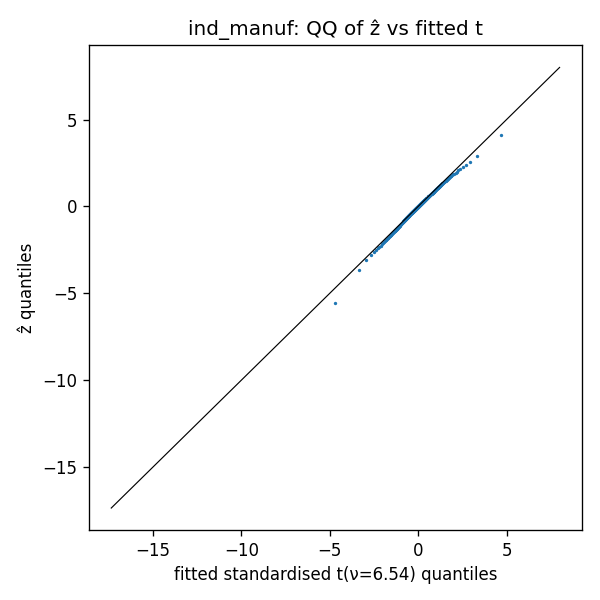
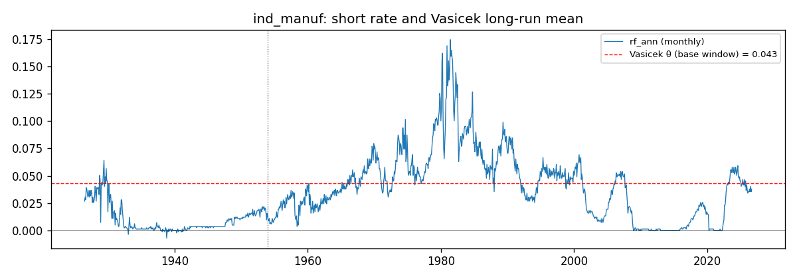
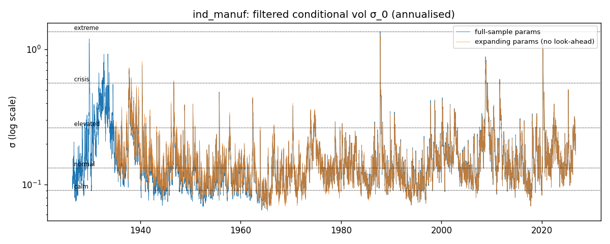
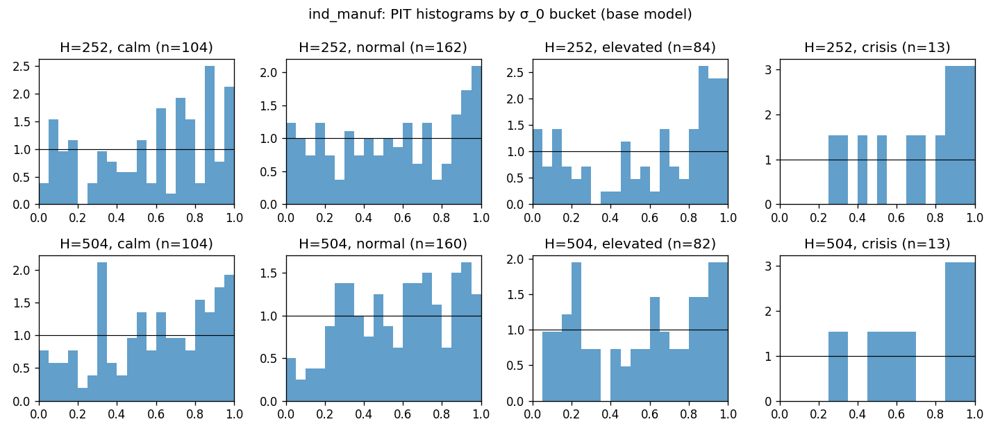
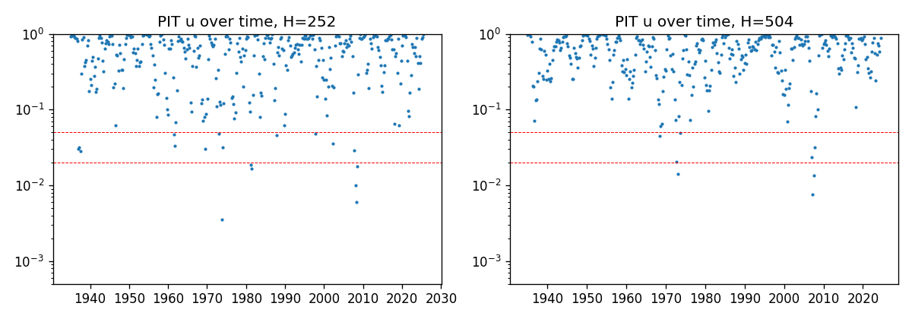
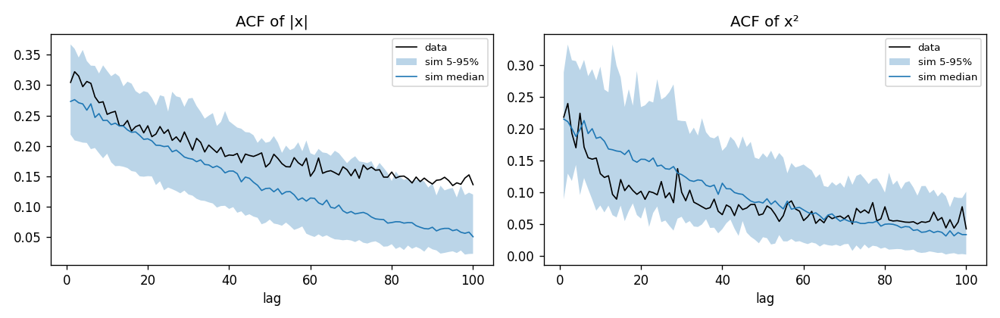
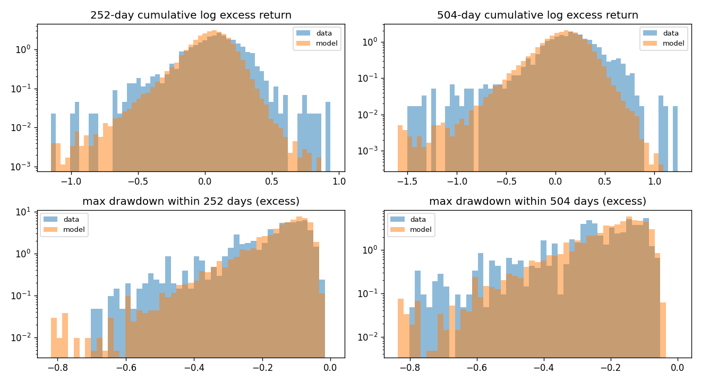
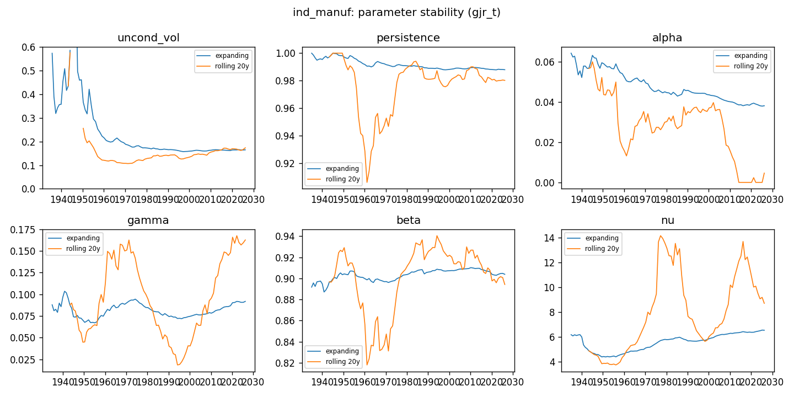

# Model report (Spec 02): `ind_manuf`

Generated 2026-11-21T13:53:58 by `scripts/02_fit_model.py --asset ind_manuf` in 113s. Estimation window 1926-07-01 – 2026-09-30 (26338 days). Base model **gjr_t**, gap variant **scale**, innovations **t**. Data hashes: `F-F_Research_Data_Factors_daily.csv` 3f7910502dd6…, `F-F_Research_Data_Factors.csv` a3894d74d553…, `10_Industry_Portfolios_Daily.csv` 01cfe3d5e54f….

**Fallback-window rule**: full-history base fit persistence 0.98815, valid parameter draws 100% → not triggered; full history used.

## 1. Model comparison

Log-likelihoods are for the *unscaled decimal* x; for the `scale` gap variant the Jacobian (−½ Σ log k) is added so log-likelihood/BIC are comparable across variants. PIT columns: observed share of historical starts with u below the level (nominal = the level), expanding-window parameters. PIT score = mean |obs − nominal|/nominal over σ_0 buckets at levels ≤ 5% (lower is better). 'buckets thin/fat' counts bucket×level cells whose CI excludes the nominal.

| model | gap_variant | nobs | loglik | bic | nu | persistence | half_life_days | uncond_vol_ann | PIT u<0.02 H252 | PIT u<0.05 H252 | PIT u<0.02 H504 | PIT u<0.05 H504 | PIT score | buckets thin/fat | VaR0.01 hit rate | VaR0.01 p_uc | VaR0.001 hit rate | VaR0.001 p_uc |
|---|---|---|---|---|---|---|---|---|---|---|---|---|---|---|---|---|---|---|
| garch_n | none | 26338 | 85854.4 | -171668.0 | n/a | 0.9893 | 64.4 | 18.8% | 1.93% | 3.86% | 1.11% | 1.95% | 0.73 | H252: 0/0, H504: 0/0 | 1.71% | 0.000 | 0.54% | 0.000 |
| garch_t | none | 26338 | 86708.9 | -173366.9 | 6.07 | 0.9938 | 111.9 | 21.0% | 1.65% | 4.41% | 0.56% | 1.67% | 0.72 | H252: 0/0, H504: 0/0 | 1.14% | 0.036 | 0.12% | 0.404 |
| gjr_t | none | 26338 | 86854.7 | -173648.3 | 6.49 | 0.9881 | 57.9 | 16.6% | 1.65% | 4.96% | 1.11% | 1.95% | 0.71 | H252: 0/0, H504: 0/0 | 1.04% | 0.525 | 0.12% | 0.404 |
| egarch_t | none | 26338 | 86888.7 | -173716.4 | 6.37 | 0.9874 | 54.7 | 13.6% | 1.10% | 4.13% | 1.11% | 1.95% | 0.73 | H252: 0/0, H504: 0/0 | 1.05% | 0.484 | 0.11% | 0.523 |
| garch_n | scale | 26338 | 85889.4 | -171738.1 | n/a | 0.9891 | 63.1 | 18.5% | 1.93% | 4.13% | 1.11% | 1.95% | 0.77 | H252: 0/0, H504: 0/0 | 1.73% | 0.000 | 0.54% | 0.000 |
| garch_t | scale | 26338 | 86716.6 | -173382.2 | 6.12 | 0.9939 | 113.5 | 21.1% | 1.38% | 3.86% | 0.56% | 1.67% | 0.71 | H252: 0/0, H504: 0/0 | 1.15% | 0.023 | 0.11% | 0.523 |
| gjr_t | scale | 26338 | 86861.1 | -173661.0 | 6.54 | 0.9882 | 58.2 | 16.6% | 1.65% | 4.96% | 0.84% | 2.23% | 0.67 | H252: 0/0, H504: 0/0 | 1.05% | 0.408 | 0.12% | 0.304 |
| egarch_t | scale | 26338 | 86894.5 | -173727.8 | 6.42 | 0.9874 | 54.8 | 13.6% | 1.38% | 4.13% | 1.11% | 1.95% | 0.75 | H252: 0/0, H504: 0/0 | 1.06% | 0.373 | 0.11% | 0.523 |
| gjr_t (FHS innovations) | scale | 26338 | 86861.1 | -173661.0 | 6.54 | 0.9882 | 58.2 | 16.6% | 0.83% | 3.31% | 0.28% | 1.67% | 0.80 | H252: 0/0, H504: 0/0 | n/a | n/a | n/a | n/a |

### Base model parameters (gjr_t, decimal daily units, robust SEs)

| param | estimate | se |
|---|---|---|
| mu | 0.000543995 | 4.61e-05 |
| omega | 1.28979e-06 | 1.55e-07 |
| alpha | 0.038203 | 0.0034 |
| gamma | 0.0918107 | 0.00773 |
| beta | 0.904042 | 0.00592 |
| nu | 6.54082 | 0.276 |

log-lik 86866.7, AIC -173721.5, BIC -173672.4; persistence 0.9882; half-life 58.2 days; unconditional vol 16.6%; ν = 6.54.

## 2. Expected excess return (premium)

Raw estimate (mean of r − rf × 252): **8.38%** p.a., SE 1.86% (t = 4.52, 104.5 years). Shrunk 0.5 toward 0.0: **4.19%** used (mode `constant_arith`). Resolved coefficients for all modes (same average premium): `constant_arith` mu_e_daily=0.0001663; `prop_variance` mu_e_daily=0.0001663, lambda=1.155; `constant_sharpe` mu_e_daily=0.0001663, S=0.01622

## 3. Standardised residuals (FHS pool)

n = 26338, mean -0.030, sd 1.005, skew -0.59, excess kurtosis 5.77 (fitted t implies 2.36); min -17.36 on 1955-09-26. The FHS pool is demeaned and scaled to unit variance before resampling.

## 4. Interest-rate model (Vasicek on monthly rf_ann)

| window | start | end | months | kappa | se_kappa | theta | s | half-life (y) | neg. months | rho used | rho same-month | rho prev-month |
|---|---|---|---|---|---|---|---|---|---|---|---|---|
| base | 1954-01 | 2026-09 | 872 | 0.338 | 0.095 | 4.30% | 2.57% | 2.0 | 0 | -0.121 | -0.121 | -0.019 |
| full_sample | 1926-07 | 2026-09 | 1202 | 0.298 | 0.077 | 3.37% | 2.39% | 2.3 | 12 | -0.056 | -0.056 | -0.034 |
| from_1952-07 | 1952-07 | 2026-09 | 890 | 0.334 | 0.094 | 4.23% | 2.55% | 2.1 | 0 | -0.123 | -0.123 | -0.017 |

Negative monthly rf months in the data: 1933-02, 1938-03, 1938-07, 1938-11, 1939-01, 1939-03, 1939-08, 1940-05, 1940-08, 1941-01, 1941-02, 1941-04. Base window (1954-01-01+) excludes them: **True**. `floor_at_zero = False`.

## 5. Starting states (σ_0, r_0)

Under GJR-GARCH the one-step-ahead conditional variance σ_0² is the complete equity state (the sign of the last shock is already inside it); r_0 is the Vasicek state. Both are observable at t = 0. Named states are percentiles of the asset's own filtered σ history (full-sample params), so they transfer across assets. Annualised with N = 252 (see note on pre-1952 data in DECISIONS).

| state_name | sigma0_ann | r0_ann | definition |
|---|---|---|---|
| calm | 9.1% | 2.67% | P10 of filtered sigma; r0 = median rf_ann of estimation window |
| normal | 13.3% | 2.67% | P50 of filtered sigma; r0 = median rf_ann of estimation window |
| elevated | 26.4% | 2.67% | P90 of filtered sigma; r0 = median rf_ann of estimation window |
| crisis | 56.6% | 2.67% | P99 of filtered sigma; r0 = median rf_ann of estimation window |
| extreme | 134.5% | 2.67% | historical max of filtered sigma (1987-10-19); r0 = median rf_ann of estimation window |

Anchor dates (σ_0 = next-day vol at the close of the date):

| state_name | sigma0_ann | r0_ann | sigma0_ann_expanding | rv63_ann | dd252 |
|---|---|---|---|---|---|
| anchor_2006-12-29 | 10.3% | 4.9% | 10.2% | 9.5% | -0.8% |
| anchor_1987-10-16 | 40.8% | 7.4% | 39.4% | 19.6% | -14.6% |
| anchor_1987-10-19 | 134.5% | 7.4% | 129.2% | 48.7% | -31.7% |
| anchor_2008-10-10 | 66.9% | 1.0% | 65.0% | 36.8% | -40.4% |
| anchor_2008-11-20 | 78.7% | 0.4% | 77.4% | 63.1% | -51.6% |
| anchor_2020-03-16 | 108.8% | 1.4% | 107.3% | 47.0% | -32.6% |
| anchor_2022-06-16 | 39.4% | 0.7% | 39.5% | 25.8% | -22.7% |
| anchor_2026-09-30 | 17.1% | 3.8% | 17.1% | 19.6% | -14.8% |

σ_0 bucket edges used in the PIT/VaR tests (annualised): calm: [6.5%, 11.2%), normal: [11.2%, 16.6%), elevated: [16.6%, 34.6%), crisis: [34.6%, n/a)

## 6. Conditional tail calibration (PIT test)

Quarterly start dates; at each start the model is re-estimated on data **before** the start (expanding window, refit every 252 days; premium and rate model also expanding). 2000 paths per start. u = model CDF of the realised cumulative log total return over H days. Effective n = non-overlapping windows = n_starts × 63/H; CIs are Wilson 95% on the effective n. 'too thin' = more realised left-tail outcomes than the model predicts (dangerous for the floor).

### gjr_t / scale / t

| group_type | group | H | n_starts | n_eff | u<0.01 | u<0.02 | u<0.05 | u<0.1 |
|---|---|---|---|---|---|---|---|---|
| overall | all | 252 | 363 | 90.8 | 0.6% (0.1%–5.1%) | 1.7% (0.4%–6.8%) | 5.0% (2.0%–11.5%) | 10.2% (5.5%–18.1%) |
| bucket | calm | 252 | 104 | 26.0 | 1.0% (0.1%–14.5%) | 1.0% (0.1%–14.5%) | 1.9% (0.2%–16.0%) | 9.6% (3.0%–26.6%) |
| bucket | crisis | 252 | 13 | 3.2 | 0.0% (0.0%–54.2%) | 0.0% (0.0%–54.2%) | 0.0% (0.0%–54.2%) | 0.0% (0.0%–54.2%) |
| bucket | elevated | 252 | 84 | 21.0 | 1.2% (0.1%–17.4%) | 3.6% (0.5%–21.0%) | 7.1% (1.7%–25.9%) | 10.7% (3.2%–30.4%) |
| bucket | normal | 252 | 162 | 40.5 | 0.0% (0.0%–8.7%) | 1.2% (0.1%–10.8%) | 6.2% (1.9%–18.0%) | 11.1% (4.6%–24.3%) |
| bucket_group | high | 252 | 97 | 24.2 | 1.0% (0.1%–15.4%) | 3.1% (0.4%–18.6%) | 6.2% (1.4%–22.9%) | 9.3% (2.8%–26.9%) |
| era | 1952-1999 | 252 | 192 | 48.0 | 0.5% (0.0%–8.3%) | 1.6% (0.2%–10.1%) | 5.2% (1.6%–15.4%) | 12.0% (5.5%–24.1%) |
| era | 2000- | 252 | 103 | 25.8 | 1.0% (0.1%–14.6%) | 2.9% (0.4%–17.6%) | 4.9% (1.0%–20.4%) | 9.7% (3.1%–26.8%) |
| era | pre-1952 | 252 | 68 | 17.0 | 0.0% (0.0%–18.4%) | 0.0% (0.0%–18.4%) | 4.4% (0.6%–25.0%) | 5.9% (1.0%–27.0%) |
| overall | all | 504 | 359 | 44.9 | 0.3% (0.0%–8.4%) | 0.8% (0.1%–9.4%) | 2.2% (0.4%–11.6%) | 4.7% (1.4%–15.3%) |
| bucket | calm | 504 | 104 | 13.0 | 0.0% (0.0%–22.8%) | 1.0% (0.0%–24.3%) | 3.8% (0.4%–28.3%) | 6.7% (1.1%–32.1%) |
| bucket | crisis | 504 | 13 | 1.6 | 0.0% (0.0%–70.3%) | 0.0% (0.0%–70.3%) | 0.0% (0.0%–70.3%) | 0.0% (0.0%–70.3%) |
| bucket | elevated | 504 | 82 | 10.2 | 0.0% (0.0%–27.3%) | 0.0% (0.0%–27.3%) | 0.0% (0.0%–27.3%) | 4.9% (0.5%–33.8%) |
| bucket | normal | 504 | 160 | 20.0 | 0.6% (0.0%–17.1%) | 1.2% (0.1%–18.1%) | 2.5% (0.3%–20.0%) | 3.8% (0.5%–21.9%) |
| bucket_group | high | 504 | 95 | 11.9 | 0.0% (0.0%–24.4%) | 0.0% (0.0%–24.4%) | 0.0% (0.0%–24.4%) | 4.2% (0.4%–30.4%) |
| era | 1952-1999 | 504 | 192 | 24.0 | 0.0% (0.0%–13.8%) | 0.5% (0.0%–14.7%) | 2.1% (0.2%–17.2%) | 5.2% (1.1%–21.7%) |
| era | 2000- | 504 | 99 | 12.4 | 1.0% (0.0%–25.2%) | 2.0% (0.1%–26.7%) | 4.0% (0.4%–29.4%) | 6.1% (0.9%–32.1%) |
| era | pre-1952 | 504 | 68 | 8.5 | 0.0% (0.0%–31.1%) | 0.0% (0.0%–31.1%) | 0.0% (0.0%–31.1%) | 1.5% (0.0%–33.1%) |

**Verdicts:**

- H=252, bucket `calm`: no evidence of miscalibration (nominal inside the CI at all levels), but low power: the CI at the 2% level spans 14%
- H=252, bucket `normal`: no evidence of miscalibration (nominal inside the CI at all levels), but low power: the CI at the 2% level spans 11%
- H=252, bucket `elevated`: no evidence of miscalibration (nominal inside the CI at all levels), but low power: the CI at the 2% level spans 20%
- H=252, bucket `crisis`: inconclusive: too few independent windows to test (CI would include 0% and >20%)
- H=252, bucket_group `high`: no evidence of miscalibration (nominal inside the CI at all levels), but low power: the CI at the 2% level spans 18%
- H=252, era `pre-1952`: no evidence of miscalibration (nominal inside the CI at all levels), but low power: the CI at the 2% level spans 18%
- H=252, era `1952-1999`: no evidence of miscalibration (nominal inside the CI at all levels), but low power: the CI at the 2% level spans 10%
- H=252, era `2000-`: no evidence of miscalibration (nominal inside the CI at all levels), but low power: the CI at the 2% level spans 17%
- H=504, bucket `calm`: no evidence of miscalibration (nominal inside the CI at all levels), but low power: the CI at the 2% level spans 24%
- H=504, bucket `normal`: no evidence of miscalibration (nominal inside the CI at all levels), but low power: the CI at the 2% level spans 18%
- H=504, bucket `elevated`: no evidence of miscalibration (nominal inside the CI at all levels), but low power: the CI at the 2% level spans 27%
- H=504, bucket `crisis`: inconclusive: too few independent windows to test (CI would include 0% and >20%)
- H=504, bucket_group `high`: no evidence of miscalibration (nominal inside the CI at all levels), but low power: the CI at the 2% level spans 24%
- H=504, era `pre-1952`: no evidence of miscalibration (nominal inside the CI at all levels), but low power: the CI at the 2% level spans 31%
- H=504, era `1952-1999`: no evidence of miscalibration (nominal inside the CI at all levels), but low power: the CI at the 2% level spans 15%
- H=504, era `2000-`: no evidence of miscalibration (nominal inside the CI at all levels), but low power: the CI at the 2% level spans 27%

### gjr_t / scale / fhs

| group_type | group | H | n_starts | n_eff | u<0.01 | u<0.02 | u<0.05 | u<0.1 |
|---|---|---|---|---|---|---|---|---|
| overall | all | 252 | 363 | 90.8 | 0.3% (0.0%–4.6%) | 0.8% (0.1%–5.5%) | 3.3% (1.1%–9.3%) | 8.5% (4.3%–16.1%) |
| bucket | calm | 252 | 104 | 26.0 | 1.0% (0.1%–14.5%) | 1.0% (0.1%–14.5%) | 1.0% (0.1%–14.5%) | 7.7% (2.1%–24.1%) |
| bucket | crisis | 252 | 13 | 3.2 | 0.0% (0.0%–54.2%) | 0.0% (0.0%–54.2%) | 0.0% (0.0%–54.2%) | 0.0% (0.0%–54.2%) |
| bucket | elevated | 252 | 84 | 21.0 | 0.0% (0.0%–15.5%) | 2.4% (0.2%–19.2%) | 7.1% (1.7%–25.9%) | 10.7% (3.2%–30.4%) |
| bucket | normal | 252 | 162 | 40.5 | 0.0% (0.0%–8.7%) | 0.0% (0.0%–8.7%) | 3.1% (0.6%–13.7%) | 8.6% (3.2%–21.2%) |
| bucket_group | high | 252 | 97 | 24.2 | 0.0% (0.0%–13.7%) | 2.1% (0.2%–17.0%) | 6.2% (1.4%–22.9%) | 9.3% (2.8%–26.9%) |
| era | 1952-1999 | 252 | 192 | 48.0 | 0.5% (0.0%–8.3%) | 0.5% (0.0%–8.3%) | 3.1% (0.7%–12.5%) | 8.9% (3.6%–20.2%) |
| era | 2000- | 252 | 103 | 25.8 | 0.0% (0.0%–13.0%) | 1.9% (0.2%–16.2%) | 3.9% (0.7%–19.1%) | 9.7% (3.1%–26.8%) |
| era | pre-1952 | 252 | 68 | 17.0 | 0.0% (0.0%–18.4%) | 0.0% (0.0%–18.4%) | 2.9% (0.3%–22.9%) | 5.9% (1.0%–27.0%) |
| overall | all | 504 | 359 | 44.9 | 0.0% (0.0%–7.9%) | 0.3% (0.0%–8.4%) | 1.7% (0.2%–10.7%) | 4.2% (1.1%–14.5%) |
| bucket | calm | 504 | 104 | 13.0 | 0.0% (0.0%–22.8%) | 0.0% (0.0%–22.8%) | 2.9% (0.2%–27.0%) | 6.7% (1.1%–32.1%) |
| bucket | crisis | 504 | 13 | 1.6 | 0.0% (0.0%–70.3%) | 0.0% (0.0%–70.3%) | 0.0% (0.0%–70.3%) | 0.0% (0.0%–70.3%) |
| bucket | elevated | 504 | 82 | 10.2 | 0.0% (0.0%–27.3%) | 0.0% (0.0%–27.3%) | 0.0% (0.0%–27.3%) | 3.7% (0.3%–32.3%) |
| bucket | normal | 504 | 160 | 20.0 | 0.0% (0.0%–16.1%) | 0.6% (0.0%–17.1%) | 1.9% (0.2%–19.1%) | 3.1% (0.4%–21.0%) |
| bucket_group | high | 504 | 95 | 11.9 | 0.0% (0.0%–24.4%) | 0.0% (0.0%–24.4%) | 0.0% (0.0%–24.4%) | 3.2% (0.3%–29.0%) |
| era | 1952-1999 | 504 | 192 | 24.0 | 0.0% (0.0%–13.8%) | 0.0% (0.0%–13.8%) | 1.0% (0.1%–15.5%) | 4.7% (0.9%–21.0%) |
| era | 2000- | 504 | 99 | 12.4 | 0.0% (0.0%–23.7%) | 1.0% (0.0%–25.2%) | 4.0% (0.4%–29.4%) | 6.1% (0.9%–32.1%) |
| era | pre-1952 | 504 | 68 | 8.5 | 0.0% (0.0%–31.1%) | 0.0% (0.0%–31.1%) | 0.0% (0.0%–31.1%) | 0.0% (0.0%–31.1%) |

**Verdicts:**

- H=252, bucket `calm`: no evidence of miscalibration (nominal inside the CI at all levels), but low power: the CI at the 2% level spans 14%
- H=252, bucket `normal`: no evidence of miscalibration (nominal inside the CI at all levels), but low power: the CI at the 2% level spans 9%
- H=252, bucket `elevated`: no evidence of miscalibration (nominal inside the CI at all levels), but low power: the CI at the 2% level spans 19%
- H=252, bucket `crisis`: inconclusive: too few independent windows to test (CI would include 0% and >20%)
- H=252, bucket_group `high`: no evidence of miscalibration (nominal inside the CI at all levels), but low power: the CI at the 2% level spans 17%
- H=252, era `pre-1952`: no evidence of miscalibration (nominal inside the CI at all levels), but low power: the CI at the 2% level spans 18%
- H=252, era `1952-1999`: no evidence of miscalibration (nominal inside the CI at all levels), but low power: the CI at the 2% level spans 8%
- H=252, era `2000-`: no evidence of miscalibration (nominal inside the CI at all levels), but low power: the CI at the 2% level spans 16%
- H=504, bucket `calm`: no evidence of miscalibration (nominal inside the CI at all levels), but low power: the CI at the 2% level spans 23%
- H=504, bucket `normal`: no evidence of miscalibration (nominal inside the CI at all levels), but low power: the CI at the 2% level spans 17%
- H=504, bucket `elevated`: no evidence of miscalibration (nominal inside the CI at all levels), but low power: the CI at the 2% level spans 27%
- H=504, bucket `crisis`: inconclusive: too few independent windows to test (CI would include 0% and >20%)
- H=504, bucket_group `high`: no evidence of miscalibration (nominal inside the CI at all levels), but low power: the CI at the 2% level spans 24%
- H=504, era `pre-1952`: no evidence of miscalibration (nominal inside the CI at all levels), but low power: the CI at the 2% level spans 31%
- H=504, era `1952-1999`: no evidence of miscalibration (nominal inside the CI at all levels), but low power: the CI at the 2% level spans 14%
- H=504, era `2000-`: no evidence of miscalibration (nominal inside the CI at all levels), but low power: the CI at the 2% level spans 25%

## 7. One-day tail check

| level | bucket | n | hits | rate | LR_uc | p_uc | LR_ind | p_ind |
|---|---|---|---|---|---|---|---|---|
| 0.01 | all | 23818 | 251 | 1.054% | 0.68 | 0.408 | 5.07 | 0.024 |
| 0.01 | calm | 6839 | 93 | 1.360% | 8.04 | 0.005 | 2.56 | 0.109 |
| 0.01 | crisis | 720 | 10 | 1.389% | 0.98 | 0.322 | 0.28 | 0.595 |
| 0.01 | elevated | 5889 | 50 | 0.849% | 1.43 | 0.232 | 0.86 | 0.355 |
| 0.01 | normal | 10370 | 98 | 0.945% | 0.32 | 0.570 | 0.96 | 0.328 |
| 0.001 | all | 23818 | 29 | 0.122% | 1.05 | 0.304 | 0.07 | 0.790 |
| 0.001 | calm | 6839 | 13 | 0.190% | 4.38 | 0.036 | 0.05 | 0.824 |
| 0.001 | crisis | 720 | 1 | 0.139% | 0.10 | 0.755 | 0.00 | 0.958 |
| 0.001 | elevated | 5889 | 5 | 0.085% | 0.14 | 0.707 | 0.01 | 0.927 |
| 0.001 | normal | 10370 | 10 | 0.096% | 0.01 | 0.908 | 0.02 | 0.889 |

(Christoffersen independence within a bucket uses consecutive days of that bucket's sub-sequence.)

- **full_sample_params**: σ for 1987-10-19 = 40.8% (ann.), ν = 6.54. P(one-day loss ≥ 17%) = 3.81e-05 (once in 104 years at that σ). Realised standardised shock = -8.8; model probability of a shock that size or worse = 1.23e-05.
- **expanding_params**: σ for 1987-10-19 = 39.4% (ann.), ν = 5.89. P(one-day loss ≥ 17%) = 4.93e-05 (once in 80.5 years at that σ). Realised standardised shock = -9.1; model probability of a shock that size or worse = 1.76e-05.
- P(one-day loss ≥ 17%) from named states: calm: 2.65e-09, normal: 3.09e-08, elevated: 2.55e-06, crisis: 2.67e-04, extreme: 1.75e-02

## 8. Stylised facts: data vs simulated long paths

40 simulated paths of the estimation-window length from the base model (t innovations, base premium and rate model).

| statistic | data | model |
|---|---|---|
| annualised vol of x | 19.0% | 16.3% (5–95%: 14.6%–18.3%) |
| excess kurtosis of daily x | 19.4 | 14.8 (5–95%: 7.0–106.1) |
| skew of daily x | -0.32 | 0.05 |
| ACF |x| lags 1/10/50/100 | 0.30 / 0.25 / 0.17 / 0.14 | 0.27 / 0.24 / 0.13 / 0.05 |

252-day windows (start every 21 days) — quantiles:

| quantile | cum log excess, data | cum log excess, model | max DD, data | max DD, model |
|---|---|---|---|---|
| 0.01 | -58.4% | -48.3% | -56.8% | -47.3% |
| 0.02 | -51.0% | -36.6% | -52.1% | -41.4% |
| 0.05 | -33.6% | -23.8% | -42.6% | -32.9% |
| 0.1 | -17.8% | -15.3% | -31.9% | -26.0% |
| 0.5 | 8.6% | 5.0% | -13.8% | -12.2% |

504-day windows (start every 21 days) — quantiles:

| quantile | cum log excess, data | cum log excess, model | max DD, data | max DD, model |
|---|---|---|---|---|
| 0.01 | -102.1% | -62.5% | -73.0% | -59.9% |
| 0.02 | -72.8% | -49.2% | -65.4% | -52.0% |
| 0.05 | -34.3% | -33.2% | -55.9% | -43.0% |
| 0.1 | -17.5% | -21.0% | -43.5% | -35.5% |
| 0.5 | 14.3% | 9.0% | -21.5% | -17.3% |

Simulated x clipped at −99% simple return: 0 times.

## 9. Parameter stability

| sample | start | end | nobs | mu | omega | alpha | gamma | beta | nu | persistence | half_life_days | uncond_vol_ann | loglik |
|---|---|---|---|---|---|---|---|---|---|---|---|---|---|
| estimation window (base) | 1926-07-01 | 2026-09-30 | 26338 | 5.44e-04 | 1.29e-06 | 0.038 | 0.092 | 0.904 | 6.54 | 0.9882 | 58 | 16.6% | 86867 |
| pre-1963 | 1926-07-01 | 1962-12-31 | 10295 | 7.17e-04 | 1.56e-06 | 0.050 | 0.085 | 0.897 | 4.85 | 0.9900 | 69 | 19.8% | 33401 |
| 1963-1999 | 1963-01-02 | 1999-12-31 | 9317 | 4.16e-04 | 8.38e-07 | 0.037 | 0.063 | 0.920 | 7.72 | 0.9882 | 58 | 13.4% | 32325 |
| 2000-end | 2000-01-03 | 2026-09-30 | 6726 | 4.32e-04 | 2.28e-06 | 0.004 | 0.152 | 0.901 | 10.64 | 0.9812 | 37 | 17.5% | 21216 |
| from 1952-07-01 | 1952-07-01 | 2026-09-30 | 18685 | 4.66e-04 | 1.25e-06 | 0.031 | 0.100 | 0.905 | 8.18 | 0.9856 | 48 | 14.8% | 62893 |
| from 1963-07-01 | 1963-07-01 | 2026-09-30 | 15918 | 4.37e-04 | 1.14e-06 | 0.031 | 0.095 | 0.910 | 8.51 | 0.9882 | 59 | 15.6% | 53009 |
| from 1990-01-01 | 1990-01-02 | 2026-09-30 | 9254 | 4.84e-04 | 1.69e-06 | 0.015 | 0.131 | 0.903 | 9.30 | 0.9843 | 44 | 16.4% | 29998 |

## 10. Parameter-uncertainty draws

200 draws from the asymptotic normal of the robust covariance (acceptance 100.0%; rejected: non-stationary, ω ≤ 0, negative ARCH terms, ν ≤ 2.5). Unconditional vol 5–95%: 15.4%–18.3%; ν 5–95%: 6.11–7.03. Saved to `results/model/param_draws_ind_manuf.npy` (columns ['mu', 'omega', 'alpha', 'gamma', 'beta', 'nu']).

## 11. Closure-gap returns

| date | from | calendar_days | busdays | x |
|---|---|---|---|---|
| 1929-12-02 | 1929-11-27 | 5 | 3 | -0.09% |
| 1933-03-15 | 1933-03-03 | 12 | 8 | 19.86% |
| 1956-12-26 | 1956-12-21 | 5 | 3 | 0.64% |
| 1958-12-29 | 1958-12-24 | 5 | 3 | 1.14% |
| 1961-05-31 | 1961-05-26 | 5 | 3 | 0.17% |
| 1968-07-08 | 1968-07-03 | 5 | 3 | 0.80% |
| 2001-09-17 | 2001-09-10 | 7 | 5 | -6.85% |
| 2007-01-03 | 2006-12-29 | 5 | 3 | -0.16% |
| 2012-10-31 | 2012-10-26 | 5 | 3 | 0.38% |

Variant `scale` divides these returns by sqrt(busdays) before fitting; `none` uses them as is. Compare the rows of the model comparison table with the same model name.

