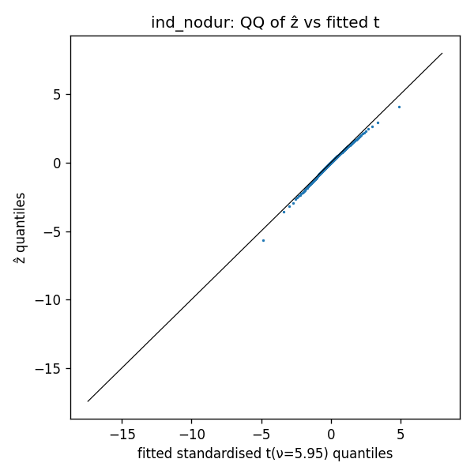
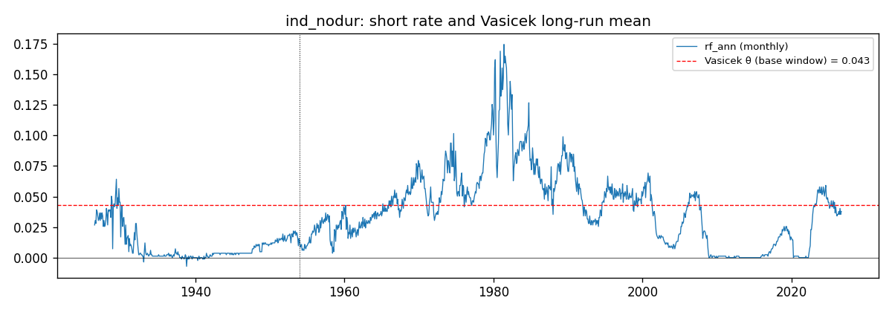
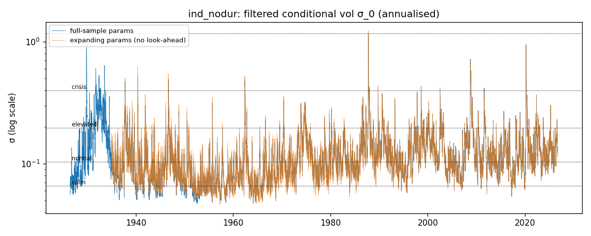
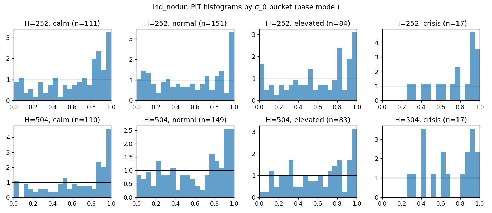
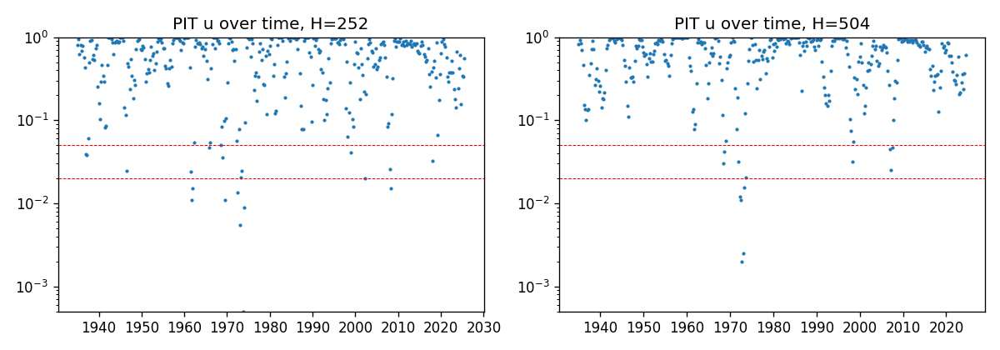
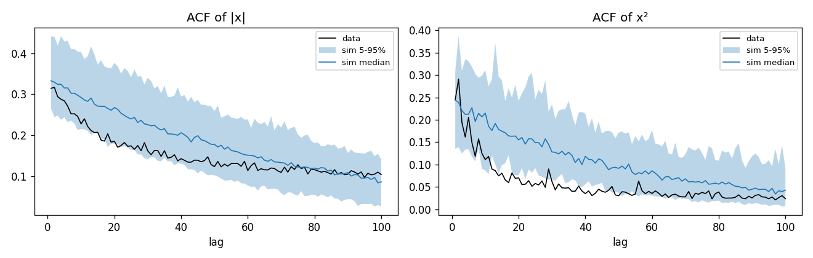
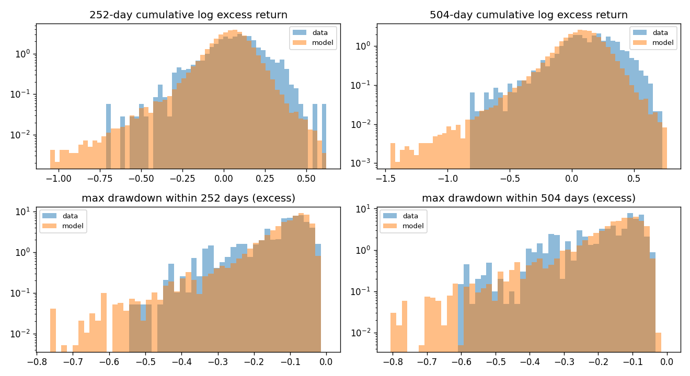
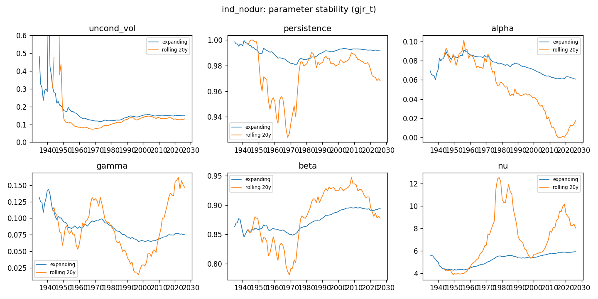

# Model report (Spec 02): `ind_nodur`

Generated 2026-11-21T13:50:09 by `scripts/02_fit_model.py --asset ind_nodur` in 115s. Estimation window 1926-07-01 – 2026-09-30 (26338 days). Base model **gjr_t**, gap variant **scale**, innovations **t**. Data hashes: `F-F_Research_Data_Factors_daily.csv` 3f7910502dd6…, `F-F_Research_Data_Factors.csv` a3894d74d553…, `10_Industry_Portfolios_Daily.csv` 01cfe3d5e54f….

**Fallback-window rule**: full-history base fit persistence 0.99225, valid parameter draws 100% → not triggered; full history used.

## 1. Model comparison

Log-likelihoods are for the *unscaled decimal* x; for the `scale` gap variant the Jacobian (−½ Σ log k) is added so log-likelihood/BIC are comparable across variants. PIT columns: observed share of historical starts with u below the level (nominal = the level), expanding-window parameters. PIT score = mean |obs − nominal|/nominal over σ_0 buckets at levels ≤ 5% (lower is better). 'buckets thin/fat' counts bucket×level cells whose CI excludes the nominal.

| model | gap_variant | nobs | loglik | bic | nu | persistence | half_life_days | uncond_vol_ann | PIT u<0.02 H252 | PIT u<0.05 H252 | PIT u<0.02 H504 | PIT u<0.05 H504 | PIT score | buckets thin/fat | VaR0.01 hit rate | VaR0.01 p_uc | VaR0.001 hit rate | VaR0.001 p_uc |
|---|---|---|---|---|---|---|---|---|---|---|---|---|---|---|---|---|---|---|
| garch_n | none | 26338 | 93333.0 | -186625.3 | n/a | 0.9886 | 60.7 | 15.4% | 2.48% | 4.68% | 1.67% | 3.06% | 0.57 | H252: 0/0, H504: 0/0 | 1.96% | 0.000 | 0.65% | 0.000 |
| garch_t | none | 26338 | 94337.8 | -188624.7 | 5.65 | 0.9972 | 251.5 | 23.7% | 2.20% | 5.23% | 1.11% | 3.06% | 0.62 | H252: 0/0, H504: 0/0 | 1.24% | 0.000 | 0.12% | 0.304 |
| gjr_t | none | 26338 | 94423.2 | -188785.4 | 5.92 | 0.9922 | 88.1 | 14.9% | 2.48% | 5.51% | 1.67% | 3.62% | 0.51 | H252: 0/0, H504: 0/0 | 1.20% | 0.003 | 0.11% | 0.523 |
| egarch_t | none | 26338 | 94475.9 | -188890.8 | 5.96 | 0.9850 | 46.0 | 10.4% | 2.75% | 5.79% | 2.23% | 3.90% | 0.64 | H252: 0/0, H504: 0/0 | 1.14% | 0.031 | 0.13% | 0.111 |
| garch_n | scale | 26338 | 93360.7 | -186680.6 | n/a | 0.9883 | 58.8 | 15.1% | 2.48% | 4.68% | 1.67% | 3.34% | 0.59 | H252: 0/0, H504: 0/0 | 1.96% | 0.000 | 0.66% | 0.000 |
| garch_t | scale | 26338 | 94344.2 | -188637.4 | 5.68 | 0.9973 | 256.3 | 23.9% | 1.65% | 4.96% | 1.11% | 3.06% | 0.61 | H252: 0/0, H504: 0/0 | 1.25% | 0.000 | 0.12% | 0.304 |
| gjr_t | scale | 26338 | 94427.7 | -188794.3 | 5.95 | 0.9922 | 89.1 | 15.0% | 2.20% | 5.51% | 1.39% | 3.62% | 0.51 | H252: 0/0, H504: 0/0 | 1.21% | 0.002 | 0.12% | 0.404 |
| egarch_t | scale | 26338 | 94479.1 | -188897.1 | 5.99 | 0.9851 | 46.0 | 10.4% | 2.75% | 5.51% | 1.95% | 3.62% | 0.67 | H252: 0/0, H504: 0/0 | 1.15% | 0.027 | 0.14% | 0.075 |
| gjr_t (FHS innovations) | scale | 26338 | 94427.7 | -188794.3 | 5.95 | 0.9922 | 89.1 | 15.0% | 1.38% | 4.68% | 0.84% | 2.79% | 0.63 | H252: 0/0, H504: 0/0 | n/a | n/a | n/a | n/a |

### Base model parameters (gjr_t, decimal daily units, robust SEs)

| param | estimate | se |
|---|---|---|
| mu | 0.000499208 | 3.39e-05 |
| omega | 6.87646e-07 | 8.63e-08 |
| alpha | 0.0608051 | 0.00466 |
| gamma | 0.0749692 | 0.0074 |
| beta | 0.893959 | 0.00646 |
| nu | 5.94588 | 0.225 |

log-lik 94433.4, AIC -188854.8, BIC -188805.7; persistence 0.9922; half-life 89.1 days; unconditional vol 15.0%; ν = 5.95.

## 2. Expected excess return (premium)

Raw estimate (mean of r − rf × 252): **7.53%** p.a., SE 1.36% (t = 5.53, 104.5 years). Shrunk 0.5 toward 0.0: **3.77%** used (mode `constant_arith`). Resolved coefficients for all modes (same average premium): `constant_arith` mu_e_daily=0.0001494; `prop_variance` mu_e_daily=0.0001494, lambda=1.854; `constant_sharpe` mu_e_daily=0.0001494, S=0.01934

## 3. Standardised residuals (FHS pool)

n = 26338, mean -0.034, sd 1.005, skew -0.68, excess kurtosis 6.44 (fitted t implies 3.08); min -17.45 on 1955-09-26. The FHS pool is demeaned and scaled to unit variance before resampling.

## 4. Interest-rate model (Vasicek on monthly rf_ann)

| window | start | end | months | kappa | se_kappa | theta | s | half-life (y) | neg. months | rho used | rho same-month | rho prev-month |
|---|---|---|---|---|---|---|---|---|---|---|---|---|
| base | 1954-01 | 2026-09 | 872 | 0.338 | 0.095 | 4.30% | 2.57% | 2.0 | 0 | -0.141 | -0.141 | -0.044 |
| full_sample | 1926-07 | 2026-09 | 1202 | 0.298 | 0.077 | 3.37% | 2.39% | 2.3 | 12 | -0.082 | -0.082 | -0.049 |
| from_1952-07 | 1952-07 | 2026-09 | 890 | 0.334 | 0.094 | 4.23% | 2.55% | 2.1 | 0 | -0.143 | -0.143 | -0.041 |

Negative monthly rf months in the data: 1933-02, 1938-03, 1938-07, 1938-11, 1939-01, 1939-03, 1939-08, 1940-05, 1940-08, 1941-01, 1941-02, 1941-04. Base window (1954-01-01+) excludes them: **True**. `floor_at_zero = False`.

## 5. Starting states (σ_0, r_0)

Under GJR-GARCH the one-step-ahead conditional variance σ_0² is the complete equity state (the sign of the last shock is already inside it); r_0 is the Vasicek state. Both are observable at t = 0. Named states are percentiles of the asset's own filtered σ history (full-sample params), so they transfer across assets. Annualised with N = 252 (see note on pre-1952 data in DECISIONS).

| state_name | sigma0_ann | r0_ann | definition |
|---|---|---|---|
| calm | 6.6% | 2.67% | P10 of filtered sigma; r0 = median rf_ann of estimation window |
| normal | 10.4% | 2.67% | P50 of filtered sigma; r0 = median rf_ann of estimation window |
| elevated | 19.7% | 2.67% | P90 of filtered sigma; r0 = median rf_ann of estimation window |
| crisis | 39.9% | 2.67% | P99 of filtered sigma; r0 = median rf_ann of estimation window |
| extreme | 116.8% | 2.67% | historical max of filtered sigma (1987-10-19); r0 = median rf_ann of estimation window |

Anchor dates (σ_0 = next-day vol at the close of the date):

| state_name | sigma0_ann | r0_ann | sigma0_ann_expanding | rv63_ann | dd252 |
|---|---|---|---|---|---|
| anchor_2006-12-29 | 7.2% | 4.9% | 7.1% | 6.9% | -0.6% |
| anchor_1987-10-16 | 42.2% | 7.4% | 43.7% | 21.8% | -17.2% |
| anchor_1987-10-19 | 116.8% | 7.4% | 122.9% | 43.0% | -31.3% |
| anchor_2008-10-10 | 55.9% | 1.0% | 55.1% | 28.3% | -27.2% |
| anchor_2008-11-20 | 54.3% | 0.4% | 54.0% | 47.5% | -34.7% |
| anchor_2020-03-16 | 92.8% | 1.4% | 92.8% | 39.6% | -25.2% |
| anchor_2022-06-16 | 24.2% | 0.7% | 24.2% | 20.1% | -12.2% |
| anchor_2026-09-30 | 13.2% | 3.8% | 13.2% | 16.8% | -8.3% |

σ_0 bucket edges used in the PIT/VaR tests (annualised): calm: [4.7%, 8.4%), normal: [8.4%, 13.1%), elevated: [13.1%, 24.9%), crisis: [24.9%, n/a)

## 6. Conditional tail calibration (PIT test)

Quarterly start dates; at each start the model is re-estimated on data **before** the start (expanding window, refit every 252 days; premium and rate model also expanding). 2000 paths per start. u = model CDF of the realised cumulative log total return over H days. Effective n = non-overlapping windows = n_starts × 63/H; CIs are Wilson 95% on the effective n. 'too thin' = more realised left-tail outcomes than the model predicts (dangerous for the floor).

### gjr_t / scale / t

| group_type | group | H | n_starts | n_eff | u<0.01 | u<0.02 | u<0.05 | u<0.1 |
|---|---|---|---|---|---|---|---|---|
| overall | all | 252 | 363 | 90.8 | 0.8% (0.1%–5.5%) | 2.2% (0.6%–7.7%) | 5.5% (2.4%–12.3%) | 10.7% (5.9%–18.8%) |
| bucket | calm | 252 | 111 | 27.8 | 0.9% (0.1%–13.7%) | 1.8% (0.2%–15.1%) | 4.5% (0.9%–19.1%) | 9.9% (3.3%–26.3%) |
| bucket | crisis | 252 | 17 | 4.2 | 0.0% (0.0%–47.5%) | 0.0% (0.0%–47.5%) | 0.0% (0.0%–47.5%) | 0.0% (0.0%–47.5%) |
| bucket | elevated | 252 | 84 | 21.0 | 1.2% (0.1%–17.4%) | 2.4% (0.2%–19.2%) | 8.3% (2.1%–27.4%) | 10.7% (3.2%–30.4%) |
| bucket | normal | 252 | 151 | 37.8 | 0.7% (0.0%–10.4%) | 2.6% (0.5%–13.6%) | 5.3% (1.5%–17.4%) | 12.6% (5.4%–26.7%) |
| bucket_group | high | 252 | 101 | 25.2 | 1.0% (0.1%–14.9%) | 2.0% (0.2%–16.4%) | 6.9% (1.8%–23.5%) | 8.9% (2.6%–26.0%) |
| era | 1952-1999 | 252 | 192 | 48.0 | 1.6% (0.2%–10.1%) | 3.6% (0.9%–13.2%) | 6.8% (2.4%–17.5%) | 13.5% (6.5%–25.9%) |
| era | 2000- | 252 | 103 | 25.8 | 0.0% (0.0%–13.0%) | 1.0% (0.1%–14.6%) | 3.9% (0.7%–19.1%) | 6.8% (1.7%–23.1%) |
| era | pre-1952 | 252 | 68 | 17.0 | 0.0% (0.0%–18.4%) | 0.0% (0.0%–18.4%) | 4.4% (0.6%–25.0%) | 8.8% (2.1%–30.8%) |
| overall | all | 504 | 359 | 44.9 | 0.6% (0.0%–8.9%) | 1.4% (0.2%–10.3%) | 3.6% (0.9%–13.7%) | 5.3% (1.6%–16.0%) |
| bucket | calm | 504 | 110 | 13.8 | 0.0% (0.0%–21.8%) | 1.8% (0.1%–24.6%) | 5.5% (0.8%–29.6%) | 5.5% (0.8%–29.6%) |
| bucket | crisis | 504 | 17 | 2.1 | 0.0% (0.0%–64.4%) | 0.0% (0.0%–64.4%) | 0.0% (0.0%–64.4%) | 0.0% (0.0%–64.4%) |
| bucket | elevated | 504 | 83 | 10.4 | 0.0% (0.0%–27.0%) | 1.2% (0.0%–28.7%) | 1.2% (0.0%–28.7%) | 2.4% (0.1%–30.4%) |
| bucket | normal | 504 | 149 | 18.6 | 1.3% (0.1%–19.2%) | 1.3% (0.1%–19.2%) | 4.0% (0.6%–23.2%) | 7.4% (1.6%–27.7%) |
| bucket_group | high | 504 | 100 | 12.5 | 0.0% (0.0%–23.5%) | 1.0% (0.0%–25.0%) | 1.0% (0.0%–25.0%) | 2.0% (0.1%–26.5%) |
| era | 1952-1999 | 504 | 192 | 24.0 | 1.0% (0.1%–15.5%) | 2.6% (0.3%–18.0%) | 5.2% (1.1%–21.7%) | 8.3% (2.3%–25.8%) |
| era | 2000- | 504 | 99 | 12.4 | 0.0% (0.0%–23.7%) | 0.0% (0.0%–23.7%) | 3.0% (0.2%–28.1%) | 3.0% (0.2%–28.1%) |
| era | pre-1952 | 504 | 68 | 8.5 | 0.0% (0.0%–31.1%) | 0.0% (0.0%–31.1%) | 0.0% (0.0%–31.1%) | 0.0% (0.0%–31.1%) |

**Verdicts:**

- H=252, bucket `calm`: no evidence of miscalibration (nominal inside the CI at all levels), but low power: the CI at the 2% level spans 15%
- H=252, bucket `normal`: no evidence of miscalibration (nominal inside the CI at all levels), but low power: the CI at the 2% level spans 13%
- H=252, bucket `elevated`: no evidence of miscalibration (nominal inside the CI at all levels), but low power: the CI at the 2% level spans 19%
- H=252, bucket `crisis`: inconclusive: too few independent windows to test (CI would include 0% and >20%)
- H=252, bucket_group `high`: no evidence of miscalibration (nominal inside the CI at all levels), but low power: the CI at the 2% level spans 16%
- H=252, era `pre-1952`: no evidence of miscalibration (nominal inside the CI at all levels), but low power: the CI at the 2% level spans 18%
- H=252, era `1952-1999`: no evidence of miscalibration (nominal inside the CI at all levels), but low power: the CI at the 2% level spans 12%
- H=252, era `2000-`: no evidence of miscalibration (nominal inside the CI at all levels), but low power: the CI at the 2% level spans 15%
- H=504, bucket `calm`: no evidence of miscalibration (nominal inside the CI at all levels), but low power: the CI at the 2% level spans 24%
- H=504, bucket `normal`: no evidence of miscalibration (nominal inside the CI at all levels), but low power: the CI at the 2% level spans 19%
- H=504, bucket `elevated`: no evidence of miscalibration (nominal inside the CI at all levels), but low power: the CI at the 2% level spans 29%
- H=504, bucket `crisis`: inconclusive: too few independent windows to test (CI would include 0% and >20%)
- H=504, bucket_group `high`: no evidence of miscalibration (nominal inside the CI at all levels), but low power: the CI at the 2% level spans 25%
- H=504, era `pre-1952`: no evidence of miscalibration (nominal inside the CI at all levels), but low power: the CI at the 2% level spans 31%
- H=504, era `1952-1999`: no evidence of miscalibration (nominal inside the CI at all levels), but low power: the CI at the 2% level spans 18%
- H=504, era `2000-`: no evidence of miscalibration (nominal inside the CI at all levels), but low power: the CI at the 2% level spans 24%

### gjr_t / scale / fhs

| group_type | group | H | n_starts | n_eff | u<0.01 | u<0.02 | u<0.05 | u<0.1 |
|---|---|---|---|---|---|---|---|---|
| overall | all | 252 | 363 | 90.8 | 0.6% (0.1%–5.1%) | 1.4% (0.3%–6.4%) | 4.7% (1.9%–11.2%) | 10.2% (5.5%–18.1%) |
| bucket | calm | 252 | 111 | 27.8 | 0.9% (0.1%–13.7%) | 1.8% (0.2%–15.1%) | 2.7% (0.4%–16.5%) | 9.0% (2.8%–25.2%) |
| bucket | crisis | 252 | 17 | 4.2 | 0.0% (0.0%–47.5%) | 0.0% (0.0%–47.5%) | 0.0% (0.0%–47.5%) | 0.0% (0.0%–47.5%) |
| bucket | elevated | 252 | 84 | 21.0 | 0.0% (0.0%–15.5%) | 1.2% (0.1%–17.4%) | 8.3% (2.1%–27.4%) | 10.7% (3.2%–30.4%) |
| bucket | normal | 252 | 151 | 37.8 | 0.7% (0.0%–10.4%) | 1.3% (0.1%–11.5%) | 4.6% (1.2%–16.5%) | 11.9% (5.0%–25.9%) |
| bucket_group | high | 252 | 101 | 25.2 | 0.0% (0.0%–13.2%) | 1.0% (0.1%–14.9%) | 6.9% (1.8%–23.5%) | 8.9% (2.6%–26.0%) |
| era | 1952-1999 | 252 | 192 | 48.0 | 1.0% (0.1%–9.2%) | 2.6% (0.5%–11.7%) | 6.2% (2.1%–16.8%) | 13.0% (6.2%–25.3%) |
| era | 2000- | 252 | 103 | 25.8 | 0.0% (0.0%–13.0%) | 0.0% (0.0%–13.0%) | 3.9% (0.7%–19.1%) | 6.8% (1.7%–23.1%) |
| era | pre-1952 | 252 | 68 | 17.0 | 0.0% (0.0%–18.4%) | 0.0% (0.0%–18.4%) | 1.5% (0.1%–20.7%) | 7.4% (1.5%–28.9%) |
| overall | all | 504 | 359 | 44.9 | 0.6% (0.0%–8.9%) | 0.8% (0.1%–9.4%) | 2.8% (0.6%–12.4%) | 5.6% (1.7%–16.4%) |
| bucket | calm | 504 | 110 | 13.8 | 0.0% (0.0%–21.8%) | 0.9% (0.0%–23.2%) | 3.6% (0.4%–27.1%) | 5.5% (0.8%–29.6%) |
| bucket | crisis | 504 | 17 | 2.1 | 0.0% (0.0%–64.4%) | 0.0% (0.0%–64.4%) | 0.0% (0.0%–64.4%) | 0.0% (0.0%–64.4%) |
| bucket | elevated | 504 | 83 | 10.4 | 0.0% (0.0%–27.0%) | 0.0% (0.0%–27.0%) | 1.2% (0.0%–28.7%) | 2.4% (0.1%–30.4%) |
| bucket | normal | 504 | 149 | 18.6 | 1.3% (0.1%–19.2%) | 1.3% (0.1%–19.2%) | 3.4% (0.4%–22.2%) | 8.1% (1.9%–28.6%) |
| bucket_group | high | 504 | 100 | 12.5 | 0.0% (0.0%–23.5%) | 0.0% (0.0%–23.5%) | 1.0% (0.0%–25.0%) | 2.0% (0.1%–26.5%) |
| era | 1952-1999 | 504 | 192 | 24.0 | 1.0% (0.1%–15.5%) | 1.6% (0.1%–16.4%) | 4.7% (0.9%–21.0%) | 8.3% (2.3%–25.8%) |
| era | 2000- | 504 | 99 | 12.4 | 0.0% (0.0%–23.7%) | 0.0% (0.0%–23.7%) | 1.0% (0.0%–25.2%) | 4.0% (0.4%–29.4%) |
| era | pre-1952 | 504 | 68 | 8.5 | 0.0% (0.0%–31.1%) | 0.0% (0.0%–31.1%) | 0.0% (0.0%–31.1%) | 0.0% (0.0%–31.1%) |

**Verdicts:**

- H=252, bucket `calm`: no evidence of miscalibration (nominal inside the CI at all levels), but low power: the CI at the 2% level spans 15%
- H=252, bucket `normal`: no evidence of miscalibration (nominal inside the CI at all levels), but low power: the CI at the 2% level spans 11%
- H=252, bucket `elevated`: no evidence of miscalibration (nominal inside the CI at all levels), but low power: the CI at the 2% level spans 17%
- H=252, bucket `crisis`: inconclusive: too few independent windows to test (CI would include 0% and >20%)
- H=252, bucket_group `high`: no evidence of miscalibration (nominal inside the CI at all levels), but low power: the CI at the 2% level spans 15%
- H=252, era `pre-1952`: no evidence of miscalibration (nominal inside the CI at all levels), but low power: the CI at the 2% level spans 18%
- H=252, era `1952-1999`: no evidence of miscalibration (nominal inside the CI at all levels), but low power: the CI at the 2% level spans 11%
- H=252, era `2000-`: no evidence of miscalibration (nominal inside the CI at all levels), but low power: the CI at the 2% level spans 13%
- H=504, bucket `calm`: no evidence of miscalibration (nominal inside the CI at all levels), but low power: the CI at the 2% level spans 23%
- H=504, bucket `normal`: no evidence of miscalibration (nominal inside the CI at all levels), but low power: the CI at the 2% level spans 19%
- H=504, bucket `elevated`: no evidence of miscalibration (nominal inside the CI at all levels), but low power: the CI at the 2% level spans 27%
- H=504, bucket `crisis`: inconclusive: too few independent windows to test (CI would include 0% and >20%)
- H=504, bucket_group `high`: no evidence of miscalibration (nominal inside the CI at all levels), but low power: the CI at the 2% level spans 24%
- H=504, era `pre-1952`: no evidence of miscalibration (nominal inside the CI at all levels), but low power: the CI at the 2% level spans 31%
- H=504, era `1952-1999`: no evidence of miscalibration (nominal inside the CI at all levels), but low power: the CI at the 2% level spans 16%
- H=504, era `2000-`: no evidence of miscalibration (nominal inside the CI at all levels), but low power: the CI at the 2% level spans 24%

## 7. One-day tail check

| level | bucket | n | hits | rate | LR_uc | p_uc | LR_ind | p_ind |
|---|---|---|---|---|---|---|---|---|
| 0.01 | all | 23818 | 288 | 1.209% | 9.87 | 0.002 | 2.83 | 0.093 |
| 0.01 | calm | 7442 | 94 | 1.263% | 4.80 | 0.028 | 0.03 | 0.858 |
| 0.01 | crisis | 774 | 10 | 1.292% | 0.61 | 0.435 | 2.51 | 0.113 |
| 0.01 | elevated | 5731 | 60 | 1.047% | 0.13 | 0.723 | 0.19 | 0.662 |
| 0.01 | normal | 9871 | 124 | 1.256% | 6.05 | 0.014 | 0.23 | 0.628 |
| 0.001 | all | 23818 | 28 | 0.118% | 0.70 | 0.404 | 0.07 | 0.797 |
| 0.001 | calm | 7442 | 9 | 0.121% | 0.31 | 0.580 | 0.02 | 0.883 |
| 0.001 | crisis | 774 | 1 | 0.129% | 0.06 | 0.806 | 0.00 | 0.959 |
| 0.001 | elevated | 5731 | 7 | 0.122% | 0.26 | 0.608 | 0.02 | 0.896 |
| 0.001 | normal | 9871 | 11 | 0.111% | 0.12 | 0.724 | 0.02 | 0.876 |

(Christoffersen independence within a bucket uses consecutive days of that bucket's sub-sequence.)

- **full_sample_params**: σ for 1987-10-19 = 42.2% (ann.), ν = 5.95. P(one-day loss ≥ 17%) = 6.92e-05 (once in 57.4 years at that σ). Realised standardised shock = -7.1; model probability of a shock that size or worse = 6.82e-05.
- **expanding_params**: σ for 1987-10-19 = 43.7% (ann.), ν = 5.51. P(one-day loss ≥ 17%) = 1.12e-04 (once in 35.4 years at that σ). Realised standardised shock = -6.8; model probability of a shock that size or worse = 1.11e-04.
- P(one-day loss ≥ 17%) from named states: calm: 1.32e-09, normal: 1.97e-08, elevated: 8.64e-07, crisis: 5.06e-05, extreme: 1.04e-02

## 8. Stylised facts: data vs simulated long paths

40 simulated paths of the estimation-window length from the base model (t innovations, base premium and rate model).

| statistic | data | model |
|---|---|---|
| annualised vol of x | 13.9% | 14.0% (5–95%: 11.7%–17.1%) |
| excess kurtosis of daily x | 21.2 | 23.3 (5–95%: 8.8–177.8) |
| skew of daily x | -0.58 | 0.03 |
| ACF |x| lags 1/10/50/100 | 0.31 / 0.23 / 0.12 / 0.10 | 0.33 / 0.29 / 0.18 / 0.09 |

252-day windows (start every 21 days) — quantiles:

| quantile | cum log excess, data | cum log excess, model | max DD, data | max DD, model |
|---|---|---|---|---|
| 0.01 | -39.3% | -42.7% | -42.4% | -47.8% |
| 0.02 | -30.0% | -30.0% | -39.1% | -40.1% |
| 0.05 | -23.1% | -18.7% | -33.1% | -28.7% |
| 0.1 | -13.7% | -11.8% | -27.4% | -21.3% |
| 0.5 | 7.7% | 4.4% | -10.5% | -9.5% |

504-day windows (start every 21 days) — quantiles:

| quantile | cum log excess, data | cum log excess, model | max DD, data | max DD, model |
|---|---|---|---|---|
| 0.01 | -60.4% | -56.9% | -56.6% | -59.1% |
| 0.02 | -46.4% | -42.7% | -51.9% | -50.5% |
| 0.05 | -25.5% | -25.9% | -39.6% | -39.9% |
| 0.1 | -13.4% | -15.6% | -36.0% | -30.5% |
| 0.5 | 14.3% | 8.1% | -15.4% | -13.8% |

Simulated x clipped at −99% simple return: 0 times.

## 9. Parameter stability

| sample | start | end | nobs | mu | omega | alpha | gamma | beta | nu | persistence | half_life_days | uncond_vol_ann | loglik |
|---|---|---|---|---|---|---|---|---|---|---|---|---|---|
| estimation window (base) | 1926-07-01 | 2026-09-30 | 26338 | 4.99e-04 | 6.88e-07 | 0.061 | 0.075 | 0.894 | 5.95 | 0.9922 | 89 | 15.0% | 94433 |
| pre-1963 | 1926-07-01 | 1962-12-31 | 10295 | 5.88e-04 | 1.01e-06 | 0.085 | 0.090 | 0.856 | 4.60 | 0.9861 | 50 | 13.5% | 38304 |
| 1963-1999 | 1963-01-02 | 1999-12-31 | 9317 | 4.18e-04 | 5.15e-07 | 0.050 | 0.047 | 0.920 | 6.86 | 0.9936 | 107 | 14.2% | 33171 |
| 2000-end | 2000-01-03 | 2026-09-30 | 6726 | 3.48e-04 | 1.67e-06 | 0.013 | 0.128 | 0.899 | 8.77 | 0.9755 | 28 | 13.1% | 23060 |
| from 1952-07-01 | 1952-07-01 | 2026-09-30 | 18685 | 4.66e-04 | 5.63e-07 | 0.050 | 0.069 | 0.908 | 7.05 | 0.9929 | 97 | 14.1% | 66756 |
| from 1963-07-01 | 1963-07-01 | 2026-09-30 | 15918 | 4.11e-04 | 8.19e-07 | 0.043 | 0.071 | 0.911 | 7.42 | 0.9889 | 62 | 13.6% | 55692 |
| from 1990-01-01 | 1990-01-02 | 2026-09-30 | 9254 | 3.62e-04 | 1.54e-06 | 0.022 | 0.100 | 0.906 | 7.64 | 0.9785 | 32 | 13.4% | 31685 |

## 10. Parameter-uncertainty draws

200 draws from the asymptotic normal of the robust covariance (acceptance 100.0%; rejected: non-stationary, ω ≤ 0, negative ARCH terms, ν ≤ 2.5). Unconditional vol 5–95%: 12.9%–19.6%; ν 5–95%: 5.59–6.34. Saved to `results/model/param_draws_ind_nodur.npy` (columns ['mu', 'omega', 'alpha', 'gamma', 'beta', 'nu']).

## 11. Closure-gap returns

| date | from | calendar_days | busdays | x |
|---|---|---|---|---|
| 1929-12-02 | 1929-11-27 | 5 | 3 | 0.60% |
| 1933-03-15 | 1933-03-03 | 12 | 8 | 13.08% |
| 1956-12-26 | 1956-12-21 | 5 | 3 | 0.06% |
| 1958-12-29 | 1958-12-24 | 5 | 3 | 0.56% |
| 1961-05-31 | 1961-05-26 | 5 | 3 | 0.17% |
| 1968-07-08 | 1968-07-03 | 5 | 3 | 1.07% |
| 2001-09-17 | 2001-09-10 | 7 | 5 | -1.24% |
| 2007-01-03 | 2006-12-29 | 5 | 3 | 0.29% |
| 2012-10-31 | 2012-10-26 | 5 | 3 | 0.46% |

Variant `scale` divides these returns by sqrt(busdays) before fitting; `none` uses them as is. Compare the rows of the model comparison table with the same model name.

