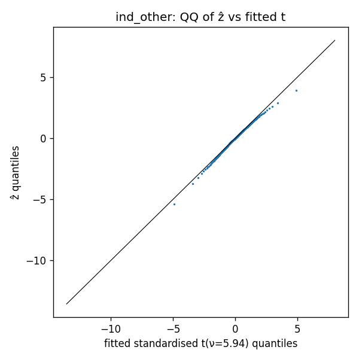
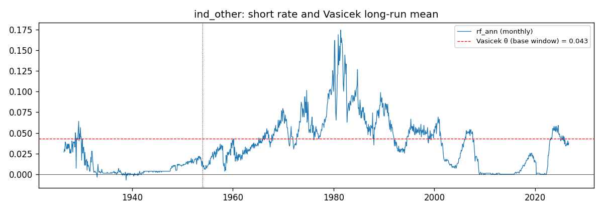
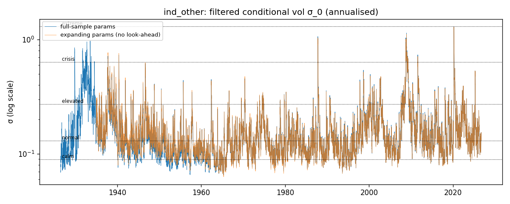
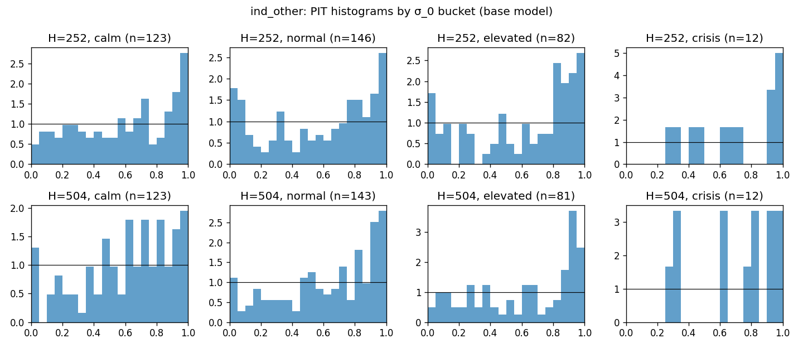
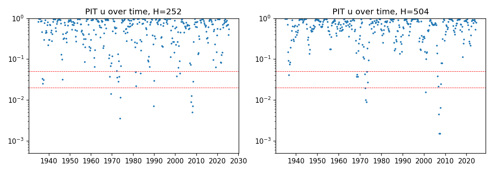
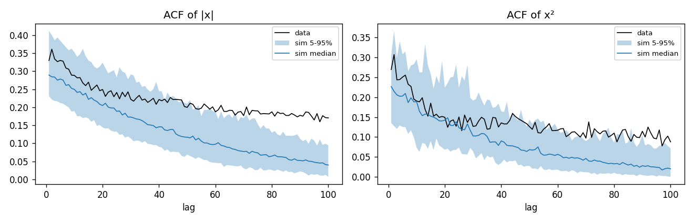
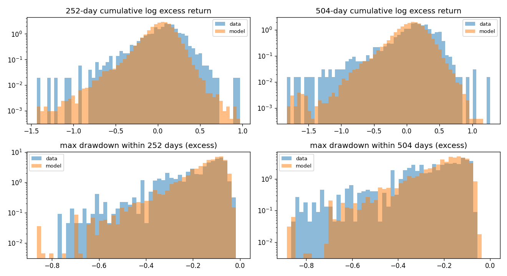
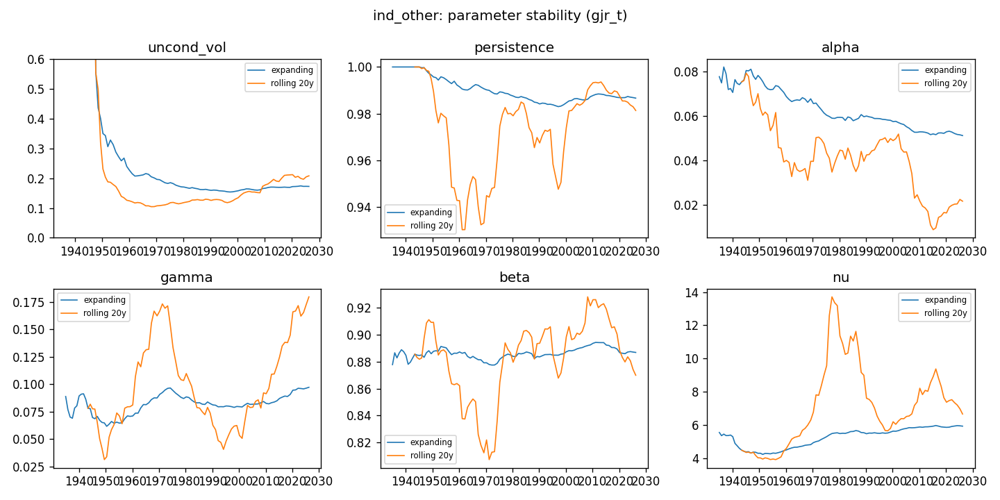

# Model report (Spec 02): `ind_other`

Generated 2026-11-21T14:02:27 by `scripts/02_fit_model.py --asset ind_other` in 117s. Estimation window 1926-07-01 – 2026-09-30 (26338 days). Base model **gjr_t**, gap variant **scale**, innovations **t**. Data hashes: `F-F_Research_Data_Factors_daily.csv` 3f7910502dd6…, `F-F_Research_Data_Factors.csv` a3894d74d553…, `10_Industry_Portfolios_Daily.csv` 01cfe3d5e54f….

**Fallback-window rule**: full-history base fit persistence 0.98657, valid parameter draws 100% → not triggered; full history used.

## 1. Model comparison

Log-likelihoods are for the *unscaled decimal* x; for the `scale` gap variant the Jacobian (−½ Σ log k) is added so log-likelihood/BIC are comparable across variants. PIT columns: observed share of historical starts with u below the level (nominal = the level), expanding-window parameters. PIT score = mean |obs − nominal|/nominal over σ_0 buckets at levels ≤ 5% (lower is better). 'buckets thin/fat' counts bucket×level cells whose CI excludes the nominal.

| model | gap_variant | nobs | loglik | bic | nu | persistence | half_life_days | uncond_vol_ann | PIT u<0.02 H252 | PIT u<0.05 H252 | PIT u<0.02 H504 | PIT u<0.05 H504 | PIT score | buckets thin/fat | VaR0.01 hit rate | VaR0.01 p_uc | VaR0.001 hit rate | VaR0.001 p_uc |
|---|---|---|---|---|---|---|---|---|---|---|---|---|---|---|---|---|---|---|
| garch_n | none | 26338 | 86006.0 | -171971.2 | n/a | 0.9886 | 60.5 | 20.1% | 2.20% | 4.96% | 1.67% | 3.34% | 0.62 | H252: 0/0, H504: 0/0 | 1.94% | 0.000 | 0.63% | 0.000 |
| garch_t | none | 26338 | 86934.0 | -173817.1 | 5.58 | 0.9933 | 102.5 | 22.5% | 2.20% | 5.79% | 1.95% | 3.90% | 0.66 | H252: 0/0, H504: 0/0 | 1.28% | 0.000 | 0.13% | 0.160 |
| gjr_t | none | 26338 | 87066.7 | -174072.3 | 5.90 | 0.9865 | 51.2 | 17.2% | 2.20% | 6.34% | 1.95% | 5.01% | 0.68 | H252: 0/0, H504: 0/0 | 1.16% | 0.016 | 0.13% | 0.223 |
| egarch_t | none | 26338 | 87101.5 | -174142.0 | 5.90 | 0.9851 | 46.3 | 13.6% | 2.20% | 4.96% | 2.23% | 4.46% | 0.68 | H252: 0/0, H504: 0/0 | 1.16% | 0.016 | 0.14% | 0.075 |
| garch_n | scale | 26338 | 86027.9 | -172015.2 | n/a | 0.9884 | 59.5 | 19.9% | 2.20% | 4.96% | 1.67% | 3.62% | 0.64 | H252: 0/0, H504: 0/0 | 1.94% | 0.000 | 0.62% | 0.000 |
| garch_t | scale | 26338 | 86939.4 | -173827.8 | 5.61 | 0.9933 | 103.4 | 22.6% | 2.20% | 5.23% | 1.67% | 3.90% | 0.63 | H252: 0/0, H504: 0/0 | 1.29% | 0.000 | 0.13% | 0.223 |
| gjr_t | scale | 26338 | 87071.8 | -174082.6 | 5.94 | 0.9866 | 51.3 | 17.2% | 2.20% | 6.34% | 2.23% | 5.01% | 0.66 | H252: 0/0, H504: 0/0 | 1.16% | 0.016 | 0.12% | 0.304 |
| egarch_t | scale | 26338 | 87106.6 | -174152.1 | 5.94 | 0.9852 | 46.4 | 13.6% | 2.20% | 5.23% | 2.23% | 4.74% | 0.70 | H252: 0/0, H504: 0/0 | 1.16% | 0.014 | 0.14% | 0.075 |
| gjr_t (FHS innovations) | scale | 26338 | 87071.8 | -174082.6 | 5.94 | 0.9866 | 51.3 | 17.2% | 1.38% | 4.68% | 1.39% | 3.34% | 0.63 | H252: 0/0, H504: 0/0 | n/a | n/a | n/a | n/a |

### Base model parameters (gjr_t, decimal daily units, robust SEs)

| param | estimate | se |
|---|---|---|
| mu | 0.000577756 | 4.46e-05 |
| omega | 1.57369e-06 | 1.69e-07 |
| alpha | 0.0508017 | 0.00419 |
| gamma | 0.0972973 | 0.00839 |
| beta | 0.887116 | 0.00671 |
| nu | 5.93885 | 0.221 |

log-lik 87077.5, AIC -174143.0, BIC -174094.0; persistence 0.9866; half-life 51.3 days; unconditional vol 17.2%; ν = 5.94.

## 2. Expected excess return (premium)

Raw estimate (mean of r − rf × 252): **7.18%** p.a., SE 1.91% (t = 3.76, 104.5 years). Shrunk 0.5 toward 0.0: **3.59%** used (mode `constant_arith`). Resolved coefficients for all modes (same average premium): `constant_arith` mu_e_daily=0.0001425; `prop_variance` mu_e_daily=0.0001425, lambda=0.9298; `constant_sharpe` mu_e_daily=0.0001425, S=0.01372

## 3. Standardised residuals (FHS pool)

n = 26338, mean -0.036, sd 1.001, skew -0.53, excess kurtosis 3.88 (fitted t implies 3.09); min -13.55 on 1955-09-26. The FHS pool is demeaned and scaled to unit variance before resampling.

## 4. Interest-rate model (Vasicek on monthly rf_ann)

| window | start | end | months | kappa | se_kappa | theta | s | half-life (y) | neg. months | rho used | rho same-month | rho prev-month |
|---|---|---|---|---|---|---|---|---|---|---|---|---|
| base | 1954-01 | 2026-09 | 872 | 0.338 | 0.095 | 4.30% | 2.57% | 2.0 | 0 | -0.107 | -0.107 | -0.037 |
| full_sample | 1926-07 | 2026-09 | 1202 | 0.298 | 0.077 | 3.37% | 2.39% | 2.3 | 12 | -0.050 | -0.050 | -0.039 |
| from_1952-07 | 1952-07 | 2026-09 | 890 | 0.334 | 0.094 | 4.23% | 2.55% | 2.1 | 0 | -0.109 | -0.109 | -0.034 |

Negative monthly rf months in the data: 1933-02, 1938-03, 1938-07, 1938-11, 1939-01, 1939-03, 1939-08, 1940-05, 1940-08, 1941-01, 1941-02, 1941-04. Base window (1954-01-01+) excludes them: **True**. `floor_at_zero = False`.

## 5. Starting states (σ_0, r_0)

Under GJR-GARCH the one-step-ahead conditional variance σ_0² is the complete equity state (the sign of the last shock is already inside it); r_0 is the Vasicek state. Both are observable at t = 0. Named states are percentiles of the asset's own filtered σ history (full-sample params), so they transfer across assets. Annualised with N = 252 (see note on pre-1952 data in DECISIONS).

| state_name | sigma0_ann | r0_ann | definition |
|---|---|---|---|
| calm | 8.9% | 2.67% | P10 of filtered sigma; r0 = median rf_ann of estimation window |
| normal | 13.1% | 2.67% | P50 of filtered sigma; r0 = median rf_ann of estimation window |
| elevated | 27.3% | 2.67% | P90 of filtered sigma; r0 = median rf_ann of estimation window |
| crisis | 63.5% | 2.67% | P99 of filtered sigma; r0 = median rf_ann of estimation window |
| extreme | 130.1% | 2.67% | historical max of filtered sigma (2020-03-16); r0 = median rf_ann of estimation window |

Anchor dates (σ_0 = next-day vol at the close of the date):

| state_name | sigma0_ann | r0_ann | sigma0_ann_expanding | rv63_ann | dd252 |
|---|---|---|---|---|---|
| anchor_2006-12-29 | 9.5% | 4.9% | 9.4% | 8.3% | -0.9% |
| anchor_1987-10-16 | 34.2% | 7.4% | 33.4% | 15.7% | -12.5% |
| anchor_1987-10-19 | 106.4% | 7.4% | 103.7% | 36.4% | -25.8% |
| anchor_2008-10-10 | 98.7% | 1.0% | 96.5% | 64.8% | -49.5% |
| anchor_2008-11-20 | 100.5% | 0.4% | 97.9% | 77.9% | -61.6% |
| anchor_2020-03-16 | 130.1% | 1.4% | 128.5% | 53.8% | -34.9% |
| anchor_2022-06-16 | 39.3% | 0.7% | 39.3% | 26.4% | -25.1% |
| anchor_2026-09-30 | 15.4% | 3.8% | 15.4% | 11.5% | -8.6% |

σ_0 bucket edges used in the PIT/VaR tests (annualised): calm: [6.5%, 10.9%), normal: [10.9%, 16.9%), elevated: [16.9%, 36.4%), crisis: [36.4%, n/a)

## 6. Conditional tail calibration (PIT test)

Quarterly start dates; at each start the model is re-estimated on data **before** the start (expanding window, refit every 252 days; premium and rate model also expanding). 2000 paths per start. u = model CDF of the realised cumulative log total return over H days. Effective n = non-overlapping windows = n_starts × 63/H; CIs are Wilson 95% on the effective n. 'too thin' = more realised left-tail outcomes than the model predicts (dangerous for the floor).

### gjr_t / scale / t

| group_type | group | H | n_starts | n_eff | u<0.01 | u<0.02 | u<0.05 | u<0.1 |
|---|---|---|---|---|---|---|---|---|
| overall | all | 252 | 363 | 90.8 | 1.4% (0.3%–6.4%) | 2.2% (0.6%–7.7%) | 6.3% (2.9%–13.3%) | 11.6% (6.5%–19.8%) |
| bucket | calm | 252 | 123 | 30.8 | 1.6% (0.2%–13.8%) | 1.6% (0.2%–13.8%) | 2.4% (0.4%–15.1%) | 6.5% (1.8%–20.9%) |
| bucket | crisis | 252 | 12 | 3.0 | 0.0% (0.0%–56.1%) | 0.0% (0.0%–56.1%) | 0.0% (0.0%–56.1%) | 0.0% (0.0%–56.1%) |
| bucket | elevated | 252 | 82 | 20.5 | 2.4% (0.3%–19.6%) | 4.9% (0.9%–23.1%) | 8.5% (2.2%–28.0%) | 12.2% (3.9%–32.5%) |
| bucket | normal | 252 | 146 | 36.5 | 0.7% (0.0%–10.7%) | 1.4% (0.1%–11.9%) | 8.9% (3.2%–22.4%) | 16.4% (7.8%–31.5%) |
| bucket_group | high | 252 | 94 | 23.5 | 2.1% (0.2%–17.5%) | 4.3% (0.8%–20.6%) | 7.4% (1.9%–24.9%) | 10.6% (3.4%–29.0%) |
| era | 1952-1999 | 252 | 192 | 48.0 | 1.0% (0.1%–9.2%) | 2.1% (0.4%–10.9%) | 6.2% (2.1%–16.8%) | 11.5% (5.2%–23.4%) |
| era | 2000- | 252 | 103 | 25.8 | 2.9% (0.4%–17.6%) | 3.9% (0.7%–19.1%) | 6.8% (1.7%–23.1%) | 14.6% (5.6%–32.7%) |
| era | pre-1952 | 252 | 68 | 17.0 | 0.0% (0.0%–18.4%) | 0.0% (0.0%–18.4%) | 5.9% (1.0%–27.0%) | 7.4% (1.5%–28.9%) |
| overall | all | 504 | 359 | 44.9 | 1.4% (0.2%–10.3%) | 2.2% (0.4%–11.6%) | 5.0% (1.5%–15.6%) | 6.7% (2.3%–17.9%) |
| bucket | calm | 504 | 123 | 15.4 | 0.8% (0.0%–21.3%) | 2.4% (0.2%–23.7%) | 6.5% (1.2%–29.2%) | 6.5% (1.2%–29.2%) |
| bucket | crisis | 504 | 12 | 1.5 | 0.0% (0.0%–71.9%) | 0.0% (0.0%–71.9%) | 0.0% (0.0%–71.9%) | 0.0% (0.0%–71.9%) |
| bucket | elevated | 504 | 81 | 10.1 | 1.2% (0.0%–29.3%) | 1.2% (0.0%–29.3%) | 2.5% (0.1%–30.9%) | 7.4% (1.1%–37.2%) |
| bucket | normal | 504 | 143 | 17.9 | 2.1% (0.2%–21.0%) | 2.8% (0.3%–22.0%) | 5.6% (1.0%–25.9%) | 7.0% (1.5%–27.8%) |
| bucket_group | high | 504 | 93 | 11.6 | 1.1% (0.0%–26.4%) | 1.1% (0.0%–26.4%) | 2.2% (0.1%–27.9%) | 6.5% (0.9%–33.6%) |
| era | 1952-1999 | 504 | 192 | 24.0 | 0.5% (0.0%–14.7%) | 1.6% (0.1%–16.4%) | 4.7% (0.9%–21.0%) | 5.2% (1.1%–21.7%) |
| era | 2000- | 504 | 99 | 12.4 | 4.0% (0.4%–29.4%) | 5.1% (0.6%–30.8%) | 8.1% (1.4%–34.6%) | 10.1% (2.1%–37.0%) |
| era | pre-1952 | 504 | 68 | 8.5 | 0.0% (0.0%–31.1%) | 0.0% (0.0%–31.1%) | 1.5% (0.0%–33.1%) | 5.9% (0.6%–38.6%) |

**Verdicts:**

- H=252, bucket `calm`: no evidence of miscalibration (nominal inside the CI at all levels), but low power: the CI at the 2% level spans 14%
- H=252, bucket `normal`: no evidence of miscalibration (nominal inside the CI at all levels), but low power: the CI at the 2% level spans 12%
- H=252, bucket `elevated`: no evidence of miscalibration (nominal inside the CI at all levels), but low power: the CI at the 2% level spans 22%
- H=252, bucket `crisis`: inconclusive: too few independent windows to test (CI would include 0% and >20%)
- H=252, bucket_group `high`: no evidence of miscalibration (nominal inside the CI at all levels), but low power: the CI at the 2% level spans 20%
- H=252, era `pre-1952`: no evidence of miscalibration (nominal inside the CI at all levels), but low power: the CI at the 2% level spans 18%
- H=252, era `1952-1999`: no evidence of miscalibration (nominal inside the CI at all levels), but low power: the CI at the 2% level spans 11%
- H=252, era `2000-`: no evidence of miscalibration (nominal inside the CI at all levels), but low power: the CI at the 2% level spans 18%
- H=504, bucket `calm`: no evidence of miscalibration (nominal inside the CI at all levels), but low power: the CI at the 2% level spans 23%
- H=504, bucket `normal`: no evidence of miscalibration (nominal inside the CI at all levels), but low power: the CI at the 2% level spans 22%
- H=504, bucket `elevated`: no evidence of miscalibration (nominal inside the CI at all levels), but low power: the CI at the 2% level spans 29%
- H=504, bucket `crisis`: inconclusive: too few independent windows to test (CI would include 0% and >20%)
- H=504, bucket_group `high`: no evidence of miscalibration (nominal inside the CI at all levels), but low power: the CI at the 2% level spans 26%
- H=504, era `pre-1952`: no evidence of miscalibration (nominal inside the CI at all levels), but low power: the CI at the 2% level spans 31%
- H=504, era `1952-1999`: no evidence of miscalibration (nominal inside the CI at all levels), but low power: the CI at the 2% level spans 16%
- H=504, era `2000-`: no evidence of miscalibration (nominal inside the CI at all levels), but low power: the CI at the 2% level spans 30%

### gjr_t / scale / fhs

| group_type | group | H | n_starts | n_eff | u<0.01 | u<0.02 | u<0.05 | u<0.1 |
|---|---|---|---|---|---|---|---|---|
| overall | all | 252 | 363 | 90.8 | 0.3% (0.0%–4.6%) | 1.4% (0.3%–6.4%) | 4.7% (1.9%–11.2%) | 9.9% (5.3%–17.8%) |
| bucket | calm | 252 | 123 | 30.8 | 0.8% (0.0%–12.5%) | 1.6% (0.2%–13.8%) | 2.4% (0.4%–15.1%) | 4.9% (1.1%–18.6%) |
| bucket | crisis | 252 | 12 | 3.0 | 0.0% (0.0%–56.1%) | 0.0% (0.0%–56.1%) | 0.0% (0.0%–56.1%) | 0.0% (0.0%–56.1%) |
| bucket | elevated | 252 | 82 | 20.5 | 0.0% (0.0%–15.8%) | 2.4% (0.3%–19.6%) | 8.5% (2.2%–28.0%) | 12.2% (3.9%–32.5%) |
| bucket | normal | 252 | 146 | 36.5 | 0.0% (0.0%–9.5%) | 0.7% (0.0%–10.7%) | 4.8% (1.2%–17.0%) | 13.7% (6.0%–28.3%) |
| bucket_group | high | 252 | 94 | 23.5 | 0.0% (0.0%–14.0%) | 2.1% (0.2%–17.5%) | 7.4% (1.9%–24.9%) | 10.6% (3.4%–29.0%) |
| era | 1952-1999 | 252 | 192 | 48.0 | 0.5% (0.0%–8.3%) | 1.0% (0.1%–9.2%) | 4.2% (1.2%–14.0%) | 9.9% (4.2%–21.5%) |
| era | 2000- | 252 | 103 | 25.8 | 0.0% (0.0%–13.0%) | 2.9% (0.4%–17.6%) | 4.9% (1.0%–20.4%) | 12.6% (4.6%–30.4%) |
| era | pre-1952 | 252 | 68 | 17.0 | 0.0% (0.0%–18.4%) | 0.0% (0.0%–18.4%) | 5.9% (1.0%–27.0%) | 5.9% (1.0%–27.0%) |
| overall | all | 504 | 359 | 44.9 | 0.3% (0.0%–8.4%) | 1.4% (0.2%–10.3%) | 3.3% (0.8%–13.3%) | 5.3% (1.6%–16.0%) |
| bucket | calm | 504 | 123 | 15.4 | 0.0% (0.0%–20.0%) | 1.6% (0.1%–22.5%) | 4.9% (0.7%–27.1%) | 6.5% (1.2%–29.2%) |
| bucket | crisis | 504 | 12 | 1.5 | 0.0% (0.0%–71.9%) | 0.0% (0.0%–71.9%) | 0.0% (0.0%–71.9%) | 0.0% (0.0%–71.9%) |
| bucket | elevated | 504 | 81 | 10.1 | 0.0% (0.0%–27.5%) | 0.0% (0.0%–27.5%) | 2.5% (0.1%–30.9%) | 3.7% (0.3%–32.6%) |
| bucket | normal | 504 | 143 | 17.9 | 0.7% (0.0%–18.8%) | 2.1% (0.2%–21.0%) | 2.8% (0.3%–22.0%) | 5.6% (1.0%–25.9%) |
| bucket_group | high | 504 | 93 | 11.6 | 0.0% (0.0%–24.8%) | 0.0% (0.0%–24.8%) | 2.2% (0.1%–27.9%) | 3.2% (0.3%–29.4%) |
| era | 1952-1999 | 504 | 192 | 24.0 | 0.0% (0.0%–13.8%) | 1.0% (0.1%–15.5%) | 2.6% (0.3%–18.0%) | 4.7% (0.9%–21.0%) |
| era | 2000- | 504 | 99 | 12.4 | 1.0% (0.0%–25.2%) | 3.0% (0.2%–28.1%) | 7.1% (1.1%–33.3%) | 9.1% (1.8%–35.8%) |
| era | pre-1952 | 504 | 68 | 8.5 | 0.0% (0.0%–31.1%) | 0.0% (0.0%–31.1%) | 0.0% (0.0%–31.1%) | 1.5% (0.0%–33.1%) |

**Verdicts:**

- H=252, bucket `calm`: no evidence of miscalibration (nominal inside the CI at all levels), but low power: the CI at the 2% level spans 14%
- H=252, bucket `normal`: no evidence of miscalibration (nominal inside the CI at all levels), but low power: the CI at the 2% level spans 11%
- H=252, bucket `elevated`: no evidence of miscalibration (nominal inside the CI at all levels), but low power: the CI at the 2% level spans 19%
- H=252, bucket `crisis`: inconclusive: too few independent windows to test (CI would include 0% and >20%)
- H=252, bucket_group `high`: no evidence of miscalibration (nominal inside the CI at all levels), but low power: the CI at the 2% level spans 17%
- H=252, era `pre-1952`: no evidence of miscalibration (nominal inside the CI at all levels), but low power: the CI at the 2% level spans 18%
- H=252, era `1952-1999`: no evidence of miscalibration (nominal inside the CI at all levels), but low power: the CI at the 2% level spans 9%
- H=252, era `2000-`: no evidence of miscalibration (nominal inside the CI at all levels), but low power: the CI at the 2% level spans 17%
- H=504, bucket `calm`: no evidence of miscalibration (nominal inside the CI at all levels), but low power: the CI at the 2% level spans 22%
- H=504, bucket `normal`: no evidence of miscalibration (nominal inside the CI at all levels), but low power: the CI at the 2% level spans 21%
- H=504, bucket `elevated`: no evidence of miscalibration (nominal inside the CI at all levels), but low power: the CI at the 2% level spans 28%
- H=504, bucket `crisis`: inconclusive: too few independent windows to test (CI would include 0% and >20%)
- H=504, bucket_group `high`: no evidence of miscalibration (nominal inside the CI at all levels), but low power: the CI at the 2% level spans 25%
- H=504, era `pre-1952`: no evidence of miscalibration (nominal inside the CI at all levels), but low power: the CI at the 2% level spans 31%
- H=504, era `1952-1999`: no evidence of miscalibration (nominal inside the CI at all levels), but low power: the CI at the 2% level spans 15%
- H=504, era `2000-`: no evidence of miscalibration (nominal inside the CI at all levels), but low power: the CI at the 2% level spans 28%

## 7. One-day tail check

| level | bucket | n | hits | rate | LR_uc | p_uc | LR_ind | p_ind |
|---|---|---|---|---|---|---|---|---|
| 0.01 | all | 23818 | 276 | 1.159% | 5.77 | 0.016 | 0.19 | 0.662 |
| 0.01 | calm | 6676 | 84 | 1.258% | 4.16 | 0.041 | 0.00 | 0.955 |
| 0.01 | crisis | 759 | 8 | 1.054% | 0.02 | 0.882 | 0.17 | 0.680 |
| 0.01 | elevated | 5952 | 59 | 0.991% | 0.00 | 0.946 | 0.25 | 0.618 |
| 0.01 | normal | 10431 | 125 | 1.198% | 3.90 | 0.048 | 3.03 | 0.082 |
| 0.001 | all | 23818 | 29 | 0.122% | 1.05 | 0.304 | 0.07 | 0.790 |
| 0.001 | calm | 6676 | 13 | 0.195% | 4.69 | 0.030 | 0.05 | 0.822 |
| 0.001 | crisis | 759 | 0 | 0.000% | 1.52 | 0.218 | -0.00 | 1.000 |
| 0.001 | elevated | 5952 | 6 | 0.101% | 0.00 | 0.984 | 0.01 | 0.912 |
| 0.001 | normal | 10431 | 10 | 0.096% | 0.02 | 0.893 | 0.02 | 0.890 |

(Christoffersen independence within a bucket uses consecutive days of that bucket's sub-sequence.)

- **full_sample_params**: σ for 1987-10-19 = 34.2% (ann.), ν = 5.94. P(one-day loss ≥ 17%) = 2.14e-05 (once in 185 years at that σ). Realised standardised shock = -7.7; model probability of a shock that size or worse = 4.23e-05.
- **expanding_params**: σ for 1987-10-19 = 33.4% (ann.), ν = 5.62. P(one-day loss ≥ 17%) = 2.46e-05 (once in 161 years at that σ). Realised standardised shock = -7.9; model probability of a shock that size or worse = 4.70e-05.
- P(one-day loss ≥ 17%) from named states: calm: 8.37e-09, normal: 7.95e-08, elevated: 5.82e-06, crisis: 6.26e-04, extreme: 1.57e-02

## 8. Stylised facts: data vs simulated long paths

40 simulated paths of the estimation-window length from the base model (t innovations, base premium and rate model).

| statistic | data | model |
|---|---|---|
| annualised vol of x | 19.6% | 16.8% (5–95%: 14.8%–19.6%) |
| excess kurtosis of daily x | 15.5 | 18.8 (5–95%: 7.5–147.5) |
| skew of daily x | -0.28 | -0.02 |
| ACF |x| lags 1/10/50/100 | 0.33 / 0.29 / 0.20 / 0.17 | 0.29 / 0.25 / 0.12 / 0.04 |

252-day windows (start every 21 days) — quantiles:

| quantile | cum log excess, data | cum log excess, model | max DD, data | max DD, model |
|---|---|---|---|---|
| 0.01 | -71.7% | -52.7% | -62.3% | -50.6% |
| 0.02 | -56.8% | -38.2% | -58.0% | -44.7% |
| 0.05 | -35.5% | -25.2% | -41.6% | -34.5% |
| 0.1 | -22.2% | -16.7% | -34.8% | -26.7% |
| 0.5 | 8.8% | 4.3% | -13.7% | -12.6% |

504-day windows (start every 21 days) — quantiles:

| quantile | cum log excess, data | cum log excess, model | max DD, data | max DD, model |
|---|---|---|---|---|
| 0.01 | -111.6% | -69.6% | -80.1% | -63.3% |
| 0.02 | -86.9% | -54.2% | -73.0% | -56.1% |
| 0.05 | -48.8% | -35.6% | -60.8% | -45.5% |
| 0.1 | -26.6% | -22.7% | -45.7% | -36.6% |
| 0.5 | 14.9% | 7.5% | -22.4% | -18.1% |

Simulated x clipped at −99% simple return: 0 times.

## 9. Parameter stability

| sample | start | end | nobs | mu | omega | alpha | gamma | beta | nu | persistence | half_life_days | uncond_vol_ann | loglik |
|---|---|---|---|---|---|---|---|---|---|---|---|---|---|
| estimation window (base) | 1926-07-01 | 2026-09-30 | 26338 | 5.78e-04 | 1.57e-06 | 0.051 | 0.097 | 0.887 | 5.94 | 0.9866 | 51 | 17.2% | 87078 |
| pre-1963 | 1926-07-01 | 1962-12-31 | 10295 | 6.44e-04 | 1.71e-06 | 0.067 | 0.078 | 0.884 | 4.66 | 0.9900 | 69 | 20.8% | 33803 |
| 1963-1999 | 1963-01-02 | 1999-12-31 | 9317 | 5.71e-04 | 1.37e-06 | 0.048 | 0.080 | 0.892 | 7.49 | 0.9796 | 34 | 13.0% | 32425 |
| 2000-end | 2000-01-03 | 2026-09-30 | 6726 | 3.90e-04 | 2.58e-06 | 0.017 | 0.161 | 0.887 | 7.53 | 0.9837 | 42 | 20.0% | 20909 |
| from 1952-07-01 | 1952-07-01 | 2026-09-30 | 18685 | 5.41e-04 | 1.46e-06 | 0.041 | 0.109 | 0.888 | 7.19 | 0.9837 | 42 | 15.0% | 62984 |
| from 1963-07-01 | 1963-07-01 | 2026-09-30 | 15918 | 5.19e-04 | 1.54e-06 | 0.039 | 0.108 | 0.892 | 7.33 | 0.9847 | 45 | 15.9% | 52800 |
| from 1990-01-01 | 1990-01-02 | 2026-09-30 | 9254 | 5.06e-04 | 1.92e-06 | 0.025 | 0.134 | 0.894 | 7.23 | 0.9858 | 49 | 18.5% | 29499 |

## 10. Parameter-uncertainty draws

200 draws from the asymptotic normal of the robust covariance (acceptance 100.0%; rejected: non-stationary, ω ≤ 0, negative ARCH terms, ν ≤ 2.5). Unconditional vol 5–95%: 15.7%–19.4%; ν 5–95%: 5.59–6.33. Saved to `results/model/param_draws_ind_other.npy` (columns ['mu', 'omega', 'alpha', 'gamma', 'beta', 'nu']).

## 11. Closure-gap returns

| date | from | calendar_days | busdays | x |
|---|---|---|---|---|
| 1929-12-02 | 1929-11-27 | 5 | 3 | -0.72% |
| 1933-03-15 | 1933-03-03 | 12 | 8 | 16.55% |
| 1956-12-26 | 1956-12-21 | 5 | 3 | -0.23% |
| 1958-12-29 | 1958-12-24 | 5 | 3 | 0.43% |
| 1961-05-31 | 1961-05-26 | 5 | 3 | -0.18% |
| 1968-07-08 | 1968-07-03 | 5 | 3 | 1.61% |
| 2001-09-17 | 2001-09-10 | 7 | 5 | -6.40% |
| 2007-01-03 | 2006-12-29 | 5 | 3 | 0.31% |
| 2012-10-31 | 2012-10-26 | 5 | 3 | 0.43% |

Variant `scale` divides these returns by sqrt(busdays) before fitting; `none` uses them as is. Compare the rows of the model comparison table with the same model name.

