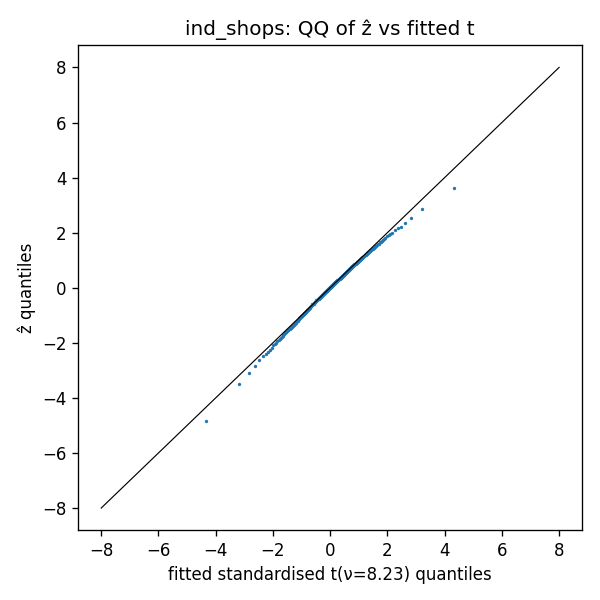
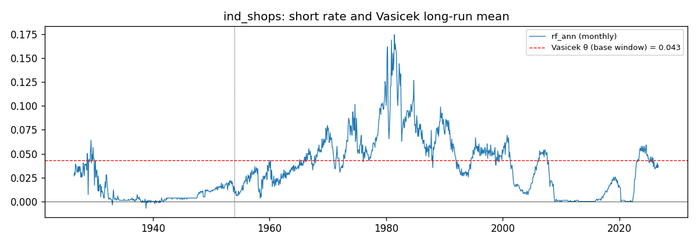
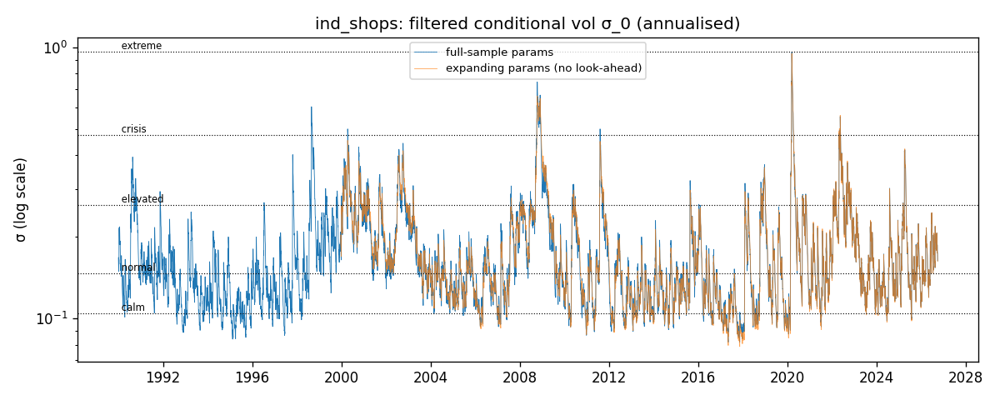
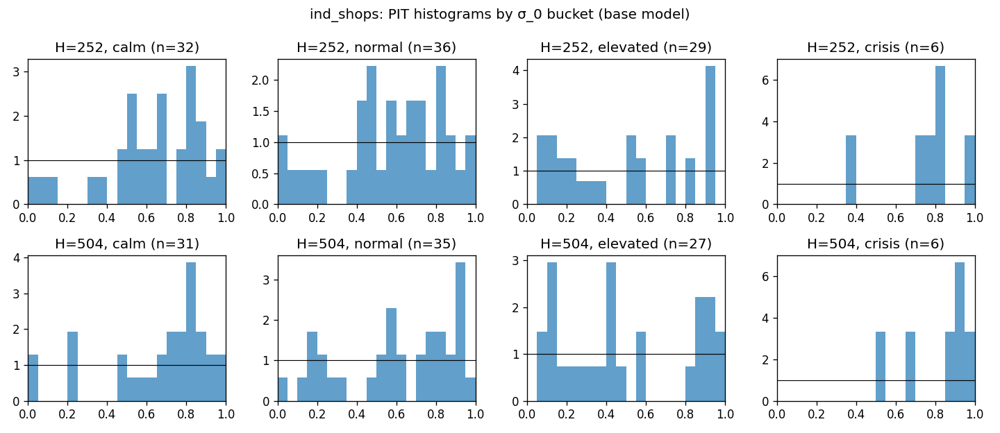
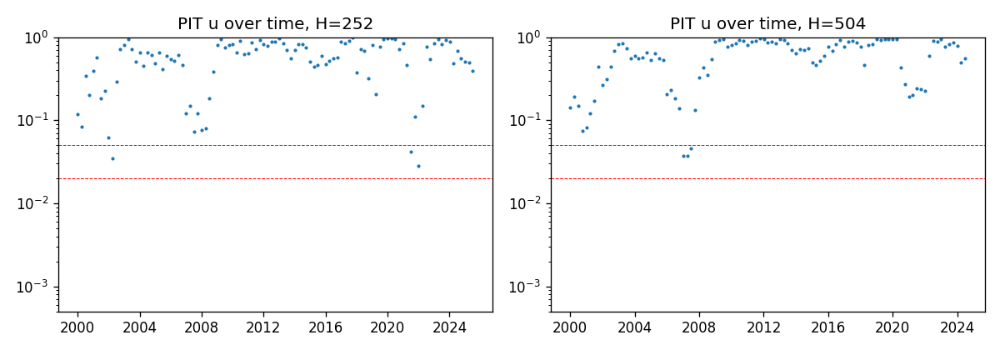
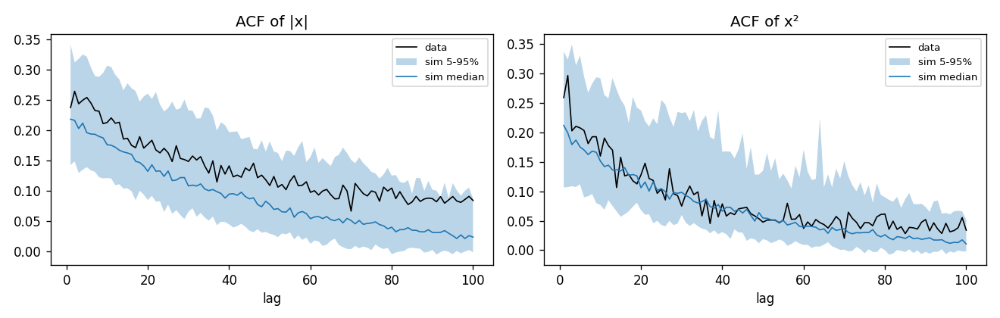
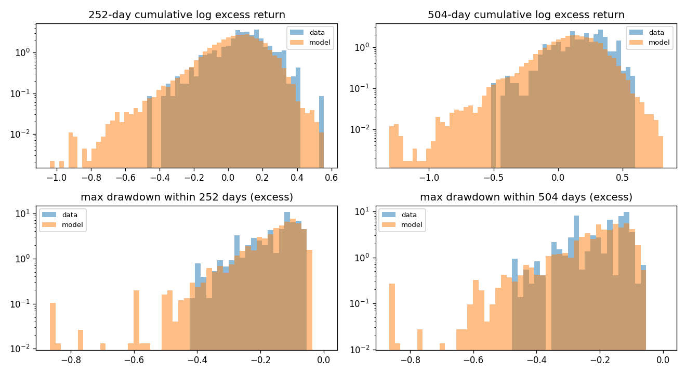
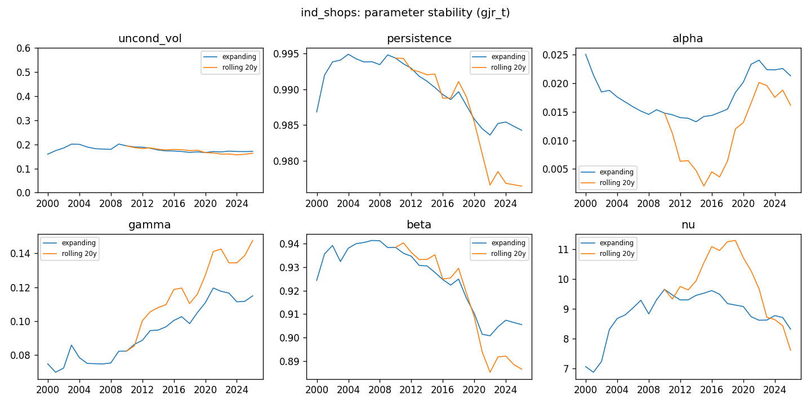

# Model report (Spec 02): `ind_shops`

Generated 2026-11-21T13:59:09 by `scripts/02_fit_model.py --asset ind_shops` in 38s. Estimation window 1990-01-02 – 2026-09-30 (9254 days). Base model **gjr_t**, gap variant **scale**, innovations **t**. Data hashes: `F-F_Research_Data_Factors_daily.csv` 3f7910502dd6…, `F-F_Research_Data_Factors.csv` a3894d74d553…, `10_Industry_Portfolios_Daily.csv` 01cfe3d5e54f….

**Fallback-window rule**: full-history base fit persistence 0.99583, valid parameter draws 50% → **triggered** (valid draws 0.50 < 0.7); all equity estimation uses data from 1990-01-01.

## 1. Model comparison

Log-likelihoods are for the *unscaled decimal* x; for the `scale` gap variant the Jacobian (−½ Σ log k) is added so log-likelihood/BIC are comparable across variants. PIT columns: observed share of historical starts with u below the level (nominal = the level), expanding-window parameters. PIT score = mean |obs − nominal|/nominal over σ_0 buckets at levels ≤ 5% (lower is better). 'buckets thin/fat' counts bucket×level cells whose CI excludes the nominal.

| model | gap_variant | nobs | loglik | bic | nu | persistence | half_life_days | uncond_vol_ann | PIT u<0.02 H252 | PIT u<0.05 H252 | PIT u<0.02 H504 | PIT u<0.05 H504 | PIT score | buckets thin/fat | VaR0.01 hit rate | VaR0.01 p_uc | VaR0.001 hit rate | VaR0.001 p_uc |
|---|---|---|---|---|---|---|---|---|---|---|---|---|---|---|---|---|---|---|
| garch_n | none | 9254 | 29460.7 | -58884.9 | n/a | 0.9837 | 42.3 | 18.6% | 0.00% | 2.91% | 0.00% | 3.03% | 0.88 | H252: 0/0, H504: 0/0 | 1.72% | 0.000 | 0.59% | 0.000 |
| garch_t | none | 9254 | 29612.6 | -59179.6 | 7.54 | 0.9894 | 64.9 | 19.5% | 0.00% | 2.91% | 0.00% | 3.03% | 0.88 | H252: 0/0, H504: 0/0 | 1.38% | 0.003 | 0.22% | 0.006 |
| gjr_t | none | 9254 | 29685.0 | -59315.2 | 8.17 | 0.9842 | 43.4 | 17.1% | 0.00% | 2.91% | 0.00% | 3.03% | 0.88 | H252: 0/0, H504: 0/0 | 1.37% | 0.004 | 0.19% | 0.032 |
| egarch_t | none | 9254 | 29700.3 | -59345.7 | 8.27 | 0.9811 | 36.2 | 15.1% | 0.00% | 1.94% | 0.00% | 2.02% | 0.92 | H252: 0/0, H504: 0/0 | 1.46% | 0.000 | 0.27% | 0.000 |
| garch_n | scale | 9254 | 29465.8 | -58895.1 | n/a | 0.9838 | 42.5 | 18.5% | 0.00% | 2.91% | 0.00% | 3.03% | 0.88 | H252: 0/0, H504: 0/0 | 1.72% | 0.000 | 0.58% | 0.000 |
| garch_t | scale | 9254 | 29614.8 | -59183.9 | 7.60 | 0.9894 | 65.3 | 19.5% | 0.00% | 1.94% | 0.00% | 3.03% | 0.91 | H252: 0/0, H504: 0/0 | 1.37% | 0.004 | 0.24% | 0.002 |
| gjr_t | scale | 9254 | 29687.1 | -59319.4 | 8.23 | 0.9844 | 44.1 | 17.1% | 0.00% | 2.91% | 0.00% | 3.03% | 0.88 | H252: 0/0, H504: 0/0 | 1.35% | 0.006 | 0.21% | 0.015 |
| egarch_t | scale | 9254 | 29702.2 | -59349.6 | 8.32 | 0.9812 | 36.5 | 15.1% | 0.00% | 1.94% | 0.00% | 2.02% | 0.92 | H252: 0/0, H504: 0/0 | 1.44% | 0.001 | 0.27% | 0.000 |
| gjr_t (FHS innovations) | scale | 9254 | 29687.1 | -59319.4 | 8.23 | 0.9844 | 44.1 | 17.1% | 0.00% | 0.97% | 0.00% | 2.02% | 0.93 | H252: 0/0, H504: 0/0 | n/a | n/a | n/a | n/a |

### Base model parameters (gjr_t, decimal daily units, robust SEs)

| param | estimate | se |
|---|---|---|
| mu | 0.000480756 | 8.83e-05 |
| omega | 1.81305e-06 | 3.21e-07 |
| alpha | 0.0201416 | 0.00529 |
| gamma | 0.114782 | 0.0134 |
| beta | 0.906871 | 0.00908 |
| nu | 8.22863 | 0.666 |

log-lik 29689.0, AIC -59366.0, BIC -59323.2; persistence 0.9844; half-life 44.1 days; unconditional vol 17.1%; ν = 8.23.

## 2. Expected excess return (premium)

Raw estimate (mean of r − rf × 252): **10.07%** p.a., SE 3.07% (t = 3.28, 36.7 years). Shrunk 0.5 toward 0.0: **5.04%** used (mode `constant_arith`). Resolved coefficients for all modes (same average premium): `constant_arith` mu_e_daily=0.0001998; `prop_variance` mu_e_daily=0.0001998, lambda=1.439; `constant_sharpe` mu_e_daily=0.0001998, S=0.01866

## 3. Standardised residuals (FHS pool)

n = 9254, mean -0.021, sd 1.000, skew -0.33, excess kurtosis 1.34 (fitted t implies 1.42); min -6.69 on 1997-10-27. The FHS pool is demeaned and scaled to unit variance before resampling.

## 4. Interest-rate model (Vasicek on monthly rf_ann)

| window | start | end | months | kappa | se_kappa | theta | s | half-life (y) | neg. months | rho used | rho same-month | rho prev-month |
|---|---|---|---|---|---|---|---|---|---|---|---|---|
| base | 1954-01 | 2026-09 | 440 | 0.338 | 0.095 | 4.30% | 2.57% | 2.0 | 0 | -0.059 | -0.059 | 0.032 |
| full_sample | 1926-07 | 2026-09 | 440 | 0.298 | 0.077 | 3.37% | 2.39% | 2.3 | 12 | -0.058 | -0.058 | 0.033 |
| from_1952-07 | 1952-07 | 2026-09 | 440 | 0.334 | 0.094 | 4.23% | 2.55% | 2.1 | 0 | -0.058 | -0.058 | 0.032 |

Negative monthly rf months in the data: 1933-02, 1938-03, 1938-07, 1938-11, 1939-01, 1939-03, 1939-08, 1940-05, 1940-08, 1941-01, 1941-02, 1941-04. Base window (1954-01-01+) excludes them: **True**. `floor_at_zero = False`.

## 5. Starting states (σ_0, r_0)

Under GJR-GARCH the one-step-ahead conditional variance σ_0² is the complete equity state (the sign of the last shock is already inside it); r_0 is the Vasicek state. Both are observable at t = 0. Named states are percentiles of the asset's own filtered σ history (full-sample params), so they transfer across assets. Annualised with N = 252 (see note on pre-1952 data in DECISIONS).

| state_name | sigma0_ann | r0_ann | definition |
|---|---|---|---|
| calm | 10.4% | 2.67% | P10 of filtered sigma; r0 = median rf_ann of estimation window |
| normal | 14.7% | 2.67% | P50 of filtered sigma; r0 = median rf_ann of estimation window |
| elevated | 26.3% | 2.67% | P90 of filtered sigma; r0 = median rf_ann of estimation window |
| crisis | 47.3% | 2.67% | P99 of filtered sigma; r0 = median rf_ann of estimation window |
| extreme | 96.0% | 2.67% | historical max of filtered sigma (2020-03-16); r0 = median rf_ann of estimation window |

Anchor dates (σ_0 = next-day vol at the close of the date):

| state_name | sigma0_ann | r0_ann | sigma0_ann_expanding | rv63_ann | dd252 |
|---|---|---|---|---|---|
| anchor_2006-12-29 | 10.4% | 4.9% | 10.6% | 12.0% | -1.3% |
| anchor_2008-10-10 | 58.3% | 1.0% | 53.1% | 35.6% | -29.8% |
| anchor_2008-11-20 | 63.3% | 0.4% | 62.2% | 53.4% | -39.4% |
| anchor_2020-03-16 | 96.0% | 1.4% | 95.0% | 41.6% | -26.4% |
| anchor_2022-06-16 | 39.7% | 0.7% | 39.6% | 33.6% | -30.0% |
| anchor_2026-09-30 | 16.3% | 3.8% | 16.2% | 18.6% | -9.6% |

σ_0 bucket edges used in the PIT/VaR tests (annualised): calm: [8.2%, 12.4%), normal: [12.4%, 18.2%), elevated: [18.2%, 31.0%), crisis: [31.0%, n/a)

## 6. Conditional tail calibration (PIT test)

Quarterly start dates; at each start the model is re-estimated on data **before** the start (expanding window, refit every 252 days; premium and rate model also expanding). 2000 paths per start. u = model CDF of the realised cumulative log total return over H days. Effective n = non-overlapping windows = n_starts × 63/H; CIs are Wilson 95% on the effective n. 'too thin' = more realised left-tail outcomes than the model predicts (dangerous for the floor).

### gjr_t / scale / t

| group_type | group | H | n_starts | n_eff | u<0.01 | u<0.02 | u<0.05 | u<0.1 |
|---|---|---|---|---|---|---|---|---|
| overall | all | 252 | 103 | 25.8 | 0.0% (0.0%–13.0%) | 0.0% (0.0%–13.0%) | 2.9% (0.4%–17.6%) | 7.8% (2.2%–24.3%) |
| bucket | calm | 252 | 32 | 8.0 | 0.0% (0.0%–32.4%) | 0.0% (0.0%–32.4%) | 3.1% (0.2%–36.5%) | 6.2% (0.7%–40.2%) |
| bucket | crisis | 252 | 6 | 1.5 | 0.0% (0.0%–71.9%) | 0.0% (0.0%–71.9%) | 0.0% (0.0%–71.9%) | 0.0% (0.0%–71.9%) |
| bucket | elevated | 252 | 29 | 7.2 | 0.0% (0.0%–34.6%) | 0.0% (0.0%–34.6%) | 0.0% (0.0%–34.6%) | 10.3% (1.5%–46.7%) |
| bucket | normal | 252 | 36 | 9.0 | 0.0% (0.0%–29.9%) | 0.0% (0.0%–29.9%) | 5.6% (0.6%–37.1%) | 8.3% (1.2%–40.4%) |
| bucket_group | high | 252 | 35 | 8.8 | 0.0% (0.0%–30.5%) | 0.0% (0.0%–30.5%) | 0.0% (0.0%–30.5%) | 8.6% (1.2%–41.2%) |
| era | 1952-1999 | 252 | 0 | 0.0 | n/a (n/a–n/a) | n/a (n/a–n/a) | n/a (n/a–n/a) | n/a (n/a–n/a) |
| era | 2000- | 252 | 103 | 25.8 | 0.0% (0.0%–13.0%) | 0.0% (0.0%–13.0%) | 2.9% (0.4%–17.6%) | 7.8% (2.2%–24.3%) |
| era | pre-1952 | 252 | 0 | 0.0 | n/a (n/a–n/a) | n/a (n/a–n/a) | n/a (n/a–n/a) | n/a (n/a–n/a) |
| overall | all | 504 | 99 | 12.4 | 0.0% (0.0%–23.7%) | 0.0% (0.0%–23.7%) | 3.0% (0.2%–28.1%) | 5.1% (0.6%–30.8%) |
| bucket | calm | 504 | 31 | 3.9 | 0.0% (0.0%–49.8%) | 0.0% (0.0%–49.8%) | 6.5% (0.4%–55.9%) | 6.5% (0.4%–55.9%) |
| bucket | crisis | 504 | 6 | 0.8 | 0.0% (0.0%–83.7%) | 0.0% (0.0%–83.7%) | 0.0% (0.0%–83.7%) | 0.0% (0.0%–83.7%) |
| bucket | elevated | 504 | 27 | 3.4 | 0.0% (0.0%–53.2%) | 0.0% (0.0%–53.2%) | 0.0% (0.0%–53.2%) | 7.4% (0.4%–59.7%) |
| bucket | normal | 504 | 35 | 4.4 | 0.0% (0.0%–46.8%) | 0.0% (0.0%–46.8%) | 2.9% (0.1%–49.7%) | 2.9% (0.1%–49.7%) |
| bucket_group | high | 504 | 33 | 4.1 | 0.0% (0.0%–48.2%) | 0.0% (0.0%–48.2%) | 0.0% (0.0%–48.2%) | 6.1% (0.4%–54.1%) |
| era | 1952-1999 | 504 | 0 | 0.0 | n/a (n/a–n/a) | n/a (n/a–n/a) | n/a (n/a–n/a) | n/a (n/a–n/a) |
| era | 2000- | 504 | 99 | 12.4 | 0.0% (0.0%–23.7%) | 0.0% (0.0%–23.7%) | 3.0% (0.2%–28.1%) | 5.1% (0.6%–30.8%) |
| era | pre-1952 | 504 | 0 | 0.0 | n/a (n/a–n/a) | n/a (n/a–n/a) | n/a (n/a–n/a) | n/a (n/a–n/a) |

**Verdicts:**

- H=252, bucket `calm`: no evidence of miscalibration (nominal inside the CI at all levels), but low power: the CI at the 2% level spans 32%
- H=252, bucket `normal`: no evidence of miscalibration (nominal inside the CI at all levels), but low power: the CI at the 2% level spans 30%
- H=252, bucket `elevated`: inconclusive: too few independent windows to test (CI would include 0% and >20%)
- H=252, bucket `crisis`: inconclusive: too few independent windows to test (CI would include 0% and >20%)
- H=252, bucket_group `high`: no evidence of miscalibration (nominal inside the CI at all levels), but low power: the CI at the 2% level spans 31%
- H=252, era `pre-1952`: no data
- H=252, era `1952-1999`: no data
- H=252, era `2000-`: no evidence of miscalibration (nominal inside the CI at all levels), but low power: the CI at the 2% level spans 13%
- H=504, bucket `calm`: inconclusive: too few independent windows to test (CI would include 0% and >20%)
- H=504, bucket `normal`: inconclusive: too few independent windows to test (CI would include 0% and >20%)
- H=504, bucket `elevated`: inconclusive: too few independent windows to test (CI would include 0% and >20%)
- H=504, bucket `crisis`: inconclusive: too few independent windows to test (CI would include 0% and >20%)
- H=504, bucket_group `high`: inconclusive: too few independent windows to test (CI would include 0% and >20%)
- H=504, era `pre-1952`: no data
- H=504, era `1952-1999`: no data
- H=504, era `2000-`: no evidence of miscalibration (nominal inside the CI at all levels), but low power: the CI at the 2% level spans 24%

### gjr_t / scale / fhs

| group_type | group | H | n_starts | n_eff | u<0.01 | u<0.02 | u<0.05 | u<0.1 |
|---|---|---|---|---|---|---|---|---|
| overall | all | 252 | 103 | 25.8 | 0.0% (0.0%–13.0%) | 0.0% (0.0%–13.0%) | 1.0% (0.1%–14.6%) | 7.8% (2.2%–24.3%) |
| bucket | calm | 252 | 32 | 8.0 | 0.0% (0.0%–32.4%) | 0.0% (0.0%–32.4%) | 0.0% (0.0%–32.4%) | 6.2% (0.7%–40.2%) |
| bucket | crisis | 252 | 6 | 1.5 | 0.0% (0.0%–71.9%) | 0.0% (0.0%–71.9%) | 0.0% (0.0%–71.9%) | 0.0% (0.0%–71.9%) |
| bucket | elevated | 252 | 29 | 7.2 | 0.0% (0.0%–34.6%) | 0.0% (0.0%–34.6%) | 0.0% (0.0%–34.6%) | 10.3% (1.5%–46.7%) |
| bucket | normal | 252 | 36 | 9.0 | 0.0% (0.0%–29.9%) | 0.0% (0.0%–29.9%) | 2.8% (0.2%–33.6%) | 8.3% (1.2%–40.4%) |
| bucket_group | high | 252 | 35 | 8.8 | 0.0% (0.0%–30.5%) | 0.0% (0.0%–30.5%) | 0.0% (0.0%–30.5%) | 8.6% (1.2%–41.2%) |
| era | 1952-1999 | 252 | 0 | 0.0 | n/a (n/a–n/a) | n/a (n/a–n/a) | n/a (n/a–n/a) | n/a (n/a–n/a) |
| era | 2000- | 252 | 103 | 25.8 | 0.0% (0.0%–13.0%) | 0.0% (0.0%–13.0%) | 1.0% (0.1%–14.6%) | 7.8% (2.2%–24.3%) |
| era | pre-1952 | 252 | 0 | 0.0 | n/a (n/a–n/a) | n/a (n/a–n/a) | n/a (n/a–n/a) | n/a (n/a–n/a) |
| overall | all | 504 | 99 | 12.4 | 0.0% (0.0%–23.7%) | 0.0% (0.0%–23.7%) | 2.0% (0.1%–26.7%) | 5.1% (0.6%–30.8%) |
| bucket | calm | 504 | 31 | 3.9 | 0.0% (0.0%–49.8%) | 0.0% (0.0%–49.8%) | 3.2% (0.1%–52.9%) | 6.5% (0.4%–55.9%) |
| bucket | crisis | 504 | 6 | 0.8 | 0.0% (0.0%–83.7%) | 0.0% (0.0%–83.7%) | 0.0% (0.0%–83.7%) | 0.0% (0.0%–83.7%) |
| bucket | elevated | 504 | 27 | 3.4 | 0.0% (0.0%–53.2%) | 0.0% (0.0%–53.2%) | 0.0% (0.0%–53.2%) | 7.4% (0.4%–59.7%) |
| bucket | normal | 504 | 35 | 4.4 | 0.0% (0.0%–46.8%) | 0.0% (0.0%–46.8%) | 2.9% (0.1%–49.7%) | 2.9% (0.1%–49.7%) |
| bucket_group | high | 504 | 33 | 4.1 | 0.0% (0.0%–48.2%) | 0.0% (0.0%–48.2%) | 0.0% (0.0%–48.2%) | 6.1% (0.4%–54.1%) |
| era | 1952-1999 | 504 | 0 | 0.0 | n/a (n/a–n/a) | n/a (n/a–n/a) | n/a (n/a–n/a) | n/a (n/a–n/a) |
| era | 2000- | 504 | 99 | 12.4 | 0.0% (0.0%–23.7%) | 0.0% (0.0%–23.7%) | 2.0% (0.1%–26.7%) | 5.1% (0.6%–30.8%) |
| era | pre-1952 | 504 | 0 | 0.0 | n/a (n/a–n/a) | n/a (n/a–n/a) | n/a (n/a–n/a) | n/a (n/a–n/a) |

**Verdicts:**

- H=252, bucket `calm`: no evidence of miscalibration (nominal inside the CI at all levels), but low power: the CI at the 2% level spans 32%
- H=252, bucket `normal`: no evidence of miscalibration (nominal inside the CI at all levels), but low power: the CI at the 2% level spans 30%
- H=252, bucket `elevated`: inconclusive: too few independent windows to test (CI would include 0% and >20%)
- H=252, bucket `crisis`: inconclusive: too few independent windows to test (CI would include 0% and >20%)
- H=252, bucket_group `high`: no evidence of miscalibration (nominal inside the CI at all levels), but low power: the CI at the 2% level spans 31%
- H=252, era `pre-1952`: no data
- H=252, era `1952-1999`: no data
- H=252, era `2000-`: no evidence of miscalibration (nominal inside the CI at all levels), but low power: the CI at the 2% level spans 13%
- H=504, bucket `calm`: inconclusive: too few independent windows to test (CI would include 0% and >20%)
- H=504, bucket `normal`: inconclusive: too few independent windows to test (CI would include 0% and >20%)
- H=504, bucket `elevated`: inconclusive: too few independent windows to test (CI would include 0% and >20%)
- H=504, bucket `crisis`: inconclusive: too few independent windows to test (CI would include 0% and >20%)
- H=504, bucket_group `high`: inconclusive: too few independent windows to test (CI would include 0% and >20%)
- H=504, era `pre-1952`: no data
- H=504, era `1952-1999`: no data
- H=504, era `2000-`: no evidence of miscalibration (nominal inside the CI at all levels), but low power: the CI at the 2% level spans 24%

## 7. One-day tail check

| level | bucket | n | hits | rate | LR_uc | p_uc | LR_ind | p_ind |
|---|---|---|---|---|---|---|---|---|
| 0.01 | all | 6734 | 91 | 1.351% | 7.57 | 0.006 | 0.42 | 0.518 |
| 0.01 | calm | 1858 | 37 | 1.991% | 14.32 | 0.000 | 0.09 | 0.767 |
| 0.01 | crisis | 409 | 4 | 0.978% | 0.00 | 0.964 | 0.08 | 0.778 |
| 0.01 | elevated | 1873 | 22 | 1.175% | 0.55 | 0.460 | 0.52 | 0.469 |
| 0.01 | normal | 2594 | 28 | 1.079% | 0.16 | 0.688 | 0.61 | 0.434 |
| 0.001 | all | 6734 | 14 | 0.208% | 5.97 | 0.015 | 0.06 | 0.809 |
| 0.001 | calm | 1858 | 9 | 0.484% | 14.14 | 0.000 | 0.09 | 0.767 |
| 0.001 | crisis | 409 | 0 | 0.000% | 0.82 | 0.366 | -0.00 | 1.000 |
| 0.001 | elevated | 1873 | 2 | 0.107% | 0.01 | 0.927 | 0.00 | 0.948 |
| 0.001 | normal | 2594 | 3 | 0.116% | 0.06 | 0.806 | 0.01 | 0.934 |

(Christoffersen independence within a bucket uses consecutive days of that bucket's sub-sequence.)

## 8. Stylised facts: data vs simulated long paths

40 simulated paths of the estimation-window length from the base model (t innovations, base premium and rate model).

| statistic | data | model |
|---|---|---|
| annualised vol of x | 18.6% | 16.7% (5–95%: 14.7%–19.6%) |
| excess kurtosis of daily x | 6.4 | 5.4 (5–95%: 2.3–25.4) |
| skew of daily x | -0.22 | 0.09 |
| ACF |x| lags 1/10/50/100 | 0.24 / 0.21 / 0.11 / 0.08 | 0.22 / 0.18 / 0.08 / 0.02 |

252-day windows (start every 21 days) — quantiles:

| quantile | cum log excess, data | cum log excess, model | max DD, data | max DD, model |
|---|---|---|---|---|
| 0.01 | -31.4% | -47.7% | -39.4% | -49.3% |
| 0.02 | -26.4% | -37.9% | -38.8% | -42.0% |
| 0.05 | -17.0% | -24.4% | -32.2% | -34.2% |
| 0.1 | -10.8% | -15.5% | -26.6% | -27.1% |
| 0.5 | 9.6% | 6.0% | -12.1% | -13.1% |

504-day windows (start every 21 days) — quantiles:

| quantile | cum log excess, data | cum log excess, model | max DD, data | max DD, model |
|---|---|---|---|---|
| 0.01 | -39.2% | -67.0% | -46.7% | -59.5% |
| 0.02 | -32.4% | -50.3% | -42.8% | -52.7% |
| 0.05 | -15.5% | -33.3% | -38.8% | -44.4% |
| 0.1 | -10.4% | -19.9% | -32.6% | -36.3% |
| 0.5 | 20.2% | 11.0% | -17.6% | -19.0% |

Simulated x clipped at −99% simple return: 0 times.

## 9. Parameter stability

| sample | start | end | nobs | mu | omega | alpha | gamma | beta | nu | persistence | half_life_days | uncond_vol_ann | loglik |
|---|---|---|---|---|---|---|---|---|---|---|---|---|---|
| estimation window (base) | 1990-01-02 | 2026-09-30 | 9254 | 4.81e-04 | 1.81e-06 | 0.020 | 0.115 | 0.907 | 8.23 | 0.9844 | 44 | 17.1% | 29689 |
| pre-1963 (skipped: 0 obs) | n/a | n/a | n/a | n/a | n/a | n/a | n/a | n/a | n/a | n/a | n/a | n/a | n/a |
| 1963-1999 | 1990-01-02 | 1999-12-31 | 2528 | 4.77e-04 | 1.33e-06 | 0.025 | 0.075 | 0.924 | 7.09 | 0.9866 | 51 | 15.8% | 8344 |
| 2000-end | 2000-01-03 | 2026-09-30 | 6726 | 4.73e-04 | 1.91e-06 | 0.014 | 0.127 | 0.906 | 8.77 | 0.9839 | 43 | 17.3% | 21351 |

## 10. Parameter-uncertainty draws

200 draws from the asymptotic normal of the robust covariance (acceptance 100.0%; rejected: non-stationary, ω ≤ 0, negative ARCH terms, ν ≤ 2.5). Unconditional vol 5–95%: 15.5%–19.5%; ν 5–95%: 7.19–9.40. Saved to `results/model/param_draws_ind_shops.npy` (columns ['mu', 'omega', 'alpha', 'gamma', 'beta', 'nu']).

## 11. Closure-gap returns

| date | from | calendar_days | busdays | x |
|---|---|---|---|---|
| 2001-09-17 | 2001-09-10 | 7 | 5 | -6.63% |
| 2007-01-03 | 2006-12-29 | 5 | 3 | 0.63% |
| 2012-10-31 | 2012-10-26 | 5 | 3 | 0.57% |

Variant `scale` divides these returns by sqrt(busdays) before fitting; `none` uses them as is. Compare the rows of the model comparison table with the same model name.

