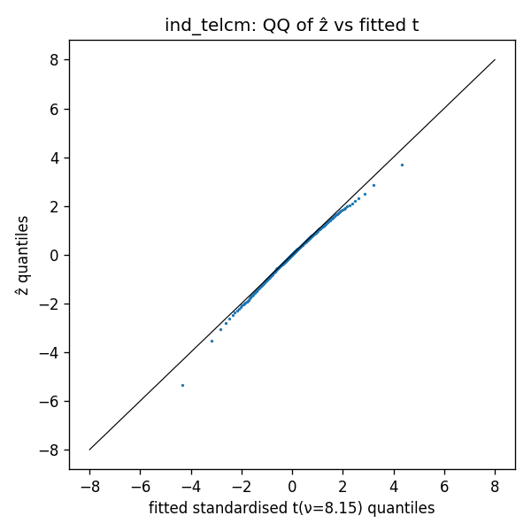
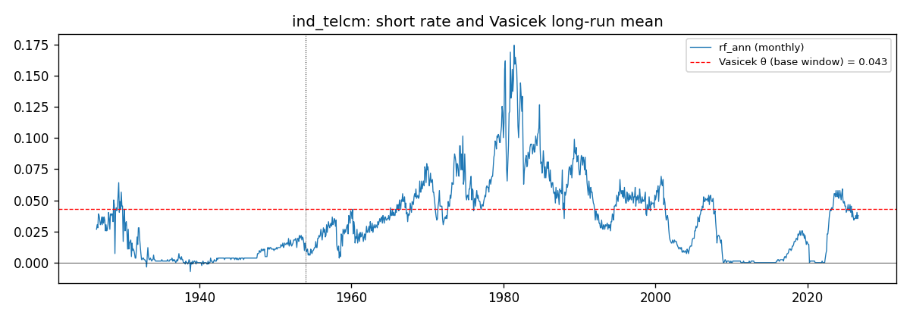
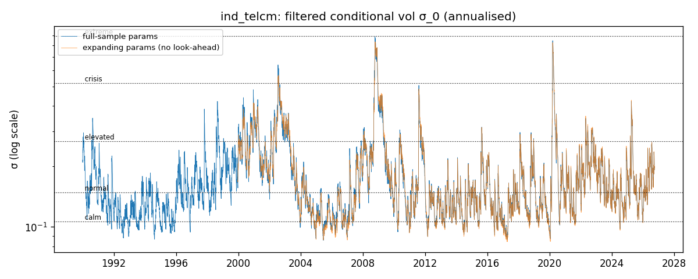
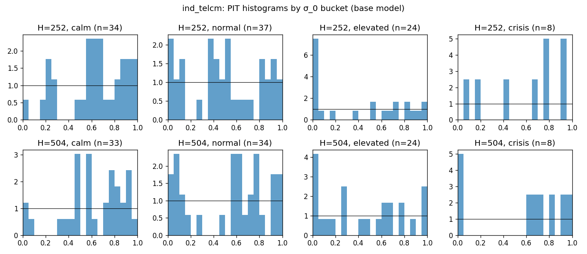
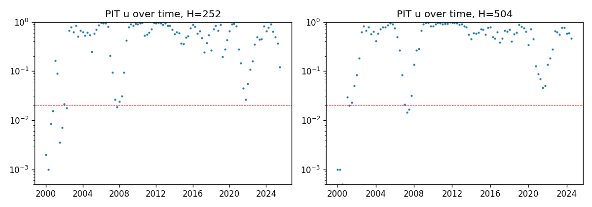
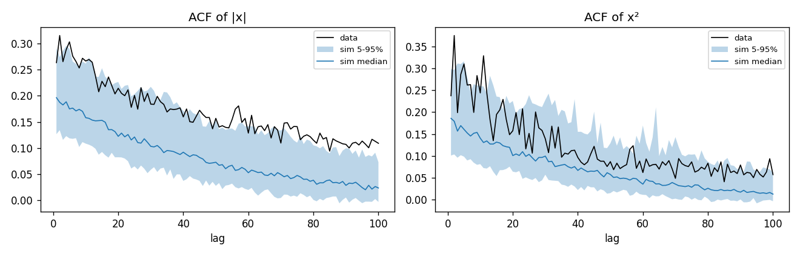
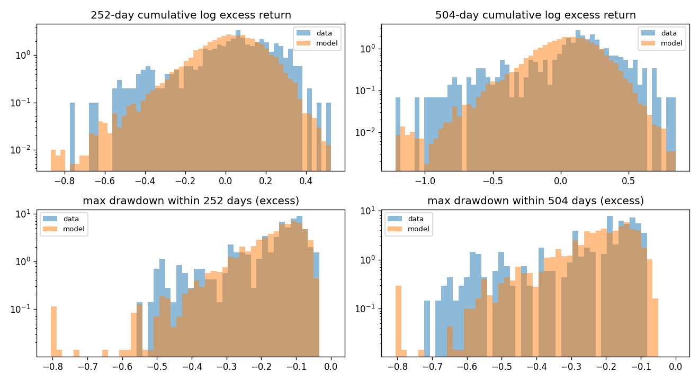
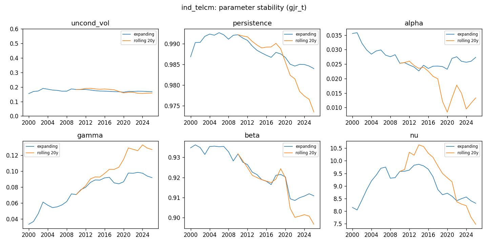

# Model report (Spec 02): `ind_telcm`

Generated 2026-11-21T13:58:30 by `scripts/02_fit_model.py --asset ind_telcm` in 39s. Estimation window 1990-01-02 – 2026-09-30 (9254 days). Base model **gjr_t**, gap variant **scale**, innovations **t**. Data hashes: `F-F_Research_Data_Factors_daily.csv` 3f7910502dd6…, `F-F_Research_Data_Factors.csv` a3894d74d553…, `10_Industry_Portfolios_Daily.csv` 01cfe3d5e54f….

**Fallback-window rule**: full-history base fit persistence 0.99996, valid parameter draws 33% → **triggered** (persistence 0.99996 >= 0.998; valid draws 0.33 < 0.7); all equity estimation uses data from 1990-01-01.

## 1. Model comparison

Log-likelihoods are for the *unscaled decimal* x; for the `scale` gap variant the Jacobian (−½ Σ log k) is added so log-likelihood/BIC are comparable across variants. PIT columns: observed share of historical starts with u below the level (nominal = the level), expanding-window parameters. PIT score = mean |obs − nominal|/nominal over σ_0 buckets at levels ≤ 5% (lower is better). 'buckets thin/fat' counts bucket×level cells whose CI excludes the nominal.

| model | gap_variant | nobs | loglik | bic | nu | persistence | half_life_days | uncond_vol_ann | PIT u<0.02 H252 | PIT u<0.05 H252 | PIT u<0.02 H504 | PIT u<0.05 H504 | PIT score | buckets thin/fat | VaR0.01 hit rate | VaR0.01 p_uc | VaR0.001 hit rate | VaR0.001 p_uc |
|---|---|---|---|---|---|---|---|---|---|---|---|---|---|---|---|---|---|---|
| garch_n | none | 9254 | 29276.9 | -58517.2 | n/a | 0.9860 | 49.3 | 18.5% | 10.68% | 13.59% | 7.07% | 13.13% | 3.72 | H252: 1/0, H504: 0/0 | 1.92% | 0.000 | 0.67% | 0.000 |
| garch_t | none | 9254 | 29448.6 | -58851.6 | 7.54 | 0.9893 | 64.4 | 19.4% | 7.77% | 12.62% | 8.08% | 13.13% | 3.60 | H252: 0/0, H504: 0/0 | 1.50% | 0.000 | 0.24% | 0.002 |
| gjr_t | none | 9254 | 29492.4 | -58929.9 | 8.13 | 0.9842 | 43.7 | 16.8% | 6.80% | 13.59% | 6.06% | 13.13% | 3.52 | H252: 0/0, H504: 0/0 | 1.38% | 0.003 | 0.18% | 0.068 |
| egarch_t | none | 9254 | 29488.8 | -58922.9 | 8.02 | 0.9857 | 48.0 | 15.3% | 6.80% | 12.62% | 8.08% | 11.11% | 3.66 | H252: 0/0, H504: 0/0 | 1.43% | 0.001 | 0.22% | 0.006 |
| garch_n | scale | 9254 | 29278.1 | -58519.7 | n/a | 0.9861 | 49.5 | 18.5% | 10.68% | 13.59% | 7.07% | 13.13% | 3.72 | H252: 1/0, H504: 0/0 | 1.89% | 0.000 | 0.67% | 0.000 |
| garch_t | scale | 9254 | 29449.2 | -58852.8 | 7.56 | 0.9893 | 64.7 | 19.3% | 8.74% | 12.62% | 8.08% | 12.12% | 3.42 | H252: 0/0, H504: 0/0 | 1.49% | 0.000 | 0.25% | 0.001 |
| gjr_t | scale | 9254 | 29493.1 | -58931.4 | 8.15 | 0.9843 | 43.9 | 16.8% | 7.77% | 13.59% | 6.06% | 12.12% | 3.58 | H252: 0/0, H504: 0/0 | 1.37% | 0.004 | 0.18% | 0.068 |
| egarch_t | scale | 9254 | 29489.4 | -58924.0 | 8.04 | 0.9857 | 48.2 | 15.3% | 5.83% | 12.62% | 8.08% | 11.11% | 3.68 | H252: 0/0, H504: 0/0 | 1.41% | 0.001 | 0.22% | 0.006 |
| gjr_t (FHS innovations) | scale | 9254 | 29493.1 | -58931.4 | 8.15 | 0.9843 | 43.9 | 16.8% | 4.85% | 12.62% | 5.05% | 11.11% | 2.88 | H252: 0/0, H504: 0/0 | n/a | n/a | n/a | n/a |

### Base model parameters (gjr_t, decimal daily units, robust SEs)

| param | estimate | se |
|---|---|---|
| mu | 0.000350178 | 9.01e-05 |
| omega | 1.76305e-06 | 3.15e-07 |
| alpha | 0.0274241 | 0.00652 |
| gamma | 0.0888619 | 0.0118 |
| beta | 0.912478 | 0.00978 |
| nu | 8.14913 | 0.666 |

log-lik 29495.0, AIC -58978.0, BIC -58935.2; persistence 0.9843; half-life 43.9 days; unconditional vol 16.8%; ν = 8.15.

## 2. Expected excess return (premium)

Raw estimate (mean of r − rf × 252): **5.19%** p.a., SE 3.23% (t = 1.61, 36.7 years). Shrunk 0.5 toward 0.0: **2.59%** used (mode `constant_arith`). Resolved coefficients for all modes (same average premium): `constant_arith` mu_e_daily=0.000103; `prop_variance` mu_e_daily=0.000103, lambda=0.6836; `constant_sharpe` mu_e_daily=0.000103, S=0.009357

## 3. Standardised residuals (FHS pool)

n = 9254, mean -0.022, sd 1.002, skew -0.35, excess kurtosis 1.67 (fitted t implies 1.45); min -7.05 on 1997-10-27. The FHS pool is demeaned and scaled to unit variance before resampling.

## 4. Interest-rate model (Vasicek on monthly rf_ann)

| window | start | end | months | kappa | se_kappa | theta | s | half-life (y) | neg. months | rho used | rho same-month | rho prev-month |
|---|---|---|---|---|---|---|---|---|---|---|---|---|
| base | 1954-01 | 2026-09 | 440 | 0.338 | 0.095 | 4.30% | 2.57% | 2.0 | 0 | 0.023 | 0.023 | -0.038 |
| full_sample | 1926-07 | 2026-09 | 440 | 0.298 | 0.077 | 3.37% | 2.39% | 2.3 | 12 | 0.024 | 0.024 | -0.037 |
| from_1952-07 | 1952-07 | 2026-09 | 440 | 0.334 | 0.094 | 4.23% | 2.55% | 2.1 | 0 | 0.024 | 0.024 | -0.038 |

Negative monthly rf months in the data: 1933-02, 1938-03, 1938-07, 1938-11, 1939-01, 1939-03, 1939-08, 1940-05, 1940-08, 1941-01, 1941-02, 1941-04. Base window (1954-01-01+) excludes them: **True**. `floor_at_zero = False`.

## 5. Starting states (σ_0, r_0)

Under GJR-GARCH the one-step-ahead conditional variance σ_0² is the complete equity state (the sign of the last shock is already inside it); r_0 is the Vasicek state. Both are observable at t = 0. Named states are percentiles of the asset's own filtered σ history (full-sample params), so they transfer across assets. Annualised with N = 252 (see note on pre-1952 data in DECISIONS).

| state_name | sigma0_ann | r0_ann | definition |
|---|---|---|---|
| calm | 10.7% | 2.67% | P10 of filtered sigma; r0 = median rf_ann of estimation window |
| normal | 14.9% | 2.67% | P50 of filtered sigma; r0 = median rf_ann of estimation window |
| elevated | 26.8% | 2.67% | P90 of filtered sigma; r0 = median rf_ann of estimation window |
| crisis | 52.1% | 2.67% | P99 of filtered sigma; r0 = median rf_ann of estimation window |
| extreme | 88.8% | 2.67% | historical max of filtered sigma (2008-10-15); r0 = median rf_ann of estimation window |

Anchor dates (σ_0 = next-day vol at the close of the date):

| state_name | sigma0_ann | r0_ann | sigma0_ann_expanding | rv63_ann | dd252 |
|---|---|---|---|---|---|
| anchor_2006-12-29 | 9.2% | 4.9% | 8.9% | 9.6% | -0.0% |
| anchor_2008-10-10 | 70.5% | 1.0% | 65.8% | 40.2% | -47.8% |
| anchor_2008-11-20 | 77.4% | 0.4% | 77.4% | 70.4% | -49.9% |
| anchor_2020-03-16 | 84.5% | 1.4% | 82.6% | 40.9% | -23.8% |
| anchor_2022-06-16 | 31.7% | 0.7% | 32.4% | 23.3% | -28.8% |
| anchor_2026-09-30 | 19.2% | 3.8% | 19.2% | 19.7% | -12.7% |

σ_0 bucket edges used in the PIT/VaR tests (annualised): calm: [8.6%, 12.6%), normal: [12.6%, 18.5%), elevated: [18.5%, 33.2%), crisis: [33.2%, n/a)

## 6. Conditional tail calibration (PIT test)

Quarterly start dates; at each start the model is re-estimated on data **before** the start (expanding window, refit every 252 days; premium and rate model also expanding). 2000 paths per start. u = model CDF of the realised cumulative log total return over H days. Effective n = non-overlapping windows = n_starts × 63/H; CIs are Wilson 95% on the effective n. 'too thin' = more realised left-tail outcomes than the model predicts (dangerous for the floor).

### gjr_t / scale / t

| group_type | group | H | n_starts | n_eff | u<0.01 | u<0.02 | u<0.05 | u<0.1 |
|---|---|---|---|---|---|---|---|---|
| overall | all | 252 | 103 | 25.8 | 4.9% (1.0%–20.4%) | 7.8% (2.2%–24.3%) | 13.6% (5.1%–31.5%) | 17.5% (7.4%–36.0%) |
| bucket | calm | 252 | 34 | 8.5 | 0.0% (0.0%–31.1%) | 0.0% (0.0%–31.1%) | 2.9% (0.2%–35.0%) | 2.9% (0.2%–35.0%) |
| bucket | crisis | 252 | 8 | 2.0 | 0.0% (0.0%–65.8%) | 0.0% (0.0%–65.8%) | 0.0% (0.0%–65.8%) | 12.5% (0.7%–73.6%) |
| bucket | elevated | 252 | 24 | 6.0 | 20.8% (4.4%–60.0%) | 29.2% (7.8%–66.8%) | 37.5% (11.7%–73.0%) | 41.7% (13.9%–75.9%) |
| bucket | normal | 252 | 37 | 9.2 | 0.0% (0.0%–29.3%) | 2.7% (0.2%–33.0%) | 10.8% (1.9%–42.7%) | 16.2% (3.8%–48.4%) |
| bucket_group | high | 252 | 32 | 8.0 | 15.6% (3.3%–50.3%) | 21.9% (5.7%–56.3%) | 28.1% (8.6%–61.8%) | 34.4% (11.9%–67.0%) |
| era | 1952-1999 | 252 | 0 | 0.0 | n/a (n/a–n/a) | n/a (n/a–n/a) | n/a (n/a–n/a) | n/a (n/a–n/a) |
| era | 2000- | 252 | 103 | 25.8 | 4.9% (1.0%–20.4%) | 7.8% (2.2%–24.3%) | 13.6% (5.1%–31.5%) | 17.5% (7.4%–36.0%) |
| era | pre-1952 | 252 | 0 | 0.0 | n/a (n/a–n/a) | n/a (n/a–n/a) | n/a (n/a–n/a) | n/a (n/a–n/a) |
| overall | all | 504 | 99 | 12.4 | 4.0% (0.4%–29.4%) | 6.1% (0.9%–32.1%) | 12.1% (2.9%–39.3%) | 18.2% (5.5%–45.9%) |
| bucket | calm | 504 | 33 | 4.1 | 0.0% (0.0%–48.2%) | 0.0% (0.0%–48.2%) | 6.1% (0.4%–54.1%) | 9.1% (0.8%–56.9%) |
| bucket | crisis | 504 | 8 | 1.0 | 0.0% (0.0%–79.3%) | 0.0% (0.0%–79.3%) | 25.0% (1.5%–88.2%) | 25.0% (1.5%–88.2%) |
| bucket | elevated | 504 | 24 | 3.0 | 16.7% (1.8%–69.0%) | 16.7% (1.8%–69.0%) | 20.8% (2.7%–71.8%) | 25.0% (3.7%–74.4%) |
| bucket | normal | 504 | 34 | 4.2 | 0.0% (0.0%–47.5%) | 5.9% (0.3%–53.3%) | 8.8% (0.7%–56.0%) | 20.6% (3.4%–65.7%) |
| bucket_group | high | 504 | 32 | 4.0 | 12.5% (1.3%–60.4%) | 12.5% (1.3%–60.4%) | 21.9% (3.6%–67.7%) | 25.0% (4.6%–69.9%) |
| era | 1952-1999 | 504 | 0 | 0.0 | n/a (n/a–n/a) | n/a (n/a–n/a) | n/a (n/a–n/a) | n/a (n/a–n/a) |
| era | 2000- | 504 | 99 | 12.4 | 4.0% (0.4%–29.4%) | 6.1% (0.9%–32.1%) | 12.1% (2.9%–39.3%) | 18.2% (5.5%–45.9%) |
| era | pre-1952 | 504 | 0 | 0.0 | n/a (n/a–n/a) | n/a (n/a–n/a) | n/a (n/a–n/a) | n/a (n/a–n/a) |

**Verdicts:**

- H=252, bucket `calm`: no evidence of miscalibration (nominal inside the CI at all levels), but low power: the CI at the 2% level spans 31%
- H=252, bucket `normal`: no evidence of miscalibration (nominal inside the CI at all levels), but low power: the CI at the 2% level spans 33%
- H=252, bucket `elevated`: inconclusive: too few independent windows to test (CI would include 0% and >20%)
- H=252, bucket `crisis`: inconclusive: too few independent windows to test (CI would include 0% and >20%)
- H=252, bucket_group `high`: too thin (more realised left-tail outcomes than the model predicts)
- H=252, era `pre-1952`: no data
- H=252, era `1952-1999`: no data
- H=252, era `2000-`: too thin (more realised left-tail outcomes than the model predicts)
- H=504, bucket `calm`: inconclusive: too few independent windows to test (CI would include 0% and >20%)
- H=504, bucket `normal`: inconclusive: too few independent windows to test (CI would include 0% and >20%)
- H=504, bucket `elevated`: inconclusive: too few independent windows to test (CI would include 0% and >20%)
- H=504, bucket `crisis`: inconclusive: too few independent windows to test (CI would include 0% and >20%)
- H=504, bucket_group `high`: inconclusive: too few independent windows to test (CI would include 0% and >20%)
- H=504, era `pre-1952`: no data
- H=504, era `1952-1999`: no data
- H=504, era `2000-`: no evidence of miscalibration (nominal inside the CI at all levels), but low power: the CI at the 2% level spans 31%

### gjr_t / scale / fhs

| group_type | group | H | n_starts | n_eff | u<0.01 | u<0.02 | u<0.05 | u<0.1 |
|---|---|---|---|---|---|---|---|---|
| overall | all | 252 | 103 | 25.8 | 1.9% (0.2%–16.2%) | 4.9% (1.0%–20.4%) | 12.6% (4.6%–30.4%) | 14.6% (5.6%–32.7%) |
| bucket | calm | 252 | 34 | 8.5 | 0.0% (0.0%–31.1%) | 0.0% (0.0%–31.1%) | 0.0% (0.0%–31.1%) | 2.9% (0.2%–35.0%) |
| bucket | crisis | 252 | 8 | 2.0 | 0.0% (0.0%–65.8%) | 0.0% (0.0%–65.8%) | 0.0% (0.0%–65.8%) | 0.0% (0.0%–65.8%) |
| bucket | elevated | 252 | 24 | 6.0 | 8.3% (0.9%–48.3%) | 20.8% (4.4%–60.0%) | 37.5% (11.7%–73.0%) | 37.5% (11.7%–73.0%) |
| bucket | normal | 252 | 37 | 9.2 | 0.0% (0.0%–29.3%) | 0.0% (0.0%–29.3%) | 10.8% (1.9%–42.7%) | 13.5% (2.8%–45.6%) |
| bucket_group | high | 252 | 32 | 8.0 | 6.2% (0.7%–40.2%) | 15.6% (3.3%–50.3%) | 28.1% (8.6%–61.8%) | 28.1% (8.6%–61.8%) |
| era | 1952-1999 | 252 | 0 | 0.0 | n/a (n/a–n/a) | n/a (n/a–n/a) | n/a (n/a–n/a) | n/a (n/a–n/a) |
| era | 2000- | 252 | 103 | 25.8 | 1.9% (0.2%–16.2%) | 4.9% (1.0%–20.4%) | 12.6% (4.6%–30.4%) | 14.6% (5.6%–32.7%) |
| era | pre-1952 | 252 | 0 | 0.0 | n/a (n/a–n/a) | n/a (n/a–n/a) | n/a (n/a–n/a) | n/a (n/a–n/a) |
| overall | all | 504 | 99 | 12.4 | 4.0% (0.4%–29.4%) | 5.1% (0.6%–30.8%) | 11.1% (2.5%–38.2%) | 17.2% (5.0%–44.9%) |
| bucket | calm | 504 | 33 | 4.1 | 0.0% (0.0%–48.2%) | 0.0% (0.0%–48.2%) | 3.0% (0.1%–51.3%) | 9.1% (0.8%–56.9%) |
| bucket | crisis | 504 | 8 | 1.0 | 0.0% (0.0%–79.3%) | 0.0% (0.0%–79.3%) | 25.0% (1.5%–88.2%) | 25.0% (1.5%–88.2%) |
| bucket | elevated | 504 | 24 | 3.0 | 16.7% (1.8%–69.0%) | 16.7% (1.8%–69.0%) | 20.8% (2.7%–71.8%) | 25.0% (3.7%–74.4%) |
| bucket | normal | 504 | 34 | 4.2 | 0.0% (0.0%–47.5%) | 2.9% (0.1%–50.5%) | 8.8% (0.7%–56.0%) | 17.6% (2.6%–63.4%) |
| bucket_group | high | 504 | 32 | 4.0 | 12.5% (1.3%–60.4%) | 12.5% (1.3%–60.4%) | 21.9% (3.6%–67.7%) | 25.0% (4.6%–69.9%) |
| era | 1952-1999 | 504 | 0 | 0.0 | n/a (n/a–n/a) | n/a (n/a–n/a) | n/a (n/a–n/a) | n/a (n/a–n/a) |
| era | 2000- | 504 | 99 | 12.4 | 4.0% (0.4%–29.4%) | 5.1% (0.6%–30.8%) | 11.1% (2.5%–38.2%) | 17.2% (5.0%–44.9%) |
| era | pre-1952 | 504 | 0 | 0.0 | n/a (n/a–n/a) | n/a (n/a–n/a) | n/a (n/a–n/a) | n/a (n/a–n/a) |

**Verdicts:**

- H=252, bucket `calm`: no evidence of miscalibration (nominal inside the CI at all levels), but low power: the CI at the 2% level spans 31%
- H=252, bucket `normal`: no evidence of miscalibration (nominal inside the CI at all levels), but low power: the CI at the 2% level spans 29%
- H=252, bucket `elevated`: inconclusive: too few independent windows to test (CI would include 0% and >20%)
- H=252, bucket `crisis`: inconclusive: too few independent windows to test (CI would include 0% and >20%)
- H=252, bucket_group `high`: too thin (more realised left-tail outcomes than the model predicts)
- H=252, era `pre-1952`: no data
- H=252, era `1952-1999`: no data
- H=252, era `2000-`: no evidence of miscalibration (nominal inside the CI at all levels), but low power: the CI at the 2% level spans 19%
- H=504, bucket `calm`: inconclusive: too few independent windows to test (CI would include 0% and >20%)
- H=504, bucket `normal`: inconclusive: too few independent windows to test (CI would include 0% and >20%)
- H=504, bucket `elevated`: inconclusive: too few independent windows to test (CI would include 0% and >20%)
- H=504, bucket `crisis`: inconclusive: too few independent windows to test (CI would include 0% and >20%)
- H=504, bucket_group `high`: inconclusive: too few independent windows to test (CI would include 0% and >20%)
- H=504, era `pre-1952`: no data
- H=504, era `1952-1999`: no data
- H=504, era `2000-`: no evidence of miscalibration (nominal inside the CI at all levels), but low power: the CI at the 2% level spans 30%

## 7. One-day tail check

| level | bucket | n | hits | rate | LR_uc | p_uc | LR_ind | p_ind |
|---|---|---|---|---|---|---|---|---|
| 0.01 | all | 6734 | 92 | 1.366% | 8.19 | 0.004 | 0.38 | 0.536 |
| 0.01 | calm | 1944 | 30 | 1.543% | 4.97 | 0.026 | 0.94 | 0.332 |
| 0.01 | crisis | 439 | 4 | 0.911% | 0.04 | 0.849 | 0.07 | 0.786 |
| 0.01 | elevated | 1900 | 26 | 1.368% | 2.34 | 0.126 | 0.72 | 0.396 |
| 0.01 | normal | 2451 | 32 | 1.306% | 2.11 | 0.146 | 3.26 | 0.071 |
| 0.001 | all | 6734 | 12 | 0.178% | 3.34 | 0.068 | 0.04 | 0.836 |
| 0.001 | calm | 1944 | 7 | 0.360% | 7.84 | 0.005 | 0.05 | 0.822 |
| 0.001 | crisis | 439 | 0 | 0.000% | 0.88 | 0.349 | -0.00 | 1.000 |
| 0.001 | elevated | 1900 | 1 | 0.053% | 0.52 | 0.472 | 0.00 | 0.974 |
| 0.001 | normal | 2451 | 4 | 0.163% | 0.82 | 0.365 | 0.01 | 0.909 |

(Christoffersen independence within a bucket uses consecutive days of that bucket's sub-sequence.)

## 8. Stylised facts: data vs simulated long paths

40 simulated paths of the estimation-window length from the base model (t innovations, base premium and rate model).

| statistic | data | model |
|---|---|---|
| annualised vol of x | 19.6% | 16.5% (5–95%: 14.9%–18.6%) |
| excess kurtosis of daily x | 8.4 | 4.4 (5–95%: 2.1–18.7) |
| skew of daily x | -0.15 | 0.06 |
| ACF |x| lags 1/10/50/100 | 0.26 / 0.27 / 0.16 / 0.11 | 0.20 / 0.16 / 0.07 / 0.02 |

252-day windows (start every 21 days) — quantiles:

| quantile | cum log excess, data | cum log excess, model | max DD, data | max DD, model |
|---|---|---|---|---|
| 0.01 | -54.7% | -47.9% | -49.9% | -48.4% |
| 0.02 | -49.9% | -37.7% | -48.7% | -40.9% |
| 0.05 | -40.4% | -26.3% | -43.7% | -33.7% |
| 0.1 | -26.6% | -18.2% | -34.6% | -27.6% |
| 0.5 | 6.4% | 3.1% | -13.2% | -13.8% |

504-day windows (start every 21 days) — quantiles:

| quantile | cum log excess, data | cum log excess, model | max DD, data | max DD, model |
|---|---|---|---|---|
| 0.01 | -90.1% | -65.7% | -65.4% | -57.3% |
| 0.02 | -80.6% | -53.2% | -62.0% | -53.6% |
| 0.05 | -60.9% | -36.9% | -58.0% | -45.2% |
| 0.1 | -43.5% | -24.6% | -50.0% | -36.6% |
| 0.5 | 14.3% | 5.6% | -18.5% | -20.0% |

Simulated x clipped at −99% simple return: 0 times.

## 9. Parameter stability

| sample | start | end | nobs | mu | omega | alpha | gamma | beta | nu | persistence | half_life_days | uncond_vol_ann | loglik |
|---|---|---|---|---|---|---|---|---|---|---|---|---|---|
| estimation window (base) | 1990-01-02 | 2026-09-30 | 9254 | 3.50e-04 | 1.76e-06 | 0.027 | 0.089 | 0.912 | 8.15 | 0.9843 | 44 | 16.8% | 29495 |
| pre-1963 (skipped: 0 obs) | n/a | n/a | n/a | n/a | n/a | n/a | n/a | n/a | n/a | n/a | n/a | n/a | n/a |
| 1963-1999 | 1990-01-02 | 1999-12-31 | 2528 | 4.36e-04 | 1.16e-06 | 0.035 | 0.031 | 0.937 | 8.13 | 0.9879 | 57 | 15.5% | 8295 |
| 2000-end | 2000-01-03 | 2026-09-30 | 6726 | 3.13e-04 | 1.88e-06 | 0.018 | 0.111 | 0.910 | 8.31 | 0.9832 | 41 | 16.8% | 21209 |

## 10. Parameter-uncertainty draws

200 draws from the asymptotic normal of the robust covariance (acceptance 100.0%; rejected: non-stationary, ω ≤ 0, negative ARCH terms, ν ≤ 2.5). Unconditional vol 5–95%: 15.3%–18.6%; ν 5–95%: 7.11–9.32. Saved to `results/model/param_draws_ind_telcm.npy` (columns ['mu', 'omega', 'alpha', 'gamma', 'beta', 'nu']).

## 11. Closure-gap returns

| date | from | calendar_days | busdays | x |
|---|---|---|---|---|
| 2001-09-17 | 2001-09-10 | 7 | 5 | -4.03% |
| 2007-01-03 | 2006-12-29 | 5 | 3 | 0.12% |
| 2012-10-31 | 2012-10-26 | 5 | 3 | -0.34% |

Variant `scale` divides these returns by sqrt(busdays) before fitting; `none` uses them as is. Compare the rows of the model comparison table with the same model name.

