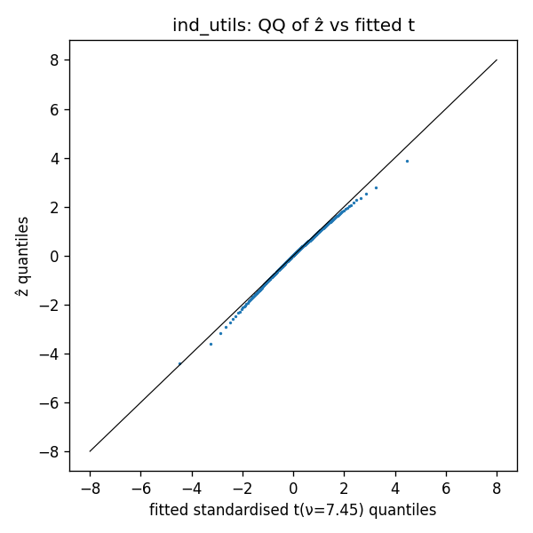
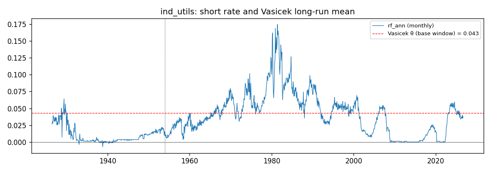
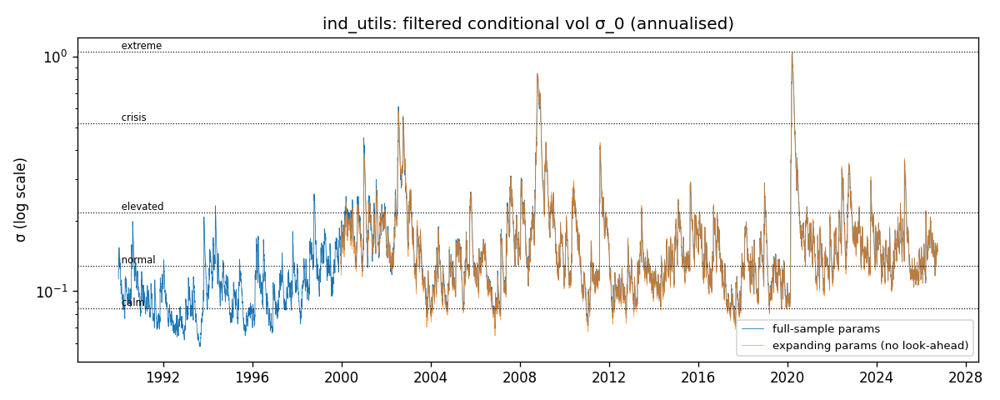
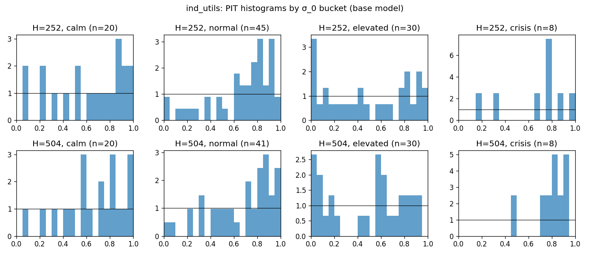
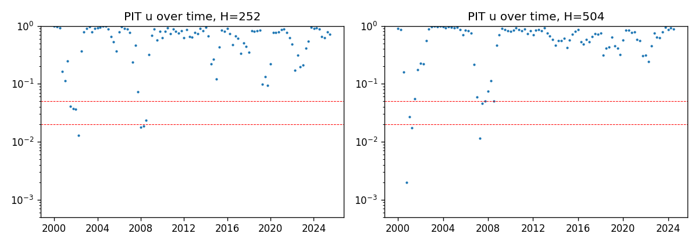
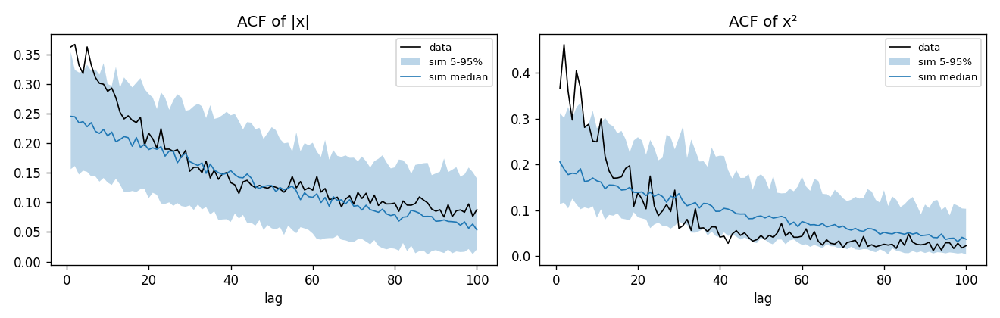
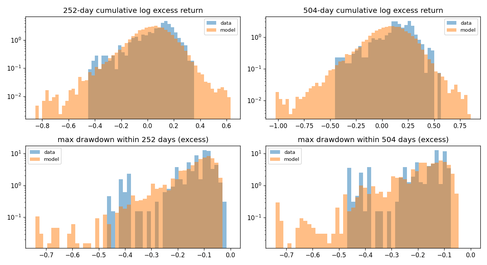
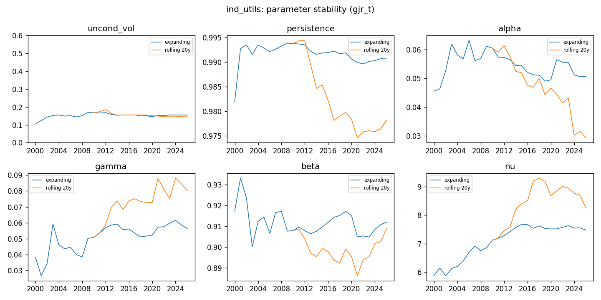

# Model report (Spec 02): `ind_utils`

Generated 2026-11-21T14:01:47 by `scripts/02_fit_model.py --asset ind_utils` in 40s. Estimation window 1990-01-02 – 2026-09-30 (9254 days). Base model **gjr_t**, gap variant **scale**, innovations **t**. Data hashes: `F-F_Research_Data_Factors_daily.csv` 3f7910502dd6…, `F-F_Research_Data_Factors.csv` a3894d74d553…, `10_Industry_Portfolios_Daily.csv` 01cfe3d5e54f….

**Fallback-window rule**: full-history base fit persistence 1.00000, valid parameter draws 33% → **triggered** (persistence 1.00000 >= 0.998; valid draws 0.33 < 0.7); all equity estimation uses data from 1990-01-01.

## 1. Model comparison

Log-likelihoods are for the *unscaled decimal* x; for the `scale` gap variant the Jacobian (−½ Σ log k) is added so log-likelihood/BIC are comparable across variants. PIT columns: observed share of historical starts with u below the level (nominal = the level), expanding-window parameters. PIT score = mean |obs − nominal|/nominal over σ_0 buckets at levels ≤ 5% (lower is better). 'buckets thin/fat' counts bucket×level cells whose CI excludes the nominal.

| model | gap_variant | nobs | loglik | bic | nu | persistence | half_life_days | uncond_vol_ann | PIT u<0.02 H252 | PIT u<0.05 H252 | PIT u<0.02 H504 | PIT u<0.05 H504 | PIT score | buckets thin/fat | VaR0.01 hit rate | VaR0.01 p_uc | VaR0.001 hit rate | VaR0.001 p_uc |
|---|---|---|---|---|---|---|---|---|---|---|---|---|---|---|---|---|---|---|
| garch_n | none | 9254 | 31036.9 | -62037.2 | n/a | 0.9935 | 105.6 | 19.0% | 2.91% | 6.80% | 3.03% | 6.06% | 1.20 | H252: 0/0, H504: 0/0 | 2.33% | 0.000 | 0.76% | 0.000 |
| garch_t | none | 9254 | 31191.0 | -62336.4 | 7.32 | 0.9948 | 133.8 | 19.6% | 1.94% | 6.80% | 3.03% | 5.05% | 1.09 | H252: 0/0, H504: 0/0 | 1.75% | 0.000 | 0.19% | 0.032 |
| gjr_t | none | 9254 | 31207.4 | -62360.0 | 7.46 | 0.9909 | 75.6 | 15.4% | 2.91% | 6.80% | 3.03% | 7.07% | 1.17 | H252: 0/0, H504: 0/0 | 1.77% | 0.000 | 0.18% | 0.068 |
| egarch_t | none | 9254 | 31216.8 | -62378.8 | 7.55 | 0.9853 | 46.7 | 13.1% | 3.88% | 6.80% | 4.04% | 8.08% | 1.43 | H252: 0/0, H504: 0/0 | 1.68% | 0.000 | 0.18% | 0.068 |
| garch_n | scale | 9254 | 31036.1 | -62035.7 | n/a | 0.9934 | 104.8 | 19.0% | 2.91% | 6.80% | 3.03% | 6.06% | 1.20 | H252: 0/0, H504: 0/0 | 2.35% | 0.000 | 0.77% | 0.000 |
| garch_t | scale | 9254 | 31190.7 | -62335.8 | 7.31 | 0.9948 | 133.5 | 19.6% | 1.94% | 6.80% | 3.03% | 4.04% | 1.04 | H252: 0/0, H504: 0/0 | 1.75% | 0.000 | 0.19% | 0.032 |
| gjr_t | scale | 9254 | 31207.1 | -62359.3 | 7.45 | 0.9909 | 75.6 | 15.4% | 2.91% | 6.80% | 3.03% | 5.05% | 1.10 | H252: 0/0, H504: 0/0 | 1.77% | 0.000 | 0.18% | 0.068 |
| egarch_t | scale | 9254 | 31216.6 | -62378.4 | 7.54 | 0.9852 | 46.6 | 13.1% | 3.88% | 6.80% | 4.04% | 8.08% | 1.45 | H252: 0/0, H504: 0/0 | 1.68% | 0.000 | 0.18% | 0.068 |
| gjr_t (FHS innovations) | scale | 9254 | 31207.1 | -62359.3 | 7.45 | 0.9909 | 75.6 | 15.4% | 0.00% | 4.85% | 1.01% | 4.04% | 0.98 | H252: 0/0, H504: 0/0 | n/a | n/a | n/a | n/a |

### Base model parameters (gjr_t, decimal daily units, robust SEs)

| param | estimate | se |
|---|---|---|
| mu | 0.000460537 | 7.36e-05 |
| omega | 8.64322e-07 | 1.99e-07 |
| alpha | 0.0491112 | 0.00892 |
| gamma | 0.0552278 | 0.0103 |
| beta | 0.914148 | 0.00994 |
| nu | 7.44934 | 0.527 |

log-lik 31209.0, AIC -62405.9, BIC -62363.1; persistence 0.9909; half-life 75.6 days; unconditional vol 15.4%; ν = 7.45.

## 2. Expected excess return (premium)

Raw estimate (mean of r − rf × 252): **7.46%** p.a., SE 2.78% (t = 2.68, 36.7 years). Shrunk 0.5 toward 0.0: **3.73%** used (mode `constant_arith`). Resolved coefficients for all modes (same average premium): `constant_arith` mu_e_daily=0.000148; `prop_variance` mu_e_daily=0.000148, lambda=1.295; `constant_sharpe` mu_e_daily=0.000148, S=0.01594

## 3. Standardised residuals (FHS pool)

n = 9254, mean -0.024, sd 0.998, skew -0.34, excess kurtosis 1.34 (fitted t implies 1.74); min -6.61 on 2025-04-04. The FHS pool is demeaned and scaled to unit variance before resampling.

## 4. Interest-rate model (Vasicek on monthly rf_ann)

| window | start | end | months | kappa | se_kappa | theta | s | half-life (y) | neg. months | rho used | rho same-month | rho prev-month |
|---|---|---|---|---|---|---|---|---|---|---|---|---|
| base | 1954-01 | 2026-09 | 440 | 0.338 | 0.095 | 4.30% | 2.57% | 2.0 | 0 | 0.012 | 0.012 | 0.076 |
| full_sample | 1926-07 | 2026-09 | 440 | 0.298 | 0.077 | 3.37% | 2.39% | 2.3 | 12 | 0.012 | 0.012 | 0.076 |
| from_1952-07 | 1952-07 | 2026-09 | 440 | 0.334 | 0.094 | 4.23% | 2.55% | 2.1 | 0 | 0.012 | 0.012 | 0.076 |

Negative monthly rf months in the data: 1933-02, 1938-03, 1938-07, 1938-11, 1939-01, 1939-03, 1939-08, 1940-05, 1940-08, 1941-01, 1941-02, 1941-04. Base window (1954-01-01+) excludes them: **True**. `floor_at_zero = False`.

## 5. Starting states (σ_0, r_0)

Under GJR-GARCH the one-step-ahead conditional variance σ_0² is the complete equity state (the sign of the last shock is already inside it); r_0 is the Vasicek state. Both are observable at t = 0. Named states are percentiles of the asset's own filtered σ history (full-sample params), so they transfer across assets. Annualised with N = 252 (see note on pre-1952 data in DECISIONS).

| state_name | sigma0_ann | r0_ann | definition |
|---|---|---|---|
| calm | 8.4% | 2.67% | P10 of filtered sigma; r0 = median rf_ann of estimation window |
| normal | 12.8% | 2.67% | P50 of filtered sigma; r0 = median rf_ann of estimation window |
| elevated | 21.6% | 2.67% | P90 of filtered sigma; r0 = median rf_ann of estimation window |
| crisis | 52.0% | 2.67% | P99 of filtered sigma; r0 = median rf_ann of estimation window |
| extreme | 104.7% | 2.67% | historical max of filtered sigma (2020-03-24); r0 = median rf_ann of estimation window |

Anchor dates (σ_0 = next-day vol at the close of the date):

| state_name | sigma0_ann | r0_ann | sigma0_ann_expanding | rv63_ann | dd252 |
|---|---|---|---|---|---|
| anchor_2006-12-29 | 8.8% | 4.9% | 8.4% | 7.4% | -1.2% |
| anchor_2008-10-10 | 62.6% | 1.0% | 60.6% | 34.5% | -39.7% |
| anchor_2008-11-20 | 66.8% | 0.4% | 67.4% | 64.8% | -38.3% |
| anchor_2020-03-16 | 97.6% | 1.4% | 96.6% | 45.3% | -30.2% |
| anchor_2022-06-16 | 33.0% | 0.7% | 33.6% | 20.9% | -14.6% |
| anchor_2026-09-30 | 14.9% | 3.8% | 14.9% | 13.3% | -12.8% |

σ_0 bucket edges used in the PIT/VaR tests (annualised): calm: [5.8%, 10.7%), normal: [10.7%, 15.6%), elevated: [15.6%, 26.6%), crisis: [26.6%, n/a)

## 6. Conditional tail calibration (PIT test)

Quarterly start dates; at each start the model is re-estimated on data **before** the start (expanding window, refit every 252 days; premium and rate model also expanding). 2000 paths per start. u = model CDF of the realised cumulative log total return over H days. Effective n = non-overlapping windows = n_starts × 63/H; CIs are Wilson 95% on the effective n. 'too thin' = more realised left-tail outcomes than the model predicts (dangerous for the floor).

### gjr_t / scale / t

| group_type | group | H | n_starts | n_eff | u<0.01 | u<0.02 | u<0.05 | u<0.1 |
|---|---|---|---|---|---|---|---|---|
| overall | all | 252 | 103 | 25.8 | 0.0% (0.0%–13.0%) | 2.9% (0.4%–17.6%) | 6.8% (1.7%–23.1%) | 9.7% (3.1%–26.8%) |
| bucket | calm | 252 | 20 | 5.0 | 0.0% (0.0%–43.4%) | 0.0% (0.0%–43.4%) | 0.0% (0.0%–43.4%) | 10.0% (1.1%–53.7%) |
| bucket | crisis | 252 | 8 | 2.0 | 0.0% (0.0%–65.8%) | 0.0% (0.0%–65.8%) | 0.0% (0.0%–65.8%) | 0.0% (0.0%–65.8%) |
| bucket | elevated | 252 | 30 | 7.5 | 0.0% (0.0%–33.9%) | 3.3% (0.2%–38.1%) | 16.7% (3.5%–52.4%) | 20.0% (4.8%–55.6%) |
| bucket | normal | 252 | 45 | 11.2 | 0.0% (0.0%–25.5%) | 4.4% (0.5%–31.6%) | 4.4% (0.5%–31.6%) | 4.4% (0.5%–31.6%) |
| bucket_group | high | 252 | 38 | 9.5 | 0.0% (0.0%–28.8%) | 2.6% (0.2%–32.4%) | 13.2% (2.8%–44.8%) | 15.8% (3.7%–47.5%) |
| era | 1952-1999 | 252 | 0 | 0.0 | n/a (n/a–n/a) | n/a (n/a–n/a) | n/a (n/a–n/a) | n/a (n/a–n/a) |
| era | 2000- | 252 | 103 | 25.8 | 0.0% (0.0%–13.0%) | 2.9% (0.4%–17.6%) | 6.8% (1.7%–23.1%) | 9.7% (3.1%–26.8%) |
| era | pre-1952 | 252 | 0 | 0.0 | n/a (n/a–n/a) | n/a (n/a–n/a) | n/a (n/a–n/a) | n/a (n/a–n/a) |
| overall | all | 504 | 99 | 12.4 | 1.0% (0.0%–25.2%) | 3.0% (0.2%–28.1%) | 5.1% (0.6%–30.8%) | 10.1% (2.1%–37.0%) |
| bucket | calm | 504 | 20 | 2.5 | 0.0% (0.0%–60.6%) | 0.0% (0.0%–60.6%) | 0.0% (0.0%–60.6%) | 5.0% (0.2%–64.4%) |
| bucket | crisis | 504 | 8 | 1.0 | 0.0% (0.0%–79.3%) | 0.0% (0.0%–79.3%) | 0.0% (0.0%–79.3%) | 0.0% (0.0%–79.3%) |
| bucket | elevated | 504 | 30 | 3.8 | 3.3% (0.1%–53.8%) | 6.7% (0.4%–56.8%) | 13.3% (1.4%–62.4%) | 23.3% (3.9%–69.8%) |
| bucket | normal | 504 | 41 | 5.1 | 0.0% (0.0%–42.8%) | 2.4% (0.1%–45.6%) | 2.4% (0.1%–45.6%) | 4.9% (0.3%–48.1%) |
| bucket_group | high | 504 | 38 | 4.8 | 2.6% (0.1%–47.5%) | 5.3% (0.3%–50.2%) | 10.5% (1.1%–55.2%) | 18.4% (3.0%–62.1%) |
| era | 1952-1999 | 504 | 0 | 0.0 | n/a (n/a–n/a) | n/a (n/a–n/a) | n/a (n/a–n/a) | n/a (n/a–n/a) |
| era | 2000- | 504 | 99 | 12.4 | 1.0% (0.0%–25.2%) | 3.0% (0.2%–28.1%) | 5.1% (0.6%–30.8%) | 10.1% (2.1%–37.0%) |
| era | pre-1952 | 504 | 0 | 0.0 | n/a (n/a–n/a) | n/a (n/a–n/a) | n/a (n/a–n/a) | n/a (n/a–n/a) |

**Verdicts:**

- H=252, bucket `calm`: inconclusive: too few independent windows to test (CI would include 0% and >20%)
- H=252, bucket `normal`: no evidence of miscalibration (nominal inside the CI at all levels), but low power: the CI at the 2% level spans 31%
- H=252, bucket `elevated`: inconclusive: too few independent windows to test (CI would include 0% and >20%)
- H=252, bucket `crisis`: inconclusive: too few independent windows to test (CI would include 0% and >20%)
- H=252, bucket_group `high`: no evidence of miscalibration (nominal inside the CI at all levels), but low power: the CI at the 2% level spans 32%
- H=252, era `pre-1952`: no data
- H=252, era `1952-1999`: no data
- H=252, era `2000-`: no evidence of miscalibration (nominal inside the CI at all levels), but low power: the CI at the 2% level spans 17%
- H=504, bucket `calm`: inconclusive: too few independent windows to test (CI would include 0% and >20%)
- H=504, bucket `normal`: inconclusive: too few independent windows to test (CI would include 0% and >20%)
- H=504, bucket `elevated`: inconclusive: too few independent windows to test (CI would include 0% and >20%)
- H=504, bucket `crisis`: inconclusive: too few independent windows to test (CI would include 0% and >20%)
- H=504, bucket_group `high`: inconclusive: too few independent windows to test (CI would include 0% and >20%)
- H=504, era `pre-1952`: no data
- H=504, era `1952-1999`: no data
- H=504, era `2000-`: no evidence of miscalibration (nominal inside the CI at all levels), but low power: the CI at the 2% level spans 28%

### gjr_t / scale / fhs

| group_type | group | H | n_starts | n_eff | u<0.01 | u<0.02 | u<0.05 | u<0.1 |
|---|---|---|---|---|---|---|---|---|
| overall | all | 252 | 103 | 25.8 | 0.0% (0.0%–13.0%) | 0.0% (0.0%–13.0%) | 4.9% (1.0%–20.4%) | 7.8% (2.2%–24.3%) |
| bucket | calm | 252 | 20 | 5.0 | 0.0% (0.0%–43.4%) | 0.0% (0.0%–43.4%) | 0.0% (0.0%–43.4%) | 0.0% (0.0%–43.4%) |
| bucket | crisis | 252 | 8 | 2.0 | 0.0% (0.0%–65.8%) | 0.0% (0.0%–65.8%) | 0.0% (0.0%–65.8%) | 0.0% (0.0%–65.8%) |
| bucket | elevated | 252 | 30 | 7.5 | 0.0% (0.0%–33.9%) | 0.0% (0.0%–33.9%) | 10.0% (1.4%–45.6%) | 20.0% (4.8%–55.6%) |
| bucket | normal | 252 | 45 | 11.2 | 0.0% (0.0%–25.5%) | 0.0% (0.0%–25.5%) | 4.4% (0.5%–31.6%) | 4.4% (0.5%–31.6%) |
| bucket_group | high | 252 | 38 | 9.5 | 0.0% (0.0%–28.8%) | 0.0% (0.0%–28.8%) | 7.9% (1.1%–38.9%) | 15.8% (3.7%–47.5%) |
| era | 1952-1999 | 252 | 0 | 0.0 | n/a (n/a–n/a) | n/a (n/a–n/a) | n/a (n/a–n/a) | n/a (n/a–n/a) |
| era | 2000- | 252 | 103 | 25.8 | 0.0% (0.0%–13.0%) | 0.0% (0.0%–13.0%) | 4.9% (1.0%–20.4%) | 7.8% (2.2%–24.3%) |
| era | pre-1952 | 252 | 0 | 0.0 | n/a (n/a–n/a) | n/a (n/a–n/a) | n/a (n/a–n/a) | n/a (n/a–n/a) |
| overall | all | 504 | 99 | 12.4 | 1.0% (0.0%–25.2%) | 1.0% (0.0%–25.2%) | 4.0% (0.4%–29.4%) | 10.1% (2.1%–37.0%) |
| bucket | calm | 504 | 20 | 2.5 | 0.0% (0.0%–60.6%) | 0.0% (0.0%–60.6%) | 0.0% (0.0%–60.6%) | 5.0% (0.2%–64.4%) |
| bucket | crisis | 504 | 8 | 1.0 | 0.0% (0.0%–79.3%) | 0.0% (0.0%–79.3%) | 0.0% (0.0%–79.3%) | 0.0% (0.0%–79.3%) |
| bucket | elevated | 504 | 30 | 3.8 | 3.3% (0.1%–53.8%) | 3.3% (0.1%–53.8%) | 10.0% (0.8%–59.7%) | 23.3% (3.9%–69.8%) |
| bucket | normal | 504 | 41 | 5.1 | 0.0% (0.0%–42.8%) | 0.0% (0.0%–42.8%) | 2.4% (0.1%–45.6%) | 4.9% (0.3%–48.1%) |
| bucket_group | high | 504 | 38 | 4.8 | 2.6% (0.1%–47.5%) | 2.6% (0.1%–47.5%) | 7.9% (0.7%–52.8%) | 18.4% (3.0%–62.1%) |
| era | 1952-1999 | 504 | 0 | 0.0 | n/a (n/a–n/a) | n/a (n/a–n/a) | n/a (n/a–n/a) | n/a (n/a–n/a) |
| era | 2000- | 504 | 99 | 12.4 | 1.0% (0.0%–25.2%) | 1.0% (0.0%–25.2%) | 4.0% (0.4%–29.4%) | 10.1% (2.1%–37.0%) |
| era | pre-1952 | 504 | 0 | 0.0 | n/a (n/a–n/a) | n/a (n/a–n/a) | n/a (n/a–n/a) | n/a (n/a–n/a) |

**Verdicts:**

- H=252, bucket `calm`: inconclusive: too few independent windows to test (CI would include 0% and >20%)
- H=252, bucket `normal`: no evidence of miscalibration (nominal inside the CI at all levels), but low power: the CI at the 2% level spans 25%
- H=252, bucket `elevated`: inconclusive: too few independent windows to test (CI would include 0% and >20%)
- H=252, bucket `crisis`: inconclusive: too few independent windows to test (CI would include 0% and >20%)
- H=252, bucket_group `high`: no evidence of miscalibration (nominal inside the CI at all levels), but low power: the CI at the 2% level spans 29%
- H=252, era `pre-1952`: no data
- H=252, era `1952-1999`: no data
- H=252, era `2000-`: no evidence of miscalibration (nominal inside the CI at all levels), but low power: the CI at the 2% level spans 13%
- H=504, bucket `calm`: inconclusive: too few independent windows to test (CI would include 0% and >20%)
- H=504, bucket `normal`: inconclusive: too few independent windows to test (CI would include 0% and >20%)
- H=504, bucket `elevated`: inconclusive: too few independent windows to test (CI would include 0% and >20%)
- H=504, bucket `crisis`: inconclusive: too few independent windows to test (CI would include 0% and >20%)
- H=504, bucket_group `high`: inconclusive: too few independent windows to test (CI would include 0% and >20%)
- H=504, era `pre-1952`: no data
- H=504, era `1952-1999`: no data
- H=504, era `2000-`: no evidence of miscalibration (nominal inside the CI at all levels), but low power: the CI at the 2% level spans 25%

## 7. One-day tail check

| level | bucket | n | hits | rate | LR_uc | p_uc | LR_ind | p_ind |
|---|---|---|---|---|---|---|---|---|
| 0.01 | all | 6734 | 119 | 1.767% | 32.59 | 0.000 | 1.41 | 0.235 |
| 0.01 | calm | 1269 | 29 | 2.285% | 15.53 | 0.000 | 1.36 | 0.244 |
| 0.01 | crisis | 458 | 8 | 1.747% | 2.11 | 0.146 | 0.29 | 0.593 |
| 0.01 | elevated | 2141 | 30 | 1.401% | 3.10 | 0.079 | 3.25 | 0.071 |
| 0.01 | normal | 2866 | 52 | 1.814% | 15.47 | 0.000 | 0.94 | 0.333 |
| 0.001 | all | 6734 | 12 | 0.178% | 3.34 | 0.068 | 0.04 | 0.836 |
| 0.001 | calm | 1269 | 3 | 0.236% | 1.70 | 0.192 | 0.01 | 0.905 |
| 0.001 | crisis | 458 | 0 | 0.000% | 0.92 | 0.338 | -0.00 | 1.000 |
| 0.001 | elevated | 2141 | 4 | 0.187% | 1.28 | 0.257 | 0.01 | 0.903 |
| 0.001 | normal | 2866 | 5 | 0.174% | 1.30 | 0.254 | 0.02 | 0.895 |

(Christoffersen independence within a bucket uses consecutive days of that bucket's sub-sequence.)

## 8. Stylised facts: data vs simulated long paths

40 simulated paths of the estimation-window length from the base model (t innovations, base premium and rate model).

| statistic | data | model |
|---|---|---|
| annualised vol of x | 16.9% | 14.8% (5–95%: 13.0%–17.7%) |
| excess kurtosis of daily x | 16.0 | 7.8 (5–95%: 3.0–19.3) |
| skew of daily x | -0.21 | 0.06 |
| ACF |x| lags 1/10/50/100 | 0.36 / 0.29 / 0.13 / 0.09 | 0.25 / 0.21 / 0.13 / 0.05 |

252-day windows (start every 21 days) — quantiles:

| quantile | cum log excess, data | cum log excess, model | max DD, data | max DD, model |
|---|---|---|---|---|
| 0.01 | -38.6% | -40.8% | -41.8% | -43.7% |
| 0.02 | -33.5% | -31.5% | -41.8% | -38.7% |
| 0.05 | -20.9% | -21.5% | -38.3% | -30.9% |
| 0.1 | -12.3% | -14.0% | -24.1% | -25.3% |
| 0.5 | 10.4% | 4.0% | -10.5% | -11.4% |

504-day windows (start every 21 days) — quantiles:

| quantile | cum log excess, data | cum log excess, model | max DD, data | max DD, model |
|---|---|---|---|---|
| 0.01 | -40.7% | -53.6% | -46.8% | -61.0% |
| 0.02 | -35.9% | -43.1% | -46.8% | -48.2% |
| 0.05 | -23.5% | -29.4% | -45.6% | -40.9% |
| 0.1 | -10.7% | -18.4% | -40.9% | -34.5% |
| 0.5 | 15.4% | 7.7% | -14.4% | -16.5% |

Simulated x clipped at −99% simple return: 0 times.

## 9. Parameter stability

| sample | start | end | nobs | mu | omega | alpha | gamma | beta | nu | persistence | half_life_days | uncond_vol_ann | loglik |
|---|---|---|---|---|---|---|---|---|---|---|---|---|---|
| estimation window (base) | 1990-01-02 | 2026-09-30 | 9254 | 4.61e-04 | 8.64e-07 | 0.049 | 0.055 | 0.914 | 7.45 | 0.9909 | 76 | 15.4% | 31209 |
| pre-1963 (skipped: 0 obs) | n/a | n/a | n/a | n/a | n/a | n/a | n/a | n/a | n/a | n/a | n/a | n/a | n/a |
| 1963-1999 | 1990-01-02 | 1999-12-31 | 2528 | 2.71e-04 | 8.13e-07 | 0.046 | 0.039 | 0.916 | 5.88 | 0.9811 | 36 | 10.4% | 9449 |
| 2000-end | 2000-01-03 | 2026-09-30 | 6726 | 5.70e-04 | 2.32e-06 | 0.044 | 0.076 | 0.894 | 8.40 | 0.9757 | 28 | 15.5% | 21793 |

## 10. Parameter-uncertainty draws

200 draws from the asymptotic normal of the robust covariance (acceptance 100.0%; rejected: non-stationary, ω ≤ 0, negative ARCH terms, ν ≤ 2.5). Unconditional vol 5–95%: 13.3%–19.3%; ν 5–95%: 6.62–8.38. Saved to `results/model/param_draws_ind_utils.npy` (columns ['mu', 'omega', 'alpha', 'gamma', 'beta', 'nu']).

## 11. Closure-gap returns

| date | from | calendar_days | busdays | x |
|---|---|---|---|---|
| 2001-09-17 | 2001-09-10 | 7 | 5 | -1.70% |
| 2007-01-03 | 2006-12-29 | 5 | 3 | 0.29% |
| 2012-10-31 | 2012-10-26 | 5 | 3 | 0.71% |

Variant `scale` divides these returns by sqrt(busdays) before fitting; `none` uses them as is. Compare the rows of the model comparison table with the same model name.

