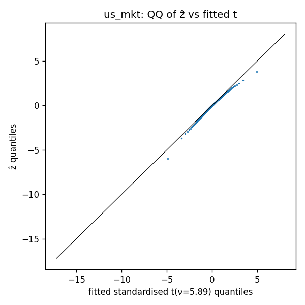
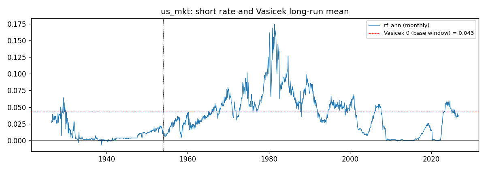
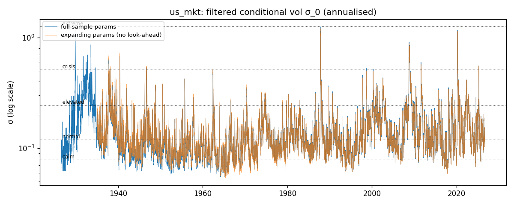
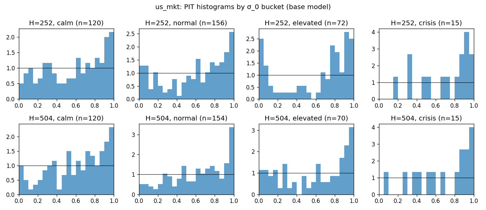
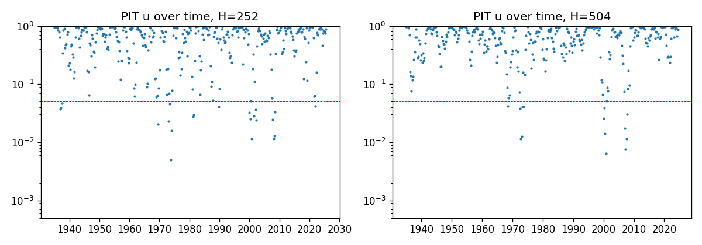
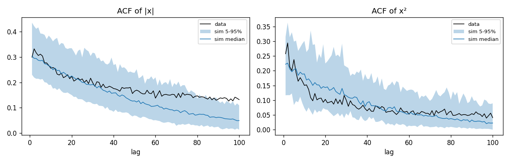
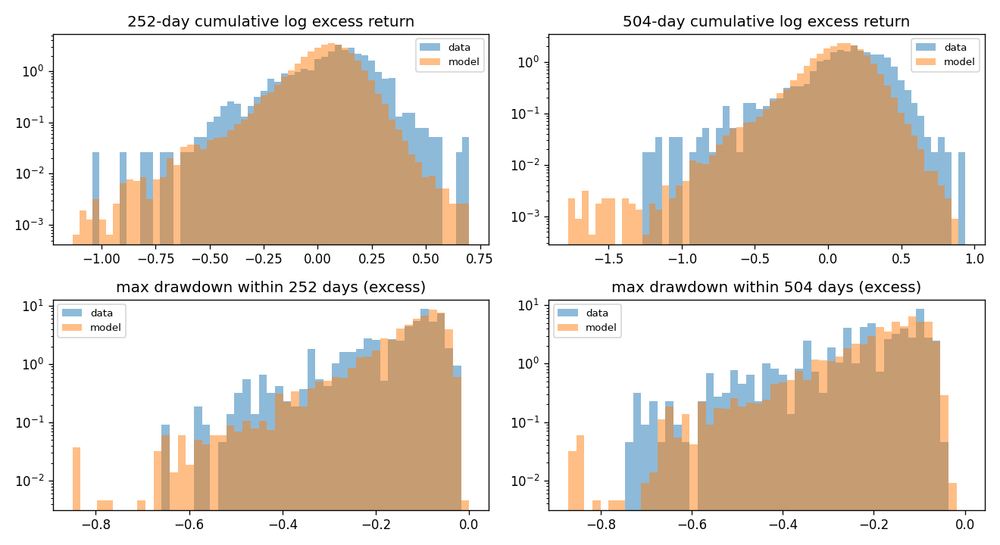
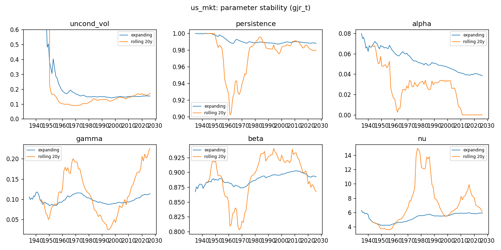

# Model report (Spec 02): `us_mkt`

Generated 2026-11-21T13:48:18 by `scripts/02_fit_model.py --asset us_mkt` in 111s. Estimation window 1926-07-01 – 2026-09-30 (26338 days). Base model **gjr_t**, gap variant **scale**, innovations **t**. Data hashes: `F-F_Research_Data_Factors_daily.csv` 3f7910502dd6…, `F-F_Research_Data_Factors.csv` a3894d74d553….

**Fallback-window rule**: full-history base fit persistence 0.98810, valid parameter draws 100% → not triggered; full history used.

## 1. Model comparison

Log-likelihoods are for the *unscaled decimal* x; for the `scale` gap variant the Jacobian (−½ Σ log k) is added so log-likelihood/BIC are comparable across variants. PIT columns: observed share of historical starts with u below the level (nominal = the level), expanding-window parameters. PIT score = mean |obs − nominal|/nominal over σ_0 buckets at levels ≤ 5% (lower is better). 'buckets thin/fat' counts bucket×level cells whose CI excludes the nominal.

| model | gap_variant | nobs | loglik | bic | nu | persistence | half_life_days | uncond_vol_ann | PIT u<0.02 H252 | PIT u<0.05 H252 | PIT u<0.02 H504 | PIT u<0.05 H504 | PIT score | buckets thin/fat | VaR0.01 hit rate | VaR0.01 p_uc | VaR0.001 hit rate | VaR0.001 p_uc |
|---|---|---|---|---|---|---|---|---|---|---|---|---|---|---|---|---|---|---|
| garch_n | none | 26338 | 88727.5 | -177414.3 | n/a | 0.9884 | 59.4 | 17.6% | 1.10% | 4.13% | 1.95% | 3.34% | 0.62 | H252: 0/0, H504: 0/0 | 1.93% | 0.000 | 0.62% | 0.000 |
| garch_t | none | 26338 | 89705.8 | -179360.7 | 5.48 | 0.9967 | 211.8 | 26.2% | 0.83% | 4.96% | 1.11% | 2.51% | 0.76 | H252: 0/0, H504: 0/0 | 1.27% | 0.000 | 0.16% | 0.012 |
| gjr_t | none | 26338 | 89884.1 | -179707.1 | 5.86 | 0.9881 | 57.8 | 15.3% | 1.38% | 6.61% | 1.95% | 3.90% | 0.73 | H252: 0/0, H504: 0/0 | 1.22% | 0.001 | 0.16% | 0.012 |
| egarch_t | none | 26338 | 89942.8 | -179824.5 | 5.90 | 0.9850 | 45.9 | 11.9% | 1.65% | 5.51% | 1.95% | 4.46% | 0.63 | H252: 0/0, H504: 0/0 | 1.21% | 0.001 | 0.16% | 0.004 |
| garch_n | scale | 26338 | 88749.1 | -177457.6 | n/a | 0.9882 | 58.3 | 17.4% | 1.10% | 4.13% | 1.95% | 3.34% | 0.62 | H252: 0/0, H504: 0/0 | 1.93% | 0.000 | 0.62% | 0.000 |
| garch_t | scale | 26338 | 89712.0 | -179373.0 | 5.51 | 0.9968 | 214.8 | 26.3% | 1.10% | 4.96% | 0.56% | 2.51% | 0.78 | H252: 0/0, H504: 0/0 | 1.28% | 0.000 | 0.16% | 0.012 |
| gjr_t | scale | 26338 | 89888.9 | -179716.8 | 5.89 | 0.9881 | 57.9 | 15.3% | 1.38% | 6.06% | 1.95% | 3.90% | 0.72 | H252: 0/0, H504: 0/0 | 1.23% | 0.000 | 0.16% | 0.008 |
| egarch_t | scale | 26338 | 89947.4 | -179833.8 | 5.93 | 0.9850 | 46.0 | 11.9% | 1.65% | 5.51% | 1.95% | 4.18% | 0.64 | H252: 0/0, H504: 0/0 | 1.23% | 0.001 | 0.17% | 0.003 |
| gjr_t (FHS innovations) | scale | 26338 | 89888.9 | -179716.8 | 5.89 | 0.9881 | 57.9 | 15.3% | 0.28% | 3.86% | 0.84% | 3.34% | 0.74 | H252: 0/0, H504: 0/0 | n/a | n/a | n/a | n/a |

### Base model parameters (gjr_t, decimal daily units, robust SEs)

| param | estimate | se |
|---|---|---|
| mu | 0.000612867 | 3.99e-05 |
| omega | 1.10517e-06 | 1.25e-07 |
| alpha | 0.0380825 | 0.00354 |
| gamma | 0.114511 | 0.0089 |
| beta | 0.892759 | 0.00603 |
| nu | 5.89424 | 0.228 |

log-lik 89894.6, AIC -179777.2, BIC -179728.1; persistence 0.9881; half-life 57.9 days; unconditional vol 15.3%; ν = 5.89.

## 2. Expected excess return (premium)

Raw estimate (mean of r − rf × 252): **7.83%** p.a., SE 1.67% (t = 4.68, 104.5 years). Shrunk 0.5 toward 0.0: **3.91%** used (mode `constant_arith`). Resolved coefficients for all modes (same average premium): `constant_arith` mu_e_daily=0.0001553; `prop_variance` mu_e_daily=0.0001553, lambda=1.289; `constant_sharpe` mu_e_daily=0.0001553, S=0.01669

## 3. Standardised residuals (FHS pool)

n = 26338, mean -0.043, sd 1.003, skew -0.74, excess kurtosis 6.10 (fitted t implies 3.17); min -17.20 on 1955-09-26. The FHS pool is demeaned and scaled to unit variance before resampling.

## 4. Interest-rate model (Vasicek on monthly rf_ann)

| window | start | end | months | kappa | se_kappa | theta | s | half-life (y) | neg. months | rho used | rho same-month | rho prev-month |
|---|---|---|---|---|---|---|---|---|---|---|---|---|
| base | 1954-01 | 2026-09 | 872 | 0.338 | 0.095 | 4.30% | 2.57% | 2.0 | 0 | -0.121 | -0.121 | -0.022 |
| full_sample | 1926-07 | 2026-09 | 1202 | 0.298 | 0.077 | 3.37% | 2.39% | 2.3 | 12 | -0.065 | -0.065 | -0.037 |
| from_1952-07 | 1952-07 | 2026-09 | 890 | 0.334 | 0.094 | 4.23% | 2.55% | 2.1 | 0 | -0.123 | -0.123 | -0.020 |

Negative monthly rf months in the data: 1933-02, 1938-03, 1938-07, 1938-11, 1939-01, 1939-03, 1939-08, 1940-05, 1940-08, 1941-01, 1941-02, 1941-04. Base window (1954-01-01+) excludes them: **True**. `floor_at_zero = False`.

## 5. Starting states (σ_0, r_0)

Under GJR-GARCH the one-step-ahead conditional variance σ_0² is the complete equity state (the sign of the last shock is already inside it); r_0 is the Vasicek state. Both are observable at t = 0. Named states are percentiles of the asset's own filtered σ history (full-sample params), so they transfer across assets. Annualised with N = 252 (see note on pre-1952 data in DECISIONS).

| state_name | sigma0_ann | r0_ann | definition |
|---|---|---|---|
| calm | 7.9% | 2.67% | P10 of filtered sigma; r0 = median rf_ann of estimation window |
| normal | 11.9% | 2.67% | P50 of filtered sigma; r0 = median rf_ann of estimation window |
| elevated | 24.6% | 2.67% | P90 of filtered sigma; r0 = median rf_ann of estimation window |
| crisis | 51.0% | 2.67% | P99 of filtered sigma; r0 = median rf_ann of estimation window |
| extreme | 125.1% | 2.67% | historical max of filtered sigma (1987-10-19); r0 = median rf_ann of estimation window |

Anchor dates (σ_0 = next-day vol at the close of the date):

| state_name | sigma0_ann | r0_ann | sigma0_ann_expanding | rv63_ann | dd252 |
|---|---|---|---|---|---|
| anchor_2006-12-29 | 8.8% | 4.9% | 8.6% | 8.0% | -0.6% |
| anchor_1987-10-16 | 40.1% | 7.4% | 38.8% | 18.2% | -14.5% |
| anchor_1987-10-19 | 125.1% | 7.4% | 120.6% | 42.1% | -29.4% |
| anchor_2008-10-10 | 75.0% | 1.0% | 72.3% | 40.6% | -40.6% |
| anchor_2008-11-20 | 80.2% | 0.4% | 78.3% | 63.4% | -49.4% |
| anchor_2020-03-16 | 115.8% | 1.4% | 113.8% | 47.6% | -30.5% |
| anchor_2022-06-16 | 41.6% | 0.7% | 41.6% | 29.0% | -25.0% |
| anchor_2026-09-30 | 10.9% | 3.8% | 10.9% | 11.3% | -2.3% |

σ_0 bucket edges used in the PIT/VaR tests (annualised): calm: [5.5%, 9.8%), normal: [9.8%, 15.4%), elevated: [15.4%, 31.7%), crisis: [31.7%, n/a)

## 6. Conditional tail calibration (PIT test)

Quarterly start dates; at each start the model is re-estimated on data **before** the start (expanding window, refit every 252 days; premium and rate model also expanding). 2000 paths per start. u = model CDF of the realised cumulative log total return over H days. Effective n = non-overlapping windows = n_starts × 63/H; CIs are Wilson 95% on the effective n. 'too thin' = more realised left-tail outcomes than the model predicts (dangerous for the floor).

### gjr_t / scale / t

| group_type | group | H | n_starts | n_eff | u<0.01 | u<0.02 | u<0.05 | u<0.1 |
|---|---|---|---|---|---|---|---|---|
| overall | all | 252 | 363 | 90.8 | 0.3% (0.0%–4.6%) | 1.4% (0.3%–6.4%) | 6.1% (2.7%–13.0%) | 11.6% (6.5%–19.8%) |
| bucket | calm | 252 | 120 | 30.0 | 0.8% (0.0%–12.8%) | 0.8% (0.0%–12.8%) | 2.5% (0.4%–15.4%) | 6.7% (1.8%–21.3%) |
| bucket | crisis | 252 | 15 | 3.8 | 0.0% (0.0%–50.6%) | 0.0% (0.0%–50.6%) | 0.0% (0.0%–50.6%) | 0.0% (0.0%–50.6%) |
| bucket | elevated | 252 | 72 | 18.0 | 0.0% (0.0%–17.6%) | 5.6% (1.0%–25.8%) | 12.5% (3.7%–34.5%) | 19.4% (7.4%–42.3%) |
| bucket | normal | 252 | 156 | 39.0 | 0.0% (0.0%–9.0%) | 0.0% (0.0%–9.0%) | 6.4% (2.0%–18.6%) | 12.8% (5.6%–26.7%) |
| bucket_group | high | 252 | 87 | 21.8 | 0.0% (0.0%–15.0%) | 4.6% (0.8%–22.0%) | 10.3% (3.1%–29.5%) | 16.1% (6.1%–36.3%) |
| era | 1952-1999 | 252 | 192 | 48.0 | 0.5% (0.0%–8.3%) | 1.0% (0.1%–9.2%) | 4.2% (1.2%–14.0%) | 12.0% (5.5%–24.1%) |
| era | 2000- | 252 | 103 | 25.8 | 0.0% (0.0%–13.0%) | 2.9% (0.4%–17.6%) | 10.7% (3.5%–28.0%) | 14.6% (5.6%–32.7%) |
| era | pre-1952 | 252 | 68 | 17.0 | 0.0% (0.0%–18.4%) | 0.0% (0.0%–18.4%) | 4.4% (0.6%–25.0%) | 5.9% (1.0%–27.0%) |
| overall | all | 504 | 359 | 44.9 | 0.6% (0.0%–8.9%) | 1.9% (0.3%–11.2%) | 3.9% (1.0%–14.1%) | 7.2% (2.6%–18.6%) |
| bucket | calm | 504 | 120 | 15.0 | 0.0% (0.0%–20.4%) | 2.5% (0.2%–24.2%) | 5.0% (0.7%–27.6%) | 7.5% (1.5%–30.9%) |
| bucket | crisis | 504 | 15 | 1.9 | 0.0% (0.0%–67.2%) | 0.0% (0.0%–67.2%) | 0.0% (0.0%–67.2%) | 6.7% (0.2%–71.4%) |
| bucket | elevated | 504 | 70 | 8.8 | 1.4% (0.0%–32.5%) | 2.9% (0.2%–34.3%) | 5.7% (0.6%–37.9%) | 11.4% (2.0%–44.3%) |
| bucket | normal | 504 | 154 | 19.2 | 0.6% (0.0%–17.7%) | 1.3% (0.1%–18.7%) | 2.6% (0.3%–20.7%) | 5.2% (0.9%–24.4%) |
| bucket_group | high | 504 | 85 | 10.6 | 1.2% (0.0%–28.2%) | 2.4% (0.1%–29.9%) | 4.7% (0.5%–33.0%) | 10.6% (2.1%–40.1%) |
| era | 1952-1999 | 504 | 192 | 24.0 | 0.0% (0.0%–13.8%) | 1.0% (0.1%–15.5%) | 3.1% (0.4%–18.7%) | 5.7% (1.3%–22.4%) |
| era | 2000- | 504 | 99 | 12.4 | 2.0% (0.1%–26.7%) | 5.1% (0.6%–30.8%) | 8.1% (1.4%–34.6%) | 14.1% (3.7%–41.6%) |
| era | pre-1952 | 504 | 68 | 8.5 | 0.0% (0.0%–31.1%) | 0.0% (0.0%–31.1%) | 0.0% (0.0%–31.1%) | 1.5% (0.0%–33.1%) |

**Verdicts:**

- H=252, bucket `calm`: no evidence of miscalibration (nominal inside the CI at all levels), but low power: the CI at the 2% level spans 13%
- H=252, bucket `normal`: no evidence of miscalibration (nominal inside the CI at all levels), but low power: the CI at the 2% level spans 9%
- H=252, bucket `elevated`: no evidence of miscalibration (nominal inside the CI at all levels), but low power: the CI at the 2% level spans 25%
- H=252, bucket `crisis`: inconclusive: too few independent windows to test (CI would include 0% and >20%)
- H=252, bucket_group `high`: no evidence of miscalibration (nominal inside the CI at all levels), but low power: the CI at the 2% level spans 21%
- H=252, era `pre-1952`: no evidence of miscalibration (nominal inside the CI at all levels), but low power: the CI at the 2% level spans 18%
- H=252, era `1952-1999`: no evidence of miscalibration (nominal inside the CI at all levels), but low power: the CI at the 2% level spans 9%
- H=252, era `2000-`: no evidence of miscalibration (nominal inside the CI at all levels), but low power: the CI at the 2% level spans 17%
- H=504, bucket `calm`: no evidence of miscalibration (nominal inside the CI at all levels), but low power: the CI at the 2% level spans 24%
- H=504, bucket `normal`: no evidence of miscalibration (nominal inside the CI at all levels), but low power: the CI at the 2% level spans 19%
- H=504, bucket `elevated`: no evidence of miscalibration (nominal inside the CI at all levels), but low power: the CI at the 2% level spans 34%
- H=504, bucket `crisis`: inconclusive: too few independent windows to test (CI would include 0% and >20%)
- H=504, bucket_group `high`: no evidence of miscalibration (nominal inside the CI at all levels), but low power: the CI at the 2% level spans 30%
- H=504, era `pre-1952`: no evidence of miscalibration (nominal inside the CI at all levels), but low power: the CI at the 2% level spans 31%
- H=504, era `1952-1999`: no evidence of miscalibration (nominal inside the CI at all levels), but low power: the CI at the 2% level spans 15%
- H=504, era `2000-`: no evidence of miscalibration (nominal inside the CI at all levels), but low power: the CI at the 2% level spans 30%

### gjr_t / scale / fhs

| group_type | group | H | n_starts | n_eff | u<0.01 | u<0.02 | u<0.05 | u<0.1 |
|---|---|---|---|---|---|---|---|---|
| overall | all | 252 | 363 | 90.8 | 0.3% (0.0%–4.6%) | 0.3% (0.0%–4.6%) | 3.9% (1.4%–10.0%) | 10.7% (5.9%–18.8%) |
| bucket | calm | 252 | 120 | 30.0 | 0.8% (0.0%–12.8%) | 0.8% (0.0%–12.8%) | 1.7% (0.2%–14.1%) | 5.0% (1.2%–19.1%) |
| bucket | crisis | 252 | 15 | 3.8 | 0.0% (0.0%–50.6%) | 0.0% (0.0%–50.6%) | 0.0% (0.0%–50.6%) | 0.0% (0.0%–50.6%) |
| bucket | elevated | 252 | 72 | 18.0 | 0.0% (0.0%–17.6%) | 0.0% (0.0%–17.6%) | 8.3% (1.9%–29.4%) | 18.1% (6.6%–40.8%) |
| bucket | normal | 252 | 156 | 39.0 | 0.0% (0.0%–9.0%) | 0.0% (0.0%–9.0%) | 3.8% (0.9%–15.1%) | 12.8% (5.6%–26.7%) |
| bucket_group | high | 252 | 87 | 21.8 | 0.0% (0.0%–15.0%) | 0.0% (0.0%–15.0%) | 6.9% (1.6%–25.1%) | 14.9% (5.4%–35.0%) |
| era | 1952-1999 | 252 | 192 | 48.0 | 0.5% (0.0%–8.3%) | 0.5% (0.0%–8.3%) | 3.1% (0.7%–12.5%) | 10.4% (4.5%–22.2%) |
| era | 2000- | 252 | 103 | 25.8 | 0.0% (0.0%–13.0%) | 0.0% (0.0%–13.0%) | 7.8% (2.2%–24.3%) | 14.6% (5.6%–32.7%) |
| era | pre-1952 | 252 | 68 | 17.0 | 0.0% (0.0%–18.4%) | 0.0% (0.0%–18.4%) | 0.0% (0.0%–18.4%) | 5.9% (1.0%–27.0%) |
| overall | all | 504 | 359 | 44.9 | 0.0% (0.0%–7.9%) | 0.8% (0.1%–9.4%) | 3.3% (0.8%–13.3%) | 6.7% (2.3%–17.9%) |
| bucket | calm | 504 | 120 | 15.0 | 0.0% (0.0%–20.4%) | 0.8% (0.0%–21.7%) | 4.2% (0.5%–26.5%) | 7.5% (1.5%–30.9%) |
| bucket | crisis | 504 | 15 | 1.9 | 0.0% (0.0%–67.2%) | 0.0% (0.0%–67.2%) | 0.0% (0.0%–67.2%) | 6.7% (0.2%–71.4%) |
| bucket | elevated | 504 | 70 | 8.8 | 0.0% (0.0%–30.5%) | 1.4% (0.0%–32.5%) | 4.3% (0.4%–36.1%) | 10.0% (1.6%–42.8%) |
| bucket | normal | 504 | 154 | 19.2 | 0.0% (0.0%–16.6%) | 0.6% (0.0%–17.7%) | 2.6% (0.3%–20.7%) | 4.5% (0.7%–23.5%) |
| bucket_group | high | 504 | 85 | 10.6 | 0.0% (0.0%–26.6%) | 1.2% (0.0%–28.2%) | 3.5% (0.3%–31.4%) | 9.4% (1.7%–38.7%) |
| era | 1952-1999 | 504 | 192 | 24.0 | 0.0% (0.0%–13.8%) | 0.5% (0.0%–14.7%) | 2.1% (0.2%–17.2%) | 5.7% (1.3%–22.4%) |
| era | 2000- | 504 | 99 | 12.4 | 0.0% (0.0%–23.7%) | 2.0% (0.1%–26.7%) | 8.1% (1.4%–34.6%) | 13.1% (3.3%–40.5%) |
| era | pre-1952 | 504 | 68 | 8.5 | 0.0% (0.0%–31.1%) | 0.0% (0.0%–31.1%) | 0.0% (0.0%–31.1%) | 0.0% (0.0%–31.1%) |

**Verdicts:**

- H=252, bucket `calm`: no evidence of miscalibration (nominal inside the CI at all levels), but low power: the CI at the 2% level spans 13%
- H=252, bucket `normal`: no evidence of miscalibration (nominal inside the CI at all levels), but low power: the CI at the 2% level spans 9%
- H=252, bucket `elevated`: no evidence of miscalibration (nominal inside the CI at all levels), but low power: the CI at the 2% level spans 18%
- H=252, bucket `crisis`: inconclusive: too few independent windows to test (CI would include 0% and >20%)
- H=252, bucket_group `high`: no evidence of miscalibration (nominal inside the CI at all levels), but low power: the CI at the 2% level spans 15%
- H=252, era `pre-1952`: no evidence of miscalibration (nominal inside the CI at all levels), but low power: the CI at the 2% level spans 18%
- H=252, era `1952-1999`: no evidence of miscalibration (nominal inside the CI at all levels), but low power: the CI at the 2% level spans 8%
- H=252, era `2000-`: no evidence of miscalibration (nominal inside the CI at all levels), but low power: the CI at the 2% level spans 13%
- H=504, bucket `calm`: no evidence of miscalibration (nominal inside the CI at all levels), but low power: the CI at the 2% level spans 22%
- H=504, bucket `normal`: no evidence of miscalibration (nominal inside the CI at all levels), but low power: the CI at the 2% level spans 18%
- H=504, bucket `elevated`: no evidence of miscalibration (nominal inside the CI at all levels), but low power: the CI at the 2% level spans 32%
- H=504, bucket `crisis`: inconclusive: too few independent windows to test (CI would include 0% and >20%)
- H=504, bucket_group `high`: no evidence of miscalibration (nominal inside the CI at all levels), but low power: the CI at the 2% level spans 28%
- H=504, era `pre-1952`: no evidence of miscalibration (nominal inside the CI at all levels), but low power: the CI at the 2% level spans 31%
- H=504, era `1952-1999`: no evidence of miscalibration (nominal inside the CI at all levels), but low power: the CI at the 2% level spans 15%
- H=504, era `2000-`: no evidence of miscalibration (nominal inside the CI at all levels), but low power: the CI at the 2% level spans 27%

## 7. One-day tail check

| level | bucket | n | hits | rate | LR_uc | p_uc | LR_ind | p_ind |
|---|---|---|---|---|---|---|---|---|
| 0.01 | all | 23818 | 294 | 1.234% | 12.30 | 0.000 | 2.53 | 0.111 |
| 0.01 | calm | 7021 | 110 | 1.567% | 19.43 | 0.000 | 0.37 | 0.544 |
| 0.01 | crisis | 776 | 7 | 0.902% | 0.08 | 0.780 | 0.13 | 0.721 |
| 0.01 | elevated | 5731 | 55 | 0.960% | 0.10 | 0.758 | 0.34 | 0.559 |
| 0.01 | normal | 10290 | 122 | 1.186% | 3.38 | 0.066 | 2.93 | 0.087 |
| 0.001 | all | 23818 | 38 | 0.160% | 7.15 | 0.008 | 0.12 | 0.727 |
| 0.001 | calm | 7021 | 19 | 0.271% | 13.89 | 0.000 | 0.10 | 0.748 |
| 0.001 | crisis | 776 | 1 | 0.129% | 0.06 | 0.808 | 0.00 | 0.959 |
| 0.001 | elevated | 5731 | 6 | 0.105% | 0.01 | 0.911 | 0.01 | 0.911 |
| 0.001 | normal | 10290 | 12 | 0.117% | 0.27 | 0.603 | 0.03 | 0.867 |

(Christoffersen independence within a bucket uses consecutive days of that bucket's sub-sequence.)

- **full_sample_params**: σ for 1987-10-19 = 40.1% (ann.), ν = 5.89. P(one-day loss ≥ 17%) = 5.41e-05 (once in 73.4 years at that σ). Realised standardised shock = -7.6; model probability of a shock that size or worse = 4.68e-05.
- **expanding_params**: σ for 1987-10-19 = 38.8% (ann.), ν = 5.68. P(one-day loss ≥ 17%) = 5.25e-05 (once in 75.5 years at that σ). Realised standardised shock = -7.9; model probability of a shock that size or worse = 4.56e-05.
- P(one-day loss ≥ 17%) from named states: calm: 4.32e-09, normal: 4.96e-08, elevated: 3.42e-06, crisis: 2.02e-04, extreme: 1.35e-02

## 8. Stylised facts: data vs simulated long paths

40 simulated paths of the estimation-window length from the base model (t innovations, base premium and rate model).

| statistic | data | model |
|---|---|---|
| annualised vol of x | 17.1% | 14.9% (5–95%: 13.0%–18.0%) |
| excess kurtosis of daily x | 17.0 | 20.9 (5–95%: 8.1–195.3) |
| skew of daily x | -0.46 | -0.01 |
| ACF |x| lags 1/10/50/100 | 0.30 / 0.26 / 0.17 / 0.13 | 0.30 / 0.26 / 0.13 / 0.05 |

252-day windows (start every 21 days) — quantiles:

| quantile | cum log excess, data | cum log excess, model | max DD, data | max DD, model |
|---|---|---|---|---|
| 0.01 | -50.4% | -47.3% | -50.2% | -49.4% |
| 0.02 | -43.4% | -33.7% | -47.1% | -40.8% |
| 0.05 | -28.6% | -21.4% | -40.1% | -31.4% |
| 0.1 | -19.0% | -13.6% | -32.6% | -23.9% |
| 0.5 | 9.3% | 4.8% | -11.9% | -10.8% |

504-day windows (start every 21 days) — quantiles:

| quantile | cum log excess, data | cum log excess, model | max DD, data | max DD, model |
|---|---|---|---|---|
| 0.01 | -84.1% | -63.1% | -67.9% | -61.2% |
| 0.02 | -67.6% | -47.4% | -57.7% | -53.6% |
| 0.05 | -41.2% | -29.9% | -51.1% | -41.3% |
| 0.1 | -20.8% | -18.1% | -42.8% | -33.1% |
| 0.5 | 16.0% | 8.6% | -19.9% | -15.4% |

Simulated x clipped at −99% simple return: 0 times.

## 9. Parameter stability

| sample | start | end | nobs | mu | omega | alpha | gamma | beta | nu | persistence | half_life_days | uncond_vol_ann | loglik |
|---|---|---|---|---|---|---|---|---|---|---|---|---|---|
| estimation window (base) | 1926-07-01 | 2026-09-30 | 26338 | 6.13e-04 | 1.11e-06 | 0.038 | 0.115 | 0.893 | 5.89 | 0.9881 | 58 | 15.3% | 89895 |
| pre-1963 | 1926-07-01 | 1962-12-31 | 10295 | 8.08e-04 | 1.40e-06 | 0.058 | 0.105 | 0.877 | 4.61 | 0.9879 | 57 | 17.1% | 35172 |
| 1963-1999 | 1963-01-02 | 1999-12-31 | 9317 | 4.41e-04 | 5.48e-07 | 0.036 | 0.073 | 0.920 | 7.23 | 0.9922 | 89 | 13.3% | 33004 |
| 2000-end | 2000-01-03 | 2026-09-30 | 6726 | 5.07e-04 | 2.01e-06 | 0.000 | 0.195 | 0.884 | 7.66 | 0.9813 | 37 | 16.5% | 21802 |
| from 1952-07-01 | 1952-07-01 | 2026-09-30 | 18685 | 5.36e-04 | 1.04e-06 | 0.026 | 0.124 | 0.898 | 7.01 | 0.9860 | 49 | 13.7% | 64629 |
| from 1963-07-01 | 1963-07-01 | 2026-09-30 | 15918 | 4.76e-04 | 9.86e-07 | 0.026 | 0.119 | 0.903 | 7.17 | 0.9888 | 61 | 14.9% | 54243 |
| from 1990-01-01 | 1990-01-02 | 2026-09-30 | 9254 | 5.37e-04 | 1.65e-06 | 0.000 | 0.172 | 0.896 | 7.00 | 0.9822 | 39 | 15.3% | 30632 |

## 10. Parameter-uncertainty draws

200 draws from the asymptotic normal of the robust covariance (acceptance 100.0%; rejected: non-stationary, ω ≤ 0, negative ARCH terms, ν ≤ 2.5). Unconditional vol 5–95%: 13.8%–17.4%; ν 5–95%: 5.54–6.30. Saved to `results/model/param_draws_us_mkt.npy` (columns ['mu', 'omega', 'alpha', 'gamma', 'beta', 'nu']).

## 11. Closure-gap returns

| date | from | calendar_days | busdays | x |
|---|---|---|---|---|
| 1929-12-02 | 1929-11-27 | 5 | 3 | 0.05% |
| 1933-03-15 | 1933-03-03 | 12 | 8 | 14.56% |
| 1956-12-26 | 1956-12-21 | 5 | 3 | 0.25% |
| 1958-12-29 | 1958-12-24 | 5 | 3 | 0.89% |
| 1961-05-31 | 1961-05-26 | 5 | 3 | 0.11% |
| 1968-07-08 | 1968-07-03 | 5 | 3 | 1.05% |
| 2001-09-17 | 2001-09-10 | 7 | 5 | -5.16% |
| 2007-01-03 | 2006-12-29 | 5 | 3 | -0.05% |
| 2012-10-31 | 2012-10-26 | 5 | 3 | 0.13% |

Variant `scale` divides these returns by sqrt(busdays) before fitting; `none` uses them as is. Compare the rows of the model comparison table with the same model name.

